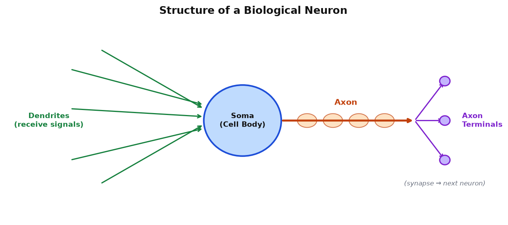
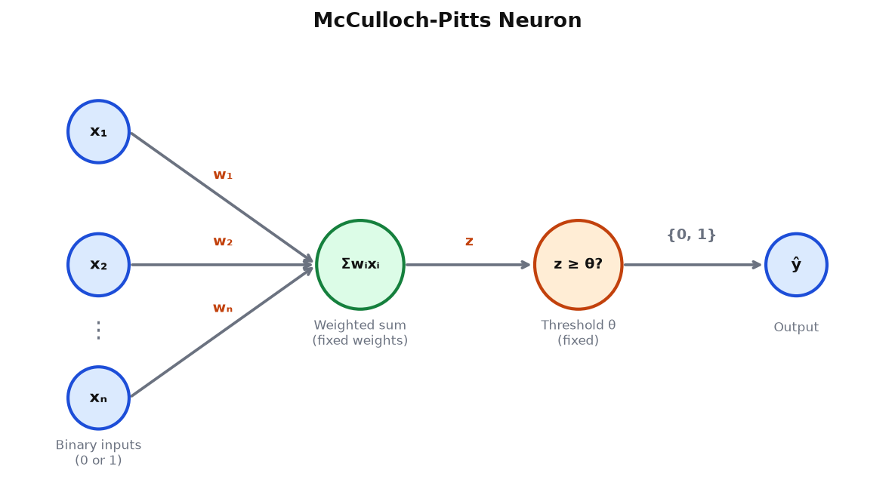
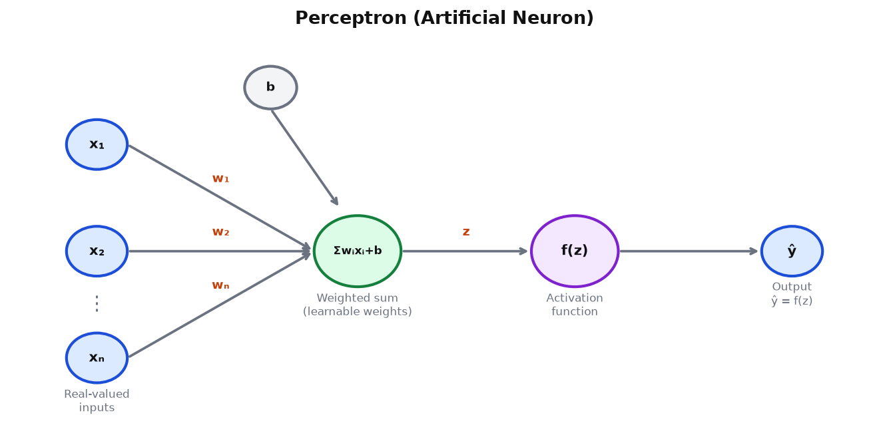
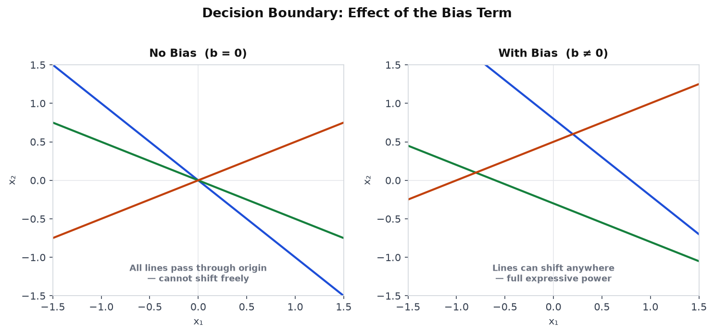
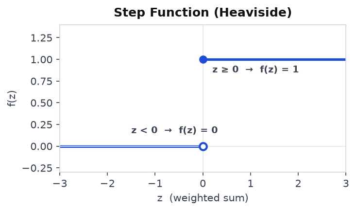
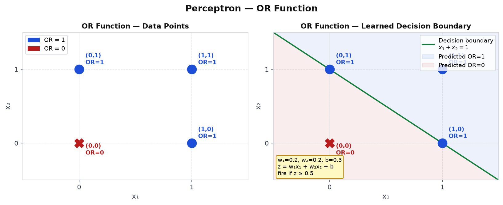
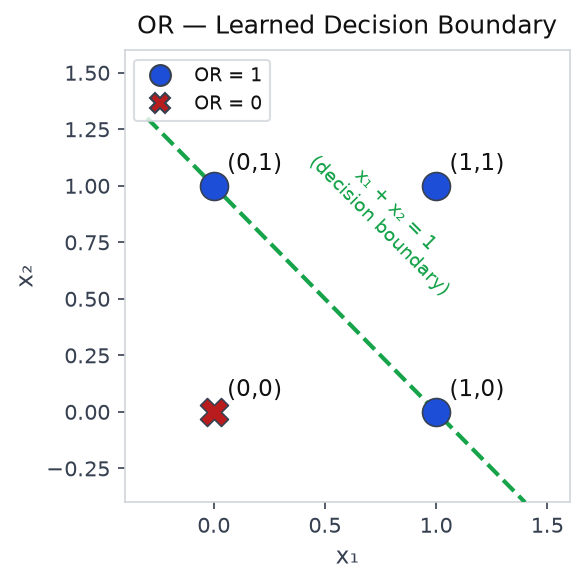
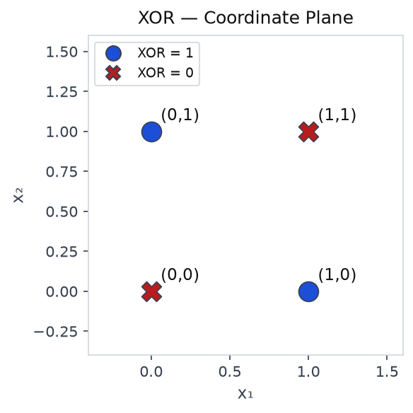
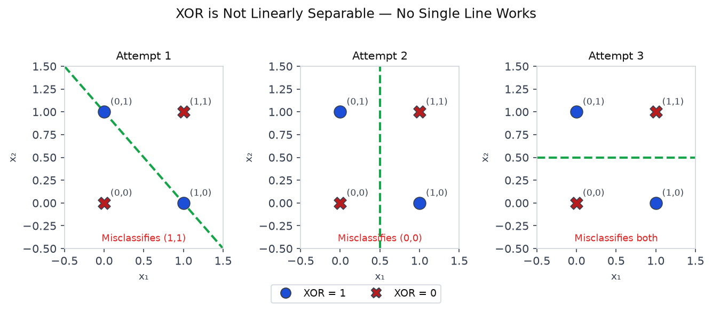

# 02 — Biological Neuron → Artificial Neuron → Perceptron

---

## Part 1: Biological Neuron

The artificial neuron is directly inspired by how a biological neuron works. Understanding the biology gives the math a reason to exist.

### Structure of a Biological Neuron

The diagram below shows the key anatomical parts of a biological neuron and the direction of signal flow.



| Biological Part | Role |
|---|---|
| Dendrites | Receive input signals from other neurons |
| Cell Body (Soma) | Accumulates and processes signals |
| Axon | Transmits output signal |
| Axon Terminals | Pass signal to next neuron via synapse |
| Synapse | Connection point — controls signal strength |

### How it fires

A biological neuron does not fire for every signal it receives. It accumulates incoming signals. If the total exceeds a **threshold**, it fires an output signal down the axon.

```
Incoming signals accumulate
         ↓
Total signal < threshold  →  neuron stays silent
Total signal ≥ threshold  →  neuron FIRES
```

This is called the **all-or-nothing principle**.

---

## Part 2: The McCulloch-Pitts Neuron

Before Rosenblatt built the perceptron in 1958, Warren McCulloch and Walter Pitts proposed the first mathematical model of a neuron in 1943. It is simpler than the perceptron — and understanding it makes the perceptron's contribution clear.

### The Model

The McCulloch-Pitts (MP) neuron takes binary inputs and produces a binary output. The diagram below shows the structure: inputs weighted by fixed integers, summed, then compared to a fixed threshold.



| Component | Description |
|---|---|
| Inputs $x_i$ | Binary only — 0 or 1 |
| Weights $w_i$ | Fixed integers — set by the designer, not learned |
| Weighted sum $z$ | $z = \sum w_i x_i$ (no bias term) |
| Threshold $\theta$ | Fixed — fires if $z \geq \theta$, silent otherwise |
| Output $\hat{y}$ | Binary — 0 or 1 |

### The Rule

$$\hat{y} = \begin{cases} 1 & \text{if } z \geq \theta \\ 0 & \text{if } z < \theta \end{cases}$$

### Worked Example — AND Gate

Set weights w₁ = 1, w₂ = 1 and threshold θ = 2:

```
x₁  x₂  z = x₁ + x₂   z ≥ 2?   ŷ
 0   0       0            No      0
 0   1       1            No      0
 1   0       1            No      0
 1   1       2            Yes     1
```

The MP neuron computes AND correctly — with manually chosen weights and threshold.

### Worked Example — OR Gate

Set weights w₁ = 1, w₂ = 1 and threshold θ = 1:

```
x₁  x₂  z = x₁ + x₂   z ≥ 1?   ŷ
 0   0       0            No      0
 0   1       1            Yes     1
 1   0       1            Yes     1
 1   1       2            Yes     1
```

### Worked Example — NOT Gate

Single input, set weight w₁ = -1 and threshold θ = 0:

```
x₁   z = -x₁   z ≥ 0?   ŷ
 0      0         Yes     1
 1     -1         No      0
```

NOT is computed by using a negative (inhibitory) weight.

### What the MP Neuron Got Right

```
✓ Binary threshold logic mirrors the all-or-nothing principle of biological neurons
✓ Showed that logical functions (AND, OR, NOT) can be computed by neuron-like units
✓ Proved that networks of such units are computationally universal
✓ Established the mathematical framework that all later work builds on
```

### The Critical Limitation

```
Weights and threshold are fixed — set by hand
              ↓
The designer must already know the answer
              ↓
The system cannot learn from data
              ↓
Not a learning machine — a logic gate
```

This is the gap Rosenblatt closed. The perceptron keeps the same structure but makes the weights **adjustable** and introduces a **learning rule** that updates them from examples.

```
McCulloch-Pitts (1943):   fixed weights, no learning, binary inputs only
         ↓
Perceptron (1958):         learnable weights, learning rule, real-valued inputs
```

---

## Part 3: Artificial Neuron and the Perceptron

The perceptron (Rosenblatt, 1958) is the direct mathematical model of the biological neuron. There is no meaningful separation between "artificial neuron" and "perceptron" at this level — the perceptron IS the artificial neuron. We build it step by step.

### Mapping Biology to Math

| Biological | Artificial / Perceptron |
|---|---|
| Dendrites | Inputs $x_1, x_2, \ldots, x_n$ |
| Synapse strength | Weights $w_1, w_2, \ldots, w_n$ |
| Cell body accumulation | Weighted sum $z = \sum w_i x_i + b$ |
| Threshold / firing | Activation function $f(z)$ |
| Axon output | Output $\hat{y} = f(z)$ |
| Resting state | Bias term $b$ |

The diagram below shows the perceptron structure: real-valued inputs, learnable weights, a bias, a weighted sum, and a differentiable activation function.



### The Math

**Step 1 — Weighted sum (pre-activation):**

$$z = w_1 x_1 + w_2 x_2 + \cdots + w_n x_n + b$$

or in vector form:

$$z = \mathbf{w}^\top \mathbf{x} + b$$

**Step 2 — Activation (post-activation):**

$$\hat{y} = f(z)$$

---

### The Neuron Formula is a Line — y = mx + c

This is a connection most textbooks skip. Look at the weighted sum for two inputs:

$$z = w_1 x_1 + w_2 x_2 + b$$

Now compare to the equation of a straight line:

$$y = mx + c$$

They are the same structure — $w_1, w_2$ are slopes and $b$ is the intercept.

For two inputs, the decision boundary $z = 0$ becomes:

$$w_1 x_1 + w_2 x_2 + b = 0$$

Rearranging:

$$x_2 = -\frac{w_1}{w_2} x_1 - \frac{b}{w_2}$$

This is literally a straight line in the x₁-x₂ plane. One side gives z > 0 (neuron fires, class 1); the other gives z < 0 (neuron silent, class 0). A single perceptron can only ever draw one straight line to separate classes — exactly why it fails on XOR and why we need multiple layers.

### What is the Bias?

The bias $b$ is the intercept of that line:

$$\text{Without bias:} \quad x_2 = -\frac{w_1}{w_2} x_1 \qquad \text{(line always passes through origin)}$$

$$\text{With bias:} \quad x_2 = -\frac{w_1}{w_2} x_1 - \frac{b}{w_2} \qquad \text{(line can shift freely)}$$

The diagram below shows the geometric effect: without bias every decision boundary passes through the origin; with bias it can shift freely.



Without bias, the decision boundary is forced through the origin — severely limiting what the neuron can learn.

---

### Activation: The Step Function

The original perceptron uses a **step function** (Heaviside function):

$$f(z) = \begin{cases} 1 & \text{if } z \geq 0 \\ 0 & \text{if } z < 0 \end{cases}$$

The diagram below shows the step function: output jumps from 0 to 1 at z = 0.



The neuron outputs 1 (fires) if the weighted sum crosses zero, otherwise 0.

---

### Why the Step Function is Not Enough — and Why Activation Functions Exist

The step function has a critical problem for training:

```
Step function:
  - Output is only 0 or 1
  - Not differentiable at z = 0
  - Derivative is 0 everywhere else
         ↓
  Cannot use gradient descent
  Cannot express probabilities
```

But there is a deeper problem that goes beyond the step function — it applies to **any linear activation**, including no activation at all.

**The linearity collapse problem:**

Suppose we stack two neurons with no activation function (or a linear one):

$$z_1 = W_1 x + b_1$$

$$z_2 = W_2 z_1 + b_2 = W_2(W_1 x + b_1) + b_2 = (W_2 W_1)x + (W_2 b_1 + b_2) = Wx + b$$

Now stack 10 layers:

$$\text{Layer 10 output} = W_{10}(W_9(\cdots(W_1 x + b_1)\cdots)) + b_{10} = Wx + b$$

**No matter how many layers you stack, without non-linear activation, the entire network collapses to a single linear transformation — equivalent to one neuron.**

```
10 layers, no activation:          1 neuron:

x → L1 → L2 → ... → L10 → ŷ  ≡  x → [Wx + b] → ŷ
```

Depth becomes meaningless. The network cannot learn anything a single neuron cannot.

This is the real reason activation functions exist:

```
✓ Non-linearity        →  breaks the collapse, allows complex boundaries
✓ Differentiability    →  allows gradient descent to work
✓ Expressiveness       →  output can represent probabilities, ranges, etc.
```

Examples: Sigmoid, Tanh, ReLU, Leaky ReLU, Softmax — covered in full detail in **Note 04**.  
For now, we use the step function to understand the perceptron fully.

---

## Part 5: Forward Pass — How a Perceptron Computes

Given inputs, weights, and bias — the perceptron computes a prediction in two steps:

```
FORWARD PASS

  Inputs + Weights
        ↓
  z = wᵀx + b        ← weighted sum
        ↓
  ŷ = f(z)           ← apply activation
        ↓
  Output ŷ
```

$$z = \mathbf{w}^\top \mathbf{x} + b \qquad \hat{y} = f(z)$$

### Example

```
x₁ = 1,  x₂ = 0
w₁ = 0.5, w₂ = 0.5, b = -0.5

z = (0.5)(1) + (0.5)(0) + (-0.5)
z = 0.5 + 0 - 0.5
z = 0

ŷ = f(0) = 1     (since z ≥ 0)
```

---

## Part 6: Perceptron Learning Rule

The perceptron learns by adjusting weights when it makes a wrong prediction.

### The Rule

```
For each training example (x, y):
  1. Compute prediction
  2. Compute error
  3. Update weights
  4. Update bias
```

$$\hat{y} = f(\mathbf{w}^\top \mathbf{x} + b)$$

$$e = y - \hat{y}$$

$$w_i \leftarrow w_i + \eta \cdot e \cdot x_i$$

$$b \leftarrow b + \eta \cdot e$$

Where $y$ is the true label, $\hat{y}$ is the predicted label, $e$ is the error (0 if correct, $\pm 1$ if wrong), and $\eta$ is the learning rate.

### Intuition

```
Prediction correct  →  e = 0  →  no update
Prediction too low  →  e = +1 →  weights increase (push output up)
Prediction too high →  e = -1 →  weights decrease (push output down)
```

---

## Part 7: Full Training Example — OR Function

### OR Truth Table

| x₁ | x₂ | y (OR) |
|---|---|---|
| 0 | 0 | 0 |
| 0 | 1 | 1 |
| 1 | 0 | 1 |
| 1 | 1 | 1 |

### Geometric View

```
x₂
 1 │  ●(0,1)    ●(1,1)
   │
 0 │  ○(0,0)    ●(1,0)
   └──────────────────── x₁
      0          1

● = class 1 (OR = 1)
○ = class 0 (OR = 0)
```

A single straight line can separate ○ from ● — OR is **linearly separable**.



### Initial Setup

```
w₁ = 0.0,  w₂ = 0.0,  b = 0.0
η  = 0.1
Step function: ŷ = 1 if z ≥ 0.5, else 0
  (we use threshold 0.5 for cleaner hand computation)
```

---

### Epoch 1

**Sample 1: x = [0, 0], y = 0**

```
z  = (0.0)(0) + (0.0)(0) + 0.0 = 0.0
ŷ  = 0     (0.0 < 0.5)
e  = 0 - 0 = 0
→  No update
w₁ = 0.0,  w₂ = 0.0,  b = 0.0
```

**Sample 2: x = [0, 1], y = 1**

```
z  = (0.0)(0) + (0.0)(1) + 0.0 = 0.0
ŷ  = 0     (0.0 < 0.5)
e  = 1 - 0 = 1
w₁ ← 0.0 + 0.1 × 1 × 0 = 0.0
w₂ ← 0.0 + 0.1 × 1 × 1 = 0.1
b  ← 0.0 + 0.1 × 1     = 0.1
w₁ = 0.0,  w₂ = 0.1,  b = 0.1
```

**Sample 3: x = [1, 0], y = 1**

```
z  = (0.0)(1) + (0.1)(0) + 0.1 = 0.1
ŷ  = 0     (0.1 < 0.5)
e  = 1 - 0 = 1
w₁ ← 0.0 + 0.1 × 1 × 1 = 0.1
w₂ ← 0.1 + 0.1 × 1 × 0 = 0.1
b  ← 0.1 + 0.1 × 1     = 0.2
w₁ = 0.1,  w₂ = 0.1,  b = 0.2
```

**Sample 4: x = [1, 1], y = 1**

```
z  = (0.1)(1) + (0.1)(1) + 0.2 = 0.4
ŷ  = 0     (0.4 < 0.5)
e  = 1 - 0 = 1
w₁ ← 0.1 + 0.1 × 1 × 1 = 0.2
w₂ ← 0.1 + 0.1 × 1 × 1 = 0.2
b  ← 0.2 + 0.1 × 1     = 0.3
w₁ = 0.2,  w₂ = 0.2,  b = 0.3
```

**End of Epoch 1:** w₁ = 0.2, w₂ = 0.2, b = 0.3

---

### Epoch 2

**Sample 1: x = [0, 0], y = 0**

```
z  = (0.2)(0) + (0.2)(0) + 0.3 = 0.3
ŷ  = 0     (0.3 < 0.5)
e  = 0 - 0 = 0
→  No update
```

**Sample 2: x = [0, 1], y = 1**

```
z  = (0.2)(0) + (0.2)(1) + 0.3 = 0.5
ŷ  = 1     (0.5 ≥ 0.5)
e  = 1 - 1 = 0
→  No update
```

**Sample 3: x = [1, 0], y = 1**

```
z  = (0.2)(1) + (0.2)(0) + 0.3 = 0.5
ŷ  = 1     (0.5 ≥ 0.5)
e  = 1 - 1 = 0
→  No update
```

**Sample 4: x = [1, 1], y = 1**

```
z  = (0.2)(1) + (0.2)(1) + 0.3 = 0.7
ŷ  = 1     (0.7 ≥ 0.5)
e  = 1 - 1 = 0
→  No update
```

**End of Epoch 2:** No updates — perceptron has converged.

---

### Final Verification

```
Final weights: w₁ = 0.2,  w₂ = 0.2,  b = 0.3

x=[0,0]: z = 0.3          → ŷ = 0  ✓  (y=0)
x=[0,1]: z = 0.5          → ŷ = 1  ✓  (y=1)
x=[1,0]: z = 0.5          → ŷ = 1  ✓  (y=1)
x=[1,1]: z = 0.7          → ŷ = 1  ✓  (y=1)
```

All correct. The perceptron learned the OR function in 2 epochs.

### Decision Boundary

The learned decision boundary is:

$$w_1 x_1 + w_2 x_2 + b = 0.5$$

$$0.2x_1 + 0.2x_2 + 0.3 = 0.5$$

$$0.2x_1 + 0.2x_2 = 0.2$$

$$x_1 + x_2 = 1$$

The diagram below shows the four OR points and the learned decision boundary x₁ + x₂ = 1 that correctly separates them.



---

## Part 8: Why XOR Fails — The Limitation of a Single Perceptron

### XOR Truth Table

| x₁ | x₂ | y (XOR) |
|---|---|---|
| 0 | 0 | 0 |
| 0 | 1 | 1 |
| 1 | 0 | 1 |
| 1 | 1 | 0 |

### Geometric Intuition

The coordinate plane below shows the four XOR points. The two class-1 points sit on opposite corners — no single straight line can separate them from the class-0 points.


The three panels below show three different line attempts — every one misclassifies at least one point.



**It is impossible.** No single straight line can separate the two classes of XOR. XOR is **not linearly separable**.

### Mathematical Proof

A perceptron computes:

$$\hat{y} = \begin{cases} 1 & \text{if } w_1 x_1 + w_2 x_2 + b \geq 0 \\ 0 & \text{otherwise} \end{cases}$$

For XOR to be solved, we need all four conditions simultaneously:

$$\text{(i)}\quad b < 0$$
$$\text{(ii)}\quad w_2 + b \geq 0$$
$$\text{(iii)}\quad w_1 + b \geq 0$$
$$\text{(iv)}\quad w_1 + w_2 + b < 0$$

From (ii): $w_2 \geq -b > 0$. From (iii): $w_1 \geq -b > 0$. Adding (ii) and (iii):

$$w_1 + w_2 + 2b \geq 0 \implies w_1 + w_2 + b \geq -b > 0$$

But condition (iv) requires $w_1 + w_2 + b < 0$.

**Contradiction.** No values of $w_1, w_2, b$ can satisfy all four conditions.

### The Conclusion

```
Single Perceptron
       ↓
Can only learn LINEARLY SEPARABLE functions
       ↓
OR  ✓   AND  ✓   NAND  ✓
XOR ✗   XNOR ✗
```

This was the core criticism in Minsky & Papert's 1969 book "Perceptrons" — it nearly killed neural network research for a decade.

The solution: **stack multiple layers** → Multilayer Perceptron (Note 03).

---

## Summary

| Biological | Artificial / Perceptron |
|---|---|
| Dendrites | Inputs $\mathbf{x}$ |
| Synapse strength | Weights $\mathbf{w}$ |
| Cell body | Weighted sum $z = \mathbf{w}^\top \mathbf{x} + b \equiv y = mx + c$ |
| Threshold / firing | Activation function $f(z)$ |
| Axon output | Output $\hat{y} = f(z)$ |

Key takeaways:

- The McCulloch-Pitts neuron (1943) was the first mathematical model of a neuron — binary inputs, fixed weights, hard threshold, no learning
- The perceptron (1958) extended MP by making weights learnable from data — that is the key advance
- Artificial neuron and perceptron are the same thing — the perceptron is the artificial neuron with a step function
- The neuron formula $z = \mathbf{w}^\top \mathbf{x} + b$ is a straight line — the decision boundary is literally $y = mx + c$
- Without non-linear activation, stacking any number of layers collapses to a single line — depth is meaningless
- A perceptron learns using the perceptron learning rule: $w_i \leftarrow w_i + \eta(y - \hat{y})x_i$
- It can solve linearly separable problems (OR, AND)
- It **cannot** solve non-linearly separable problems (XOR) — proven geometrically and mathematically
- Stacking multiple perceptrons into layers solves the XOR problem → **Note 03**
