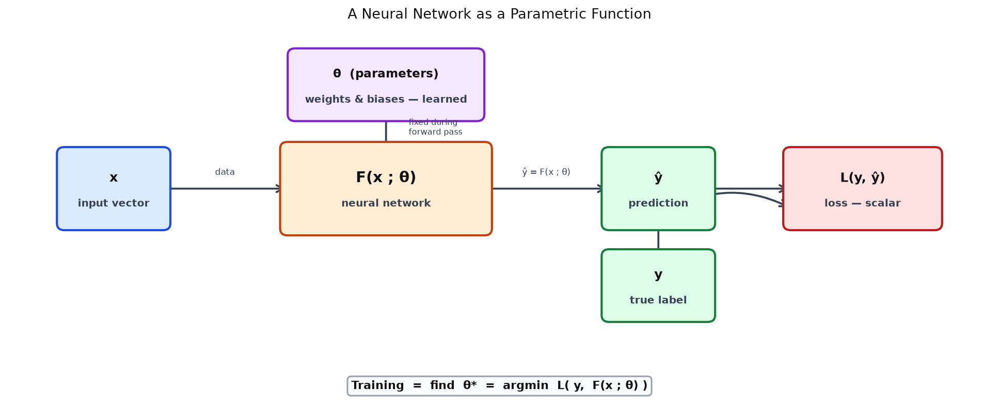
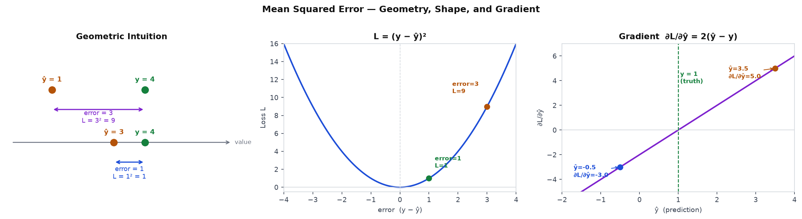
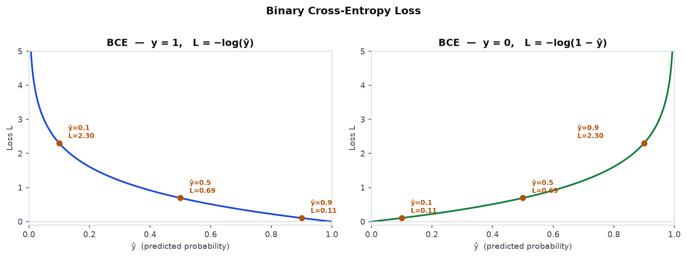
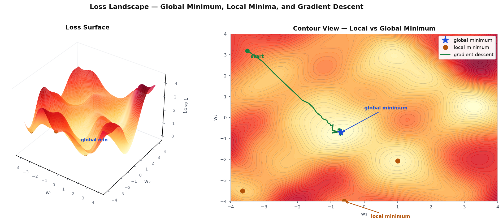

# 05 — Loss Functions

---

## Part 1: A Neural Network is a Parametric Function

Before defining what a loss function is, we need to be precise about what a neural network actually is — not architecturally, but mathematically.

A neural network is a **parametric function**. It takes an input vector $x$ and produces an output $\hat{y}$. The mapping from $x$ to $\hat{y}$ is controlled entirely by a set of learned numerical values — the weights and biases — collectively written as $\theta$:

$$\hat{y} = F(x\,;\,\theta)$$

This single expression is the most important abstraction in the course. Everything from here onwards — loss functions, gradient descent, backpropagation, regularisation, optimisation — is about one thing: finding the right θ.

### The Three Distinct Things

The expression F(x ; θ) contains three things that must never be conflated:

**x — the input data**

```
x is fixed during training
It is the raw feature vector fed into the network
The network does not change x — it transforms it
```

**$\theta$ — the parameters**

$$\theta = \{ W^{(1)}, b^{(1)}, W^{(2)}, b^{(2)}, \ldots, W^{(L)}, b^{(L)} \}$$

```
θ is everything the network learns
Before training: θ is random
After training:  θ encodes everything the network has learned about the task
Training is the process of finding the right θ
```

**The architecture — the structure of F**

```
The architecture is the designer's choice:
  - How many layers
  - How many neurons per layer
  - Which activation functions
  - How layers are connected

The architecture is fixed before training begins
It determines what functions F(x ; θ) is capable of representing
No amount of training can compensate for a wrong architecture
```

The semicolon in $F(x\,;\,\theta)$ is deliberate notation from the literature. It separates the variable the function acts on ($x$) from the parameters that define the function ($\theta$). During inference, $x$ varies and $\theta$ is fixed. During training, $x$ is fixed (the dataset) and $\theta$ is what changes.

### What the Network is Trying to Approximate

Why do we want $F(x\,;\,\theta) \approx y$? Because $y$ was not generated arbitrarily — it came from some process.

There exists a true underlying function $f^*$ that maps inputs to outputs. You do not have access to $f^*$ directly. What you have is a finite set of input-output pairs sampled from it:

$$y = f^*(x)$$

$$\hat{y} = F(x\,;\,\theta) \approx f^*(x)$$

### Why f* is Unknown

f* is unknown for a fundamental reason: it is not a formula someone wrote down. It is the actual process — physical, biological, perceptual, or statistical — that generated the labels. We can observe its outputs but we cannot inspect its internals.

Three concrete reasons f* is inaccessible:

```
1. It is a physical or biological process
   Example: f* maps a protein's amino acid sequence → its 3D folded structure.
   The folding is governed by thermodynamics and molecular forces.
   No one has written down a closed-form rule — we only observe the outcomes.

2. It is a human judgment that is consistent but not articulable
   Example: f* maps an image → "cat" or "not cat".
   Humans agree on the answer reliably, but no one can write down the rule
   that distinguishes a cat from everything else in pixel space.

3. It is a statistical regularity too complex to express analytically
   Example: f* maps a sentence prefix → the most likely next word.
   The rule depends on grammar, world knowledge, context, and style —
   no formula captures it, but the pattern exists in large amounts of text.
```

In all three cases, the only access we have to f* is through examples — pairs (x, y) where y = f*(x) (possibly with noise). The network must infer the rule from those examples alone.

### Concrete Examples of f*

```
Task                          x (input)                    y = f*(x) (output)
────────────────────────────  ───────────────────────────  ──────────────────────────────
Tumour diagnosis              Clinical measurements        Malignant / benign
                              (size, shape, density)       The true biological state —
                                                           observed via biopsy, not formula

Image classification          Raw pixel values             Object category
                              (28×28 = 784 numbers)        The true perceptual label —
                                                           observed via human annotation

House price prediction        Location, size, age,         Market price
                              number of rooms              The true market value —
                                                           observed via sale records

Next-word prediction          Sequence of words            Most probable next word
                              "The cat sat on the..."      The true language distribution —
                                                           observed via large text corpora
```

In every case, f* is the real-world process. The training data is a finite, possibly noisy window into that process. The network approximates f* from that window.

This is the framing Goodfellow et al. use in *Deep Learning* (2016, Section 5.1). They describe supervised learning as: given examples of f*, recover an approximation that generalises beyond those examples. The network F(x ; θ) is a **function approximator** — it defines a family of functions indexed by θ, and training selects the member of that family that best matches the observed samples from f*.

This framing makes three things precise that are otherwise left vague:

```
1. f* exists but is never directly accessible
   — you can only observe samples from it

2. The training data is a finite, noisy sample from f*
   — it may contain measurement noise

3. F(x ; θ) approximates f*, it does not recover it exactly
   — the architecture, data, and optimisation all constrain what is found
```

> A neural network does not learn a rule. It approximates an unknown function $f^*$ from a finite sample of its input-output behaviour. Everything that can go wrong in deep learning — overfitting, underfitting, poor generalisation — is a consequence of the gap between the finite sample and the true $f^*$.

This also clarifies what generalisation means precisely: training minimises $L$ on the observed samples, but the actual goal is $F(x\,;\,\theta) \approx f^*(x)$ for all $x$ — including inputs never seen during training. The gap between those two objectives is the subject of **Note 07**.

### What Training Formally Is

Given a dataset of input-output pairs (x, y), training is the process of finding the parameter values θ that make F(x ; θ) as close to y as possible across all examples.

This is an optimisation problem. We need a scalar measure of how wrong the current $\theta$ is — that is the loss function $L(y, \hat{y})$. Training is then:

$$\theta^* = \arg\min_{\theta}\, L\bigl(y,\, F(x\,;\,\theta)\bigr)$$

Read: find the θ that minimises the loss between the true labels y and the network's predictions F(x ; θ).

The diagram below shows this abstraction: x enters the network, θ controls the transformation, ŷ comes out, and the loss measures the gap between ŷ and the true label y. Training is the process of adjusting θ to close that gap.



### Existence vs Findability

The Universal Approximation Theorem (**Note 03**) established that a network with sufficient capacity can represent any continuous function — there exist θ values that make F(x ; θ) arbitrarily close to any target. That is a statement about the expressive power of the architecture.

But existence is not the same as findability. The UAT says nothing about:

```
- Whether gradient descent can actually reach those θ values
- Whether the training data is sufficient to constrain θ toward them
- Whether the optimisation landscape has traps that prevent convergence
- Whether the found θ generalises beyond the training examples
```

Those are four separate problems, and they are precisely what the rest of this course addresses. The F(x ; θ) framing makes this gap explicit: the architecture determines what is representable, but training determines what is actually found. A network can be theoretically capable of solving a task and practically unable to learn it — and the reason is always in the gap between existence and findability.

> The UAT guarantees that the right θ exists. Everything from Note 05 onwards is about finding it.

---

## Part 2: What a Loss Function Is

A neural network learns by adjusting its weights. But adjust them toward what? There must be a precise, mathematical measure of how wrong the network's current predictions are. That measure is the **loss function**.

```
Loss function L(y, ŷ):

  y  = true label (what the answer actually is)
  ŷ  = predicted output (what the network currently says)
  L  = a scalar ≥ 0 measuring the discrepancy between them
```

The loss function is the signal that drives all learning. Without it, gradient descent has nothing to minimise. Without it, backpropagation has no starting point. The entire training process is the process of minimising L.

### Three Requirements for a Loss Function

- $L = 0$ when $\hat{y} = y$ exactly — perfect prediction costs nothing
- $L$ increases as $\hat{y}$ diverges from $y$ — worse predictions cost more
- $L$ is differentiable with respect to $\hat{y}$ — gradient descent requires $\partial L / \partial \hat{y}$

Different tasks require different loss functions. The choice is not arbitrary — it determines the shape of the gradient signal and therefore what the network learns to optimise.

---

## Part 3: Mean Squared Error (MSE)

### The Setting

MSE is the standard loss function for **regression** — tasks where the output is a continuous numerical value.

```
Examples:
  Predicting house price given features
  Predicting tomorrow's temperature
  Predicting a patient's blood pressure from clinical measurements
```

### Formula

For a single sample:

$$L = (y - \hat{y})^2$$

For a dataset of $n$ samples:

$$L = \frac{1}{n} \sum_{i} (y_i - \hat{y}_i)^2$$

The squared difference between the true value and the predicted value, averaged over all samples.

### Geometric Intuition

MSE measures the squared distance between the prediction and the truth on a number line. The left panel below shows this geometrically — a small error of 1 costs 1, but a large error of 3 costs 9, not 3. The middle panel shows the full parabola: the loss surface is bowl-shaped with the minimum at zero error. The right panel shows the gradient $\partial L / \partial \hat{y} = 2(\hat{y} - y)$ as a straight line — large when the prediction is far from the truth, zero when it is exactly right.



Squaring the error has two consequences:

- All errors are positive — overestimates and underestimates both contribute
- Large errors are penalised disproportionately — an error of 3 costs 9, not 3

### Why Squaring Matters

Consider two models:

```
Model A errors:  [2, 2, 2, 2]     MSE = 4.0
Model B errors:  [0, 0, 0, 8]     MSE = 16.0
```

Both models have the same total absolute error (8). But MSE penalises Model B far more heavily because of the single large error. MSE is appropriate when large errors are especially undesirable — a prediction that is catastrophically wrong should cost much more than one that is slightly wrong.

### Gradient of MSE

Differentiating $L = (y - \hat{y})^2$ with respect to $\hat{y}$:

$$\frac{\partial L}{\partial \hat{y}} = -2(y - \hat{y}) = 2(\hat{y} - y)$$

The gradient is **linear in the error** — when the prediction is far from the truth the gradient is large, and when the prediction is close the gradient is small. This means the network automatically takes larger steps when it is more wrong and smaller steps as it converges. This is well-behaved for regression with a linear output layer.

### MSE for Classification — Why It Fails

MSE can technically be applied to classification. It fails for a subtle but important reason related to gradient behaviour when combined with sigmoid or softmax outputs, which is explained in Part 6 after cross-entropy is introduced.

---

## Part 4: Binary Cross-Entropy

### The Setting

Binary cross-entropy (BCE) is the standard loss for **binary classification** — tasks where the output is one of two classes.

```
Examples:
  Spam vs not spam
  Disease present vs absent
  Fraud vs legitimate transaction
```

The network's output layer uses sigmoid activation, producing ŷ ∈ (0, 1) — a probability that the input belongs to class 1.

### Derivation from Maximum Likelihood

BCE is not an arbitrary formula — it is derived from the principle of maximum likelihood estimation.

**Step 1 — Model the output as a probability.**

The network outputs $\hat{y} \in (0,1)$ via sigmoid. We interpret this as the probability that the input belongs to class 1:

$$P(y=1 \mid x) = \hat{y} \qquad P(y=0 \mid x) = 1 - \hat{y}$$

**Step 2 — Write both cases as one expression.**

Both cases can be captured in a single formula using the label $y$ as an exponent:

$$P(y \mid x) = \hat{y}^{\,y} \cdot (1 - \hat{y})^{1-y}$$

Verify:

$$y=1:\quad \hat{y}^1 \cdot (1-\hat{y})^0 = \hat{y} \checkmark \qquad y=0:\quad \hat{y}^0 \cdot (1-\hat{y})^1 = 1-\hat{y} \checkmark$$

**Step 3 — Write the likelihood over the full dataset.**

Assuming the $n$ training samples are independent:

$$\text{likelihood} = \prod_i P(y_i \mid x_i) = \prod_i \hat{y}_i^{\,y_i} \cdot (1-\hat{y}_i)^{1-y_i}$$

**Step 4 — Take the log.**

The logarithm converts the product into a sum:

$$\log\text{-likelihood} = \sum_i \left[ y_i \log(\hat{y}_i) + (1-y_i)\log(1-\hat{y}_i) \right]$$

**Step 5 — Negate to get a loss.**

$$\text{BCE} = -\frac{1}{n} \sum_i \left[ y_i \log(\hat{y}_i) + (1-y_i)\log(1-\hat{y}_i) \right]$$

The 1/n averages over the dataset so the loss scale does not grow with dataset size.

> BCE is not a heuristic — it is the exact maximum likelihood loss for a Bernoulli output. Every term in the formula has a precise probabilistic meaning.

### Intuition

The following plot shows how BCE behaves for y = 1 (left) and y = 0 (right):



The log is what gives BCE its key property: as $\hat{y} \to 0$ when $y = 1$, $-\log(\hat{y}) \to \infty$. A confidently wrong prediction is not just penalised — it is penalised without bound.

For a single sample:

| True label | Prediction ŷ | Loss L | Interpretation |
|---|---|---|---|
| y = 1 | 0.9 | 0.105 | Confident and correct — low loss |
| y = 1 | 0.5 | 0.693 | Uncertain — moderate loss |
| y = 1 | 0.1 | 2.303 | Confident and wrong — high loss |
| y = 0 | 0.1 | 0.105 | Confident and correct — low loss |
| y = 0 | 0.5 | 0.693 | Uncertain — moderate loss |
| y = 0 | 0.9 | 2.303 | Confident and wrong — high loss |

The loss grows without bound as the prediction becomes confidently wrong. A network that predicts ŷ = 0.001 when y = 1 incurs a loss of −log(0.001) = 6.9 — a very strong gradient signal pushing the weights to correct the mistake.

### Gradient of BCE with Sigmoid

The raw gradient of BCE with respect to $\hat{y}$:

$$\frac{\partial L}{\partial \hat{y}} = -\frac{y}{\hat{y}} + \frac{1-y}{1-\hat{y}}$$

When BCE is paired with sigmoid, $\hat{y} = \sigma(z)$, and we need $\partial L / \partial z$ via the chain rule:

$$\frac{\partial L}{\partial z} = \frac{\partial L}{\partial \hat{y}} \cdot \frac{d\sigma}{dz} = \left(-\frac{y}{\hat{y}} + \frac{1-y}{1-\hat{y}}\right) \cdot \sigma(z)(1-\sigma(z))$$

Substituting $\hat{y} = \sigma(z)$ and expanding:

$$= -y(1-\sigma(z)) + (1-y)\sigma(z) = -y + y\sigma(z) + \sigma(z) - y\sigma(z) = \sigma(z) - y$$

So:

$$\frac{\partial L}{\partial z} = \hat{y} - y$$

The gradient is simply the prediction error. The sigmoid derivative cancels out completely — BCE is specifically designed to pair with sigmoid so that saturation does not suppress the gradient.

---

## Part 5: Categorical Cross-Entropy

### The Setting

Categorical cross-entropy (CCE) extends binary cross-entropy to **multiclass classification** — tasks where the output is one of K ≥ 3 classes.

```
Examples:
  Digit recognition (10 classes: 0–9)
  Disease diagnosis (multiple conditions)
  Language model next-word prediction (vocabulary size classes)
```

The network's output layer uses softmax, producing a probability distribution $\hat{y} = [\hat{y}_1, \hat{y}_2, \ldots, \hat{y}_K]$ where $\sum_k \hat{y}_k = 1$.

### Formula

The true label $y$ is represented as a **one-hot vector**:

$$L = -\sum_k y_k \log(\hat{y}_k)$$

Because $y$ is one-hot, only the term for the correct class $c$ is non-zero:

$$L = -\log(\hat{y}_c)$$

The loss is simply the negative log of the probability assigned to the correct class.

### Worked Example

True class: class 2 (index 1, 0-based). Network outputs: ŷ = [0.1, 0.7, 0.2].

```
y = [0, 1, 0]

L = −(0 × log(0.1) + 1 × log(0.7) + 0 × log(0.2))
  = −log(0.7)
  = 0.357
```

| Network output ŷ | Loss L | Interpretation |
|---|---|---|
| [0.1, 0.7, 0.2] | 0.357 | Confident and correct |
| [0.3, 0.4, 0.3] | 0.916 | Uncertain |
| [0.05, 0.05, 0.9] | 2.996 | Confident and wrong |

The loss only cares about the probability assigned to the correct class. All other probabilities matter only indirectly through the softmax normalisation.

### Gradient of CCE with Softmax

The gradient of CCE with respect to the pre-softmax score $z_k$:

$$\frac{\partial L}{\partial z_k} = \hat{y}_k - y_k$$

Expanding: for the correct class $k = c$, $\partial L / \partial z_c = \hat{y}_c - 1$ (push probability up toward 1); for all other classes $k \neq c$, $\partial L / \partial z_k = \hat{y}_k$ (push probability down toward 0).

This is the same clean form as BCE + sigmoid. Softmax and cross-entropy are natural conjugates — the softmax Jacobian and the cross-entropy gradient cancel in exactly the same way that sigmoid and BCE cancel, leaving prediction error as the gradient.

---

## Part 6: Why Cross-Entropy Outperforms MSE for Classification

This is one of the most important practical insights in deep learning. The issue is not accuracy — both losses can in principle converge to the correct answer. The issue is **gradient behaviour**.

### The Saturation Problem with MSE + Sigmoid

Consider a binary classification network with sigmoid output. The network predicts ŷ = 0.01 when the true label is y = 1. This is a catastrophically wrong, highly confident prediction.

**With MSE:**

```
L = (y − ŷ)² = (1 − 0.01)² ≈ 0.98

∂L/∂ŷ = 2(ŷ − y) = 2(0.01 − 1) = −1.98

∂L/∂z = ∂L/∂ŷ × dσ/dz = −1.98 × σ(z)(1 − σ(z))
```

When ŷ = 0.01, the sigmoid is near zero, meaning z is a large negative number. At z ≈ −4.6:

```
σ(z)(1 − σ(z)) = 0.01 × 0.99 ≈ 0.01

∂L/∂z = −1.98 × 0.01 ≈ −0.02
```

The gradient is tiny — despite the prediction being catastrophically wrong. The sigmoid has saturated, and MSE does not compensate for this. The network learns extremely slowly from its worst mistakes.

**With BCE:**

```
L = −log(ŷ) = −log(0.01) = 4.605

∂L/∂z = ŷ − y = 0.01 − 1 = −0.99
```

The gradient is large — nearly 1. The network receives a strong signal to correct the mistake immediately. BCE + sigmoid cancels the sigmoid saturation algebraically, producing a gradient that is always proportional to the prediction error.

### Summary

| Scenario: y = 1, ŷ = 0.01 (confidently wrong) | Gradient ∂L/∂z | Learning speed |
|---|---|---|
| MSE + sigmoid | ≈ −0.02 | Very slow |
| BCE + sigmoid | ≈ −0.99 | Fast |

The same principle applies to CCE + softmax for multiclass classification.

### When to Use Each Loss Function

| Task | Output activation | Loss function |
|---|---|---|
| Regression | None (linear) | MSE |
| Binary classification | Sigmoid | Binary cross-entropy |
| Multiclass classification | Softmax | Categorical cross-entropy |

---

## Part 7: Loss as the Landscape — Connection to Training

The loss function defines a **surface** in parameter space. Every possible setting of the network's weights corresponds to a point on this surface, and the height of the surface at that point is the loss value.

The following plot shows the loss surface as a function of two weights. The left panel is the 3D surface — crests are regions of high loss, troughs are regions of low loss. The right panel is the contour view from above, with a gradient descent path overlaid:



Three features of this surface matter for training:

**Global minimum** (blue star) — the weight configuration that produces the lowest possible loss on the training data. This is what gradient descent is trying to reach.

**Local minima** (orange dots) — troughs that are lower than their immediate surroundings but not the lowest point overall. Gradient descent can get trapped here: the gradient is zero, so weights stop updating, but the network has not found the best solution. In practice, deep networks have so many parameters that true local minima are rare — most apparent traps are saddle points where the gradient is zero in some directions but not others.

**Gradient descent path** (green line) — the trajectory of weight updates from a starting point. Each step moves in the direction of steepest descent. The path is not straight because the surface is curved and the step size (learning rate) is finite.

Training is the process of navigating this surface to find the global minimum. The loss function determines the shape of the surface. Gradient descent (**Note 06**) is the navigation algorithm.

The choice of loss function directly determines:

- The shape of the loss surface — smooth or jagged, convex or not
- The gradient signal at every point — how strongly and in what direction weights update
- What the network is actually optimising — MSE optimises for small average squared error, cross-entropy optimises for correct probability assignment

> The loss function is not a detail — it is a fundamental design decision that determines what the network learns. Choosing the wrong loss for a task does not just slow training — it trains the network to optimise the wrong thing entirely.

---

## Summary

Key takeaways:

- A neural network is a parametric function $\hat{y} = F(x\,;\,\theta)$ — $x$ is the input, $\theta$ are the learned weights and biases, and the architecture is the designer's fixed choice of structure
- The network approximates an unknown true function $f^*$ from a finite sample of its input-output behaviour — this is the function approximation framing of Goodfellow et al. (2016)
- Training is the optimisation problem $\theta^* = \arg\min_\theta L(y, F(x\,;\,\theta))$ — finding the parameters that minimise the loss over the training data
- $x$, $\theta$, and the architecture are three distinct things — conflating them is the source of most conceptual errors in deep learning
- The loss function is the mathematical measure of prediction error — it is the signal that drives all learning; without it backpropagation has no starting point
- MSE measures average squared error — appropriate for regression, penalises large errors disproportionately, well-behaved gradient for linear outputs
- Binary cross-entropy is derived from maximum likelihood for Bernoulli outputs — the principled loss for binary classification with sigmoid; gradient simplifies to $\hat{y} - y$
- Categorical cross-entropy extends BCE to $K$ classes — always paired with softmax, reduces to $-\log(\hat{y}_c)$; gradient also simplifies to $\hat{y}_k - y_k$
- Cross-entropy outperforms MSE for classification because it cancels sigmoid/softmax saturation algebraically — the gradient is always proportional to the prediction error, not suppressed by the activation derivative
- The loss function defines the shape of the parameter space landscape that gradient descent navigates — it is a fundamental design choice, not a detail
- Practical defaults: MSE for regression, BCE for binary classification, CCE for multiclass classification
