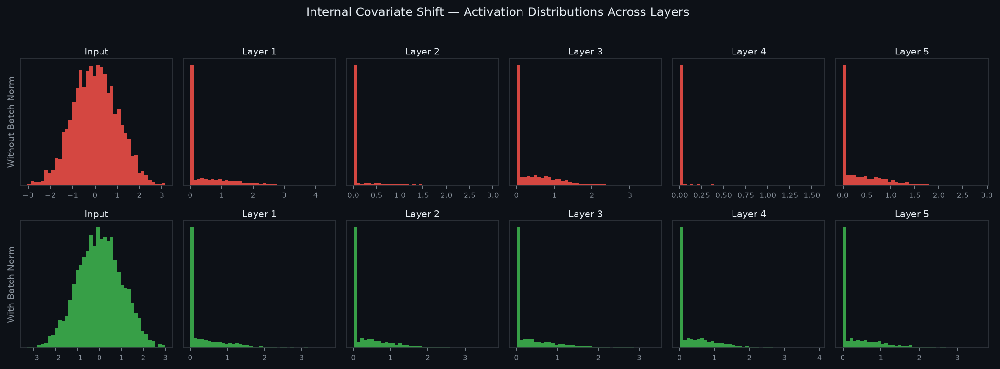
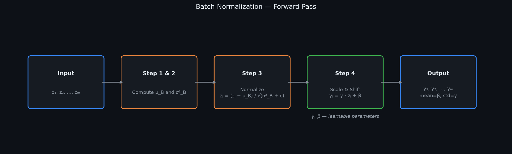
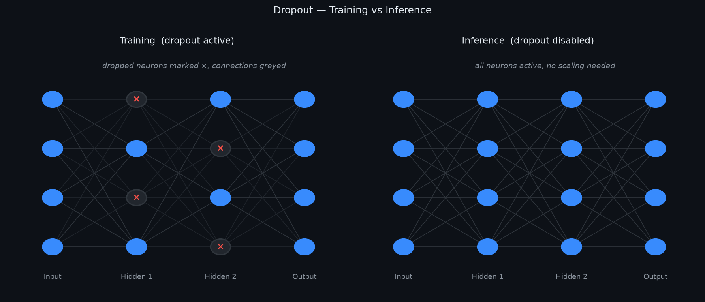

# 11 — Batch Normalization and Dropout

---

## Part 1: The Problem Batch Normalization Solves

Training a deep network is an optimization problem over many layers simultaneously. Every weight update in one layer changes the distribution of inputs to the next layer. The layer above then receives a shifted distribution and must adapt — but while it is adapting, it is also changing the distribution for the layer above it. This happens at every layer, at every step, throughout training.

This phenomenon is called **internal covariate shift**: the distribution of each layer's inputs changes continuously during training because the parameters of all preceding layers are changing.

```
Step 1:  Layer 1 weights update → distribution of a⁽¹⁾ shifts
Step 2:  Layer 2 now receives a different distribution → must re-adapt
Step 3:  Layer 2 weights update → distribution of a⁽²⁾ shifts
Step 4:  Layer 3 now receives a different distribution → must re-adapt
...
```

The consequence is that each layer spends part of its capacity chasing a moving target rather than learning the task. This slows training, requires careful learning rate tuning, and makes the network sensitive to initialization — because a bad starting distribution compounds through every layer.

> Internal covariate shift does not prevent learning — it makes learning slower and less stable. Each layer must continuously re-adapt to the shifting output of the layer below it, rather than learning from a stable input distribution.

The two rows below show activation distributions at each layer during a forward pass — without batch norm (top) the distributions drift and spread across layers, with batch norm (bottom) they remain consistent.



Batch normalization addresses this directly: it standardises the input to each layer at every training step, so each layer always receives a distribution with the same mean and variance regardless of what the layers below are doing.

---

## Part 2: Batch Normalization

Batch normalization operates on a mini-batch of activations. For a given layer and a mini-batch of m examples, it applies four steps to the pre-activations z⁽ˡ⁾:

```
Step 1 — Compute batch mean:
  μ_B = (1/m) Σᵢ zᵢ

Step 2 — Compute batch variance:
  σ²_B = (1/m) Σᵢ (zᵢ − μ_B)²

Step 3 — Normalize:
  ẑᵢ = (zᵢ − μ_B) / √(σ²_B + ε)

Step 4 — Scale and shift:
  yᵢ = γ · ẑᵢ + β
```

Where ε is a small constant (e.g. 10⁻⁸) added for numerical stability, and γ (scale) and β (shift) are **learnable parameters** — one pair per feature, trained by gradient descent alongside the weights.

### Why Scale and Shift?

After normalization, every feature has mean 0 and variance 1. This is useful for stability, but it is too restrictive — it removes the network's ability to represent any other distribution. The learnable γ and β restore that freedom. If the network determines that the optimal distribution for a given layer has mean 2 and standard deviation 3, gradient descent will learn γ = 3 and β = 2.

> Batch normalization does not force the network to use zero-mean unit-variance activations. It forces the network to learn what mean and variance to use, rather than having them determined accidentally by the weights of preceding layers.

The diagram below shows the four steps of the batch norm forward pass and what each step produces.



### Worked Example

Mini-batch of m = 4 pre-activations at one neuron:

```
z = [2.0,  4.0,  6.0,  8.0]
```

**Step 1 — Batch mean:**
```
μ_B = (2.0 + 4.0 + 6.0 + 8.0) / 4 = 20.0 / 4 = 5.0
```

**Step 2 — Batch variance:**
```
σ²_B = [(2−5)² + (4−5)² + (6−5)² + (8−5)²] / 4
     = [9 + 1 + 1 + 9] / 4
     = 20 / 4
     = 5.0
```

**Step 3 — Normalize** (ε = 0 for clarity):
```
ẑ₁ = (2.0 − 5.0) / √5.0 = −3.0 / 2.236 = −1.342
ẑ₂ = (4.0 − 5.0) / √5.0 = −1.0 / 2.236 = −0.447
ẑ₃ = (6.0 − 5.0) / √5.0 =  1.0 / 2.236 =  0.447
ẑ₄ = (8.0 − 5.0) / √5.0 =  3.0 / 2.236 =  1.342
```

Verify: mean(ẑ) = (−1.342 − 0.447 + 0.447 + 1.342) / 4 = 0.0 ✓

**Step 4 — Scale and shift** with γ = 2.0, β = 1.0:
```
y₁ = 2.0 × (−1.342) + 1.0 = −1.684
y₂ = 2.0 × (−0.447) + 1.0 =  0.106
y₃ = 2.0 × (0.447)  + 1.0 =  1.894
y₄ = 2.0 × (1.342)  + 1.0 =  3.684
```

The output distribution now has mean 1.0 and standard deviation 2.0 — exactly what γ and β specified.

### What Batch Normalization Achieves

```
Before batch norm:   distribution of z⁽ˡ⁾ depends on all preceding weights
                     → shifts every time any earlier weight updates

After batch norm:    distribution of z⁽ˡ⁾ is always mean μ_B, variance σ²_B
                     → then rescaled to learned mean β, variance γ²
                     → stable, predictable input to the activation function
```

This stability allows higher learning rates, reduces sensitivity to initialization (as noted in **Note 10**), and acts as a mild regularizer — because the normalization introduces noise from the batch statistics.

---

## Part 3: Batch Norm at Inference

During training, batch normalization uses the mean and variance of the current mini-batch. This works because each mini-batch provides a fresh estimate of the distribution.

At inference, there is no mini-batch — predictions are often made one example at a time. Using a single example's statistics would be meaningless: the mean of one value is that value, and the variance is zero.

The solution is to accumulate **running statistics** during training:

```
Running mean:     μ_run ← α · μ_run + (1 − α) · μ_B
Running variance: σ²_run ← α · σ²_run + (1 − α) · σ²_B
```

Where α is a momentum parameter (typically 0.9 or 0.99) that controls how quickly the running statistics update. After training, μ_run and σ²_run are fixed estimates of the population mean and variance.

At inference, the batch norm layer uses these fixed statistics instead of computing new ones:

```
Training:   ẑᵢ = (zᵢ − μ_B) / √(σ²_B + ε)       ← batch statistics, changes each step
Inference:  ẑᵢ = (zᵢ − μ_run) / √(σ²_run + ε)    ← fixed statistics, deterministic
```

The learnable γ and β are applied the same way in both modes.

> This is why frameworks like PyTorch require explicitly switching between `model.train()` and `model.eval()` — batch norm behaves differently in each mode. Forgetting to call `model.eval()` at inference time means the model is still computing batch statistics from single examples, producing incorrect and non-deterministic outputs.

---

## Part 4: Where to Place Batch Norm

The original paper (Ioffe and Szegedy, 2015) placed batch normalization **before the activation function** — applied to the pre-activation z⁽ˡ⁾, then passed through f:

```
Original:   z⁽ˡ⁾ → BatchNorm → f(·) → a⁽ˡ⁾
```

The reasoning: normalize the input to the activation so it operates in its most sensitive region — near zero for tanh and sigmoid, in the linear region for ReLU.

In practice, many implementations place batch norm **after the activation**:

```
Common practice:   z⁽ˡ⁾ → f(·) → BatchNorm → a⁽ˡ⁾
```

The difference matters most for sigmoid and tanh. Normalizing before the activation keeps inputs in the non-saturating region, which helps with vanishing gradients. For ReLU, the placement matters less because ReLU does not saturate for positive inputs.

```
Placement         Effect
──────────────    ──────────────────────────────────────────────────────
Before activation  Inputs to f(·) are normalized — prevents saturation
                   More consistent with the original derivation
After activation   Outputs of f(·) are normalized — stabilises the
                   distribution passed to the next layer
```

There is no universal answer — both are used in practice. The original placement (before activation) is the standard starting point.

---

## Part 5: Dropout Revisited

Dropout was introduced in **Note 07** as a regularization technique: during each training step, each neuron is independently zeroed with probability p, forcing the network to learn distributed representations rather than relying on specific neurons.

Note 07 covered the mechanism, inverted dropout scaling, and the ensemble interpretation. Three things were not covered there: where to apply dropout, what rates to use, and the training/inference mode switch.

### Where to Apply Dropout

Dropout is most effective in **fully connected layers**, where neurons can co-adapt freely. In convolutional layers, spatial correlation between adjacent pixels means dropping individual activations has less effect — the network can reconstruct dropped information from neighbours. For convolutional layers, a variant called **spatial dropout** drops entire feature maps rather than individual activations.

```
Fully connected layers:   standard dropout — drop individual neurons
Convolutional layers:     spatial dropout — drop entire feature maps
Output layer:             never apply dropout — the prediction layer must be intact
```

### Dropout Rates in Practice

```
Layer type              Typical dropout rate
──────────────────────  ────────────────────
Large fully connected   0.5  (drop half the neurons)
Smaller FC layers       0.2 – 0.3
After convolutional     0.1 – 0.2  (if used at all)
```

A rate of 0.5 is the standard starting point for large fully connected layers — it maximises the regularization effect. Lower rates are used when the layer is already small or when the model is underfitting.

### Training vs Inference Mode

As with batch normalization, dropout behaves differently during training and inference. The two panels below show the same network in training mode (dropped neurons marked ×) and inference mode (all neurons active).



```
Training:   neurons dropped randomly with probability p
            surviving neurons scaled by 1/(1−p)  ← inverted dropout

Inference:  all neurons active, no scaling needed
            the full network is used for prediction
```

In PyTorch, `model.train()` enables dropout and `model.eval()` disables it. Both batch norm and dropout are affected by this switch — which is why it must always be called before evaluation or inference.

---

## Part 6: Batch Norm vs Dropout — Interaction

Batch normalization and dropout both reduce overfitting, but through different mechanisms and at different points in the network.

```
Technique         What it regularizes             How
────────────────  ──────────────────────────────  ──────────────────────────────────────
Batch norm        Activation distributions        Normalizes per mini-batch → adds noise
                                                  from batch statistics
Dropout           Weight co-adaptation            Randomly removes neurons → forces
                                                  redundant representations
```

Batch norm's regularization effect comes from the noise in mini-batch statistics — the mean and variance of a mini-batch are noisy estimates of the true population statistics. This noise acts as a mild regularizer. Dropout's regularization effect comes from structural disruption — the network cannot rely on any neuron being present.

### Why Combining Them Is Tricky

Using batch norm and dropout together can interfere. The problem is **variance shift**: dropout randomly removes neurons, which changes the variance of the layer's output. Batch norm then normalizes using statistics computed with some neurons present — but at inference, all neurons are active, so the variance is different. The running statistics accumulated during training no longer match the inference distribution.

```
Training (dropout active):   some neurons zeroed → lower variance
                              batch norm normalizes this lower-variance distribution
                              running statistics reflect this

Inference (dropout off):     all neurons active → higher variance
                              batch norm applies running statistics from training
                              → mismatch → incorrect normalization
```

This mismatch degrades performance. The effect is more pronounced when dropout rates are high.

### When to Use Each

```
Situation                                   Recommendation
──────────────────────────────────────────  ──────────────────────────────────────
Deep network, any architecture              Batch norm — almost always beneficial
Large fully connected layers                Dropout — strong regularizer
Both used together                          Place dropout after batch norm,
                                            use a lower dropout rate (0.1 – 0.2)
Network is underfitting                     Remove dropout first
Convolutional network                       Batch norm yes, dropout rarely needed
```

The safest combination: use batch norm throughout, and if additional regularization is needed in fully connected layers, add dropout after batch norm with a conservative rate.

---

## Summary

Key takeaways:

- Internal covariate shift is the continuous change in each layer's input distribution caused by weight updates in preceding layers — it slows training by forcing each layer to re-adapt to a moving target
- Batch normalization normalizes pre-activations to zero mean and unit variance per mini-batch, then applies learnable scale γ and shift β — the network learns what distribution to use, rather than having it determined by upstream weights
- The learnable parameters γ and β are essential — without them, batch norm would force all layers to use zero-mean unit-variance activations, removing representational freedom
- At inference, batch norm uses running mean and variance accumulated during training — not batch statistics. Forgetting `model.eval()` produces incorrect, non-deterministic outputs
- Batch norm is placed before the activation function in the original formulation — this keeps inputs to the activation in its most sensitive region and is the standard starting point
- Dropout is most effective in fully connected layers; spatial dropout is used for convolutional layers; the output layer is never dropped
- Both batch norm and dropout require `model.train()` / `model.eval()` mode switching — batch norm switches between batch and running statistics, dropout switches between random masking and full activation
- Combining batch norm and dropout causes variance shift: dropout lowers activation variance during training, but at inference all neurons are active, so the running statistics no longer match — use a low dropout rate when combining
