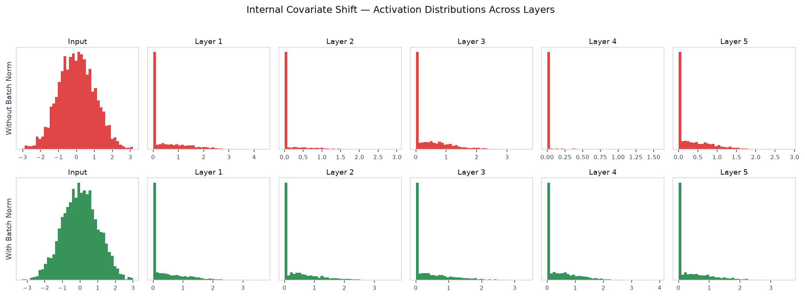
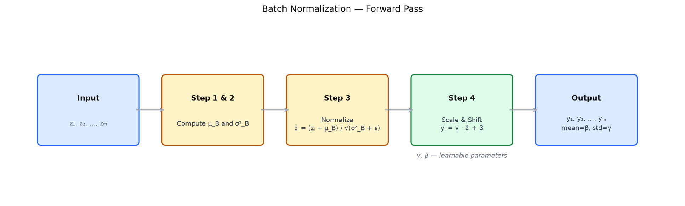

# 11 — Batch Normalization

---

## Part 1: The Problem Batch Normalization Solves

Training a deep network is an optimization problem over many layers simultaneously. Every weight update in one layer changes the distribution of inputs to the next layer. The layer above then receives a shifted distribution and must adapt — but while it is adapting, it is also changing the distribution for the layer above it. This happens at every layer, at every step, throughout training.

This phenomenon is called **internal covariate shift**: the distribution of each layer's inputs changes continuously during training because the parameters of all preceding layers are changing.

```
Step 1:  Layer 1 weights update → distribution of a⁽¹⁾ shifts
Step 2:  Layer 2 now receives a different distribution → must re-adapt
Step 3:  Layer 2 weights update → distribution of a⁽²⁾ shifts
Step 4:  Layer 3 now receives a different distribution → must re-adapt
...
```

The consequence is that each layer spends part of its capacity chasing a moving target rather than learning the task. This slows training, requires careful learning rate tuning, and makes the network sensitive to initialization.

> Internal covariate shift does not prevent learning — it makes learning slower and less stable. Each layer must continuously re-adapt to the shifting output of the layer below it, rather than learning from a stable input distribution.

The two rows below show activation distributions at each layer during a forward pass — without batch norm (top) the distributions drift and spread across layers, with batch norm (bottom) they remain consistent.



Batch normalization addresses this directly: it standardises the input to each layer at every training step, so each layer always receives a distribution with the same mean and variance regardless of what the layers below are doing.

---

## Part 2: Batch Normalization

Batch normalization operates on a mini-batch of activations. For a given layer and a mini-batch of m examples, it applies four steps to the pre-activations z⁽ˡ⁾:

```
Step 1 — Compute batch mean:
  μ_B = (1/m) Σᵢ zᵢ

Step 2 — Compute batch variance:
  σ²_B = (1/m) Σᵢ (zᵢ − μ_B)²

Step 3 — Normalize:
  ẑᵢ = (zᵢ − μ_B) / √(σ²_B + ε)

Step 4 — Scale and shift:
  yᵢ = γ · ẑᵢ + β
```

Where ε is a small constant (e.g. 10⁻⁸) added for numerical stability, and γ (scale) and β (shift) are **learnable parameters** — one pair per feature, trained by gradient descent alongside the weights.

### Why Scale and Shift?

After normalization, every feature has mean 0 and variance 1. This is useful for stability, but it is too restrictive — it removes the network's ability to represent any other distribution. The learnable γ and β restore that freedom. If the network determines that the optimal distribution for a given layer has mean 2 and standard deviation 3, gradient descent will learn γ = 3 and β = 2.

> Batch normalization does not force the network to use zero-mean unit-variance activations. It forces the network to learn what mean and variance to use, rather than having them determined accidentally by the weights of preceding layers.

The diagram below shows the four steps of the batch norm forward pass and what each step produces.



---

## Part 3: Batch Norm at Inference

During training, batch normalization uses the mean and variance of the current mini-batch. This works because each mini-batch provides a fresh estimate of the distribution.

At inference, there is no mini-batch — predictions are often made one example at a time. Using a single example's statistics would be meaningless: the mean of one value is that value, and the variance is zero.

The solution is to accumulate **running statistics** during training:

```
Running mean:     μ_run ← α · μ_run + (1 − α) · μ_B
Running variance: σ²_run ← α · σ²_run + (1 − α) · σ²_B
```

Where α is a momentum parameter (typically 0.9 or 0.99). After training, μ_run and σ²_run are fixed estimates of the population mean and variance.

At inference, the batch norm layer uses these fixed statistics instead of computing new ones:

```
Training:   ẑᵢ = (zᵢ − μ_B) / √(σ²_B + ε)       ← batch statistics, changes each step
Inference:  ẑᵢ = (zᵢ − μ_run) / √(σ²_run + ε)    ← fixed statistics, deterministic
```

> This is why frameworks like PyTorch require explicitly switching between `model.train()` and `model.eval()` — batch norm behaves differently in each mode. Forgetting to call `model.eval()` at inference time means the model is still computing batch statistics from single examples, producing incorrect and non-deterministic outputs.

---

## Summary

Key takeaways:

- Internal covariate shift is the continuous change in each layer's input distribution caused by weight updates in preceding layers — it slows training by forcing each layer to re-adapt to a moving target
- Batch normalization normalizes pre-activations to zero mean and unit variance per mini-batch, then applies learnable scale γ and shift β — the network learns what distribution to use, rather than having it determined by upstream weights
- The learnable parameters γ and β are essential — without them, batch norm would force all layers to use zero-mean unit-variance activations, removing representational freedom
- At inference, batch norm uses running mean and variance accumulated during training — not batch statistics. Forgetting `model.eval()` produces incorrect, non-deterministic outputs
