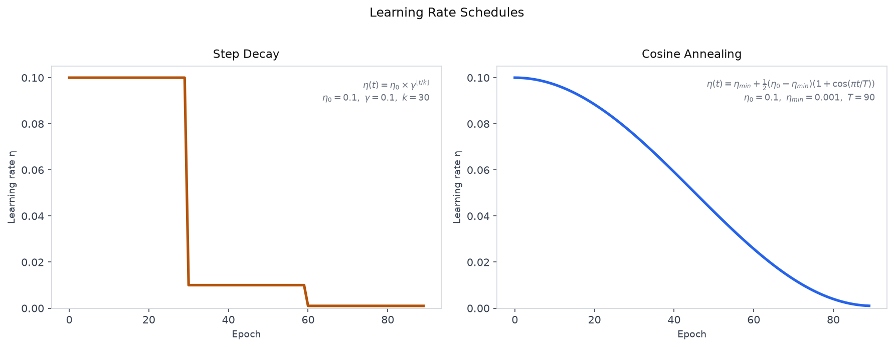

# 12 — Optimization Algorithms: SGD, Momentum, RMSProp, Adam

---

## Part 1: Limitations of Vanilla Gradient Descent

Gradient descent updates every parameter by the same rule at every step:

$$w \leftarrow w - \eta \cdot \frac{\partial L}{\partial w}$$

This works in principle — if the loss surface were a smooth bowl, gradient descent would roll straight to the minimum. In practice, the loss surfaces of deep networks are not smooth bowls. They have structure that makes vanilla gradient descent slow, unstable, or stuck.

### Ravines

A ravine is a region of the loss surface where curvature is much higher in one direction than another — like a narrow valley. Gradient descent oscillates across the steep walls while making slow progress along the valley floor.

- High curvature direction: large gradient → large step → overshoots → oscillates
- Low curvature direction: small gradient → small step → slow progress

The same learning rate $\eta$ governs both directions. A large $\eta$ fixes the slow direction but causes oscillation in the steep direction. A small $\eta$ fixes the oscillation but makes the slow direction even slower. There is no single $\eta$ that works well for both.

### Saddle Points

A saddle point is a location where the gradient is zero but it is not a minimum — the loss decreases in some directions and increases in others. In high-dimensional spaces, saddle points are far more common than local minima.

At a saddle point, $\partial L / \partial w = 0$ for all parameters, so gradient descent stops updating and training stalls. Vanilla gradient descent has no mechanism to escape a saddle point once it arrives there.

### Flat Regions

In flat regions of the loss surface, gradients are very small. Gradient descent makes tiny steps and converges extremely slowly. This is common early in training with poor initialization, and near the end of training when approaching a minimum.

> These three failure modes — ravines, saddle points, and flat regions — all have the same root cause: vanilla gradient descent uses only the current gradient, with no memory of where it has been and no adaptation to the local geometry of the loss surface. Every optimizer in this note addresses one or more of these failures.

---

## Part 2: Momentum

The problem with ravines is that gradient descent oscillates — it overshoots in the steep direction and undershoots in the flat direction. The fix is to give the optimizer memory: instead of updating based on the current gradient alone, accumulate a running average of past gradients.

This is **momentum**. The update rule becomes:

$$v_t = \beta \cdot v_{t-1} + (1 - \beta) \cdot \frac{\partial L}{\partial w}$$

$$w_t = w_{t-1} - \eta \cdot v_t$$

Where $v_t$ is the **velocity** — an exponential moving average of past gradients — and $\beta$ is the momentum coefficient (typically 0.9).

### How Momentum Helps

In a ravine, gradients in the steep direction alternate in sign (positive, negative, positive, ...) because the optimizer oscillates across the walls. When these are averaged, they cancel out — the velocity in the steep direction stays small. Gradients in the flat direction are consistently the same sign, so they accumulate — the velocity in the flat direction grows.

- Steep direction: gradients alternate sign → cancel in average → small velocity → less oscillation
- Flat direction: gradients same sign → accumulate → large velocity → faster progress

The $\beta$ parameter controls how much history is retained. $\beta = 0.9$ means the current gradient contributes 10% and the history contributes 90%.

> Momentum dampens oscillation in high-curvature directions and accelerates progress in low-curvature directions — by accumulating gradient history rather than reacting to each gradient independently.

### Worked Example

One parameter $w$, learning rate $\eta = 0.1$, momentum $\beta = 0.9$. Starting at $w_0 = 1.0$, $v_0 = 0$.

Gradients at each step: $g_1 = 0.8$, $g_2 = 0.6$, $g_3 = 0.7$.

**Step 1:**

$$v_1 = 0.9 \times 0.0 + 0.1 \times 0.8 = 0.08$$

$$w_1 = 1.0 - 0.1 \times 0.08 = 0.992$$

**Step 2:**

$$v_2 = 0.9 \times 0.08 + 0.1 \times 0.6 = 0.072 + 0.06 = 0.132$$

$$w_2 = 0.992 - 0.1 \times 0.132 = 0.9788$$

**Step 3:**

$$v_3 = 0.9 \times 0.132 + 0.1 \times 0.7 = 0.1188 + 0.07 = 0.1888$$

$$w_3 = 0.9788 - 0.1 \times 0.1888 = 0.9599$$

The velocity grows across steps because the gradients are consistently positive — momentum is accelerating progress in this direction.

---

## Part 3: RMSProp

Momentum addresses oscillation by smoothing the gradient direction. But it does not address the ravine problem directly — it still uses the same learning rate $\eta$ for all parameters. What we want is a **per-parameter learning rate** that is large for parameters with small gradients and small for parameters with large gradients.

**RMSProp** (Root Mean Square Propagation) achieves this by tracking the magnitude of recent gradients for each parameter:

$$s_t = \beta \cdot s_{t-1} + (1 - \beta) \cdot \left(\frac{\partial L}{\partial w}\right)^2$$

$$w_t = w_{t-1} - \frac{\eta}{\sqrt{s_t + \varepsilon}} \cdot \frac{\partial L}{\partial w}$$

Where $s_t$ is an exponential moving average of squared gradients, and $\varepsilon$ is a small constant (e.g. $10^{-8}$) for numerical stability.

### How RMSProp Helps

The effective learning rate for each parameter is $\eta / \sqrt{s_t}$:

- Large gradients → large $s_t$ → small effective learning rate → prevents overshooting
- Small gradients → small $s_t$ → large effective learning rate → accelerates slow directions

This is exactly what is needed in a ravine: the steep direction has large gradients and gets a small effective learning rate (reducing oscillation), while the flat direction has small gradients and gets a large effective learning rate (accelerating progress).

> RMSProp adapts the learning rate per parameter based on the recent history of gradient magnitudes — parameters that have been receiving large gradients get smaller updates, and parameters that have been receiving small gradients get larger updates.

### Worked Example

Same parameter, same gradients as Part 2. $\eta = 0.1$, $\beta = 0.9$, $\varepsilon = 10^{-8}$, $s_0 = 0$, $w_0 = 1.0$.

**Step 1:**

$$s_1 = 0.9 \times 0.0 + 0.1 \times (0.8)^2 = 0.064$$

$$w_1 = 1.0 - \frac{0.1}{\sqrt{0.064}} \times 0.8 = 1.0 - \frac{0.1}{0.2530} \times 0.8 = 1.0 - 0.3162 = 0.6838$$

**Step 2:**

$$s_2 = 0.9 \times 0.064 + 0.1 \times (0.6)^2 = 0.0576 + 0.036 = 0.0936$$

$$w_2 = 0.6838 - \frac{0.1}{\sqrt{0.0936}} \times 0.6 = 0.6838 - \frac{0.1}{0.3060} \times 0.6 = 0.6838 - 0.1961 = 0.4877$$

**Step 3:**

$$s_3 = 0.9 \times 0.0936 + 0.1 \times (0.7)^2 = 0.08424 + 0.049 = 0.13324$$

$$w_3 = 0.4877 - \frac{0.1}{\sqrt{0.13324}} \times 0.7 = 0.4877 - \frac{0.1}{0.3650} \times 0.7 = 0.4877 - 0.1918 = 0.2959$$

RMSProp takes much larger steps than momentum here because the effective learning rate $\eta/\sqrt{s}$ is larger than $\eta$ alone when $s < 1$ — which is typical early in training.

---

## Part 4: Adam

Adam (Adaptive Moment Estimation) combines momentum and RMSProp into a single optimizer. It maintains two moving averages per parameter:

$$m_t = \beta_1 \cdot m_{t-1} + (1 - \beta_1) \cdot \frac{\partial L}{\partial w} \qquad \text{(first moment, like momentum)}$$

$$v_t = \beta_2 \cdot v_{t-1} + (1 - \beta_2) \cdot \left(\frac{\partial L}{\partial w}\right)^2 \qquad \text{(second moment, like RMSProp)}$$

Where $\beta_1 = 0.9$ and $\beta_2 = 0.999$ are the standard defaults.

### Bias Correction

There is a problem with these moving averages at the start of training. Both $m$ and $v$ are initialised to zero. In the first few steps, the averages are heavily biased toward zero — they have not had enough steps to accumulate a meaningful estimate.

For example, at step 1 with $\beta_1 = 0.9$:

$$m_1 = 0.9 \times 0 + 0.1 \times g_1 = 0.1 \times g_1$$

The estimate $m_1$ is only 10% of the true gradient — it is biased toward zero by a factor of 10. Adam corrects for this:

$$\hat{m}_t = \frac{m_t}{1 - \beta_1^t} \qquad \hat{v}_t = \frac{v_t}{1 - \beta_2^t}$$

At step 1: $1 - \beta_1^1 = 1 - 0.9 = 0.1$, so $\hat{m}_1 = m_1 / 0.1 = 10 \times m_1$ — restoring the true scale. As $t$ grows, $\beta_1^t \to 0$ and the correction factor $\to 1$, so bias correction has no effect after the first few steps.

The full Adam update:

$$m_t = \beta_1 \cdot m_{t-1} + (1 - \beta_1) \cdot \frac{\partial L}{\partial w}$$

$$v_t = \beta_2 \cdot v_{t-1} + (1 - \beta_2) \cdot \left(\frac{\partial L}{\partial w}\right)^2$$

$$\hat{m}_t = \frac{m_t}{1 - \beta_1^t} \qquad \hat{v}_t = \frac{v_t}{1 - \beta_2^t}$$

$$w_t = w_{t-1} - \eta \cdot \frac{\hat{m}_t}{\sqrt{\hat{v}_t} + \varepsilon}$$

### Worked Example

Same parameter, same gradients. $\eta = 0.1$, $\beta_1 = 0.9$, $\beta_2 = 0.999$, $\varepsilon = 10^{-8}$, $m_0 = v_0 = 0$, $w_0 = 1.0$.

**Step 1** ($g_1 = 0.8$):

$$m_1 = 0.9 \times 0 + 0.1 \times 0.8 = 0.08$$

$$v_1 = 0.999 \times 0 + 0.001 \times (0.8)^2 = 0.00064$$

$$\hat{m}_1 = \frac{0.08}{1 - 0.9^1} = \frac{0.08}{0.1} = 0.8 \qquad \hat{v}_1 = \frac{0.00064}{1 - 0.999^1} = \frac{0.00064}{0.001} = 0.64$$

$$w_1 = 1.0 - 0.1 \times \frac{0.8}{\sqrt{0.64}} = 1.0 - 0.1 \times \frac{0.8}{0.8} = 1.0 - 0.1 = 0.9$$

**Step 2** ($g_2 = 0.6$):

$$m_2 = 0.9 \times 0.08 + 0.1 \times 0.6 = 0.132$$

$$v_2 = 0.999 \times 0.00064 + 0.001 \times (0.6)^2 = 0.00063936 + 0.00036 = 0.00099936$$

$$\hat{m}_2 = \frac{0.132}{1 - 0.9^2} = \frac{0.132}{0.19} = 0.6947 \qquad \hat{v}_2 = \frac{0.00099936}{1 - 0.999^2} = \frac{0.00099936}{0.001999} = 0.4999$$

$$w_2 = 0.9 - 0.1 \times \frac{0.6947}{\sqrt{0.4999}} = 0.9 - 0.1 \times \frac{0.6947}{0.7071} = 0.9 - 0.0982 = 0.8018$$

**Step 3** ($g_3 = 0.7$):

$$m_3 = 0.9 \times 0.132 + 0.1 \times 0.7 = 0.1888$$

$$v_3 = 0.999 \times 0.00099936 + 0.001 \times (0.7)^2 = 0.00099836 + 0.00049 = 0.00148836$$

$$\hat{m}_3 = \frac{0.1888}{1 - 0.9^3} = \frac{0.1888}{0.271} = 0.6967 \qquad \hat{v}_3 = \frac{0.00148836}{1 - 0.999^3} = \frac{0.00148836}{0.002997} = 0.4966$$

$$w_3 = 0.8018 - 0.1 \times \frac{0.6967}{\sqrt{0.4966}} = 0.8018 - 0.1 \times \frac{0.6967}{0.7047} = 0.8018 - 0.0989 = 0.7029$$

### Comparing the Three Optimizers

The three-step trace on the same parameter and gradients:

| Step | Momentum $w$ | RMSProp $w$ | Adam $w$ |
|---|---|---|---|
| 0 | 1.0000 | 1.0000 | 1.0000 |
| 1 | 0.9920 | 0.6838 | 0.9000 |
| 2 | 0.9788 | 0.4877 | 0.8018 |
| 3 | 0.9599 | 0.2959 | 0.7029 |

Momentum makes small, consistent steps — it accumulates velocity but the effective step size is still governed by $\eta$. RMSProp makes large steps early because the running average $s$ is small, giving a large effective learning rate. Adam takes steps of approximately $\eta = 0.1$ per step — the bias correction normalises the update so the effective step size is approximately constant and equal to $\eta$, regardless of gradient magnitude.

> Adam's bias correction gives it a well-defined effective step size from the very first update — approximately $\eta$ per step. This is why Adam is less sensitive to the choice of $\eta$ than RMSProp or momentum alone.

---

## Part 5: Learning Rate Schedules

Even with a good optimizer, a fixed learning rate is rarely optimal throughout training. Early in training, a larger learning rate explores the loss surface quickly. Later in training, a smaller learning rate allows fine-grained convergence near a minimum.

A **learning rate schedule** reduces $\eta$ over the course of training according to a predefined rule.

The diagram below shows step decay and cosine annealing over 90 epochs, illustrating the difference between discontinuous and smooth schedules.



### Step Decay

Reduce the learning rate by a fixed factor every $k$ epochs:

$$\eta(\text{epoch}) = \eta_0 \times \gamma^{\lfloor \text{epoch} / k \rfloor}$$

Where $\gamma$ is the decay factor (e.g. 0.1) and $k$ is the step size (e.g. every 30 epochs). For example, with $\eta_0 = 0.1$, $\gamma = 0.1$, $k = 30$: epochs 0–29 use $\eta = 0.1$, epochs 30–59 use $\eta = 0.01$, epochs 60–89 use $\eta = 0.001$.

Step decay is simple and widely used. The discontinuous drops can cause instability at each step boundary.

### Cosine Annealing

Reduce the learning rate smoothly following a cosine curve from $\eta_0$ to $\eta_{\min}$ over $T$ epochs:

$$\eta(t) = \eta_{\min} + \frac{1}{2}(\eta_0 - \eta_{\min})\left(1 + \cos\frac{\pi t}{T}\right)$$

The learning rate starts at $\eta_0$, decreases smoothly to $\eta_{\min}$, and can be restarted periodically (cosine annealing with warm restarts). The smooth decay avoids the instability of step decay:

- $t=0$: $\eta = \eta_0$ (maximum)
- $t=T/2$: $\eta \approx (\eta_0 + \eta_{\min})/2$ (midpoint)
- $t=T$: $\eta = \eta_{\min}$ (minimum)

### Choosing an Optimizer in Practice

```
Situation                                    Recommendation
───────────────────────────────────────────  ──────────────────────────────────────────
Default starting point                       Adam (b1=0.9, b2=0.999, lr=0.001)
Computer vision, CNNs                        SGD + momentum (b=0.9) with schedule
                                             Often outperforms Adam with tuning
NLP, transformers                            Adam or AdamW (Adam + weight decay)
RNNs                                         RMSProp — handles non-stationary gradients
Small dataset, risk of overfitting           SGD + momentum — less aggressive adaptation
Need fast convergence, less tuning           Adam — robust to lr choice
```

### Common Pitfalls

```
Pitfall                                      Fix
───────────────────────────────────────────  ──────────────────────────────────────────
Learning rate too large                      Loss diverges or oscillates — reduce lr
Learning rate too small                      Training is very slow — increase lr
No learning rate schedule                    Loss plateaus early — add step decay or
                                             cosine annealing
Using Adam with very large lr                Adam is robust but not immune — lr=0.001
                                             is the standard starting point
Forgetting weight decay                      Use AdamW instead of Adam for L2
                                             regularization — Adam's adaptive rates
                                             interact poorly with standard L2
```

> No optimizer is universally best. Adam is the robust default — it works well across most tasks with minimal tuning. SGD with momentum and a schedule often achieves better final performance on vision tasks but requires more careful tuning. Start with Adam; switch to SGD if you have the time to tune.

---

## Summary

Key takeaways:

- Vanilla gradient descent fails on deep network loss surfaces due to ravines (oscillation across steep walls), saddle points (zero gradient, training stalls), and flat regions (tiny gradients, slow progress)
- Momentum accumulates an exponential moving average of past gradients — gradients that alternate in sign cancel out (reducing oscillation), gradients that are consistently signed accumulate (accelerating progress). $\beta = 0.9$ is the standard default
- RMSProp adapts the learning rate per parameter by dividing by the root mean square of recent gradients — large gradients get smaller effective learning rates, small gradients get larger effective learning rates
- Adam combines momentum (first moment $m$) and RMSProp (second moment $v$) with bias correction — the correction removes the zero-initialisation bias in the first few steps and gives Adam an approximately constant effective step size of $\eta$ from the start
- Bias correction is essential in Adam's early steps — without it, $m$ and $v$ are heavily biased toward zero, producing undersized updates
- Learning rate schedules reduce $\eta$ during training: step decay reduces by a fixed factor every $k$ epochs (simple but discontinuous), cosine annealing reduces smoothly following a cosine curve (preferred for stability)
- Adam is the robust default for most tasks; SGD with momentum and a schedule often achieves better final performance on vision tasks with careful tuning; RMSProp is preferred for RNNs
