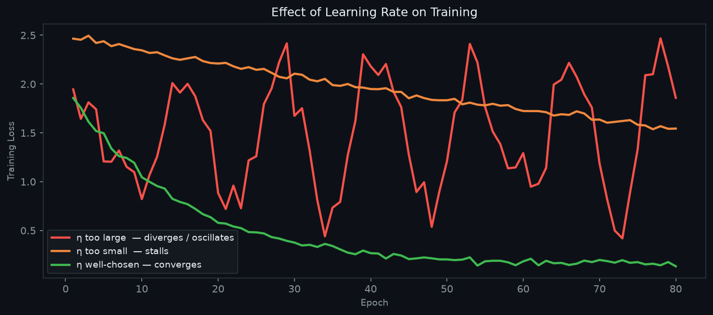
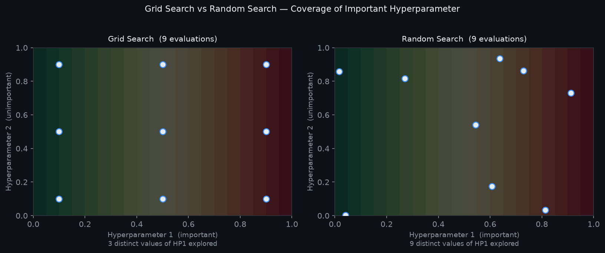

# 13 — Hyperparameter Tuning

---

## Part 1: What Is a Hyperparameter

A neural network has two kinds of values that must be set before training can produce a useful model.

**Parameters** are the weights and biases of the network. They are learned — gradient descent updates them automatically based on the training data. The network finds good parameter values on its own.

**Hyperparameters** are everything else. They are set by the practitioner before training begins and are not updated by gradient descent. The network cannot learn them — they must be chosen, tested, and adjusted manually or by a search procedure.

```
Parameters (learned by gradient descent):
  W⁽ˡ⁾, b⁽ˡ⁾  — weights and biases at every layer

Hyperparameters (set before training):
  Optimization:    learning rate η, batch size, number of epochs
  Architecture:    number of layers, units per layer, activation functions
  Regularization:  dropout rate p, L2 penalty λ, early stopping patience
  Initialization:  initialization scheme (He, Xavier)
```

The distinction matters because hyperparameters control the conditions under which learning happens. A network with the right architecture but the wrong learning rate may never converge. A network with the right learning rate but the wrong batch size may converge to a poor solution. Getting hyperparameters right is not optional — it is a prerequisite for training to work at all.

> Hyperparameters define the learning process. Parameters are what the learning process produces. No amount of training data or model capacity compensates for badly chosen hyperparameters.

---

## Part 2: Learning Rate

The learning rate η is the single most important hyperparameter. It controls how large a step gradient descent takes at each update:

```
w ← w − η · ∂L/∂w
```

### Effect on Training

```
η too large:   steps overshoot the minimum → loss oscillates or diverges
η too small:   steps are tiny → training is extremely slow → may never converge
η just right:  loss decreases steadily → converges to a good minimum
```

The diagram below shows training loss over epochs under three learning rate conditions.



### The Learning Rate Range Test

A practical method for finding a good starting learning rate: start with a very small η (e.g. 10⁻⁷) and increase it exponentially over a short run (e.g. 100 steps). Plot the loss against η. The loss will initially decrease as η grows, then diverge when η becomes too large.

```
Region                    Interpretation
──────────────────────    ──────────────────────────────────────────
Loss still decreasing     η is too small — can increase further
Loss at minimum           good range for η
Loss increasing sharply   η is too large — back off by one order of magnitude
```

A good starting η is typically one order of magnitude below the value where the loss starts to increase.

### Interaction with Batch Size

Learning rate and batch size are coupled. When batch size is doubled, the gradient estimate becomes less noisy — the effective gradient is more accurate. To maintain the same training dynamics, the learning rate should be scaled proportionally:

```
Linear scaling rule:   if batch size × k, then η × k
```

This rule holds approximately for moderate scaling. For very large batch sizes it breaks down and more careful tuning is needed.

---

## Part 3: Batch Size

The batch size determines how many training examples are used to compute each gradient update.

### Effect on Gradient Noise

```
Small batch (e.g. 32):   gradient is a noisy estimate of the true gradient
                          → noisy updates → escapes sharp minima
                          → tends to find flatter, more generalizable minima

Large batch (e.g. 2048): gradient is a more accurate estimate
                          → stable updates → converges faster per epoch
                          → tends to converge to sharp minima → worse generalization
```

This is not just a computational tradeoff — it affects the quality of the solution. Small batches introduce noise that acts as implicit regularization, helping the optimizer avoid sharp minima that overfit. Large batches are more efficient per step but often produce models that generalize worse.

> The generalization gap between small and large batch training is a well-documented empirical phenomenon. Large batch training converges to sharper minima — regions of the loss surface where small perturbations cause large increases in loss — which correspond to worse generalization.

### Effect on Compute

```
Batch size    Gradient updates per epoch    Memory per step    GPU utilization
──────────    ──────────────────────────    ───────────────    ───────────────
Small (32)    many                          low                low
Large (512)   few                           high               high
```

Larger batches make better use of GPU parallelism — the hardware is more fully utilized. The practical choice balances generalization quality against training speed.

### Typical Starting Points

```
Task                        Typical batch size
──────────────────────────  ──────────────────
Image classification        32 – 256
NLP / transformers          16 – 64  (memory-limited by sequence length)
Small datasets              8 – 32
Large-scale training        256 – 2048  (with learning rate scaling)
```

---

## Part 4: Epochs and Early Stopping

An epoch is one complete pass through the training dataset. The number of epochs determines how long training runs.

### Underfitting and Overfitting as a Function of Epochs

```
Too few epochs:   model has not converged → underfitting → high training and validation loss
Too many epochs:  model has memorised training data → overfitting → low training, high validation loss
```

The right number of epochs is not known in advance — it depends on the learning rate, batch size, model capacity, and dataset. Fixing a number of epochs and hoping it is right is fragile.

### Early Stopping

Early stopping monitors validation loss during training and stops when it stops improving. It removes the need to choose the number of epochs in advance.

```
Algorithm:
  best_loss = ∞
  patience_counter = 0

  for each epoch:
      train for one epoch
      compute validation loss

      if val_loss < best_loss:
          best_loss = val_loss
          save model weights
          patience_counter = 0
      else:
          patience_counter += 1

      if patience_counter >= patience:
          stop training
          restore saved weights
```

The **patience** parameter controls how many epochs without improvement are tolerated before stopping. A patience of 10–20 epochs is typical — it allows the validation loss to temporarily plateau or fluctuate without triggering early termination.

Restoring the saved weights at the end is essential — the final epoch's weights are not the best weights. The best weights are from the epoch with the lowest validation loss.

> Early stopping is simultaneously a solution to the epochs hyperparameter and a regularization technique — it prevents the model from training long enough to overfit. It is computationally free and should almost always be used.

---

## Part 5: Search Strategies

With many hyperparameters to tune, a systematic search strategy is needed. Three approaches are common.

### Grid Search

Define a discrete set of values for each hyperparameter and try every combination.

```
Example: η ∈ {0.1, 0.01, 0.001},  batch size ∈ {32, 64, 128}
→ 3 × 3 = 9 combinations to evaluate
```

Grid search is exhaustive within the defined grid. Its weakness is the **curse of dimensionality** — with k hyperparameters each taking n values, the number of combinations is nᵏ. With 6 hyperparameters and 5 values each, that is 5⁶ = 15,625 training runs.

A subtler problem: grid search wastes evaluations. If the loss is insensitive to one hyperparameter, grid search still evaluates every value of it — spending most of its budget on a dimension that does not matter.

### Random Search

Sample hyperparameter combinations randomly from a defined range rather than a fixed grid.

```
Example: η ~ LogUniform(10⁻⁴, 10⁻¹),  batch size ~ Uniform({32, 64, 128, 256})
→ sample N combinations at random and evaluate each
```

Random search is more efficient than grid search when only a few hyperparameters matter. If 2 out of 6 hyperparameters are important, random search explores many different values of those 2, while grid search wastes most of its budget on the other 4.

The diagram below illustrates why random search finds better configurations than grid search with the same number of evaluations when one hyperparameter matters more than the other.



### Bayesian Optimization

Bayesian optimization builds a probabilistic model of the loss as a function of hyperparameters and uses it to choose the next configuration to evaluate — focusing on regions likely to improve on the current best. It is more sample-efficient than random search but more complex to implement. Tools like Optuna and Ray Tune provide practical implementations.

### Manual Tuning

For most practical work, manual tuning guided by understanding of the hyperparameters is the most efficient approach. The practitioner uses knowledge of how each hyperparameter affects training to make informed adjustments rather than searching blindly.

```
Random search:    good when you have compute budget and little prior knowledge
Manual tuning:    good when you understand the problem and want fast iteration
Bayesian opt:     good when evaluations are expensive and you need sample efficiency
Grid search:      rarely the best choice — use random search instead
```

---

## Part 6: Practical Tuning Workflow

Tuning all hyperparameters simultaneously is inefficient and makes it impossible to understand what is causing changes in performance. The practical approach is to tune one thing at a time, in order of impact.

### Tuning Order

```
Priority    Hyperparameter          Why first
─────────   ─────────────────────   ──────────────────────────────────────────────
1           Learning rate           Largest impact on whether training works at all
2           Batch size              Affects gradient noise and training stability
3           Regularization         Dropout rate, L2 λ — address overfitting once
            (dropout, L2)          the model is training correctly
4           Architecture           Depth, width — only after optimization is stable
            (depth, width)
5           Other                  Momentum β, β₁, β₂ — rarely need changing from
                                   defaults
```

### The Workflow

```
Step 1:  Start with known-good defaults
         Adam (lr=0.001), batch size 32, He init, no dropout, 100 epochs + early stopping

Step 2:  Run a learning rate range test
         Find the range where loss decreases — pick η one order of magnitude below divergence

Step 3:  Confirm training is working
         Loss should decrease steadily, validation loss should track training loss early on

Step 4:  Address overfitting if present
         Add dropout, increase L2, reduce model capacity — one change at a time

Step 5:  Tune batch size if needed
         Increase for speed, decrease if generalization is poor

Step 6:  Tune architecture last
         Only after optimization and regularization are stable
```

### One Change at a Time

Changing multiple hyperparameters simultaneously makes it impossible to attribute changes in performance to any single cause. If validation loss improves after changing both the learning rate and dropout rate, you do not know which change helped — or whether one helped and the other hurt.

> Always change one hyperparameter at a time. Record every experiment. The goal is to build understanding of how each hyperparameter affects your specific model and dataset — not just to find a configuration that works once.

---

## Summary

Key takeaways:

- Hyperparameters are set before training and are not learned by gradient descent — they control the conditions under which learning happens. Getting them wrong prevents training from working regardless of model capacity or data quality
- Learning rate is the most critical hyperparameter — too large causes divergence, too small causes stalling. The learning rate range test finds a good starting value empirically
- Batch size affects gradient noise and generalization — small batches are noisy and tend to find flatter, more generalizable minima; large batches are stable but tend to converge to sharp minima with worse generalization
- The linear scaling rule couples learning rate and batch size — doubling batch size should approximately double the learning rate to maintain the same training dynamics
- Early stopping monitors validation loss and stops training when it stops improving, restoring the best weights — it eliminates the need to choose epochs in advance and acts as a regularizer
- Random search outperforms grid search when only a few hyperparameters matter — it explores more distinct values of the important dimensions with the same number of evaluations
- Tune in order of impact: learning rate first, then batch size, then regularization, then architecture — one change at a time so the effect of each change is attributable
