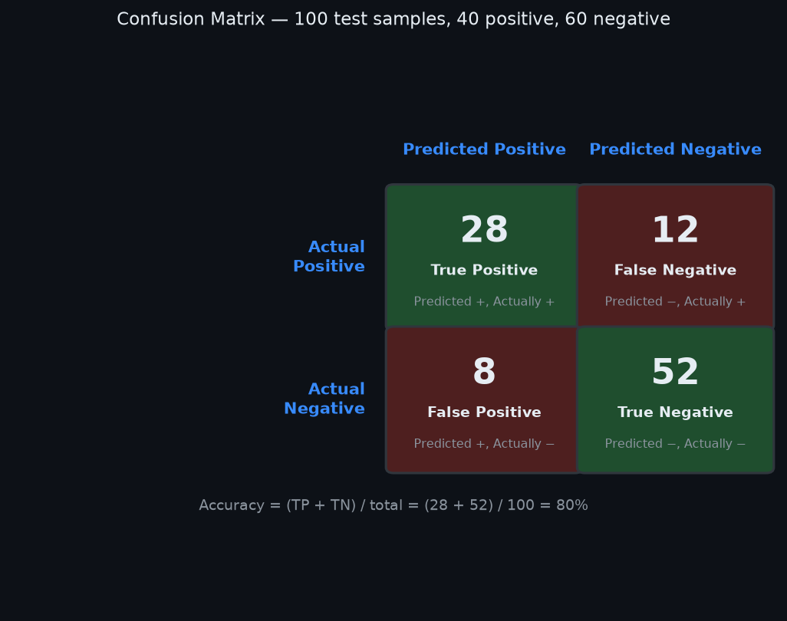
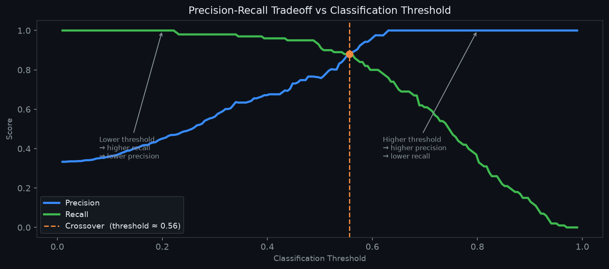
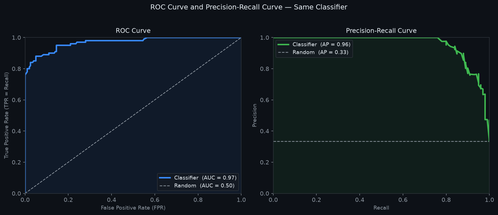

# 14 — Model Evaluation: Metrics

---

## Part 1: Why Accuracy Is Not Enough

The most natural way to measure a classifier is accuracy — the fraction of predictions that are correct:

```
Accuracy = (number of correct predictions) / (total predictions)
```

For balanced datasets, accuracy is a reasonable starting point. For imbalanced datasets, it is actively misleading.

### The Class Imbalance Problem

Consider a medical test for a rare disease that affects 1% of the population. A classifier that predicts "no disease" for every single patient — without looking at any features — achieves 99% accuracy. It is also completely useless: it misses every actual case.

```
Dataset: 1000 patients — 10 have the disease, 990 do not

Classifier: always predict "no disease"

Correct predictions: 990  (all the healthy patients)
Wrong predictions:    10  (all the sick patients)

Accuracy = 990 / 1000 = 99%
```

99% accuracy, zero ability to detect the disease. Accuracy rewards the classifier for exploiting the class imbalance rather than learning anything useful.

> Accuracy measures how often the classifier is right. In imbalanced problems, being right most of the time is easy — just predict the majority class. What matters is whether the classifier is right on the cases that matter.

This is why a richer set of metrics is needed — ones that separately measure performance on each class and make the cost of different types of errors explicit.

---

## Part 2: The Confusion Matrix

The confusion matrix organises all predictions into four categories based on the combination of predicted class and true class.

For binary classification with classes Positive (P) and Negative (N):

```
                        Predicted Positive    Predicted Negative
                       ┌──────────────────────┬──────────────────────┐
Actual Positive        │  True Positive (TP)  │  False Negative (FN) │
                       ├──────────────────────┼──────────────────────┤
Actual Negative        │  False Positive (FP) │  True Negative (TN)  │
                       └──────────────────────┴──────────────────────┘
```

```
TP — predicted positive, actually positive   (correct — caught a real case)
TN — predicted negative, actually negative   (correct — correctly dismissed)
FP — predicted positive, actually negative   (wrong — false alarm)
FN — predicted negative, actually positive   (wrong — missed a real case)
```

The names are from the perspective of the positive class. A **False Positive** is a false alarm — the classifier said positive but was wrong. A **False Negative** is a miss — the classifier said negative but the true label was positive.

### Worked Example

A binary classifier is evaluated on 100 test samples: 40 are positive, 60 are negative.

```
Results:
  TP = 28   (28 of the 40 positives were correctly identified)
  FN = 12   (12 of the 40 positives were missed)
  FP =  8   (8 of the 60 negatives were incorrectly flagged)
  TN = 52   (52 of the 60 negatives were correctly dismissed)

Check: TP + FN = 28 + 12 = 40  ✓  (all actual positives accounted for)
       FP + TN =  8 + 52 = 60  ✓  (all actual negatives accounted for)
       Total   = 28 + 12 + 8 + 52 = 100  ✓
```

The confusion matrix for this example:

```
                   Predicted +    Predicted −
Actual +               28             12
Actual −                8             52
```

Accuracy from the confusion matrix:

```
Accuracy = (TP + TN) / total = (28 + 52) / 100 = 80%
```

All metrics in Parts 3, 4, and 5 are derived from these same four numbers.

The diagram below shows the confusion matrix for this example with each cell labelled.



---

## Part 3: Precision and Recall

Precision and recall each answer a different question about the classifier's behaviour.

### Precision

**Precision** asks: of all the samples the classifier predicted as positive, what fraction actually are positive?

```
Precision = TP / (TP + FP)
```

Precision measures the **quality of positive predictions** — how trustworthy a positive prediction is. A classifier with high precision rarely raises false alarms.

From the worked example:

```
Precision = 28 / (28 + 8) = 28 / 36 = 0.778
```

78% of the samples predicted positive were actually positive. 22% were false alarms.

### Recall

**Recall** asks: of all the samples that actually are positive, what fraction did the classifier find?

```
Recall = TP / (TP + FN)
```

Recall measures the **coverage of actual positives** — how many real cases the classifier catches. A classifier with high recall misses few actual positives.

From the worked example:

```
Recall = 28 / (28 + 12) = 28 / 40 = 0.700
```

70% of the actual positives were found. 30% were missed.

### The Precision-Recall Tradeoff

Precision and recall pull in opposite directions. A classifier makes predictions by comparing its output score to a threshold — samples above the threshold are predicted positive, samples below are predicted negative.

```
Lower threshold:   more samples predicted positive
                   → more true positives found → higher recall
                   → more false positives included → lower precision

Higher threshold:  fewer samples predicted positive
                   → fewer false positives → higher precision
                   → more true positives missed → lower recall
```

You cannot simultaneously maximise both. The right balance depends on the cost of each type of error.

The diagram below shows precision and recall as functions of the classification threshold — as the threshold decreases, recall rises and precision falls. The crossover point is where they are equal.



### When Each Matters

```
Task                        Priority    Reasoning
──────────────────────────  ──────────  ──────────────────────────────────────────────
Cancer screening            Recall      Missing a cancer case (FN) is catastrophic.
                                        False alarms (FP) lead to further tests — costly
                                        but not fatal. Catch everything.

Spam filter                 Precision   Sending a legitimate email to spam (FP) is
                                        unacceptable. Missing some spam (FN) is tolerable.
                                        Only flag what you are sure about.

Fraud detection             Recall      Missing fraud (FN) is costly. False alarms (FP)
                                        cause inconvenience but can be reviewed manually.

Legal document review       Precision   Flagging irrelevant documents (FP) wastes lawyer
                                        time. Missing some relevant ones (FN) is acceptable
                                        if the review is a first pass.
```

> Precision and recall are not interchangeable. The choice of which to prioritise is a domain decision, not a modelling decision — it depends on the relative cost of false positives and false negatives in the specific application.

---

## Part 4: F1 Score

When both precision and recall matter, a single number that combines them is useful. The **F1 score** is the harmonic mean of precision and recall:

```
F1 = 2 × (Precision × Recall) / (Precision + Recall)
```

From the worked example:

```
F1 = 2 × (0.778 × 0.700) / (0.778 + 0.700)
   = 2 × 0.5446 / 1.478
   = 1.0892 / 1.478
   = 0.737
```

### Why Harmonic Mean, Not Arithmetic Mean

The arithmetic mean of precision and recall would be (0.778 + 0.700) / 2 = 0.739 — close to F1 here, but the difference matters when precision and recall are very different.

Consider a classifier with precision = 1.0 and recall = 0.01 — it makes very few positive predictions, all of them correct, but misses 99% of actual positives.

```
Arithmetic mean:  (1.0 + 0.01) / 2 = 0.505   ← suggests reasonable performance
Harmonic mean:    2 × (1.0 × 0.01) / (1.0 + 0.01) = 0.020   ← correctly penalises the imbalance
```

The harmonic mean is dominated by the smaller value. A classifier that is excellent on one metric but terrible on the other gets a low F1 — which is the correct behaviour. The arithmetic mean would give it a passing score.

> F1 is low whenever either precision or recall is low. It rewards classifiers that are good at both, not classifiers that sacrifice one for the other.

### F1 in Context

F1 is appropriate when both false positives and false negatives matter and neither dominates. When one type of error is much more costly than the other, use precision or recall directly — or the Fβ score, which weights recall β times more than precision:

```
Fβ = (1 + β²) × (Precision × Recall) / (β² × Precision + Recall)

β > 1:   weights recall more heavily   (missing positives is more costly)
β < 1:   weights precision more heavily (false alarms are more costly)
β = 1:   F1 — equal weight
```

---

## Part 5: ROC Curve and AUC

Precision, recall, and F1 are all computed at a single threshold. The **ROC curve** (Receiver Operating Characteristic) evaluates the classifier across all possible thresholds simultaneously, giving a threshold-independent view of performance.

### Building the ROC Curve

A binary classifier outputs a score for each sample. By varying the threshold from 0 to 1, we get different confusion matrices — and different values of two rates:

```
True Positive Rate (TPR) = Recall = TP / (TP + FN)
    — fraction of actual positives correctly identified

False Positive Rate (FPR) = FP / (FP + TN)
    — fraction of actual negatives incorrectly flagged
```

The ROC curve plots TPR (y-axis) against FPR (x-axis) as the threshold varies from 1 down to 0.

```
Threshold = 1:   nothing predicted positive → TP=0, FP=0 → TPR=0, FPR=0  (bottom-left)
Threshold = 0:   everything predicted positive → all positives found, all negatives flagged
                 → TPR=1, FPR=1  (top-right)
```

As the threshold decreases, the curve moves from bottom-left to top-right. A good classifier reaches high TPR before accumulating much FPR — its curve bows toward the top-left corner.

### The Diagonal Baseline

A random classifier that ignores all features and predicts positive with probability p produces TPR = FPR = p for any threshold. Its ROC curve is the diagonal line from (0,0) to (1,1). Any classifier whose ROC curve lies on or below the diagonal is no better than random.

### AUC — Area Under the Curve

The **AUC** (Area Under the ROC Curve) summarises the entire ROC curve as a single number — the area under it, between 0 and 1.

```
AUC = 0.5:   random classifier — no discriminative ability
AUC = 1.0:   perfect classifier — separates all positives from all negatives
AUC = 0.8:   good classifier — 80% of the time, a randomly chosen positive
             scores higher than a randomly chosen negative
```

The last interpretation is exact: AUC equals the probability that the classifier ranks a randomly chosen positive sample higher than a randomly chosen negative sample.

### The Precision-Recall Curve

The ROC curve can be misleadingly optimistic when classes are heavily imbalanced. Because FPR has TN in the denominator, a large number of true negatives keeps FPR small even when many false positives are produced — making the curve look better than it is.

The **precision-recall curve** plots precision (y-axis) against recall (x-axis) as the threshold varies. It does not involve TN at all, so it is not affected by class imbalance.

```
ROC curve:              use when classes are roughly balanced
Precision-recall curve: use when the positive class is rare
                        — gives a more honest picture of performance
```

A random classifier on an imbalanced dataset (1% positive) has AUC ≈ 0.5 on the ROC curve but average precision ≈ 0.01 on the precision-recall curve — correctly reflecting that random predictions are nearly useless for finding the rare class.

The diagram below shows both curves for the same classifier — the ROC curve on the left and the precision-recall curve on the right.



---

## Part 6: Choosing the Right Metric

```
Situation                                    Metric
───────────────────────────────────────────  ──────────────────────────────────────────
Balanced classes, general performance        Accuracy or F1
Imbalanced classes                           F1, precision, recall, or average precision
                                             — not accuracy
Cost of FN >> cost of FP                     Recall (or Fβ with β > 1)
Cost of FP >> cost of FN                     Precision (or Fβ with β < 1)
Comparing classifiers across thresholds      AUC-ROC
Rare positive class, threshold comparison    Average precision (AUC-PR)
Both FP and FN matter equally                F1
Reporting to non-technical stakeholders      Precision and recall — interpretable
                                             as "how often right" and "how much found"
```

### The Cost Framing

Every metric choice is implicitly a statement about the relative cost of false positives and false negatives. Making this explicit is good practice:

```
Before choosing a metric, ask:
  1. What happens when the classifier misses a real positive? (FN cost)
  2. What happens when the classifier raises a false alarm? (FP cost)
  3. Which is worse?

If FN cost >> FP cost:   optimise recall
If FP cost >> FN cost:   optimise precision
If roughly equal:        optimise F1
If you need a single threshold-independent number:   use AUC
```

> The metric is not a technical choice — it is a domain choice. The right metric is the one that best reflects the real-world consequences of the classifier's errors. Choosing the wrong metric can lead to a model that performs well on paper and fails in deployment.

---

## Summary

Key takeaways:

- Accuracy is misleading on imbalanced datasets — a classifier that always predicts the majority class achieves high accuracy while being completely useless for the minority class
- The confusion matrix organises predictions into TP, TN, FP, FN — all evaluation metrics are derived from these four numbers
- Precision = TP / (TP + FP) — measures the quality of positive predictions; high precision means few false alarms
- Recall = TP / (TP + FN) — measures coverage of actual positives; high recall means few missed cases
- Precision and recall trade off against each other as the classification threshold changes — lowering the threshold increases recall and decreases precision
- F1 = harmonic mean of precision and recall — dominated by the smaller value, correctly penalising classifiers that sacrifice one metric for the other
- The ROC curve plots TPR vs FPR across all thresholds; AUC summarises it as a single number equal to the probability that a random positive scores higher than a random negative
- The precision-recall curve is preferred over ROC when the positive class is rare — ROC can be misleadingly optimistic on imbalanced datasets because FPR is diluted by the large number of true negatives
- Metric choice is a domain decision based on the relative cost of false positives and false negatives — not a technical default
