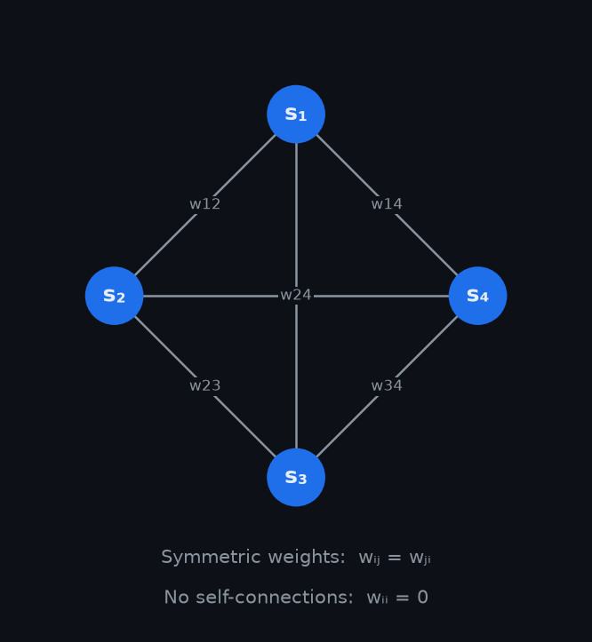
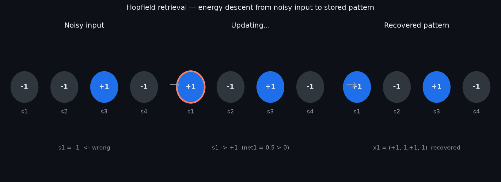

# 15 — Hopfield Network

---

## Part 1: Associative Memory

Every network covered so far in this course is a **feedforward** system: given an input, compute an output. The input must be complete and clean — a partial or corrupted input produces a degraded output with no mechanism for recovery.

The brain does not work this way. You can recognise a face from a partial photograph, recall a song from a few notes, or retrieve a memory from a vague cue. This is **associative memory** — the ability to retrieve a complete, stored pattern from a partial or noisy version of it.

```
Feedforward network:   input → output   (no memory, no completion)

Associative memory:    partial/noisy input → stored pattern   (completion and correction)
```

The question is: can a neural network implement associative memory? The answer, given by John Hopfield in 1982, is yes — and the mechanism is elegant.

The key insight is to treat stored patterns not as outputs to be computed, but as **stable states** of a dynamical system. The network has energy. It evolves over time, always moving toward lower energy. Stored patterns are energy minima — valleys in the energy landscape. A noisy input is a point near a valley. The network rolls downhill and lands in the valley, recovering the stored pattern.

> Associative memory is not a lookup table. It is a dynamical system that converges to stored patterns from nearby starting points. The stored patterns are attractors — stable states the network is drawn toward.

---

## Part 2: Architecture

A Hopfield network consists of **N binary neurons**. Each neuron has a state sᵢ ∈ {−1, +1}. The network is **fully connected** — every neuron is connected to every other neuron.

Two architectural constraints distinguish the Hopfield network from a general recurrent network:

```
1. Symmetric weights:     wᵢⱼ = wⱼᵢ   for all i, j
2. No self-connections:   wᵢᵢ = 0      for all i
```

Symmetry is not a biological constraint — it is a mathematical requirement. Without symmetric weights, the energy function (Part 3) does not exist, and convergence is not guaranteed.

The diagram below shows a 4-neuron Hopfield network — every neuron connects to every other, weights are symmetric, and no neuron connects to itself.



The state of the network at any time is the vector **s** = (s₁, s₂, ..., sN). The network evolves by updating neuron states one at a time until no further changes occur.

### Update Rule

Each neuron computes a weighted sum of all other neuron states and applies a sign threshold:

```
netᵢ = Σⱼ wᵢⱼ sⱼ

         +1   if netᵢ ≥ 0
sᵢ  ←  {
         −1   if netᵢ < 0
```

This is applied **asynchronously** — one neuron at a time, in any order. The network runs until a full pass through all neurons produces no state changes. At that point, the network has converged to a stable state.

---

## Part 3: Energy Function

The reason the Hopfield network converges — rather than cycling or diverging — is the **energy function**. Hopfield defined a scalar energy for every possible network state:

```
E = −½ Σᵢ Σⱼ wᵢⱼ sᵢ sⱼ
```

The sum is over all pairs i ≠ j (the diagonal is zero by the no-self-connection constraint). The factor of ½ avoids double-counting each pair.

### Why Energy Always Decreases

When neuron i updates its state, the change in energy is:

```
ΔE = −Δsᵢ × netᵢ

where  Δsᵢ = sᵢ(new) − sᵢ(old)
       netᵢ = Σⱼ wᵢⱼ sⱼ
```

The ½ in the energy function cancels with the factor of 2 from double-counting: when only sᵢ changes, the sum over all pairs (k, j) contributes two terms involving sᵢ — one for (i, j) and one for (j, i) — giving ½ × 2 = 1.

The update rule sets sᵢ = sign(netᵢ). This means:

```
If netᵢ > 0:   sᵢ → +1
  If sᵢ was −1:  Δsᵢ = +2,  ΔE = −(+2)(netᵢ) < 0   (energy decreases)
  If sᵢ was +1:  Δsᵢ = 0,   ΔE = 0                  (no change)

If netᵢ < 0:   sᵢ → −1
  If sᵢ was +1:  Δsᵢ = −2,  ΔE = −(−2)(netᵢ) < 0   (energy decreases)
  If sᵢ was −1:  Δsᵢ = 0,   ΔE = 0                  (no change)
```

Every update either decreases energy or leaves it unchanged. Energy never increases. Since the number of possible states is finite (2ᴺ), the network must eventually reach a state where no update changes any neuron — a **local energy minimum**.

> The energy function is the guarantee of convergence. Every asynchronous update is a step downhill. The network cannot cycle because cycling would require energy to increase at some point, which the update rule forbids.

The stable states — the local minima of the energy function — are the **attractors** of the network. These are the states the network converges to from nearby starting points.

---

## Part 4: Storing Patterns — The Hebbian Weight Rule

To store a set of patterns, the weight matrix is constructed using the **Hebbian outer product rule**. For P patterns x¹, x², ..., xᴾ, each a vector of ±1 values of length N:

```
W = (1/N) Σₘ xᵐ (xᵐ)ᵀ

with wᵢᵢ = 0   (zero diagonal enforced after construction)
```

Each term xᵐ(xᵐ)ᵀ is the outer product of pattern m with itself — an N×N matrix where entry (i,j) is xᵢᵐ × xⱼᵐ. Summing over all patterns accumulates co-activation statistics: wᵢⱼ is large and positive when neurons i and j tend to be in the same state across stored patterns, and large and negative when they tend to be in opposite states.

This is exactly Hebbian learning applied once per pattern — neurons that fire together in a stored pattern wire together.

### Worked Example

Store two patterns of length N = 4:

```
x¹ = (+1, −1, +1, −1)
x² = (+1, +1, −1, −1)
```

**Step 1 — Outer product for x¹:**

```
x¹(x¹)ᵀ = (+1, −1, +1, −1)ᵀ × (+1, −1, +1, −1)

     +1  −1  +1  −1
     −1  +1  −1  +1
     +1  −1  +1  −1
     −1  +1  −1  +1
```

**Step 2 — Outer product for x²:**

```
x²(x²)ᵀ = (+1, +1, −1, −1)ᵀ × (+1, +1, −1, −1)

     +1  +1  −1  −1
     +1  +1  −1  −1
     −1  −1  +1  +1
     −1  −1  +1  +1
```

**Step 3 — Sum and scale:**

```
W = (1/4) × (x¹(x¹)ᵀ + x²(x²)ᵀ)

  = (1/4) × [ (+1+1)  (−1+1)  (+1−1)  (−1−1) ]
             [ (−1+1)  (+1+1)  (−1−1)  (+1−1) ]
             [ (+1−1)  (−1−1)  (+1+1)  (−1+1) ]
             [ (−1−1)  (+1−1)  (−1+1)  (+1+1) ]

  = (1/4) × [  2   0   0  −2 ]
             [  0   2  −2   0 ]
             [  0  −2   2   0 ]
             [ −2   0   0   2 ]

  =  [ 0.5   0     0   −0.5 ]
     [ 0     0.5  −0.5  0   ]
     [ 0    −0.5   0.5  0   ]
     [−0.5   0     0    0.5 ]
```

**Step 4 — Zero the diagonal:**

The diagonal of each outer product xᵐ(xᵐ)ᵀ is always all-ones (since (±1)² = 1). The sum diagonal is 2,2,2,2, scaled to 0.5,0.5,0.5,0.5. Set these to zero:

```
W = [  0     0     0   −0.5 ]
    [  0     0    −0.5  0   ]
    [  0    −0.5   0    0   ]
    [ −0.5   0     0    0   ]
```

**Step 5 — Verify retrieval from a noisy input:**

Start from a corrupted version of x¹ with one bit flipped — neuron 1 is wrong:

```
s = (−1, −1, +1, −1)   ← x¹ with s₁ flipped from +1 to −1
```

Update neuron 1 (asynchronous):

```
net₁ = w₁₂s₂ + w₁₃s₃ + w₁₄s₄
     = (0)(−1) + (0)(+1) + (−0.5)(−1)
     = 0 + 0 + 0.5
     = 0.5 > 0   →   s₁ → +1
```

After updating neuron 1: s = (+1, −1, +1, −1) = x¹ ✓

The network recovered the stored pattern in a single update step.

The diagram below shows the retrieval process: a noisy input descends the energy landscape and converges to the stored pattern.



---

## Part 5: Synchronous vs Asynchronous Update

There are two ways to update the neurons in a Hopfield network.

### Asynchronous Update

One neuron is selected at a time (randomly or in a fixed order) and its state is updated based on the current states of all other neurons. The other neurons remain unchanged during this update.

```
Asynchronous update:
  Pick neuron i
  Compute netᵢ = Σⱼ wᵢⱼ sⱼ
  Set sᵢ = sign(netᵢ)
  Repeat for next neuron
```

As shown in Part 3, each asynchronous update either decreases energy or leaves it unchanged. Convergence to a stable state is **guaranteed**.

### Synchronous Update

All neurons update simultaneously, each computing its new state based on the states from the previous time step.

```
Synchronous update:
  Compute netᵢ = Σⱼ wᵢⱼ sⱼ   for all i simultaneously
  Set sᵢ = sign(netᵢ)         for all i simultaneously
```

Synchronous update is computationally simpler and maps naturally to parallel hardware. However, it does **not** guarantee convergence. With symmetric weights, the network is guaranteed to either converge to a fixed point or enter a **2-cycle** — oscillating between two states indefinitely. Longer cycles are not possible with symmetric weights, but 2-cycles are a real failure mode.

```
Asynchronous:   guaranteed convergence to a fixed point
Synchronous:    converges to a fixed point or a 2-cycle
```

For the purpose of associative memory, asynchronous update is the standard choice. The order in which neurons are updated does not affect the final attractor reached — only the path taken to get there.

---

## Part 6: Storage Capacity and Spurious States

### Storage Capacity

The Hopfield network can store patterns reliably only up to a limit. Beyond that limit, the stored patterns are no longer stable attractors — the network fails to retrieve them correctly.

The theoretical storage capacity, derived by Amit, Gutfreund, and Sompolinsky (1985), is:

```
P_max ≈ 0.138 × N   ≈ 0.14N
```

For a network of N neurons, approximately 0.14N patterns can be stored and reliably retrieved. Beyond this, retrieval errors increase rapidly.

```
N = 100 neurons:   store up to ~14 patterns reliably
N = 1000 neurons:  store up to ~140 patterns reliably
```

The capacity limit arises from **crosstalk** — interference between stored patterns. Each weight wᵢⱼ encodes the co-activation statistics of all stored patterns simultaneously. When too many patterns are stored, the contributions from different patterns interfere, distorting the energy landscape and destroying the clean minima.

### Spurious States

Even within the capacity limit, the Hopfield network has attractors that do not correspond to any stored pattern. These are called **spurious states**.

The most common type is the **mixture state** — a superposition of an odd number of stored patterns. If x¹, x², x³ are stored patterns, then the sign of the sum x¹ + x² + x³ is often a spurious attractor.

```
Stored:   x¹ = (+1, −1, +1, −1)
          x² = (+1, +1, −1, −1)
          x³ = (−1, +1, +1, −1)

Spurious mixture:   sign(x¹ + x² + x³) = sign((+1, +1, +1, −3)) = (+1, +1, +1, −1)
```

This state is not any of the stored patterns, but it may be a local energy minimum.

The **reversed patterns** −xᵐ are also always spurious attractors. If x¹ is a stored pattern, then −x¹ has the same energy as x¹ (the energy function is symmetric in s → −s). The network may converge to the bit-flipped version of the intended pattern.

```
Spurious states summary:
  Mixture states:    superpositions of odd numbers of stored patterns
  Reversed patterns: −xᵐ for every stored pattern xᵐ
  Spin-glass states: random attractors that appear when capacity is exceeded
```

### What Happens Beyond Capacity

When P > 0.14N, the energy landscape becomes disordered. The clean valleys corresponding to stored patterns fill in, and the network converges to spin-glass states — random configurations with no relationship to any stored pattern. Retrieval fails completely.

> The 0.14N capacity limit is not a soft guideline — it is a phase transition. Below it, retrieval is reliable. Above it, the network enters a spin-glass phase and retrieval collapses. The transition is sharp.

---

## Summary

Key takeaways:

- A Hopfield network implements associative memory — it retrieves a complete stored pattern from a partial or noisy input by converging to the nearest energy minimum
- The network has N binary neurons (states ±1), fully connected with symmetric weights (wᵢⱼ = wⱼᵢ) and no self-connections (wᵢᵢ = 0)
- The energy function E = −½ Σᵢⱼ wᵢⱼ sᵢ sⱼ is the convergence guarantee — every asynchronous update either decreases energy or leaves it unchanged, so the network always reaches a local minimum
- Patterns are stored using the Hebbian outer product rule: W = (1/N) Σₘ xᵐ(xᵐ)ᵀ with the diagonal zeroed — neurons that co-activate in a stored pattern have strong positive weights
- Asynchronous update guarantees convergence to a fixed point; synchronous update can produce 2-cycles
- Storage capacity is approximately 0.14N patterns — beyond this, crosstalk between patterns destroys the energy minima and retrieval fails
- Spurious states — mixture states, reversed patterns, and spin-glass states — are attractors that do not correspond to any stored pattern; they are an unavoidable consequence of the Hebbian weight construction
