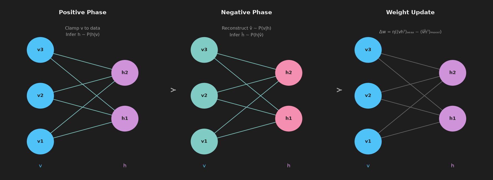
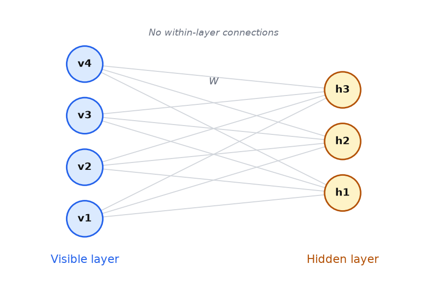

# 16 — Boltzmann Machine and Restricted Boltzmann Machine

---

## Part 1: Stochastic Neurons and Temperature

**Note 08** introduced the Boltzmann machine as an energy-based model with visible and hidden units. The neurons there were described as stochastic — they fire probabilistically rather than deterministically. This part makes that precise.

### Why Stochastic Neurons

A deterministic neuron always produces the same output for the same input. This is useful for prediction, but it is a poor model of uncertainty. A generative model — one that learns a probability distribution over data — needs neurons that can represent uncertainty: sometimes firing, sometimes not, with a probability that reflects how strongly the evidence supports activation.

A **stochastic binary neuron** fires (outputs 1) with a probability that depends on its net input:

$$P(s_i = 1) = \sigma(\text{net}_i) = \frac{1}{1 + e^{-\text{net}_i}}$$

Where $\text{net}_i = \sum_j w_{ij} s_j + b_i$ is the weighted sum of inputs plus bias. This is the sigmoid function — the same one used as a deterministic activation in feedforward networks, but here interpreted as a probability.

### Temperature

The **temperature parameter T** controls how sharply the probability responds to the net input:

$$P(s_i = 1) = \sigma\!\left(\frac{\text{net}_i}{T}\right) = \frac{1}{1 + e^{-\text{net}_i / T}}$$

```
T → 0:   σ(netᵢ / T) → step function
         → neuron fires deterministically when netᵢ > 0, silent when netᵢ < 0
         → the network settles into a single fixed state

T → ∞:   σ(netᵢ / T) → 0.5 for all netᵢ
         → neuron fires randomly with probability 0.5 regardless of input
         → the network explores states uniformly

T = 1:   standard sigmoid — intermediate stochasticity
```

Temperature comes from statistical physics, where it controls the tendency of a physical system to explore high-energy states. At low temperature, a physical system settles into its lowest-energy configuration. At high temperature, thermal fluctuations allow it to explore freely. The Boltzmann machine borrows this analogy directly.

> Temperature controls the exploration-exploitation tradeoff in the network's state space. High temperature explores broadly; low temperature exploits the current energy landscape. Training typically uses $T = 1$ and anneals toward lower $T$ to find stable configurations.

---

## Part 2: The Boltzmann Distribution

### Energy Function

The energy of a state $s = (s_1, s_2, \ldots, s_n)$ in a Boltzmann machine is:

$$E(s) = -\sum_{i<j} w_{ij} s_i s_j - \sum_i b_i s_i$$

Where $w_{ij}$ is the symmetric weight between units $i$ and $j$ ($w_{ij} = w_{ji}$, no self-connections), and $b_i$ is the bias of unit $i$. Lower energy means a more preferred configuration.

For a network with visible units $v$ and hidden units $h$, the energy is:

$$E(v, h) = -\sum_{ij} w_{ij} v_i h_j - \sum_i a_i v_i - \sum_j b_j h_j$$

Where $a_i$ are visible biases and $b_j$ are hidden biases.

### Deriving the Boltzmann Distribution

The probability of the network being in state $s$ is proportional to $e^{-E(s)/T}$. This is the **Boltzmann distribution** from statistical physics:

$$P(s) = \frac{e^{-E(s)/T}}{Z}$$

Where $Z$ is the **partition function** — the sum over all possible states, ensuring probabilities sum to 1:

$$Z = \sum_s e^{-E(s)/T}$$

**Why this form?** The Boltzmann distribution is the unique distribution that maximises entropy subject to a fixed expected energy. It assigns higher probability to lower-energy states, with the sharpness of that preference controlled by $T$.

At $T = 1$:

$$P(s) = \frac{e^{-E(s)}}{Z}$$

Lower energy → larger $e^{-E(s)}$ → higher probability. The network naturally favours low-energy states.

### Worked Example

A small network: 2 visible units (v₁, v₂), 1 hidden unit (h₁). Weights: w₁₁ = 1.0 (v₁–h₁), w₂₁ = 0.5 (v₂–h₁). All biases = 0. T = 1.

There are 2³ = 8 possible states. Computing energy for each:

```
E(v, h) = −w₁₁ v₁ h₁ − w₂₁ v₂ h₁

State (v₁,v₂,h₁)    E(s)
─────────────────    ──────────────────────────────────────
(0, 0, 0)            −1.0×0×0 − 0.5×0×0 = 0.0
(0, 0, 1)            −1.0×0×1 − 0.5×0×1 = 0.0
(0, 1, 0)            −1.0×0×0 − 0.5×1×0 = 0.0
(0, 1, 1)            −1.0×0×1 − 0.5×1×1 = −0.5
(1, 0, 0)            −1.0×1×0 − 0.5×0×0 = 0.0
(1, 0, 1)            −1.0×1×1 − 0.5×0×1 = −1.0
(1, 1, 0)            −1.0×1×0 − 0.5×1×0 = 0.0
(1, 1, 1)            −1.0×1×1 − 0.5×1×1 = −1.5
```

Computing e^(−E) and Z:

```
State (v₁,v₂,h₁)    E(s)    e^(−E)
─────────────────    ──────  ──────────
(0, 0, 0)            0.0     1.0000
(0, 0, 1)            0.0     1.0000
(0, 1, 0)            0.0     1.0000
(0, 1, 1)           −0.5     1.6487
(1, 0, 0)            0.0     1.0000
(1, 0, 1)           −1.0     2.7183
(1, 1, 0)            0.0     1.0000
(1, 1, 1)           −1.5     4.4817

Z = 1.0 + 1.0 + 1.0 + 1.6487 + 1.0 + 2.7183 + 1.0 + 4.4817 = 13.8487
```

Probabilities:

```
P(1,1,1) = 4.4817 / 13.8487 = 0.3236   ← most probable — lowest energy
P(1,0,1) = 2.7183 / 13.8487 = 0.1963
P(0,1,1) = 1.6487 / 13.8487 = 0.1190
P(others) = 1.0 / 13.8487   = 0.0722 each
```

The state where all units are active (v₁=1, v₂=1, h₁=1) has the lowest energy and the highest probability — the network has learned to associate these units.

---

## Part 3: Visible and Hidden Units

### The Generative Model

The Boltzmann machine defines a probability distribution over its visible units by marginalising over the hidden units:

$$P(v) = \sum_h P(v, h) = \frac{\sum_h e^{-E(v,h)}}{Z}$$

This is the model's distribution over data. The goal of learning is to adjust the weights so that P(v) matches the empirical distribution of the training data — the network should assign high probability to configurations that look like training examples and low probability to configurations that do not.

### What Hidden Units Do

The visible units represent the data — pixel values, binary features, observed variables. The hidden units represent **latent features** — internal structure that the network discovers to explain the data.

```
Example: learning from binary images of handwritten digits

Visible units:   pixel values (observed)
Hidden units:    stroke detectors, curve detectors, loop detectors
                 (discovered — not specified by the designer)
```

Hidden units allow the model to capture statistical dependencies between visible units that cannot be represented by direct visible-to-visible connections alone. Two visible units that are never directly connected can still be correlated through a shared hidden unit that responds to both.

> The hidden units are the mechanism by which the Boltzmann machine models complex, multi-modal distributions. Without them, the model can only capture pairwise correlations between visible units. With them, it can capture higher-order structure.

### Conditional Distributions

Given the visible units, the probability that hidden unit $j$ is active is:

$$P(h_j = 1 \mid v) = \sigma\!\left(\sum_i w_{ij} v_i + b_j\right)$$

This follows directly from the energy function — fixing $v$, the energy is linear in $h_j$, which gives a sigmoid conditional.

Similarly, given the hidden units:

$$P(v_i = 1 \mid h) = \sigma\!\left(\sum_j w_{ij} h_j + a_i\right)$$

In a fully connected Boltzmann machine, these conditionals are not independent across units — computing $P(h|v)$ requires knowing the states of all other hidden units simultaneously, which makes inference intractable.

---

## Part 4: Contrastive Hebbian Learning

### The Learning Objective

The goal is to maximise the log-likelihood of the training data under the model:

$$\log P(v) = \log \sum_h e^{-E(v,h)} - \log Z$$

Taking the gradient with respect to a weight $w_{ij}$:

$$\frac{\partial \log P(v)}{\partial w_{ij}} = \langle v_i h_j \rangle_{\text{data}} - \langle v_i h_j \rangle_{\text{model}}$$

Where:
- $\langle v_i h_j \rangle_{\text{data}}$ = expected co-activation of $v_i$ and $h_j$ when $v$ is clamped to training data
- $\langle v_i h_j \rangle_{\text{model}}$ = expected co-activation when the network runs freely

The weight update is:

$$\Delta w_{ij} = \eta \left( \langle v_i h_j \rangle_{\text{data}} - \langle v_i h_j \rangle_{\text{model}} \right)$$

This is **contrastive Hebbian learning** — a difference of two Hebbian terms.

### The Two Phases

**Positive phase** — clamp visible units to a training example, let hidden units settle to equilibrium:

```
v is fixed to training data
Hidden units update stochastically until equilibrium
Measure <v_i h_j>_data — the co-activation statistics under the data
```

The positive phase strengthens connections between units that co-activate when the data is present.

**Negative phase** — release the visible units, let the entire network run freely to equilibrium:

```
All units update freely — no clamping
Network samples from its own distribution P(v, h)
Measure <v_i h_j>_model — the co-activation statistics under the model
```

The negative phase weakens connections between units that co-activate in the model's fantasy — configurations the model currently over-represents.

The diagram below shows the two phases and the weight update that follows.



### Intuition

```
<v_i h_j>_data > <v_i h_j>_model:
  v_i and h_j co-activate more in the data than the model predicts
  → increase w_ij — make this co-activation more probable

<v_i h_j>_data < <v_i h_j>_model:
  v_i and h_j co-activate more in the model than in the data
  → decrease w_ij — suppress this spurious co-activation
```

### Worked Example

A network with 2 visible units and 1 hidden unit. Weights: w₁₁ = 0.5, w₂₁ = 0.3. Biases all 0. η = 0.1.

**Training example:** v = (1, 0).

**Positive phase** — clamp $v = (1, 0)$, compute $P(h_1 = 1 \mid v)$:

$$\text{net}_{h_1} = w_{11} \times v_1 + w_{21} \times v_2 = 0.5 \times 1 + 0.3 \times 0 = 0.5$$

$$P(h_1 = 1 \mid v) = \sigma(0.5) = \frac{1}{1 + e^{-0.5}} = 0.6225$$

$$\langle v_1 h_1 \rangle_{\text{data}} = v_1 \times P(h_1{=}1|v) = 1 \times 0.6225 = 0.6225$$

$$\langle v_2 h_1 \rangle_{\text{data}} = v_2 \times P(h_1{=}1|v) = 0 \times 0.6225 = 0.0000$$

**Negative phase** — reconstruct v̂ from h₁, then re-infer h̃₁.

Sample $h_1 \sim P(h_1{=}1|v) = 0.6225$. Use the expectation directly (mean-field approximation):

$$h_1 \approx 0.6225$$

$$P(v_1{=}1 \mid h_1) = \sigma(w_{11} \times h_1) = \sigma(0.5 \times 0.6225) = \sigma(0.3113) = 0.5771$$

$$P(v_2{=}1 \mid h_1) = \sigma(w_{21} \times h_1) = \sigma(0.3 \times 0.6225) = \sigma(0.1868) = 0.5466$$

$$\text{net}_{\tilde{h}_1} = w_{11} \times P(v_1{=}1|h_1) + w_{21} \times P(v_2{=}1|h_1) = 0.5 \times 0.5771 + 0.3 \times 0.5466 = 0.2886 + 0.1640 = 0.4526$$

$$P(\tilde{h}_1{=}1 \mid \hat{v}) = \sigma(0.4526) = 0.6113$$

$$\langle v_1 h_1 \rangle_{\text{model}} = P(v_1{=}1|h_1) \times P(\tilde{h}_1{=}1|\hat{v}) = 0.5771 \times 0.6113 = 0.3528$$

$$\langle v_2 h_1 \rangle_{\text{model}} = P(v_2{=}1|h_1) \times P(\tilde{h}_1{=}1|\hat{v}) = 0.5466 \times 0.6113 = 0.3341$$

**Weight updates:**

$$\Delta w_{11} = 0.1 \times (0.6225 - 0.3528) = 0.1 \times 0.2697 = 0.0270$$

$$\Delta w_{21} = 0.1 \times (0.0000 - 0.3341) = 0.1 \times (-0.3341) = -0.0334$$

$$w_{11} \leftarrow 0.5 + 0.0270 = 0.5270 \qquad w_{21} \leftarrow 0.3 - 0.0334 = 0.2666$$

w₁₁ increased — the connection between v₁ and h₁ strengthened because v₁ was active in the data. w₂₁ decreased — the model was over-representing the v₂–h₁ co-activation relative to the data.

### Why the Full Boltzmann Machine Is Intractable

The negative phase requires computing ⟨vᵢ hⱼ⟩_model — the expected co-activation under the model's distribution. This requires sampling from P(v, h), which requires running Gibbs sampling until the network reaches thermal equilibrium.

In a fully connected Boltzmann machine, the hidden units are not conditionally independent given v — each hidden unit's state depends on all other hidden units. Gibbs sampling must update one unit at a time, and convergence to equilibrium can require an exponential number of steps for large networks.

This intractability is what motivated the Restricted Boltzmann Machine.

---

## Part 5: Restricted Boltzmann Machine

### The Restriction

A **Restricted Boltzmann Machine (RBM)** removes all connections within the visible layer and all connections within the hidden layer. Only visible-to-hidden connections remain.

The diagram below shows the RBM architecture — a bipartite graph with no within-layer connections.



The energy function simplifies to:

$$E(v, h) = -\sum_{ij} w_{ij} v_i h_j - \sum_i a_i v_i - \sum_j b_j h_j$$

This is the same form as the full Boltzmann machine, but now there are no $h_i h_j$ or $v_i v_j$ terms.

### Conditional Independence

The restriction has a critical consequence. Given the visible units, the hidden units are **conditionally independent** of each other:

$$P(h \mid v) = \prod_j P(h_j \mid v)$$

Because there are no hidden-to-hidden connections, knowing $v$ tells you everything about each $h_j$ independently — no hidden unit's state depends on any other hidden unit's state.

Similarly, given the hidden units, the visible units are conditionally independent:

$$P(v \mid h) = \prod_i P(v_i \mid h)$$

The conditional probabilities are:

$$P(h_j = 1 \mid v) = \sigma\!\left(\sum_i w_{ij} v_i + b_j\right)$$

$$P(v_i = 1 \mid h) = \sigma\!\left(\sum_j w_{ij} h_j + a_i\right)$$

### Contrastive Divergence (CD-k)

Conditional independence makes the positive phase exact — all hidden units can be sampled simultaneously given v. The negative phase is still intractable in principle, but the RBM structure allows an efficient approximation: **Contrastive Divergence**.

Instead of running Gibbs sampling to equilibrium, CD-k runs only k steps:

```
CD-k algorithm for one training example v⁽⁰⁾:

1. Positive phase:
   Sample h⁽⁰⁾ ~ P(h | v⁽⁰⁾)          ← all hidden units in parallel

2. k Gibbs steps:
   Sample v⁽¹⁾ ~ P(v | h⁽⁰⁾)          ← reconstruct visible
   Sample h⁽¹⁾ ~ P(h | v⁽¹⁾)          ← re-infer hidden
   ... repeat k times ...

3. Weight update using k-step approximation:
   Δw_ij = η × (v_i^(0) h_j^(0) − v_i^(k) h_j^(k))
```

**CD-1** (k = 1) is the standard in practice — one Gibbs step is sufficient for useful learning, even though it is a rough approximation of the true gradient. The approximation works because the reconstructed v⁽¹⁾ is already close to the data distribution after one step, so the negative phase statistics are a reasonable estimate of ⟨vᵢ hⱼ⟩_model.

> CD-1 is not gradient descent on the log-likelihood — it is an approximation that works well in practice. The theoretical justification is that it minimises a different objective (contrastive divergence) that is correlated with the log-likelihood gradient near the data distribution.

### Bias Updates

The bias updates follow the same contrastive structure:

$$\Delta a_i = \eta \left( v_i^{(0)} - v_i^{(1)} \right) \qquad \Delta b_j = \eta \left( h_j^{(0)} - h_j^{(1)} \right)$$

---

## Part 6: Deep Belief Networks

### The Problem RBMs Solved

Before 2006, training deep networks was practically impossible. Backpropagation through many layers caused vanishing gradients — the signal reaching early layers was too small to produce useful weight updates. Networks with more than two or three layers rarely trained successfully.

The RBM provided a solution: **greedy layer-wise pre-training**.

### Greedy Layer-Wise Pre-Training

A **Deep Belief Network (DBN)** is a stack of RBMs. It is built one layer at a time:

```
Step 1:  Train RBM₁ on the raw training data v
         RBM₁ learns to model P(v) using hidden layer h⁽¹⁾

Step 2:  Freeze RBM₁
         Use the hidden activations h⁽¹⁾ = P(h⁽¹⁾=1 | v) as the new "data"
         Train RBM₂ on h⁽¹⁾
         RBM₂ learns to model P(h⁽¹⁾) using hidden layer h⁽²⁾

Step 3:  Freeze RBM₂
         Use h⁽²⁾ as the new "data"
         Train RBM₃ on h⁽²⁾
         ...

Repeat for as many layers as desired.
```

Each RBM learns a higher-level representation of the layer below it. The first RBM learns features of the raw data. The second learns features of features. The third learns features of features of features — a hierarchy of abstractions, built one layer at a time.

### Fine-Tuning

After pre-training, the stacked RBMs form the initial weights of a deep network. A classification layer is added on top and the entire network is fine-tuned end-to-end with backpropagation:

```
Pre-training:   each RBM trained greedily, one layer at a time
                → gives each layer a good starting point
                → early layers already encode useful features

Fine-tuning:    backpropagation through the full network
                → adjusts all weights jointly for the classification task
                → starts from a good initialisation, so gradients are useful
```

The pre-training solved the vanishing gradient problem not by fixing backpropagation, but by bypassing it — each layer was initialised to a useful representation before backpropagation was applied. By the time fine-tuning began, the gradients had something meaningful to work with.

### Historical Significance and Modern Context

The 2006 paper by Hinton, Osindero, and Teh ("A Fast Learning Algorithm for Deep Belief Nets") demonstrated that deep networks could be trained effectively using this approach. It reignited interest in deep learning after more than a decade of stagnation.

```
What DBNs contributed:
  1. Proof of concept — deep networks can learn useful hierarchical representations
  2. Greedy pre-training — a practical method for initialising deep networks
  3. Generative modelling — networks that model P(v), not just P(y|v)

Why DBNs are no longer the standard:
  1. Better initialisation (He, Xavier) — Note 10
  2. Batch normalisation — Note 11
  3. ReLU activations — Note 04
  4. These advances made deep networks trainable without pre-training
```

> DBNs are not widely used in modern practice, but they are conceptually important. They demonstrated that depth is learnable, introduced the idea of unsupervised pre-training, and established the generative modelling perspective that underlies VAEs, GANs, and diffusion models.

---

## Summary

Key takeaways:

- Stochastic neurons fire with probability $P(s_i=1) = \sigma(\text{net}_i/T)$ — temperature $T$ controls sharpness: $T \to 0$ is deterministic, $T \to \infty$ is uniform random
- The Boltzmann distribution $P(s) = e^{-E(s)/T} / Z$ assigns higher probability to lower-energy states; the partition function $Z$ sums over all states to normalise
- Visible units represent observed data; hidden units represent latent features the network discovers to explain statistical structure in the data
- Contrastive Hebbian learning: $\Delta w_{ij} = \eta(\langle v_i h_j \rangle_{\text{data}} - \langle v_i h_j \rangle_{\text{model}})$ — the positive phase measures co-activation under data, the negative phase measures co-activation under the model's own distribution
- The full Boltzmann machine is intractable — the negative phase requires Gibbs sampling to equilibrium, which is exponentially slow for large networks
- The RBM removes within-layer connections, making hidden units conditionally independent given visible units (and vice versa) — this makes the positive phase exact and enables the CD-k approximation
- CD-1 runs one Gibbs step to approximate the negative phase — sufficient in practice despite being a rough approximation of the true gradient
- A Deep Belief Network stacks RBMs trained greedily layer by layer — each layer learns features of the layer below, giving the full network a good initialisation before fine-tuning with backpropagation
- DBNs solved the vanishing gradient problem through pre-training rather than fixing backpropagation; modern initialisation and batch normalisation have since made pre-training unnecessary
