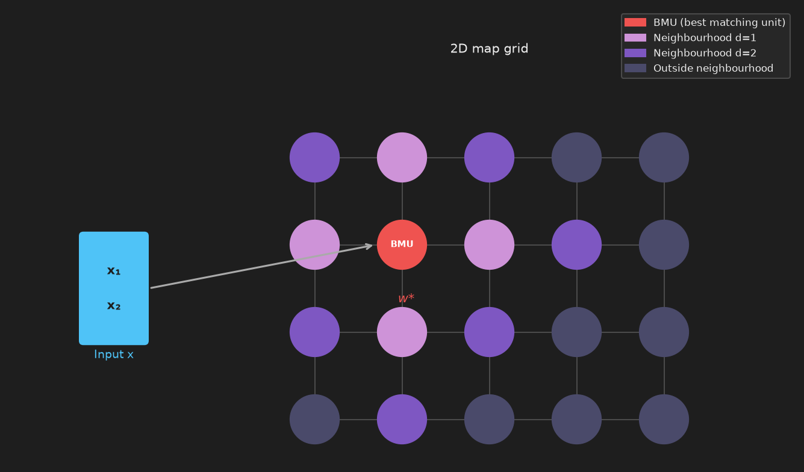
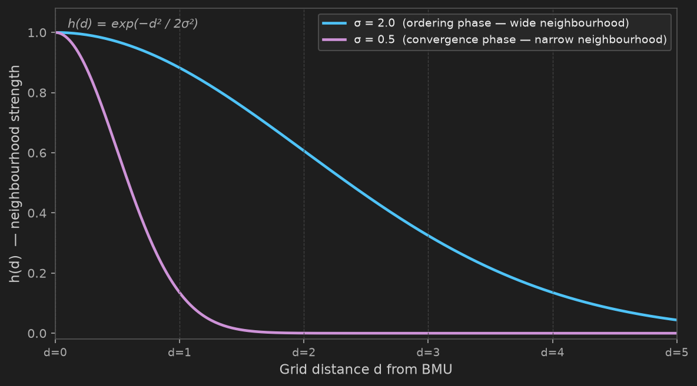

# 17 — Kohonen's Self-Organising Map

---

## Part 1: The Problem — Topology-Preserving Dimensionality Reduction

High-dimensional data has structure. Inputs that are similar in the original space should be represented as similar in any useful summary of that space. The challenge is to reduce dimensionality while preserving this structure — not just compressing the data, but preserving the relationships between points.

**Note 08** introduced competitive learning: a winner-takes-all rule where the neuron closest to an input updates its weights toward that input. Over many examples, neurons converge to cluster centroids. This is useful, but it discards all neighbourhood information. Two neurons that win on similar inputs may end up anywhere in the output layer — there is no guarantee that similar inputs map to nearby neurons.

The **Self-Organising Map (SOM)**, introduced by Teuvo Kohonen in 1982, extends competitive learning with one additional constraint: **neurons that are close on the map should respond to similar inputs**. The map is not just a set of prototypes — it is a topology-preserving projection of the input space onto a low-dimensional grid.

```
Competitive learning:   input → nearest neuron wins → neuron updates
                        No constraint on which neurons are near each other

SOM:                    input → nearest neuron wins → BMU and neighbours update
                        Nearby neurons on the map learn similar weight vectors
                        → topology of input space is preserved in the map
```

> The SOM does not just cluster data — it organises the clusters. The spatial arrangement of neurons on the map reflects the structure of the input space. Inputs that are close in the original high-dimensional space map to neurons that are close on the 2D grid.

---

## Part 2: SOM Architecture

A SOM has two layers:

```
Input layer:    n neurons — one per input feature
                No weights, no computation — just passes the input vector x ∈ ℝⁿ

Map layer:      a grid of N neurons arranged in a 2D lattice (or 1D line)
                Each neuron j has:
                  - a position rⱼ on the grid (e.g. (row, col))
                  - a weight vector wⱼ ∈ ℝⁿ — same dimension as the input
```

Every input neuron connects to every map neuron. There are no connections between map neurons — the grid topology is used only to define neighbourhood relationships, not to pass activations.

The diagram below shows a 4×5 map grid receiving a 2D input vector. The BMU is highlighted in red; its immediate neighbours are shown in decreasing intensity.



The weight vector wⱼ of each map neuron acts as a **prototype** — a representative point in the input space. After training, the weight vectors tile the input space, with nearby neurons holding similar weight vectors.

```
Before training:   weight vectors are random — no organisation
After training:    weight vectors form a smooth map of the input space
                   — nearby neurons have similar weight vectors
                   — the map reflects the topology of the data distribution
```

---

## Part 3: Winner-Takes-All — The Best Matching Unit

For each input x, the **Best Matching Unit (BMU)** is the map neuron whose weight vector is closest to x:

```
j* = argmin_j ‖x − wⱼ‖
```

The distance is Euclidean. The BMU is the neuron that best represents the current input — the one whose prototype is most similar to x.

### Worked Example

A 1D map of 3 neurons (j=1, j=2, j=3) with 2D weight vectors. Input x = (0.7, 0.4).

```
w₁ = (0.2, 0.8)
w₂ = (0.6, 0.3)
w₃ = (0.9, 0.1)

‖x − w₁‖ = √((0.7−0.2)² + (0.4−0.8)²) = √(0.25 + 0.16) = √0.41 = 0.6403
‖x − w₂‖ = √((0.7−0.6)² + (0.4−0.3)²) = √(0.01 + 0.01) = √0.02 = 0.1414
‖x − w₃‖ = √((0.7−0.9)² + (0.4−0.1)²) = √(0.04 + 0.09) = √0.13 = 0.3606
```

Neuron j=2 is closest — it is the BMU for this input.

---

## Part 4: Neighbourhood Function and Weight Update

Competitive learning updates only the BMU. The SOM updates the BMU **and its neighbours**, with the update magnitude decreasing with distance from the BMU on the map grid.

### Neighbourhood Function

The **Gaussian neighbourhood function** h(j, j*) gives the update strength for neuron j when the BMU is j*:

```
h(j, j*) = exp(−d(j, j*)² / 2σ²)
```

Where d(j, j*) is the grid distance between neuron j and the BMU j*, and σ is the neighbourhood radius.

```
j = j*:   d = 0  →  h = exp(0) = 1.0        ← BMU gets full update
d = 1:              h = exp(−1/2σ²)          ← immediate neighbours
d = 2:              h = exp(−4/2σ²)          ← further neighbours
d → ∞:              h → 0                    ← distant neurons unaffected
```

The plot below shows h(d) as a function of grid distance for two values of σ — wide during the ordering phase and narrow during the convergence phase.



### Weight Update Rule

For each input x, after finding the BMU j*, update every neuron j:

```
Δwⱼ = η · h(j, j*) · (x − wⱼ)
wⱼ ← wⱼ + Δwⱼ
```

Where η is the learning rate. The update moves wⱼ toward x, scaled by both η and h(j, j*). The BMU moves the most; neurons far from the BMU move very little or not at all.

### Worked Example

Continuing from Part 3. BMU is j=2. σ = 1.5, η = 0.5. Grid distances: d(1,2)=1, d(2,2)=0, d(3,2)=1.

**Neighbourhood strengths:**

```
h(1, 2) = exp(−1² / (2 × 1.5²)) = exp(−1/4.5) = exp(−0.2222) = 0.8007
h(2, 2) = exp(−0² / (2 × 1.5²)) = exp(0)      = 1.0000
h(3, 2) = exp(−1² / (2 × 1.5²)) = exp(−0.2222) = 0.8007
```

**Weight updates** (x = (0.7, 0.4)):

```
Δw₁ = 0.5 × 0.8007 × ((0.7, 0.4) − (0.2, 0.8))
     = 0.5 × 0.8007 × (0.5, −0.4)
     = (0.2002, −0.1601)

w₁ ← (0.2 + 0.2002, 0.8 − 0.1601) = (0.4002, 0.6399)

Δw₂ = 0.5 × 1.0000 × ((0.7, 0.4) − (0.6, 0.3))
     = 0.5 × 1.0000 × (0.1, 0.1)
     = (0.0500, 0.0500)

w₂ ← (0.6 + 0.0500, 0.3 + 0.0500) = (0.6500, 0.3500)

Δw₃ = 0.5 × 0.8007 × ((0.7, 0.4) − (0.9, 0.1))
     = 0.5 × 0.8007 × (−0.2, 0.3)
     = (−0.0801, 0.1201)

w₃ ← (0.9 − 0.0801, 0.1 + 0.1201) = (0.8199, 0.2201)
```

All three neurons moved toward x = (0.7, 0.4). The BMU (j=2) moved the most. Neurons j=1 and j=3 moved less, scaled by h = 0.8007. After many such updates, the weight vectors will organise so that j=1, j=2, j=3 represent a smooth progression across the input space.

---

## Part 5: Learning Rate and Neighbourhood Decay

A fixed η and σ throughout training produces poor results. Large σ is needed early to allow global reorganisation — neurons can move far from their initial positions to find their correct place in the map. Large η is needed to make this reorganisation fast. But large σ and η late in training prevent fine-grained convergence — the map never settles.

The solution is to decay both parameters over time.

### Exponential Decay

Both η and σ decay exponentially from their initial values to their final values over T total training steps:

```
η(t) = η₀ · exp(−t / τ_η)

σ(t) = σ₀ · exp(−t / τ_σ)
```

Where t is the current training step, and τ_η, τ_σ are time constants controlling the decay rate. A common choice is τ = T / log(σ₀) for σ, so that σ decays to approximately 1 by the end of training.

### The Two Phases

```
Ordering phase (early training):
  η large (e.g. 0.5–1.0),  σ large (covers most of the map)
  → BMU and most of the map update together
  → global topology forms — the map unfolds and organises
  → neurons find their approximate correct region

Convergence phase (late training):
  η small (e.g. 0.01–0.05),  σ small (covers only immediate neighbours)
  → only the BMU and its closest neighbours update
  → fine-grained tuning — weight vectors converge to precise prototypes
  → map stabilises
```

Both phases are necessary. Without the ordering phase, the map may never unfold — neurons stay tangled in their initial random configuration. Without the convergence phase, the map never settles to stable prototypes.

> The ordering phase gives the map its global structure. The convergence phase gives it precision. Skipping either produces a map that is either tangled or imprecise.

---

## Part 6: What a Trained SOM Represents

### Topographic Map of the Input Space

After training, the SOM is a **topographic map** — a 2D projection of the input space that preserves topology. Inputs that are close in the original high-dimensional space map to neurons that are close on the 2D grid.

```
Input space:   high-dimensional, complex structure
Map grid:      2D, simple — but topology is preserved

If x₁ ≈ x₂ in input space  →  j*(x₁) ≈ j*(x₂) on the map
```

This is the key property that distinguishes the SOM from k-means or competitive learning. K-means assigns inputs to clusters but the cluster labels are arbitrary — cluster 3 is not necessarily near cluster 4. In a SOM, the spatial arrangement of neurons is meaningful.

### The U-Matrix

The **U-matrix** (Unified Distance Matrix) visualises the distances between adjacent neuron weight vectors on the map:

```
U(j) = average of ‖wⱼ − wₖ‖ for all immediate neighbours k of j
```

High U-matrix values between two neurons indicate a large gap in weight space — a cluster boundary. Low values indicate a smooth transition — neurons in the same cluster.

```
U-matrix interpretation:
  Dark regions (high distance):   cluster boundaries
  Light regions (low distance):   within-cluster areas
```

The U-matrix turns the SOM into a visualisation tool: the map shows not just where inputs land, but where the natural boundaries between groups are.

### Practical Uses

```
Visualisation:           project high-dimensional data onto a 2D map
                         — see structure that is invisible in the original space

Clustering:              neurons that win on similar inputs form regions
                         — U-matrix reveals the boundaries

Dimensionality reduction: use the BMU index as a low-dimensional representation
                          — preserves topology unlike PCA (which preserves variance)

Anomaly detection:        inputs that activate neurons far from their usual region
                          — or that produce high reconstruction error — are anomalies
```

---

## Summary

Key takeaways:

- The SOM extends competitive learning with a topology-preserving constraint — nearby neurons on the map learn to respond to similar inputs, so the map reflects the structure of the input space
- Each map neuron has a weight vector (prototype) of the same dimension as the input; the BMU is the neuron whose weight vector is closest to the current input: j* = argmin_j ‖x − wⱼ‖
- The Gaussian neighbourhood function h(j, j*) = exp(−d² / 2σ²) scales the update for each neuron by its grid distance from the BMU — the BMU gets a full update, neighbours get partial updates, distant neurons are unaffected
- The weight update rule Δwⱼ = η · h(j, j*) · (x − wⱼ) moves every neuron toward the input, scaled by neighbourhood strength
- Both η and σ decay exponentially over training — the ordering phase (large η, large σ) establishes global topology; the convergence phase (small η, small σ) refines local precision
- A trained SOM is a topographic map: inputs close in the original space map to neurons close on the grid — topology is preserved, unlike k-means where cluster labels are arbitrary
- The U-matrix visualises distances between adjacent neuron weight vectors — high values mark cluster boundaries, low values mark within-cluster regions
