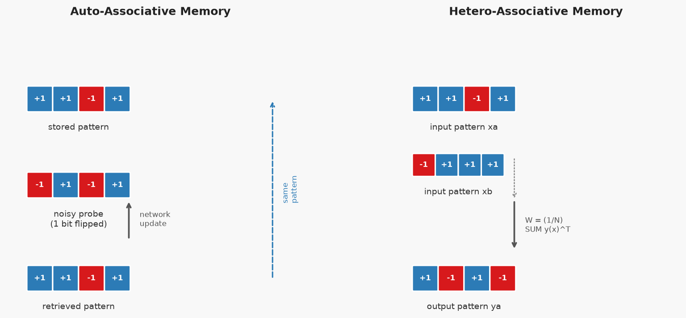
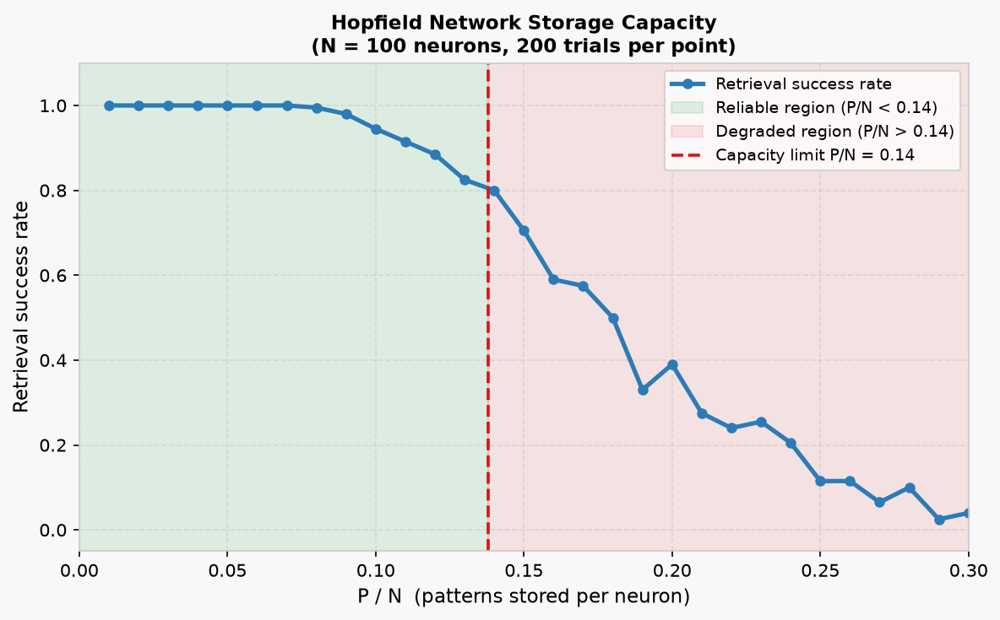

# 18 — Associative Memory

---

## Part 1: Two Kinds of Associative Memory

**Note 15** introduced the Hopfield network as a system that retrieves a stored pattern from a partial or noisy input. That is one specific form of associative memory — but the concept is broader. Before examining the mechanics, it is worth distinguishing the two fundamental types.

**Auto-associative memory** maps a pattern to itself. The input is a corrupted or incomplete version of a stored pattern, and the output is the full, clean version of that same pattern. The Hopfield network is an auto-associative memory: you present a noisy probe, and the network converges to the nearest stored pattern.

**Hetero-associative memory** maps a pattern to a different stored pattern. The input is one pattern, and the output is a paired but distinct pattern. This models associations between different objects — a name and a face, a word and its meaning, a cue and a response.

```
Auto-associative:    x_noisy  →  x_stored     (same pattern, cleaned up)

Hetero-associative:  x_a      →  y_a          (different pattern, paired at storage time)
                     x_b      →  y_b
```

The diagram below shows both types side by side: auto-associative corrects a noisy probe back to the stored pattern; hetero-associative maps an input pattern to its paired output.



Both types use the same underlying mechanism: a weight matrix constructed from stored pattern pairs using the Hebbian outer product rule. The difference is only in what is paired with what at storage time.

> In auto-associative memory, each pattern is paired with itself. In hetero-associative memory, each input pattern is paired with a distinct output pattern. The weight construction is identical — only the pairing changes.

---

## Part 2: The Hebbian Storage Rule

The weight matrix for an associative memory is built from the stored associations using the **Hebbian outer product rule**. The rule encodes co-activation: if two neurons are active together in a stored pattern, their connection is strengthened.

### Auto-Associative Storage

To store P patterns x¹, x², ..., xᴾ (each a vector of ±1 values of length N) as auto-associations:

```
W = (1/N) Σₘ xᵐ (xᵐ)ᵀ

with wᵢᵢ = 0   (zero diagonal enforced after construction)
```

Each term xᵐ(xᵐ)ᵀ is the N×N outer product of pattern m with itself. Entry (i, j) of this matrix is xᵢᵐ × xⱼᵐ — positive when neurons i and j have the same sign in pattern m, negative when they differ. Summing over all patterns accumulates these co-activation statistics across the full set of stored patterns.

The factor 1/N normalises by network size so that the signal-to-noise ratio (Part 4) scales predictably with N.

### Worked Example — Auto-Associative Storage

Store two patterns of length N = 4:

```
x¹ = (+1, +1, −1, +1)
x² = (−1, +1, +1, +1)
```

Note that x¹ · x² = (1)(−1) + (1)(1) + (−1)(1) + (1)(1) = 0. The patterns are orthogonal — this minimises crosstalk (Part 4).

**Step 1 — Outer product for x¹:**

```
x¹(x¹)ᵀ =  [ +1  +1  −1  +1 ]
            [ +1  +1  −1  +1 ]
            [ −1  −1  +1  −1 ]
            [ +1  +1  −1  +1 ]
```

**Step 2 — Outer product for x²:**

```
x²(x²)ᵀ =  [ +1  −1  −1  −1 ]
            [ −1  +1  +1  +1 ]
            [ −1  +1  +1  +1 ]
            [ −1  +1  +1  +1 ]
```

**Step 3 — Sum and scale by 1/N = 1/4:**

```
x¹(x¹)ᵀ + x²(x²)ᵀ =  [ +2   0  −2   0 ]
                       [  0  +2   0  +2 ]
                       [ −2   0  +2   0 ]
                       [  0  +2   0  +2 ]

W = (1/4) × above =   [ 0.5   0   −0.5   0  ]
                       [  0   0.5    0   0.5 ]
                       [−0.5   0    0.5   0  ]
                       [  0   0.5    0   0.5 ]
```

**Step 4 — Zero the diagonal:**

The diagonal of each outer product xᵐ(xᵐ)ᵀ is always all-ones (since (±1)² = 1). After summing and scaling, the diagonal is 0.5, 0.5, 0.5, 0.5. Set these to zero:

```
W =  [  0     0   −0.5   0  ]
     [  0     0     0   0.5 ]
     [ −0.5   0     0    0  ]
     [  0    0.5    0    0  ]
```

This is the weight matrix that stores both patterns as stable attractors.

---

## Part 3: Retrieval Dynamics

Once the weight matrix is constructed, retrieval proceeds by the same asynchronous update rule used in the Hopfield network (**Note 15**, Part 2):

```
netᵢ = Σⱼ wᵢⱼ sⱼ

         +1   if netᵢ ≥ 0
sᵢ  ←  {
         −1   if netᵢ < 0
```

Neurons update one at a time. Each update either decreases the energy or leaves it unchanged. The network converges to a local energy minimum — a stored pattern (or a spurious state, discussed in Part 4).

### Why Stored Patterns Are Fixed Points

A stored pattern xᵐ is a fixed point of the update rule if, for every neuron i:

```
sign(netᵢ) = xᵢᵐ
```

Substituting the weight matrix W = (1/N) Σₖ xᵏ(xᵏ)ᵀ (diagonal zeroed):

```
netᵢ = Σⱼ wᵢⱼ xⱼᵐ
     = (1/N) Σⱼ Σₖ xᵢᵏ xⱼᵏ xⱼᵐ   (j ≠ i)
     = (1/N) Σₖ xᵢᵏ (Σⱼ xⱼᵏ xⱼᵐ)
     = (1/N) Σₖ xᵢᵏ (xᵏ · xᵐ)
```

For the target pattern k = m, the dot product xᵐ · xᵐ = N (since each component is ±1). This gives a **signal term**:

```
Signal:   (1/N) × xᵢᵐ × N = xᵢᵐ
```

For all other patterns k ≠ m, the dot products xᵏ · xᵐ are the **crosstalk terms** — interference from the other stored patterns. If the patterns are orthogonal, these terms are zero and retrieval is exact. In general, they are small but nonzero.

> The signal term always points in the direction of the stored pattern. The crosstalk terms are noise from the other stored patterns. Retrieval succeeds when the signal dominates the crosstalk — which holds when P is small relative to N.

### Worked Example — Retrieval

Using the weight matrix from Part 2, retrieve x¹ = (+1, +1, −1, +1) from a noisy probe with s₁ flipped:

```
probe = (−1, +1, −1, +1)   ← x¹ with s₁ flipped from +1 to −1
```

Asynchronous update, neurons in order 1 → 4:

```
Neuron 1:  net₁ = w₁₂s₂ + w₁₃s₃ + w₁₄s₄
                = (0)(+1) + (−0.5)(−1) + (0)(+1)
                = 0.5 > 0   →   s₁ → +1

Neuron 2:  net₂ = w₂₁s₁ + w₂₃s₃ + w₂₄s₄
                = (0)(+1) + (0)(−1) + (0.5)(+1)
                = 0.5 > 0   →   s₂ stays +1

Neuron 3:  net₃ = w₃₁s₁ + w₃₂s₂ + w₃₄s₄
                = (−0.5)(+1) + (0)(+1) + (0)(+1)
                = −0.5 < 0  →   s₃ stays −1

Neuron 4:  net₄ = w₄₁s₁ + w₄₂s₂ + w₄₃s₃
                = (0)(+1) + (0.5)(+1) + (0)(−1)
                = 0.5 > 0   →   s₄ stays +1
```

After one pass: s = (+1, +1, −1, +1) = x¹ ✓

The network recovered the stored pattern in a single update pass.

---

## Part 4: Performance Measures

Three quantities characterise how well an associative memory performs: storage capacity, error correction radius, and crosstalk noise.

### Storage Capacity

The maximum number of patterns that can be stored and reliably retrieved is approximately:

```
P_max ≈ 0.14 × N
```

This is the same capacity limit derived for the Hopfield network in **Note 15**. It arises from the crosstalk terms in the net input. When P is small, the crosstalk is weak and the signal dominates. As P grows, the crosstalk accumulates and eventually overwhelms the signal, causing retrieval to fail.

The diagram below shows retrieval success rate as a function of P/N for a network of N = 100 neurons. The transition near P/N = 0.14 is sharp — below it, retrieval is reliable; above it, it collapses.



### Error Correction Radius

The error correction radius is the maximum number of bit errors in the probe that the network can still correct. For a network storing P patterns with N neurons, the radius is approximately:

```
r ≈ N/2 × (1 − P/P_max)
```

When P is well below capacity (P ≪ P_max), the radius approaches N/2 — the network can correct nearly half the bits. As P approaches P_max, the radius shrinks to zero.

### Crosstalk Noise

The signal-to-noise ratio for retrieving pattern xᵐ is:

```
SNR = signal / crosstalk = N / sqrt(P − 1)
```

This follows from the signal term being xᵢᵐ (magnitude 1, scaled by N/N = 1) and the crosstalk terms being a sum of P−1 random ±1 contributions, each scaled by 1/N. By the central limit theorem, the crosstalk has standard deviation sqrt(P−1)/N, giving SNR = N/sqrt(P−1).

```
P = 1:    SNR = infinity   (no crosstalk, perfect retrieval)
P = 14:   SNR ≈ N/sqrt(13) ≈ 0.27N   (near capacity for N=100)
P = 0.14N: SNR ≈ sqrt(N/0.14) ≈ 2.7 for N=100   (marginal)
```

> The capacity limit P_max ≈ 0.14N is the point where the SNR drops below the threshold for reliable retrieval. It is not a design choice — it is a consequence of the Hebbian weight construction.

---

## Part 5: Hetero-Associative Memory

In hetero-associative memory, each input pattern xᵐ is paired with a distinct output pattern yᵐ. The weight matrix is constructed from the cross-outer products of output with input:

```
W = (1/N) Σₘ yᵐ (xᵐ)ᵀ
```

Entry (i, j) of this matrix is (1/N) Σₘ yᵢᵐ xⱼᵐ — the co-activation of output neuron i and input neuron j across all stored pairs.

Retrieval is a single forward pass — not an iterative update. Given input x, the output is:

```
y = sign(W x)
```

There is no energy function and no convergence dynamics. The hetero-associative memory is a one-shot lookup: present the input, compute the weighted sum, threshold.

### Worked Example — Hetero-Associative Storage and Retrieval

Store two input-output pairs with N = 4:

```
xᵃ = (+1, +1, −1, +1)   →   yᵃ = (+1, −1, +1, −1)
xᵇ = (−1, +1, +1, +1)   →   yᵇ = (−1, −1, +1, +1)
```

**Step 1 — Outer products yᵐ(xᵐ)ᵀ:**

```
yᵃ(xᵃ)ᵀ =  [ +1  +1  −1  +1 ]
            [ −1  −1  +1  −1 ]
            [ +1  +1  −1  +1 ]
            [ −1  −1  +1  −1 ]

yᵇ(xᵇ)ᵀ =  [ +1  −1  −1  −1 ]
            [ +1  −1  −1  −1 ]
            [ −1  +1  +1  +1 ]
            [ −1  +1  +1  +1 ]
```

**Step 2 — Sum and scale by 1/4:**

```
W = (1/4) × [ +2   0  −2   0 ]   =  [ 0.5   0   −0.5   0  ]
             [  0  −2   0  −2 ]      [  0  −0.5    0  −0.5 ]
             [  0  +2   0  +2 ]      [  0   0.5    0   0.5 ]
             [ −2   0  +2   0 ]      [−0.5   0    0.5   0  ]
```

Note: the diagonal is not zeroed for hetero-associative memory — the input and output are different vectors, so self-connections are not a concern.

**Step 3 — Retrieve yᵃ from xᵃ:**

```
net = W xᵃ = [ (0.5)(+1) + (0)(+1) + (−0.5)(−1) + (0)(+1)   ]   =  [ +1.0 ]
             [ (0)(+1) + (−0.5)(+1) + (0)(−1) + (−0.5)(+1)   ]      [ −1.0 ]
             [ (0)(+1) + (0.5)(+1) + (0)(−1) + (0.5)(+1)     ]      [ +1.0 ]
             [ (−0.5)(+1) + (0)(+1) + (0.5)(−1) + (0)(+1)    ]      [ −1.0 ]

y = sign(net) = (+1, −1, +1, −1) = yᵃ  ✓
```

**Step 4 — Retrieve yᵇ from xᵇ:**

```
net = W xᵇ = (−1.0, −1.0, +1.0, +1.0)

y = sign(net) = (−1, −1, +1, +1) = yᵇ  ✓
```

Both pairs retrieved exactly.

---

## Part 6: Relationship to Hopfield Networks and Modern Attention

### Relationship to Hopfield Networks

The Hopfield network (**Note 15**) is a special case of auto-associative memory. The differences are:

```
Hopfield network:          Auto-associative memory (general):
  Symmetric weights            Symmetric weights (same)
  No self-connections          No self-connections (same)
  Asynchronous update          Asynchronous update (same)
  Energy function              Energy function (same)
  Binary states {−1, +1}       Binary states {−1, +1} (same)
  Hebbian outer product rule   Hebbian outer product rule (same)
```

They are the same model. "Hopfield network" refers to the specific architecture and energy analysis; "auto-associative memory" refers to the functional role it plays. The capacity limit 0.14N, the spurious states, and the convergence guarantee all carry over directly.

The hetero-associative memory is a generalisation: it relaxes the constraint that input and output must be the same pattern. The weight matrix is no longer symmetric (W ≠ Wᵀ in general), so there is no energy function and no convergence dynamics — retrieval is a single matrix-vector product.

### Relationship to Modern Attention

The attention mechanism in transformers (**Note 27**) can be understood as a continuous, differentiable generalisation of hetero-associative memory.

In hetero-associative memory:

```
y = sign(W x)   where   W = (1/N) Σₘ yᵐ (xᵐ)ᵀ
```

Substituting W:

```
y = sign( (1/N) Σₘ yᵐ (xᵐ · x) )
```

The term xᵐ · x is the dot product between the stored input pattern xᵐ and the query x — a similarity score. The output is a weighted combination of stored output patterns yᵐ, where the weights are the similarity scores.

Scaled dot-product attention does exactly this, but continuously:

```
Attention(Q, K, V) = softmax( Q Kᵀ / sqrt(d) ) V
```

Here Q is the query, K are the keys (stored input patterns), V are the values (stored output patterns), and the softmax replaces the hard sign threshold with a soft weighted sum. The division by sqrt(d) is a normalisation analogous to the 1/N factor.

```
Associative memory:   hard threshold,  discrete retrieval,  exact match
Attention:            soft threshold,  continuous retrieval, weighted blend
```

> Attention is a soft, differentiable associative memory. The keys are the stored input patterns, the values are the stored output patterns, and the query is the probe. The softmax replaces the sign function, making the lookup differentiable and trainable end-to-end.

This connection was made explicit by Ramsauer et al. (2020), who showed that modern Hopfield networks with continuous states and exponential energy functions are equivalent to the attention mechanism.

---

## Summary

Key takeaways:

- Auto-associative memory maps a noisy or partial input to the same stored pattern; hetero-associative memory maps an input pattern to a paired but different output pattern
- Both use the Hebbian outer product rule: auto-associative stores W = (1/N) Σₘ xᵐ(xᵐ)ᵀ; hetero-associative stores W = (1/N) Σₘ yᵐ(xᵐ)ᵀ
- Auto-associative retrieval is iterative — asynchronous updates converge to a stored attractor via energy descent; hetero-associative retrieval is a single forward pass y = sign(Wx)
- The signal term in the net input is always xᵢᵐ (pointing toward the stored pattern); the crosstalk terms are interference from other stored patterns
- Storage capacity is approximately 0.14N patterns — the same limit as the Hopfield network — arising from the SNR dropping below the reliable retrieval threshold
- The error correction radius shrinks as P approaches capacity; orthogonal patterns minimise crosstalk and maximise capacity
- The Hopfield network is a special case of auto-associative memory — same architecture, same rule, same energy function
- Scaled dot-product attention is a continuous, differentiable generalisation of hetero-associative memory: keys are stored input patterns, values are stored output patterns, the query is the probe, and softmax replaces the sign threshold
