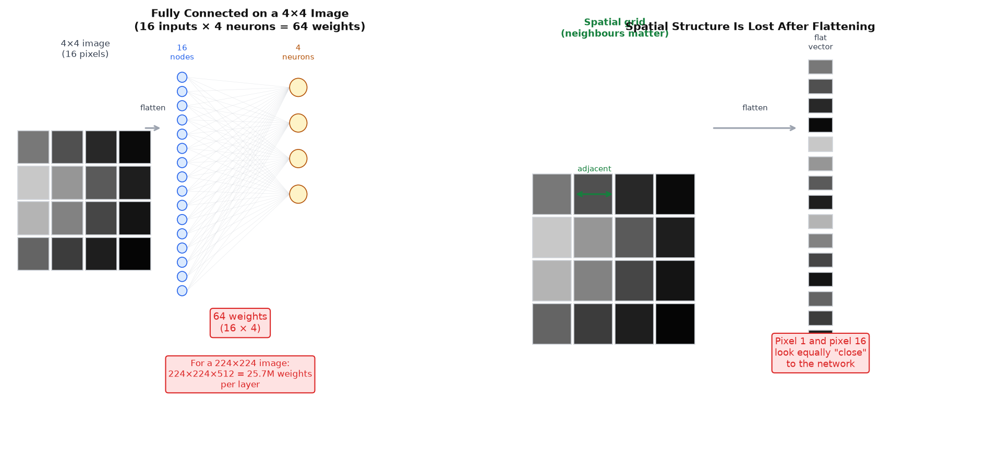
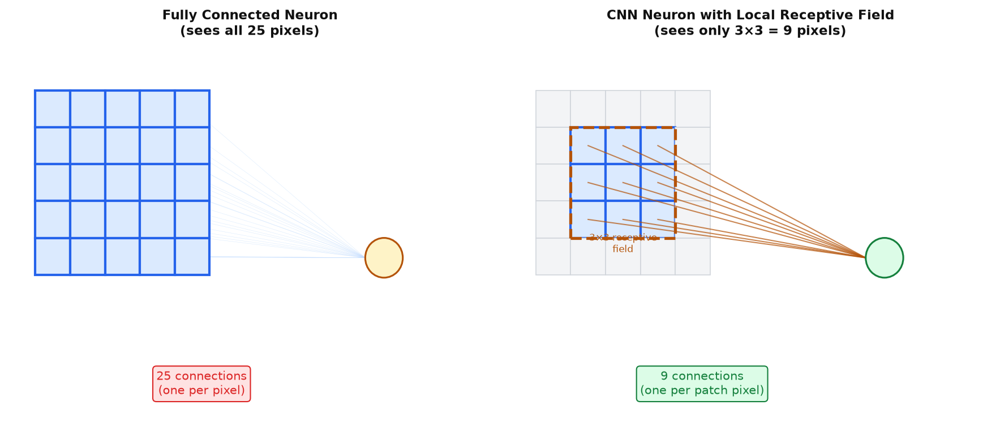
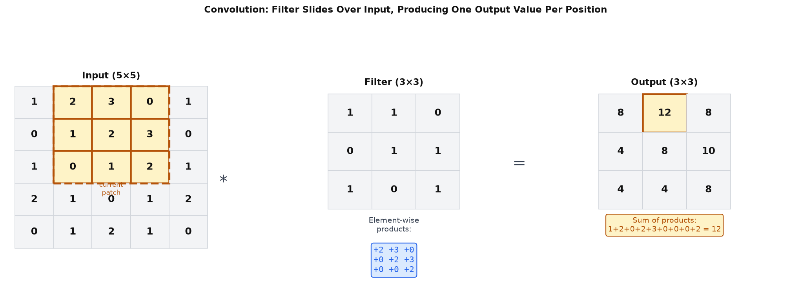
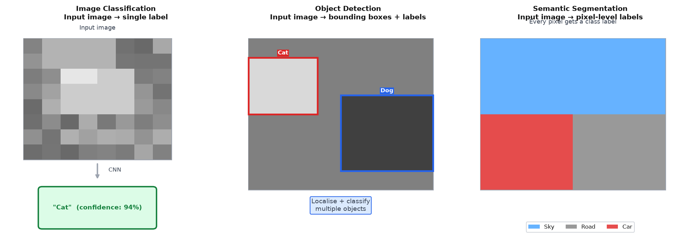

# 19 — Introduction to Convolutional Neural Networks

---

## Part 1: Why Fully Connected Networks Fail on Images

Every network covered so far in this course is **fully connected** — every neuron in one layer connects to every neuron in the next. For tabular data with tens or hundreds of features, this is fine. For images, it breaks down immediately.

### The Parameter Explosion

A modest image — 224×224 pixels in colour — has 224 × 224 × 3 = 150,528 input values. A single fully connected hidden layer with 512 neurons would require:

```
150,528 × 512 = 77,070,336 weights

...for one layer.
```

A network with several such layers would have hundreds of millions of parameters. Training this on a typical dataset is computationally prohibitive, and with so many parameters relative to training examples, overfitting is severe.

But the parameter count is not even the deeper problem.

### Spatial Structure Is Ignored

When a fully connected layer receives an image, it first flattens it into a 1D vector. Pixel (0, 0) becomes element 0. Pixel (0, 1) becomes element 1. Pixel (223, 223) becomes element 150,527. After flattening, the network has no way to know which pixels were adjacent in the original image.

This matters because images have **spatial structure**. A pixel is strongly related to its neighbours — they share edges, textures, and object boundaries. A pixel at position (10, 10) has almost nothing to do with a pixel at position (200, 200). A fully connected layer treats all pairs equally.

```
Fully connected:   pixel (0,0) and pixel (223,223) are equally "close"
                   pixel (0,0) and pixel (0,1) are equally "close"

Reality:           pixel (0,0) and pixel (0,1) are adjacent — highly related
                   pixel (0,0) and pixel (223,223) are far apart — weakly related
```

The diagram below shows both problems: the parameter explosion when connecting a small image to a fully connected layer, and the loss of spatial structure after flattening.



> A fully connected layer applied to an image ignores the fact that nearby pixels are related. It treats the image as an unordered bag of pixel values. This is the wrong inductive bias for visual data.

The solution is to build the spatial structure into the architecture itself. This is what convolutional neural networks do.

---

## Part 2: Local Receptive Fields

The first key idea in CNNs is **local connectivity**. Instead of connecting each neuron to every pixel in the image, each neuron connects only to a small local region — its **receptive field**.

A neuron with a 3×3 receptive field connects to 9 pixels instead of all 150,528. It learns to detect a local pattern — an edge, a corner, a colour gradient — within that small region.

```
FC neuron:    connects to all N pixels   →   N weights per neuron
CNN neuron:   connects to k×k pixels     →   k² weights per neuron

For a 224×224 image with k=3:
  FC:   150,528 weights per neuron
  CNN:  9 weights per neuron
```

The diagram below shows the contrast directly: a fully connected neuron with connections to all 25 pixels of a 5×5 image, versus a CNN neuron with connections to only the 9 pixels in its 3×3 receptive field.



Local connectivity is justified by the structure of natural images. Meaningful patterns — edges, textures, shapes — are local. A neuron that detects a horizontal edge does not need to see the entire image. It only needs to see a small patch where the edge might be.

> A local receptive field is the right inductive bias for images: it encodes the assumption that meaningful patterns are spatially local. This assumption is correct for virtually all visual data.

---

## Part 3: Parameter Sharing and Filters

Local connectivity reduces the number of weights per neuron from N to k². But a 224×224 image has roughly (224−k+1)² ≈ 50,000 positions where a 3×3 receptive field can be placed. If each position has its own 9 weights, the total is still 450,000 weights — just for detecting one type of pattern.

The second key idea is **parameter sharing**: use the same weights at every position.

A single set of k×k weights — called a **filter** or **kernel** — is applied at every position in the image. The filter slides across the image, computing a dot product at each position. The result is a 2D array of responses called a **feature map**.

```
Filter:       a k×k matrix of learnable weights
Feature map:  the 2D array of dot products produced by sliding the filter over the image
```

The operation of sliding a filter over an image and computing dot products at each position is called **convolution** (technically cross-correlation, but the term convolution is standard in deep learning).

### The Convolution Operation

At each position (i, j), the output value is:

```
output[i, j] = sum over r, c of:  input[i+r, j+c] × filter[r, c]

where r, c index the filter rows and columns (0 to k−1)
```

This is an element-wise multiply of the filter with the local patch, followed by a sum. One scalar output per position.

The diagram below shows a 3×3 filter applied to a 5×5 input at one specific position, producing one output value. The filter slides to all 9 valid positions, producing a 3×3 feature map.



### Parameter Sharing Reduces the Weight Count Dramatically

With parameter sharing, the number of weights for one filter is just k² — regardless of the image size. For a 3×3 filter applied to a 224×224 image:

```
Without parameter sharing:   9 weights × 50,000 positions = 450,000 weights
With parameter sharing:      9 weights total (same filter everywhere)
```

> Parameter sharing is the mechanism that makes CNNs tractable on images. The same filter is applied everywhere because the same types of features — edges, corners, textures — can appear anywhere in an image. There is no reason to learn a separate edge detector for the top-left corner and another for the bottom-right.

---

## Part 4: Translation Invariance

Parameter sharing has a consequence that goes beyond efficiency: it gives the network **translation invariance** (more precisely, translation equivariance at the feature map level).

If a feature — say, a vertical edge — appears at position (10, 20) in one image and at position (80, 150) in another, the same filter will detect it in both cases. The filter does not care where in the image the feature is. It responds whenever the pattern it has learned appears, regardless of location.

```
Translation equivariance:
  If the input shifts by (Δr, Δc), the feature map shifts by (Δr, Δc).
  The filter's response moves with the feature — it does not disappear.

Translation invariance (after pooling):
  After max pooling, the exact position of the feature is discarded.
  Only the presence of the feature is retained.
```

This is the right inductive bias for object recognition. A cat is a cat whether it is in the top-left or bottom-right of the image. A network that must relearn "cat in top-left" and "cat in bottom-right" as separate concepts is wasting capacity. A CNN with parameter sharing learns "cat" once and detects it anywhere.

---

## Part 5: Hierarchical Feature Learning

A single convolutional layer with one filter detects one type of local pattern. A deep CNN stacks many convolutional layers, each with many filters. This produces a **hierarchy of features** — each layer detects patterns built from the patterns detected by the layer below.

```
Layer 1:   detects low-level features
           → oriented edges (horizontal, vertical, diagonal)
           → colour gradients
           → simple textures

Layer 2:   detects mid-level features (combinations of layer 1 features)
           → corners (two edges meeting)
           → curves (sequences of oriented edges)
           → simple textures (repeated edge patterns)

Layer 3:   detects high-level features (combinations of layer 2 features)
           → object parts: eyes, wheels, leaves
           → complex textures: fur, fabric, bark

Output:    detects whole objects
           → cat, car, flower
```

No human specifies what each layer should detect. The hierarchy emerges from training — the network discovers that representing images as compositions of edges, then shapes, then parts, then objects is the most efficient way to minimise the loss.

This is the same representational hierarchy argument made for deep feedforward networks in **Note 09** — but now it is grounded in the specific structure of visual data. The hierarchy is not just theoretically efficient; it matches how the visual cortex in the brain processes images, and it is empirically what trained CNNs learn.

> The hierarchy is not designed — it is discovered. The network learns that edges are the right primitives for images because they are the most reusable building blocks. Every shape is made of edges. Every object is made of shapes. Depth lets the network exploit this compositional structure.

---

## Part 6: Applications

CNNs are the dominant architecture for visual data. Three tasks define the landscape of computer vision applications.

### Image Classification

The simplest task: given an image, assign it a single label from a fixed set of categories.

```
Input:   one image
Output:  one label (e.g. "cat", "car", "flower")
         + confidence score (probability from softmax)
```

The CNN processes the image through convolutional layers to extract features, then passes the features through fully connected layers to produce a probability distribution over classes. The predicted class is the one with the highest probability.

### Object Detection

A harder task: find all objects in an image, draw a bounding box around each one, and label each box.

```
Input:   one image
Output:  a list of (bounding box, label, confidence) tuples
         bounding box = (x, y, width, height)
```

Detection requires both localisation (where is the object?) and classification (what is it?). The network must handle a variable number of objects per image and objects at different scales and positions.

### Semantic Segmentation

The most detailed task: assign a class label to every pixel in the image.

```
Input:   one image of size H × W
Output:  a label map of size H × W
         each pixel labelled with its class (sky, road, car, person, ...)
```

Segmentation requires understanding the image at pixel-level resolution — not just "there is a car somewhere" but "these exact pixels belong to a car."

The diagram below shows all three tasks side by side: classification produces a single label, detection produces bounding boxes, segmentation produces a pixel-level mask.



### Medical Imaging

CNNs have transformed medical image analysis. The same principles — local receptive fields, parameter sharing, hierarchical features — apply directly to X-rays, MRI scans, and histology slides.

```
Chest X-ray classification:   detect pneumonia, tuberculosis, COVID-19
Retinal image analysis:        detect diabetic retinopathy from fundus photographs
Histology segmentation:        identify tumour regions in tissue slides
MRI segmentation:              delineate brain structures for surgical planning
```

Transfer learning (**Note 21**) is particularly valuable here: a CNN pre-trained on ImageNet already knows how to detect edges, textures, and shapes. Fine-tuning it on medical images requires far less labelled data than training from scratch — critical when labelled medical data is scarce and expensive to obtain.

---

## Summary

Key takeaways:

- Fully connected networks fail on images for two reasons: parameter explosion (a single layer on a 224×224 image requires tens of millions of weights) and loss of spatial structure (flattening destroys the neighbourhood relationships between pixels)
- Local receptive fields fix the spatial structure problem: each neuron connects to a small k×k patch, encoding the assumption that meaningful visual patterns are local
- Parameter sharing fixes the parameter explosion: the same filter (k×k weights) is applied at every position in the image, reducing the weight count from N×k² to k² per filter
- The convolution operation slides a filter over the input, computing an element-wise multiply-and-sum at each position to produce a feature map
- Translation invariance follows from parameter sharing: the same filter detects the same feature regardless of where it appears in the image
- Stacking convolutional layers produces a hierarchy of features: edges in early layers, shapes and textures in middle layers, object parts and whole objects in later layers — this hierarchy is not designed but discovered during training
- The three core computer vision tasks are image classification (one label per image), object detection (bounding boxes and labels for all objects), and semantic segmentation (one label per pixel)
- CNNs apply directly to medical imaging — the same local, hierarchical feature learning that works for natural images works for X-rays, MRI, and histology
