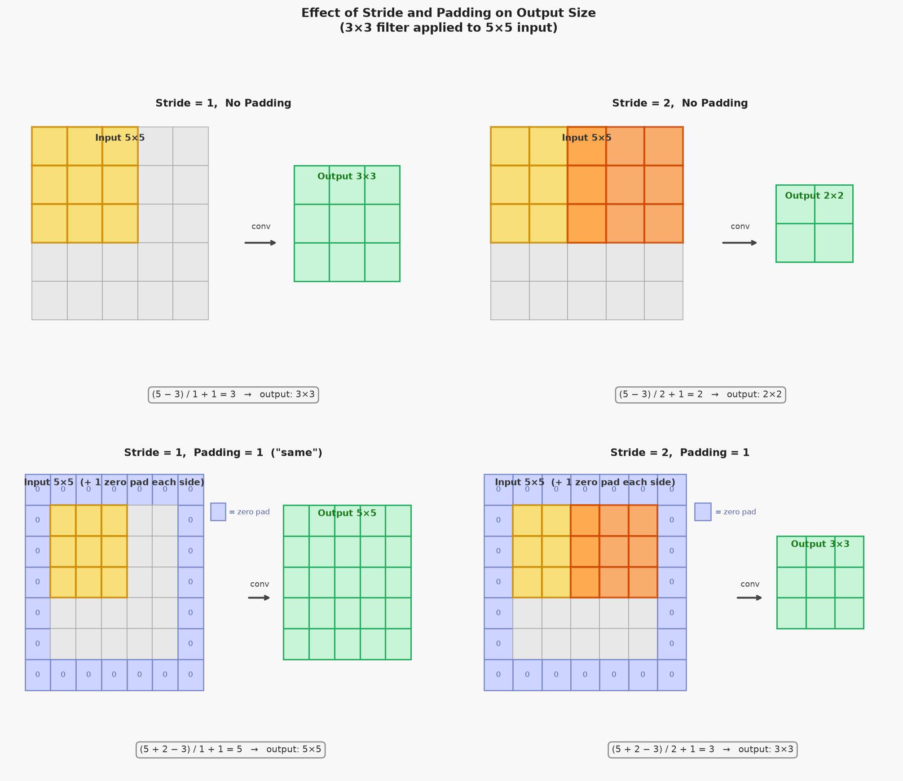
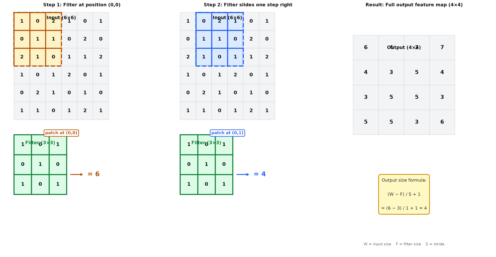
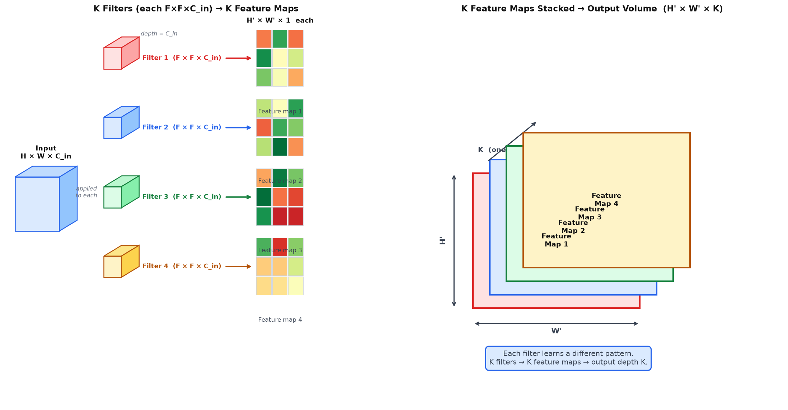
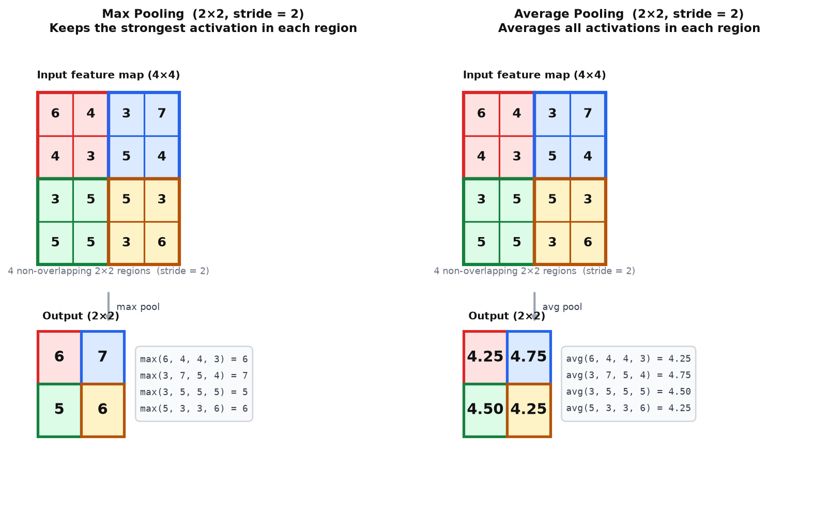
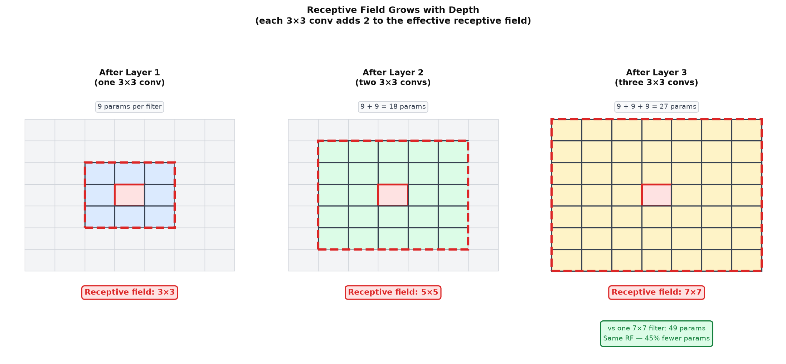

# 20 — CNN Architecture: Convolutional, Pooling, and Fully Connected Layers

---

## Part 1: The Convolutional Layer

**Note 19** introduced the idea of a filter sliding over an image. This part makes the mechanics precise: every formula is derived, every dimension is tracked, and a full worked example is computed by hand.

### The Operation

A convolutional layer takes an input volume and produces an output volume. For a single-channel input of size H×W, a single filter of size F×F, stride S, and padding P:

```
output[i, j] = bias + sum over r=0..F-1, c=0..F-1 of:
               input[i*S + r - P, j*S + c - P] × filter[r, c]
```

This is an element-wise multiply of the filter with the local patch centred at position (i*S, j*S), followed by a sum, plus a bias. One scalar output per position.

### Output Size Formula

How many positions can the filter be placed? The filter of size F can start at position 0 and must end at position F−1. With padding P added on each side, the padded input has size W+2P. The last valid starting position is W+2P−F. With stride S, the number of steps is:

```
output_size = floor((W + 2P - F) / S) + 1
```

This formula applies to both height and width independently.

```
Examples:
  W=6, F=3, S=1, P=0:   (6 + 0 - 3) / 1 + 1 = 4
  W=5, F=3, S=1, P=1:   (5 + 2 - 3) / 1 + 1 = 5   ("same" padding — output = input size)
  W=5, F=3, S=2, P=0:   (5 + 0 - 3) / 2 + 1 = 2
  W=5, F=3, S=2, P=1:   (5 + 2 - 3) / 2 + 1 = 3
```

### Stride

Stride controls how far the filter moves between positions. Stride=1 means the filter moves one pixel at a time — maximum overlap, largest output. Stride=2 means the filter jumps two pixels — less overlap, smaller output, roughly half the spatial dimensions.

### Padding

Without padding, the filter can only be placed where it fits entirely within the input. This means the output is smaller than the input, and pixels at the edges are covered by fewer filter positions than pixels in the centre — edge information is underrepresented.

**Zero padding** adds rows and columns of zeros around the input before applying the filter. With P=1 and F=3, S=1, the output has the same spatial size as the input. This is called **"same" padding** — it preserves spatial dimensions through the layer.

The diagram below shows all four combinations of stride and padding on a 5×5 input with a 3×3 filter, with the output size for each.



### Bias and Activation

Each filter has one learnable bias — a scalar added to every output position of that filter's feature map. After adding the bias, an activation function (typically ReLU) is applied element-wise:

```
z[i, j] = bias + sum of (patch × filter)
a[i, j] = ReLU(z[i, j]) = max(0, z[i, j])
```

### Worked Example — Single Filter

Input: 6×6, single channel. Filter: 3×3. Stride=1, padding=0, bias=0.

```
Input (6×6):                    Filter (3×3):
  1  0  2  1  0  1               1  0  1
  0  1  1  0  2  0               0  1  0
  2  1  0  1  1  2               1  0  1
  1  0  1  2  0  1
  0  2  1  0  1  0
  1  1  0  1  2  1
```

Output size: (6 − 3) / 1 + 1 = **4×4**

**Position (0,0) — patch is top-left 3×3:**

```
Patch:      1  0  2       Filter:   1  0  1       Products:   1  0  2
            0  1  1                 0  1  0                   0  1  0
            2  1  0                 1  0  1                   2  0  0

Sum = 1 + 2 + 1 + 2 = 6
```

**Position (0,1) — patch shifts one column right:**

```
Patch:      0  2  1       Filter:   1  0  1       Products:   0  0  1
            1  1  0                 0  1  0                   0  1  0
            1  0  1                 1  0  1                   1  0  1

Sum = 1 + 1 + 1 + 1 = 4
```

The diagram below shows the filter at positions (0,0) and (0,1), and the resulting output feature map.



Completing all 16 positions:

```
Output feature map (4×4):
  6  4  3  7
  4  3  5  4
  3  5  5  3
  5  5  3  6
```

All values are positive, so ReLU leaves them unchanged.

---

## Part 2: Multiple Filters and the Depth Dimension

A single filter detects one type of pattern. A convolutional layer uses **K filters** simultaneously, each learning to detect a different pattern. Each filter produces its own feature map. The K feature maps are stacked along a new dimension — the **depth** or **channel** dimension.

```
Input:    H × W × C_in    (height × width × input channels)
K filters: F × F × C_in   (each filter spans all input channels)
Output:   H' × W' × K     (one feature map per filter)
```

Each filter has shape F×F×C_in — it spans the full depth of the input. The dot product at each position is computed across all input channels simultaneously:

```
output[i, j, k] = bias_k + sum over r, c, d of:
                  input[i*S+r, j*S+c, d] × filter_k[r, c, d]
```

where d indexes the input channel and k indexes the filter.

The diagram below shows K filters each producing one feature map, and the resulting output volume.



### The Volume Interpretation

After a convolutional layer, the data is no longer a 2D image — it is a 3D volume. The spatial dimensions (H', W') capture where features are. The depth dimension (K) captures what features are present.

```
After Conv1 (32 filters, 3×3, stride=1, same padding):
  Input:   224 × 224 × 3    (RGB image)
  Output:  224 × 224 × 32   (32 feature maps, same spatial size)

After Conv2 (64 filters, 3×3, stride=1, same padding):
  Input:   224 × 224 × 32
  Output:  224 × 224 × 64

After Pool (2×2, stride=2):
  Input:   224 × 224 × 64
  Output:  112 × 112 × 64   (spatial halved, depth unchanged)
```

As the network deepens: spatial dimensions shrink (pooling), depth grows (more filters).

---

## Part 3: Parameter Count for Convolutional Layers

The parameter count for a convolutional layer is:

```
Parameters = (F × F × C_in + 1) × K

where:
  F × F × C_in   = weights per filter (filter size × input channels)
  + 1            = one bias per filter
  × K            = number of filters
```

The critical insight: this does not depend on the input spatial size H or W. The same 3×3 filter applied to a 32×32 image or a 224×224 image has exactly the same number of parameters.

### Comparison with Fully Connected

```
Conv layer: 3×3 filter, C_in=3, K=32
  Parameters = (3×3×3 + 1) × 32 = 28 × 32 = 896

Equivalent FC layer: 224×224×3 inputs → 224×224×32 outputs
  Parameters = (224×224×3) × (224×224×32) = 150,528 × 1,605,632 ≈ 241 billion

Ratio: FC requires ~270 million times more parameters.
```

This is why CNNs are tractable on images and FC networks are not.

### Worked Example — Parameter Count

A CNN with the following architecture:

```
Layer          Config                    Parameters
─────────────  ────────────────────────  ──────────────────────────────────────
Conv1          3×3, C_in=1, K=8          (3×3×1 + 1) × 8  =  10 × 8  =  80
Conv2          3×3, C_in=8, K=16         (3×3×8 + 1) × 16 =  73 × 16 = 1,168
FC1            128 inputs → 64 outputs   128 × 64 + 64     =          = 8,256
FC2            64 inputs  → 10 outputs   64 × 10 + 10      =          =   650

Total:  80 + 1,168 + 8,256 + 650 = 10,154 parameters
```

Notice that the two convolutional layers together have only 1,248 parameters — the FC layers dominate the parameter count. This is why modern architectures use global average pooling to eliminate the large FC layers.

---

## Part 4: Pooling Layers

After a convolutional layer, the feature maps are typically passed through a **pooling layer**. Pooling reduces the spatial dimensions of the feature maps — it downsamples.

### Why Pool?

Three reasons:

```
1. Reduce computation:   smaller feature maps → fewer operations in subsequent layers
2. Reduce parameters:    smaller input to FC layers → fewer weights
3. Translation invariance: small shifts in the input produce the same pooled output
```

The third reason is the most important. If a feature appears at position (10, 10) or (11, 10), max pooling over a 2×2 region will produce the same output — the exact position within the region is discarded. Only the presence of the feature is retained.

### Max Pooling

Max pooling divides the feature map into non-overlapping regions and takes the maximum value from each region.

```
Max pool, 2×2, stride=2:
  Input region:   6  4     →   output: 6
                  4  3

  Input region:   3  7     →   output: 7
                  5  4
```

### Average Pooling

Average pooling takes the mean of each region instead of the maximum.

```
Average pool, 2×2, stride=2:
  Input region:   6  4     →   output: (6+4+4+3)/4 = 4.25
                  4  3
```

Max pooling is more common in practice — it retains the strongest activation in each region, which corresponds to the most confident detection of a feature.

The diagram below shows both types applied to the 4×4 feature map from Part 1.



### Output Size Formula

The same formula as convolution applies, with no learnable parameters:

```
output_size = floor((W - F) / S) + 1

2×2 max pool, stride=2:   (4 - 2) / 2 + 1 = 2
2×2 max pool, stride=2:   (6 - 2) / 2 + 1 = 3
```

Pooling has **zero learnable parameters** — it is a fixed operation with no weights.

---

## Part 5: The Fully Connected Layer and Flattening

After the convolutional and pooling layers have extracted spatial features, the network must produce a final prediction — a class label, a regression value, or a probability distribution. This requires collapsing the 3D feature volume into a 1D vector and passing it through one or more fully connected layers.

### Flattening

Flattening reshapes the 3D output volume (H×W×C) into a 1D vector of length H×W×C. No computation is performed — it is a reshape operation.

```
Volume:   2 × 2 × 1   →   Flat vector: [6, 7, 5, 6]   (length 4)
Volume:   7 × 7 × 512 →   Flat vector: length 25,088
```

### The FC Layer in a CNN

The fully connected layer after flattening is identical to the FC layers in **Note 09** — a matrix multiplication plus bias plus activation. Its role is to combine the spatial features extracted by the convolutional layers into a final prediction.

```
z = W^T a + b
output = softmax(z)   (for classification)
```

### When to Use FC Layers

```
Classification:   one or two FC layers at the end, final layer has K neurons (K classes)
Detection:        FC layers predict bounding box coordinates and class scores
Regression:       FC layer with linear activation, one output per value to predict
```

Modern architectures (ResNet, EfficientNet) often replace the large FC layers with **global average pooling** — averaging each feature map to a single value, producing a vector of length C directly. This eliminates the parameter-heavy FC layers entirely.

---

## Part 6: Full CNN Forward Pass — Worked Example

This part traces a complete forward pass through a small CNN, computing every value by hand. The architecture:

```
Input (6×6×1)
    ↓
Conv: 3×3 filter, stride=1, pad=0, bias=0   →   4×4×1
    ↓
ReLU
    ↓
MaxPool: 2×2, stride=2                       →   2×2×1
    ↓
Flatten                                      →   4×1
    ↓
FC: 4 inputs → 2 outputs                    →   2×1
    ↓
Softmax                                      →   2×1 (probabilities)
```

### Step 1 — Convolution

Input and filter from Part 1. Full output:

```
Conv output (4×4):
  6  4  3  7
  4  3  5  4
  3  5  5  3
  5  5  3  6
```

### Step 2 — ReLU

All values are already positive. ReLU leaves the feature map unchanged:

```
After ReLU (4×4):
  6  4  3  7
  4  3  5  4
  3  5  5  3
  5  5  3  6
```

### Step 3 — Max Pooling (2×2, stride=2)

Four non-overlapping 2×2 regions:

```
Region (0,0):   6  4   →   max = 6
                4  3

Region (0,1):   3  7   →   max = 7
                5  4

Region (1,0):   3  5   →   max = 5
                5  5

Region (1,1):   5  3   →   max = 6
                3  6

Max pool output (2×2):
  6  7
  5  6
```

### Step 4 — Flatten

```
Flat vector: [6, 7, 5, 6]
```

### Step 5 — Fully Connected Layer

```
W = [ 0.5  -0.5 ]     b = [0, 0]
    [ 0.5   0.5 ]
    [-0.5   0.5 ]
    [ 0.5   0.5 ]

z = W^T × [6, 7, 5, 6] + b

z[0] = 0.5(6) + 0.5(7) + (-0.5)(5) + 0.5(6) = 3.0 + 3.5 − 2.5 + 3.0 = 7.0
z[1] = (-0.5)(6) + 0.5(7) + 0.5(5) + 0.5(6) = −3.0 + 3.5 + 2.5 + 3.0 = 6.0
```

### Step 6 — Softmax

```
exp(7.0) = 1096.6
exp(6.0) =  403.4

softmax[0] = 1096.6 / (1096.6 + 403.4) = 1096.6 / 1500.0 = 0.731
softmax[1] =  403.4 / (1096.6 + 403.4) =  403.4 / 1500.0 = 0.269

Output: [0.731, 0.269]   (class 0 predicted with 73.1% confidence)
```

---

## Part 7: Receptive Field Growth and Architecture Design

### Receptive Field

The **receptive field** of a neuron is the region of the original input that influences its value. Understanding how the receptive field grows with depth is essential for architecture design.

For a single convolutional layer with filter size F and stride S=1:

```
Receptive field after layer 1:   RF₁ = F
Receptive field after layer 2:   RF₂ = RF₁ + (F − 1)
Receptive field after layer L:   RF_L = 1 + L × (F − 1)
```

For 3×3 filters (F=3):

```
After 1 layer:   RF = 3×3
After 2 layers:  RF = 5×5
After 3 layers:  RF = 7×7
After 4 layers:  RF = 9×9
```

The diagram below shows this growth: each additional 3×3 conv layer adds 2 to the effective receptive field in each dimension.



### Why Stack Small Filters Instead of Using One Large Filter?

A single 7×7 filter has the same receptive field as three stacked 3×3 filters. But:

```
One 7×7 filter:          7 × 7 = 49 weights
Three 3×3 filters:   3 × (3 × 3) = 27 weights

Same receptive field. 3 stacked 3×3 filters use 45% fewer parameters.
```

Additionally, three stacked 3×3 filters with ReLU activations between them can represent more complex functions than one 7×7 filter — each ReLU adds a non-linearity. This is why VGG (2014) and virtually all modern architectures use 3×3 filters exclusively.

### A Complete Architecture — LeNet Style

To consolidate everything, here is a complete small CNN for classifying 28×28 grayscale images into 10 classes:

```
Layer          Input size     Config                    Output size    Parameters
─────────────  ─────────────  ────────────────────────  ─────────────  ──────────
Conv1 + ReLU   28×28×1        6 filters, 5×5, S=1, P=0  24×24×6        (5×5×1+1)×6  = 156
MaxPool1       24×24×6        2×2, S=2                  12×12×6        0
Conv2 + ReLU   12×12×6        16 filters, 5×5, S=1, P=0 8×8×16         (5×5×6+1)×16 = 2,416
MaxPool2       8×8×16         2×2, S=2                  4×4×16         0
Flatten        4×4×16         —                         256            0
FC1 + ReLU     256            → 120 neurons             120            256×120+120  = 30,840
FC2 + ReLU     120            → 84 neurons              84             120×84+84    = 10,164
FC3 (output)   84             → 10 neurons (Softmax)    10             84×10+10     =   850

Total parameters:  156 + 2,416 + 30,840 + 10,164 + 850 = 44,426
```

This is essentially LeNet-5 (LeCun et al., 1998) — the first successful CNN, trained on handwritten digit recognition. Notice that the two convolutional layers together have only 2,572 parameters, while the three FC layers have 41,854. The FC layers dominate — this is why modern architectures work hard to reduce them.

---

## Summary

Key takeaways:

- The output size formula for a convolutional layer is (W + 2P − F) / S + 1, where W is input size, F is filter size, P is padding, S is stride — this must be memorised and applied correctly at every layer
- Stride controls spatial downsampling within the conv layer; padding controls whether spatial size is preserved ("same" padding with P=1, F=3, S=1) or reduced
- A convolutional layer with K filters produces an output volume of depth K — one feature map per filter; each filter spans the full input depth C_in
- Parameter count for a conv layer: (F×F×C_in + 1) × K — independent of input spatial size, which is why CNNs scale to large images
- Max pooling takes the maximum over non-overlapping regions; it has zero learnable parameters and provides translation invariance within each pooled region
- Flattening reshapes the 3D feature volume into a 1D vector for the FC layers; the FC layers combine spatial features into a final prediction
- The full forward pass: conv → ReLU → pool → (repeat) → flatten → FC → softmax; every dimension must be tracked at every step
- Stacking three 3×3 conv layers achieves the same 7×7 receptive field as one 7×7 filter but with 45% fewer parameters and three non-linearities — this is why all modern architectures use small filters
- In a typical CNN, the convolutional layers have far fewer parameters than the FC layers; modern architectures use global average pooling to eliminate the large FC layers entirely
