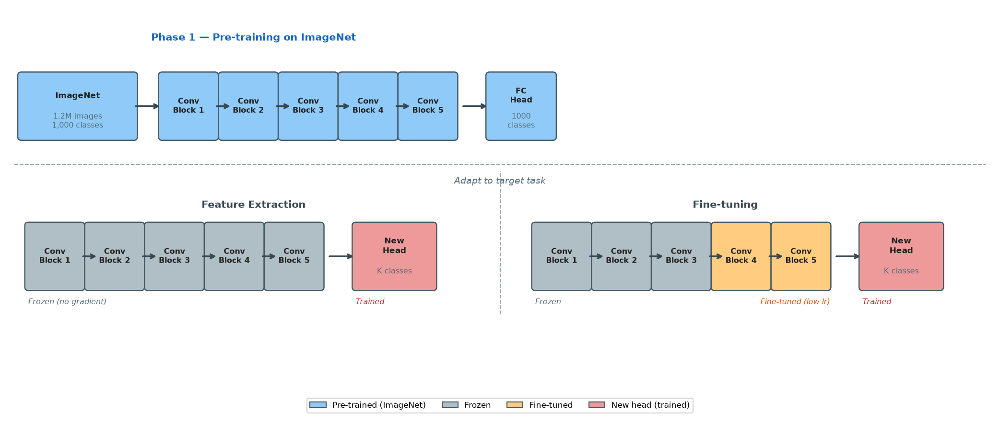
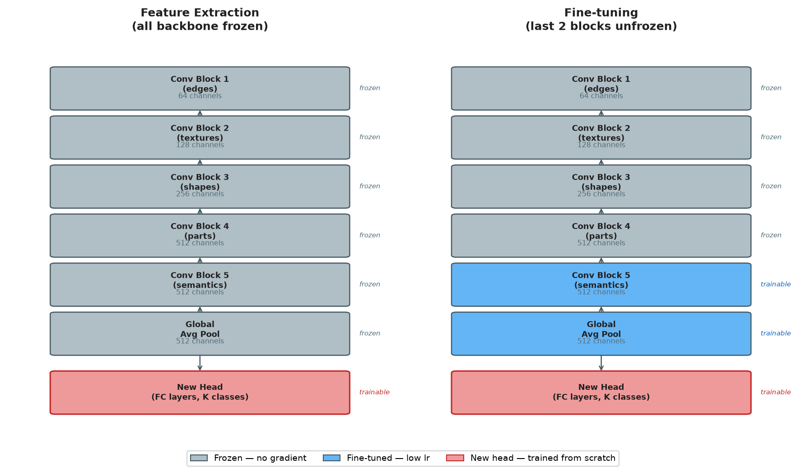
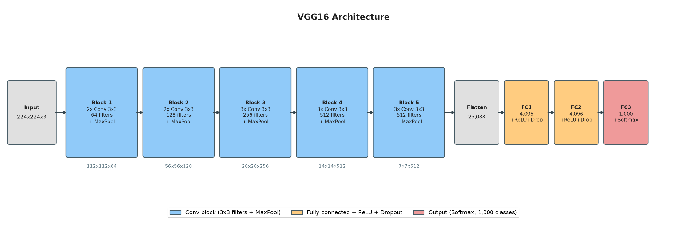
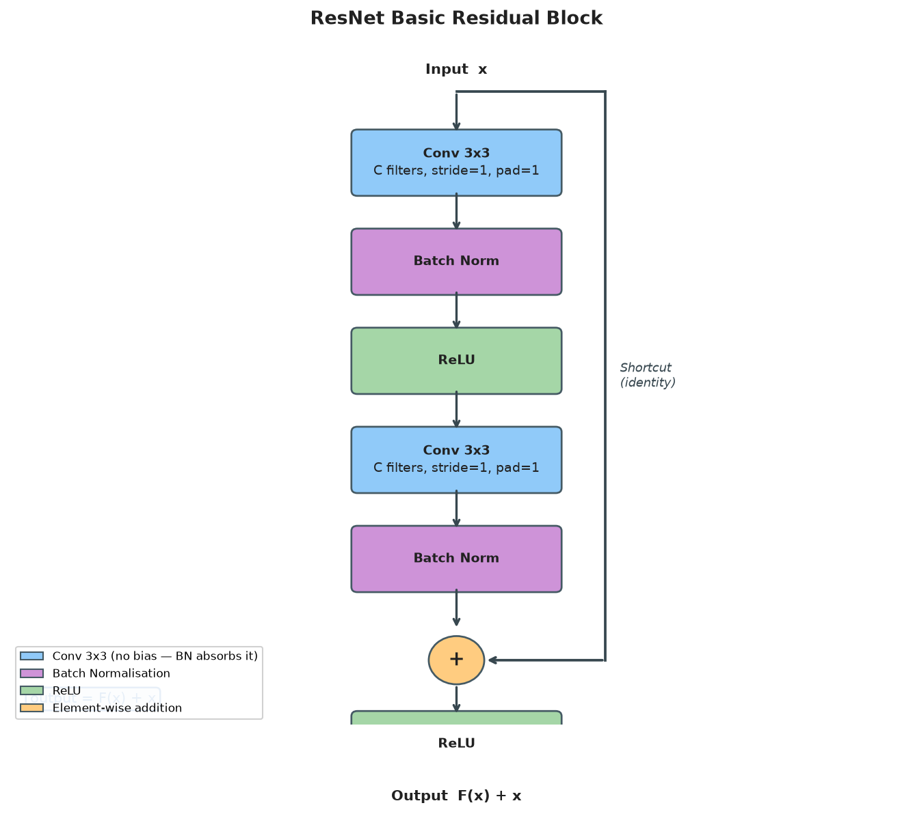
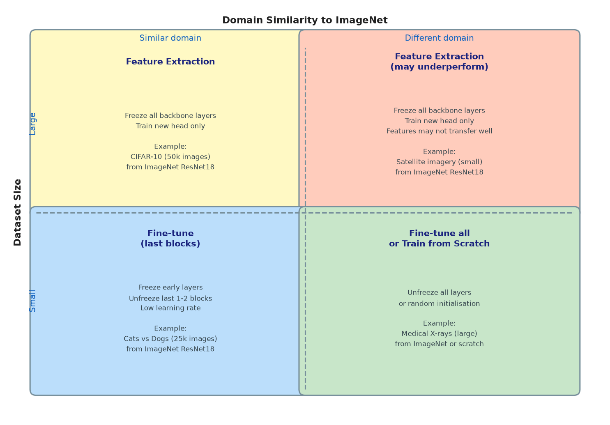

# 21 — Transfer Learning and Pre-trained Models

---

## Part 1: Why Training from Scratch Is Expensive

Every network trained so far in this course has been initialised with random weights and trained from scratch — the network starts knowing nothing and learns everything from the training data. For small networks on small datasets, this is fine. For deep CNNs on real image data, it breaks down.

### The Data Problem

A deep CNN has millions of parameters. Learning good values for all of them requires a large, diverse, labelled dataset. The benchmark dataset for image classification is **ImageNet** — 1.2 million images across 1,000 categories, each manually labelled. Collecting and labelling a dataset of this scale for a new task is prohibitively expensive.

```
ImageNet:   1,281,167 training images   — years of collection and labelling effort
CIFAR-10:      50,000 training images   — manageable, but shallow networks only
Medical task:   1,000 labelled X-rays   — typical real-world constraint
```

With only 1,000 labelled examples, a deep CNN trained from scratch will overfit severely — it has far more parameters than training examples.

### The Compute Problem

Training a large CNN from scratch on ImageNet takes days to weeks on multiple GPUs. VGG16 was trained for 2–3 weeks on 4 GPUs. ResNet-50 requires roughly 10^18 floating-point operations for a single training run. For most practitioners, this compute budget is not available.

> The combination of data scarcity and compute cost makes training from scratch impractical for most real-world tasks. Transfer learning is the standard solution.

---

## Part 2: What Transfer Learning Is

The key observation is that the features learned by a CNN trained on ImageNet are not specific to ImageNet. The early layers learn edge detectors, colour gradients, and texture filters. The middle layers learn corners, curves, and simple shapes. These are properties of natural images in general — not of the 1,000 ImageNet categories specifically.

```
Layer 1 features:   oriented edges, colour blobs       — universal to all images
Layer 2 features:   corners, curves, simple textures   — universal to all images
Layer 3 features:   object parts, complex textures     — somewhat general
Layer 4 features:   high-level semantic features       — more task-specific
Final layer:        ImageNet class scores               — completely task-specific
```

This means a CNN trained on ImageNet has already learned a powerful general-purpose feature extractor. For a new task — say, classifying chest X-rays — the early and middle layers are immediately useful. Only the final layers need to be adapted.

**Transfer learning** is the practice of taking a network trained on a large source task and reusing its weights as the starting point for a different target task.

```
Source task:   ImageNet classification (1,000 classes, 1.2M images)
Target task:   chest X-ray classification (2 classes, 1,000 images)

Transfer:      reuse the feature extraction layers
               replace and retrain the classification head
```

The diagram below shows the two-phase pipeline: pre-training on the source task, then adaptation to the target task.



> Transfer learning works because visual features are hierarchical and general. The same edge detectors that help classify dogs also help classify tumours. The network does not need to relearn how to see — it only needs to learn what to look for.

---

## Part 3: Feature Extraction

The simplest form of transfer learning is **feature extraction**. The pre-trained network is used as a fixed feature extractor — its weights are frozen and never updated. Only a new classification head (one or two FC layers) is trained from scratch on the target dataset.

```
Pre-trained backbone:   weights frozen — no gradient computed, no update
New head:               weights randomly initialised — trained on target data
```

### Why Freeze the Backbone?

With a small target dataset, updating the backbone weights would cause overfitting — the network would overwrite the general ImageNet features with noise from the small dataset. Freezing prevents this. The backbone acts as a fixed transformation: it maps each input image to a rich feature vector, and the new head learns to classify from those features.

```
Input image
    ↓
Frozen backbone   →   512-dimensional feature vector
    ↓
New FC head       →   class probabilities
```

### In PyTorch

Freezing is done by setting `requires_grad = False` on all backbone parameters:

```python
for param in model.parameters():
    param.requires_grad = False

# Replace the final layer with a new head
model.fc = nn.Linear(512, num_classes)
# Only model.fc parameters have requires_grad = True
```

The optimiser only receives the new head's parameters — the backbone is never touched.

### When to Use Feature Extraction

Feature extraction is the right choice when:

```
Target dataset is small   (hundreds to low thousands of examples)
Target domain is similar to source domain   (natural images → natural images)
Compute budget is limited   (only the head is trained — fast)
```

The diagram below shows the frozen backbone (grey) and the trainable new head (colour).



---

## Part 4: Fine-Tuning

Feature extraction treats the backbone as completely fixed. **Fine-tuning** goes further: after training the new head, some or all of the backbone layers are unfrozen and the entire network is trained at a very low learning rate.

```
Phase 1:   freeze backbone, train new head until convergence
Phase 2:   unfreeze some backbone layers, train at low learning rate (e.g. 1e-5)
```

### Why a Low Learning Rate?

The backbone weights are already good — they encode general visual features learned from 1.2M images. A high learning rate would destroy them. A low learning rate makes small adjustments, nudging the features toward the target domain without overwriting what was learned.

### Which Layers to Unfreeze?

The standard strategy is to unfreeze from the top down — unfreeze the last few layers first, keep the early layers frozen.

```
Early layers (frozen):    edge detectors, colour filters — universal, do not change
Middle layers (frozen):   corners, textures — still general
Late layers (unfrozen):   high-level semantic features — most task-specific, benefit most from adaptation
New head (unfrozen):      always trained
```

### When to Use Fine-Tuning

| Strategy | Dataset size | Domain similarity | Trainable layers |
|---|---|---|---|
| Feature extraction | Small | Similar | New head only |
| Fine-tune last block | Medium | Similar | Last conv block + head |
| Fine-tune all layers | Large | Different | All layers |
| Train from scratch | Very large | Very different | All layers (random init) |

---

## Part 5: VGG16

**VGG16** (Simonyan & Zisserman, 2014) was one of the first architectures to demonstrate that depth — not architectural complexity — is the key driver of performance. The design principle is extreme uniformity: use only 3×3 filters throughout, double the number of filters after each pooling layer.

### Architecture

VGG16 processes 224×224×3 images through 5 convolutional blocks followed by 3 FC layers:

```
Block 1:   2× Conv(3×3, 64)    + MaxPool   →   112×112×64
Block 2:   2× Conv(3×3, 128)   + MaxPool   →    56×56×128
Block 3:   3× Conv(3×3, 256)   + MaxPool   →    28×28×256
Block 4:   3× Conv(3×3, 512)   + MaxPool   →    14×14×512
Block 5:   3× Conv(3×3, 512)   + MaxPool   →     7×7×512

Flatten:   7×7×512 = 25,088

FC1:   25,088 → 4,096   + ReLU + Dropout
FC2:    4,096 → 4,096   + ReLU + Dropout
FC3:    4,096 → 1,000   + Softmax
```

The diagram below shows the full VGG16 architecture with filter counts at each block.



### Parameter Count

```
Block 1:   (3×3×3+1)×64  + (3×3×64+1)×64   =   1,792  +  36,928  =    38,720
Block 2:   (3×3×64+1)×128 + (3×3×128+1)×128 =  73,856  + 147,584  =   221,440
Block 3:   3×(3×3×256+1)×256 (approx)        =                       1,475,328
Block 4:   3×(3×3×512+1)×512                 =                       5,899,776
Block 5:   3×(3×3×512+1)×512                 =                       7,079,424

Conv total:   14,714,688

FC1:   25,088×4,096 + 4,096   =  102,764,544
FC2:    4,096×4,096 + 4,096   =   16,781,312
FC3:    4,096×1,000 + 1,000   =    4,097,000

FC total:   123,642,856

Total VGG16:   138,357,544 parameters
```

The FC layers hold 123.6M of the 138.4M parameters — **89% of all parameters are in three FC layers**. This is the same pattern seen in LeNet in **Note 20**, but at a far larger scale. It is why modern architectures replace FC layers with global average pooling.

### VGG16 as a Feature Extractor

For transfer learning, the standard practice is to remove FC3 (the 1,000-class output layer) and optionally FC1 and FC2, and replace them with a new head sized for the target task. The 5 conv blocks — 14.7M parameters — are frozen.

---

## Part 6: ResNet and Residual Connections

VGG16 has 16 layers. A natural question: why not go deeper? The answer, before ResNet, was that deeper networks performed *worse* — not because of overfitting, but because of a training failure.

### The Degradation Problem

When plain networks (no skip connections) are made very deep, training accuracy degrades. This is not overfitting — the training loss itself gets worse. The cause is the vanishing gradient: in a 50-layer plain network, gradients must flow back through 50 layers of multiplications. By the time they reach the early layers, they are effectively zero. The early layers stop learning.

```
Plain 20-layer network:   training error ~8%
Plain 56-layer network:   training error ~11%   ← deeper is worse
```

This is the degradation problem: adding more layers should never hurt — a deeper network can always learn the identity function and match the shallower network. But in practice, optimisation fails to find this solution.

### The Residual Block

**ResNet** (He et al., 2015) solves this with a simple structural change: the **residual connection** (also called a skip connection). Instead of learning a mapping H(x) directly, the layer learns the residual F(x) = H(x) − x, and the output is:

```
output = F(x) + x
```

where x is the input passed directly through a shortcut connection, bypassing the weight layers.

The basic residual block (used in ResNet-18 and ResNet-34) contains two 3×3 conv layers with batch normalisation:

```
Input x
  │
  ├──────────────────────────────┐  (shortcut — identity)
  │                              │
  ↓                              │
Conv(3×3, C, C) → BN → ReLU     │
  ↓                              │
Conv(3×3, C, C) → BN            │
  ↓                              │
  + ←────────────────────────────┘
  ↓
ReLU
  ↓
Output F(x) + x
```

The diagram below shows the basic residual block with the shortcut connection.



### Why Residual Connections Work

If the optimal transformation for a block is close to the identity, the weight layers only need to learn F(x) ≈ 0 — a small correction. This is much easier to optimise than learning the identity mapping from scratch through two conv layers.

More importantly, the shortcut provides a **gradient highway**: during backpropagation, gradients flow directly through the shortcut without passing through the weight layers. This means gradients reach the early layers intact, even in very deep networks.

```
Gradient flow without skip:   ∂L/∂x = ∂L/∂output × ∂F/∂x
                               (multiplied through weight layers — can vanish)

Gradient flow with skip:      ∂L/∂x = ∂L/∂output × (∂F/∂x + 1)
                               (the +1 term ensures gradient never vanishes completely)
```

### ResNet-18 Architecture

ResNet-18 uses the basic block throughout:

```
Layer          Config                        Output size    Parameters
─────────────  ────────────────────────────  ─────────────  ──────────
Conv1 + BN     7×7, 64 filters, stride=2     112×112×64        9,536
MaxPool        3×3, stride=2                  56×56×64              0
Layer1         2× basic block (64→64)         56×56×64        147,968
Layer2         2× basic block (64→128)        28×28×128       525,568
Layer3         2× basic block (128→256)       14×14×256     2,099,712
Layer4         2× basic block (256→512)        7×7×512       8,393,728
AvgPool        global average pooling          1×1×512               0
FC             512 → 1,000                     1,000           513,000

Total:   11,689,512 parameters
```

ResNet-18 has 11.7M parameters — **8× fewer than VGG16** — and trains faster, generalises better, and scales to much greater depth (ResNet-50, ResNet-152) without degradation.

### ResNet-18 as a Feature Extractor

For transfer learning, the FC layer (512→1000) is replaced with a new head. The backbone — everything up to and including the global average pooling — outputs a 512-dimensional feature vector per image.

```
Frozen backbone:   11,176,512 parameters   (never updated)
New head:             133,898 parameters   (trained on target data)

Trainable fraction:   133,898 / 11,310,410 = 1.2%
```

---

## Part 7: When to Use Transfer Learning vs Train from Scratch

The decision depends on two factors: the size of the target dataset and the similarity between the source and target domains.

```
                    Similar domain          Different domain
                 ┌──────────────────────┬──────────────────────┐
  Small dataset  │  Feature extraction  │  Feature extraction  │
                 │  (freeze all)        │  (freeze all,        │
                 │                      │   may underperform)  │
                 ├──────────────────────┼──────────────────────┤
  Large dataset  │  Fine-tune           │  Fine-tune all       │
                 │  (last few blocks)   │  or train from       │
                 │                      │  scratch             │
                 └──────────────────────┴──────────────────────┘
```

The diagram below shows this decision grid with concrete examples in each quadrant.



### Practical Guidelines

```
Always start with transfer learning unless:
  — the target domain is fundamentally different from natural images
    (e.g. satellite radar, molecular graphs, audio spectrograms)
  — the target dataset is very large (>1M labelled examples)
  — the task requires features that cannot exist in ImageNet

When in doubt:
  1. Start with feature extraction (fast, low risk of overfitting)
  2. If performance is insufficient, unfreeze the last block and fine-tune
  3. Only unfreeze more layers if the dataset is large enough to support it
```

### Why Transfer Learning Dominates in Practice

Training ResNet-18 from scratch on ImageNet takes roughly 90 epochs × 1.28M images = ~115M gradient steps. Fine-tuning the head on a 10,000-image target dataset takes ~100 epochs × 10,000 images = ~1M gradient steps — 100× less compute, with a better starting point.

---

## Summary

Key takeaways:

- Training from scratch requires large labelled datasets and significant compute — for most real tasks, neither is available; transfer learning is the standard solution
- Transfer learning works because early and middle CNN layers learn general visual features (edges, textures, shapes) that transfer across tasks; only the final layers are task-specific
- Feature extraction freezes the entire pre-trained backbone and trains only a new classification head — the right strategy when the target dataset is small
- Fine-tuning unfreezes the top layers of the backbone and continues training at a very low learning rate — the right strategy when the target dataset is medium to large or the domain differs from ImageNet
- VGG16 has 138M parameters, 89% of which are in three FC layers; the 5 conv blocks (14.7M parameters) are the reusable feature extractor
- ResNet introduced residual connections: output = F(x) + x, where the shortcut bypasses the weight layers; this provides a gradient highway that prevents vanishing gradients in very deep networks
- ResNet-18 has 11.7M parameters — 8× fewer than VGG16 — and achieves better performance through depth enabled by residual connections
- The transfer learning decision depends on dataset size and domain similarity: small + similar → feature extraction; large + different → fine-tune all or train from scratch
