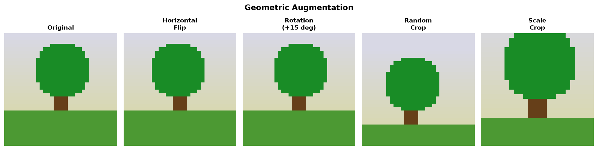
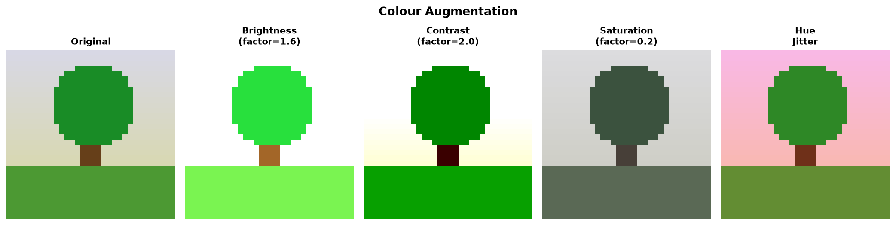
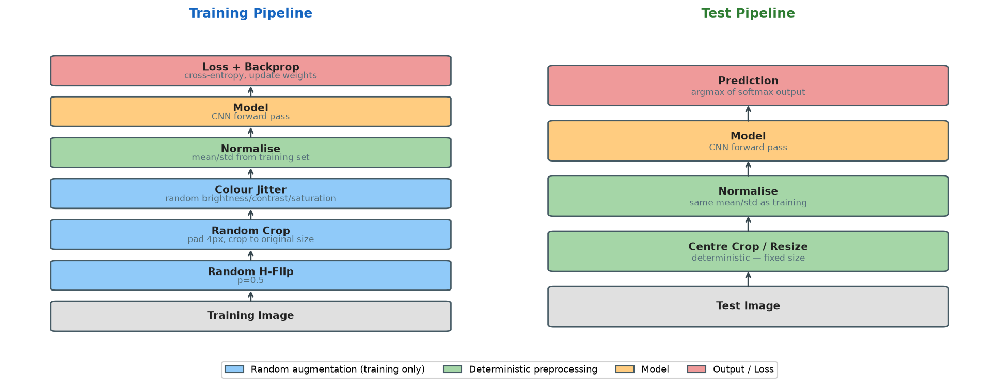
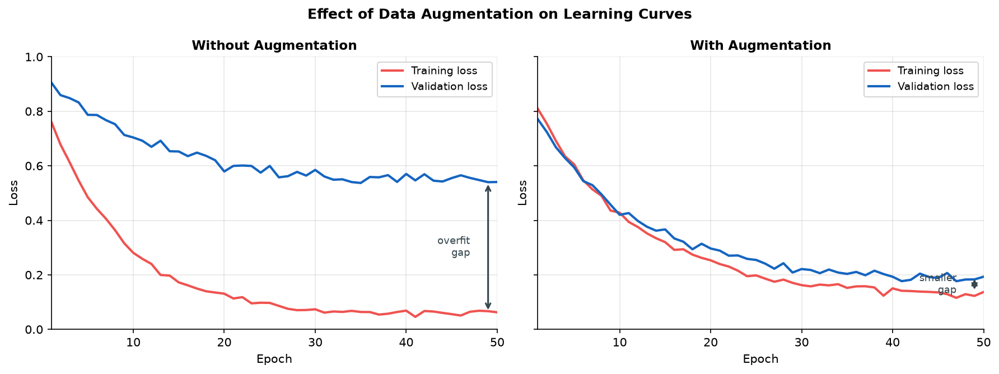

# 22 — Data Augmentation

---

## Part 1: Why Augmentation Helps

A model generalises well when it has seen enough variation in the training data to learn the underlying pattern rather than memorising specific examples. The problem is that labelled training data is expensive to collect. A dataset of 1,000 images is often all that is available — far too few for a deep CNN with millions of parameters.

**Data augmentation** artificially increases the effective size of the training set by applying label-preserving transformations to existing images. A cat is still a cat whether it is flipped horizontally, slightly rotated, or photographed in dim light. Each transformed version is a new training example with the same label.

```
Without augmentation:   1,000 images → model sees each image once per epoch
With augmentation:      1,000 images → model sees a different version each epoch
                        effectively never sees the exact same image twice
```

### The Overfitting Connection

Overfitting occurs when the model memorises the training examples rather than learning the underlying pattern. Augmentation makes memorisation harder — the model cannot simply store pixel values because the pixels change every epoch. It is forced to learn features that are stable across transformations.

This is the same mechanism as dropout (**Note 11**): both techniques prevent the model from relying on any single specific pattern. Augmentation operates on the input; dropout operates on the activations.

> Augmentation is regularisation applied at the data level. It encodes prior knowledge about which transformations should not change the label — and forces the model to learn representations that are invariant to those transformations.

---

## Part 2: Geometric Transforms

Geometric transforms change the spatial layout of the image without altering its content. Each transform encodes a specific invariance assumption.

### Horizontal Flip

Reflects the image left-to-right. A cat facing left and a cat facing right are both cats. This doubles the effective dataset size at zero cost.

```
When to use:   almost always for natural images — left-right symmetry holds
When not to:   text recognition (letters are not symmetric), medical imaging
               where left-right orientation carries clinical meaning
```

### Rotation

Rotates the image by a random angle within a range (e.g. ±15°). Encodes the assumption that the object class does not depend on small orientation changes.

```
Small rotation (±15°):   safe for most tasks — objects rarely appear perfectly upright
Large rotation (±90°):   only if the task genuinely has rotational invariance
                         (e.g. aerial/satellite imagery, microscopy)
```

### Random Crop

Crops a random sub-region of the image, then resizes back to the original dimensions. This forces the model to recognise objects from partial views and at different scales.

```
Typical implementation:
  1. Pad the image by P pixels on each side (e.g. P=4 for 32×32 images → 40×40)
  2. Randomly crop back to the original size (32×32)
  Result: the object appears at slightly different positions and scales
```

### Scaling / Resize Crop

Randomly resizes the image to a scale between a minimum and maximum fraction of the original, then crops to the target size. This is the standard augmentation for ImageNet training.

```
RandomResizedCrop(224, scale=(0.08, 1.0)):
  — randomly selects a crop covering 8% to 100% of the image area
  — resizes the crop to 224×224
  — forces the model to handle objects at very different scales
```

The diagram below shows one source image transformed by each geometric operation.



---

## Part 3: Colour Transforms

Colour transforms change the photometric properties of the image — brightness, contrast, saturation, and hue — without changing the spatial layout. They encode the assumption that the object class does not depend on lighting conditions or camera settings.

### Brightness

Adds a constant offset to all pixel values, making the image lighter or darker. Simulates different lighting conditions.

```
Brightness factor b:   pixel_out = pixel_in × b
b > 1:   brighter (overexposed)
b < 1:   darker (underexposed)
Typical range:   b ∈ [0.6, 1.4]
```

### Contrast

Scales the difference between each pixel and the mean pixel value. High contrast makes bright regions brighter and dark regions darker.

```
Contrast factor c:   pixel_out = mean + c × (pixel_in - mean)
c > 1:   higher contrast
c < 1:   lower contrast (washed out)
```

### Saturation

Scales the colourfulness of the image. At saturation=0, the image becomes greyscale. At saturation=2, colours are twice as vivid.

### Hue Jitter

Shifts all hue values by a random amount. A red apple becomes slightly orange or slightly purple. This prevents the model from relying on exact colour values.

```
Hue shift h:   hue_out = (hue_in + h) mod 360
Typical range:   h ∈ [-0.1, 0.1]  (small shifts — large shifts change semantics)
```

In PyTorch, all four are combined in a single transform:

```python
transforms.ColorJitter(brightness=0.4, contrast=0.4, saturation=0.4, hue=0.1)
```

The diagram below shows one source image with each colour transform applied independently.



---

## Part 4: Augmentation at Training Time Only

Augmentation is applied **only during training**. The test set is never augmented.

### Why Not Augment the Test Set?

The test set measures the model's performance on real, unmodified data — the kind of data it will encounter in deployment. Augmenting the test set would change what is being measured. The goal is to evaluate the model on the actual distribution of inputs, not on artificially transformed versions.

```
Training pipeline:
  image → random flip → random crop → colour jitter → normalise → model → loss

Test pipeline:
  image → (resize/centre crop only) → normalise → model → prediction
```

The only preprocessing applied at test time is deterministic: resize to the expected input size and normalise with the training set statistics. No random transforms.

The diagram below shows the two pipelines side by side.



### Test-Time Augmentation (TTA)

An exception exists: **test-time augmentation** applies multiple deterministic transforms to each test image, runs the model on each version, and averages the predictions. This is used to squeeze out extra accuracy at inference time — not for training.

```
TTA example:
  original + horizontal flip + 4 crops → 6 predictions → average → final prediction
```

TTA is a deployment technique, not a training technique. It increases inference cost by a factor equal to the number of augmented versions.

---

## Part 5: Augmentation as Regularisation

Augmentation reduces overfitting by the same mechanism as other regularisation techniques — it prevents the model from memorising the training data. The connection to other regularisers is direct.

### Comparison with Other Regularisers

| Technique | Where it acts | Mechanism |
|---|---|---|
| L2 regularisation | Weight values | Penalises large weights |
| Dropout | Activations | Randomly zeros neurons |
| Augmentation | Input data | Randomly transforms inputs |
| Early stopping | Training process | Stops before overfitting |

All four reduce the gap between training and validation loss. Augmentation and dropout are complementary — they act at different levels of the network and are typically used together.

### Effect on Learning Curves

Without augmentation, a model trained on a small dataset will overfit quickly — training loss continues to fall while validation loss rises. With augmentation, the model sees a different version of each image every epoch, making it harder to memorise. The validation loss stays lower and the gap between training and validation loss is smaller.

The diagram below shows learning curves with and without augmentation on the same dataset.



### When to Use Augmentation

```
Always use:
  — horizontal flip for natural images (almost always valid)
  — random crop with padding (standard for CIFAR-10, ImageNet)

Use when domain supports it:
  — rotation: aerial imagery, microscopy, satellite data
  — colour jitter: natural images with variable lighting
  — vertical flip: aerial/satellite imagery (not for upright objects)

Use carefully:
  — large rotations: only if objects genuinely appear at all orientations
  — hue jitter: keep small — large hue shifts change object identity
  — aggressive cropping: ensure the object of interest remains in the crop

Do not use:
  — on the test set (except TTA at inference time)
  — transforms that change the label (e.g. flipping a digit 6 → 9)
```

---

## Summary

Key takeaways:

- Data augmentation artificially increases the effective training set size by applying label-preserving transformations — a cat is still a cat when flipped, rotated, or photographed in different lighting
- Augmentation is regularisation at the data level: it prevents memorisation by ensuring the model never sees the exact same input twice, forcing it to learn transformation-invariant features
- Geometric transforms (flip, rotation, crop, scale) encode spatial invariances — the assumption that the label does not depend on position, orientation, or scale
- Colour transforms (brightness, contrast, saturation, hue) encode photometric invariances — the assumption that the label does not depend on lighting conditions or camera settings
- Augmentation is applied only during training — the test set uses deterministic preprocessing only, so that evaluation measures performance on the real data distribution
- Test-time augmentation (TTA) is a separate inference technique that averages predictions over multiple deterministic transforms to improve accuracy at the cost of compute
- Augmentation and dropout are complementary regularisers — augmentation acts on the input, dropout acts on the activations; both are typically used together for image classification
