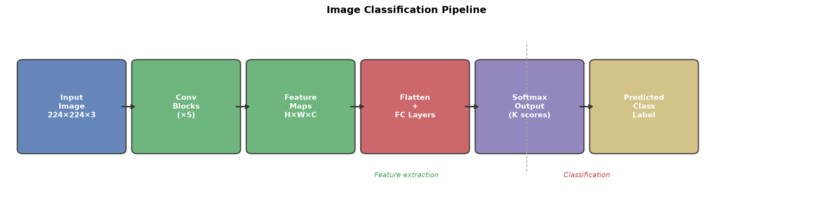
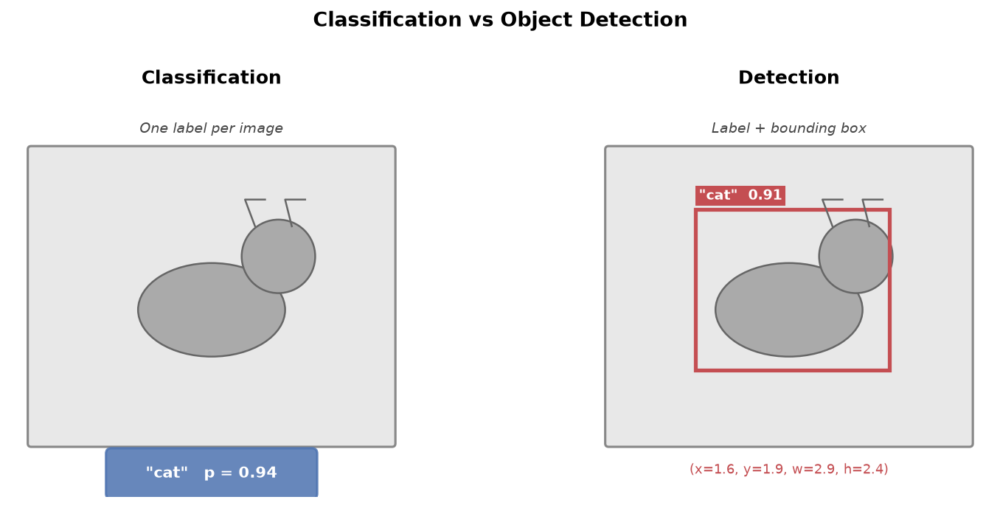
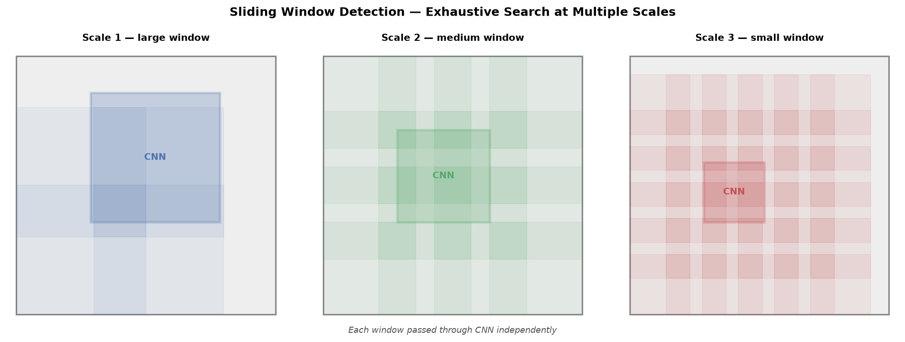
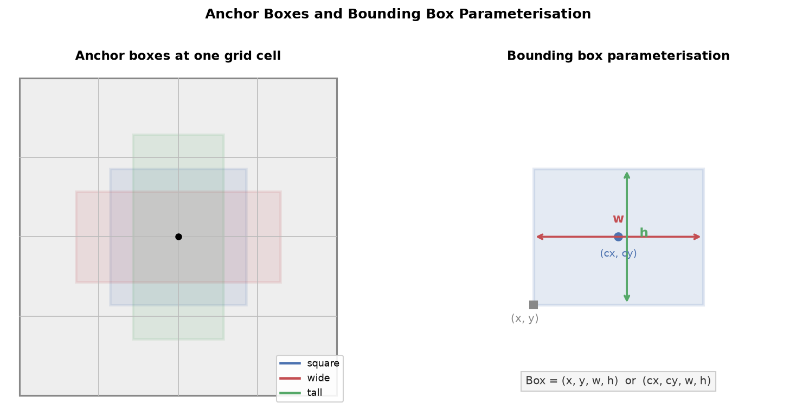
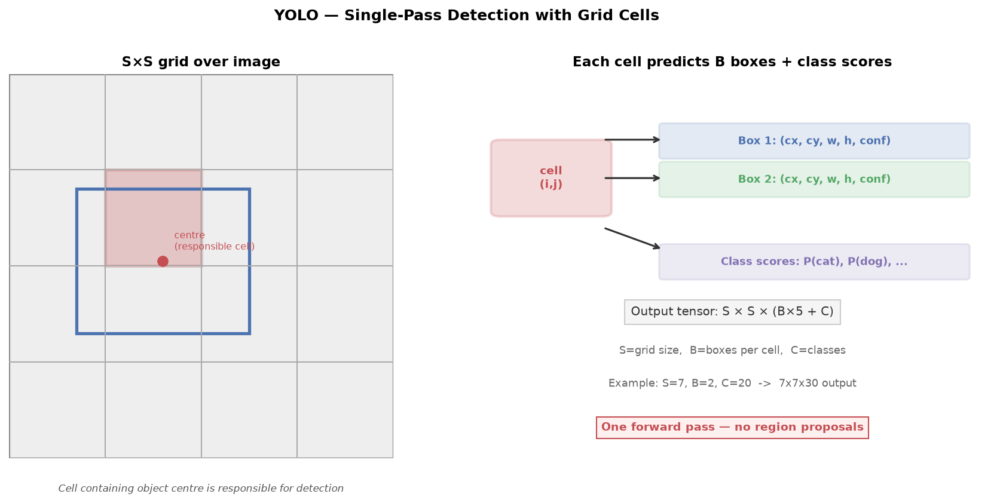

# 23 — Case Studies: Image Classification and Object Detection

---

## Part 1: The Image Classification Pipeline

Notes 19–22 introduced the building blocks of CNNs: local receptive fields, convolution, pooling, transfer learning, and augmentation. This note assembles those pieces into two complete systems — image classification and object detection — and examines how each works end to end.

### The Full Pipeline

Image classification takes a single image and assigns it one label from a fixed set of categories. The pipeline has two stages: feature extraction and classification.

```
Input image (H × W × 3)
    ↓
Convolutional blocks
  — each block: Conv → BN → ReLU → Pool
  — spatial dimensions shrink, depth grows
  — early layers: edges and textures
  — late layers: object parts and semantic features
    ↓
Feature volume (H' × W' × C)
    ↓
Flatten  →  FC layers
  — collapse spatial structure
  — combine features into a prediction vector
    ↓
Softmax
  — convert raw scores to probabilities
  — one probability per class, sum to 1
    ↓
Predicted class label  (argmax of softmax output)
```

The diagram below shows the full pipeline from input image to predicted label.



### What Each Stage Does

The convolutional blocks are the feature extractor — they transform the raw pixel values into a compact, semantically rich representation. The FC layers are the classifier — they map that representation to class scores. The softmax converts scores to probabilities so the output can be interpreted as confidence.

```
Feature extractor:   learns what to look for — task-agnostic in early layers
Classifier:          learns how to decide — task-specific, replaced in transfer learning
```

This separation is exactly what transfer learning (**Note 21**) exploits: the feature extractor transfers across tasks; only the classifier is replaced.

### Confidence and the Argmax Decision

The softmax output is a probability distribution over K classes. The predicted class is the one with the highest probability:

```
ŷ = argmax_k  softmax(z)_k

Example (3-class):
  z = [3.2, 1.1, 0.4]
  softmax = [0.83, 0.15, 0.02]
  predicted class = 0   (83% confidence)
```

The model is always forced to pick one class — even if the image contains no recognisable object. This is a fundamental limitation of closed-set classification: the model cannot say "I don't know."

> The classification pipeline is a function from image to probability distribution. The argmax gives the prediction; the probability gives the confidence. A high-confidence wrong prediction is more dangerous than a low-confidence wrong prediction — it signals a failure of calibration, not just accuracy.

---

## Part 2: From Classification to Detection

Classification answers: *what is in this image?*
Detection answers: *what is in this image, and where is it?*

The difference is localisation. Detection requires the network to output not just a class label but also the spatial location of each object — a **bounding box**.

```
Classification output:   one label + one confidence score
Detection output:        a list of (bounding box, label, confidence) tuples
                         one tuple per detected object
                         variable number of objects per image
```

The diagram below shows the two tasks side by side on the same image.



### Why Detection Is Harder

Three properties make detection fundamentally harder than classification:

```
1. Variable output size:
   Classification always outputs K numbers (one per class).
   Detection outputs a variable number of boxes — zero, one, or many.

2. Two simultaneous tasks:
   The network must solve regression (where is the box?) and
   classification (what is in the box?) at the same time.

3. Scale and aspect ratio variation:
   Objects appear at different sizes and shapes.
   A person standing is tall and narrow. A car is wide and short.
   The network must handle all combinations.
```

---

## Part 3: Bounding Boxes as Regression Targets

A bounding box is a rectangle that tightly encloses an object. It is represented as four numbers. Two conventions are common:

```
Corner format:    (x_min, y_min, x_max, y_max)
                  top-left corner and bottom-right corner

Centre format:    (cx, cy, w, h)
                  centre coordinates, width, height
```

Coordinates are typically normalised to [0, 1] relative to the image dimensions, so the representation is resolution-independent.

```
Image: 640 × 480 pixels
Object at pixel (128, 96) to (384, 336)

Corner format (normalised):
  x_min = 128/640 = 0.20
  y_min =  96/480 = 0.20
  x_max = 384/640 = 0.60
  y_max = 336/480 = 0.70

Centre format (normalised):
  cx = (0.20 + 0.60) / 2 = 0.40
  cy = (0.20 + 0.70) / 2 = 0.45
  w  = 0.60 − 0.20       = 0.40
  h  = 0.70 − 0.20       = 0.50
```

### Bounding Box Prediction as Regression

The network predicts bounding box coordinates as continuous values — this is a regression problem, not a classification problem. The loss for box coordinates is typically smooth L1 loss (also called Huber loss):

```
smooth_L1(x) = 0.5 x²          if |x| < 1
               |x| − 0.5       otherwise
```

Smooth L1 is less sensitive to outliers than MSE — a single badly predicted box does not dominate the gradient.

The total detection loss combines the box regression loss and the classification loss:

```
L_total = L_classification + λ × L_box

where λ balances the two terms (typically λ = 1 or 5)
```

> Bounding box prediction is regression, not classification. The network outputs four continuous numbers per box. This means detection requires solving two different loss functions simultaneously — one for the class, one for the coordinates.

---

## Part 4: Sliding Window Detection

The most direct approach to detection is to ask: could there be an object at this location and scale? Repeat for every location and every scale. This is the **sliding window** approach.

### How It Works

```
For each scale s in {small, medium, large}:
    Resize the image to scale s
    For each position (x, y) in a dense grid:
        Extract the window at (x, y) with fixed size W × W
        Pass the window through a CNN classifier
        If classifier confidence > threshold:
            Record (x, y, W, W, class, confidence) as a detection
```

The diagram below shows windows of three different sizes scanning across an image.



### Why It Is Correct in Principle

Sliding window is exhaustive — it checks every possible location and scale. If the classifier is accurate and the grid is dense enough, it will find every object. The approach requires no architectural changes to the CNN — any image classifier can be used directly.

### Why It Is Computationally Brutal

The number of windows grows rapidly:

```
Image: 224 × 224
Window: 32 × 32, stride 8
Positions per scale: ((224 − 32) / 8 + 1)² = 25² = 625
Scales: 5
Total windows: 625 × 5 = 3,125 forward passes per image
```

Each forward pass is a full CNN inference. For a network that takes 10ms per image, 3,125 windows takes 31 seconds — far too slow for real-time use. And this is a small example; real detectors use finer strides and more scales.

> Sliding window is the conceptually correct solution to detection. Its failure is not correctness but efficiency. Every subsequent detection method — region proposals, anchor boxes, YOLO — is an attempt to get the same correctness with a fraction of the compute.

---

## Part 5: Region Proposal Networks

The inefficiency of sliding window comes from checking every location. Most windows contain only background — no object. The key insight behind region-based detection is: **generate candidate regions first, then classify only those**.

### Selective Search

Before deep learning, **selective search** was the standard region proposal method. It groups pixels into regions based on colour, texture, and size similarity, then merges regions bottom-up to produce a set of candidate bounding boxes — typically 2,000 proposals per image, covering most objects while discarding most background.

```
Sliding window:   ~3,000 windows, most are background
Selective search: ~2,000 proposals, most contain objects
```

The proposals are not classified — they are just candidate locations. A CNN then classifies each proposal. This is the basis of **R-CNN** (Regions with CNN features, Girshick et al., 2014).

### Anchor Boxes

Selective search is not learned — it uses hand-crafted heuristics. A learned alternative is the **anchor box** approach used in Faster R-CNN (Ren et al., 2015).

At each position in the feature map, a fixed set of **anchor boxes** is defined — boxes of different scales and aspect ratios, all centred at that position. The network predicts, for each anchor:

```
1. Objectness score:   is there an object here? (binary)
2. Box offsets:        how much to adjust (cx, cy, w, h) from the anchor
```

Anchors that overlap significantly with a ground-truth box are labelled positive. Anchors that overlap very little are labelled negative. The network learns to predict which anchors contain objects and how to refine their coordinates.

```
Typical anchor configuration:
  3 scales × 3 aspect ratios = 9 anchors per position
  Feature map: 14 × 14
  Total anchors: 14 × 14 × 9 = 1,764 per image
```

The diagram below shows three anchor boxes of different aspect ratios centred at one grid cell, and the bounding box parameterisation.



### Two-Stage Detection

Region-based detectors are **two-stage**:

```
Stage 1 — Region Proposal Network (RPN):
  Scans the feature map, proposes ~300 candidate regions
  Fast — shares computation with the backbone

Stage 2 — Detection Head:
  For each proposal: classify the object and refine the box
  Slower — runs once per proposal
```

The two-stage approach is accurate but slower than single-stage methods. The R-CNN family (R-CNN → Fast R-CNN → Faster R-CNN) progressively moved more computation into the shared backbone to reduce cost.

---

## Part 6: YOLO — Single-Pass Detection

Two-stage detectors are accurate but slow because they run the detection head once per proposal. **YOLO** (You Only Look Once, Redmon et al., 2016) eliminates the proposal stage entirely — it predicts all boxes and all class scores in a single forward pass.

### The Grid Cell Idea

YOLO divides the image into an S×S grid. Each grid cell is responsible for detecting objects whose **centre falls within that cell**.

Each cell predicts:
- B bounding boxes, each with 5 values: (cx, cy, w, h, confidence)
- C class probability scores (shared across all B boxes in the cell)

```
Output tensor shape:   S × S × (B × 5 + C)

Original YOLO (2016):  S=7, B=2, C=20 (Pascal VOC)
Output:                7 × 7 × 30
```

The diagram below shows the S×S grid, the responsible cell for a detected object, and the structure of each cell's prediction.



### The Confidence Score

The confidence score for each predicted box combines two things:

```
confidence = P(object) × IoU(predicted box, ground truth box)

P(object):   1 if an object centre falls in this cell, 0 otherwise
IoU:         overlap between predicted box and ground truth box
             (Intersection over Union — ranges from 0 to 1)
```

At test time, the final class-specific confidence for each box is:

```
class confidence = class score × box confidence
                 = P(class | object) × P(object) × IoU
```

### IoU — Intersection over Union

IoU measures how well a predicted box matches a ground truth box:

```
IoU = area of intersection / area of union

IoU = 1.0:   perfect overlap
IoU = 0.5:   standard detection threshold (box is "correct" if IoU ≥ 0.5)
IoU = 0.0:   no overlap
```

### Non-Maximum Suppression

YOLO produces many overlapping boxes for the same object — multiple cells near the object centre may predict it. **Non-maximum suppression (NMS)** removes duplicates:

```
1. Sort all boxes by confidence score (highest first)
2. Keep the highest-confidence box
3. Remove all other boxes with IoU > threshold (e.g. 0.5) with the kept box
4. Repeat for remaining boxes
```

### YOLO vs Two-Stage Detectors

```
                    Two-stage (Faster R-CNN)    One-stage (YOLO)
─────────────────   ─────────────────────────   ─────────────────
Forward passes      2 (RPN + head)              1
Speed               ~5 fps (VGG backbone)       ~45 fps (original)
Accuracy (mAP)      Higher                      Lower (original)
Small objects       Better                      Worse
Architecture        More complex                Simpler
```

YOLO trades some accuracy for a large speed gain. Later versions (YOLOv3, YOLOv5, YOLOv8) close the accuracy gap significantly while maintaining real-time speed.

> YOLO reframes detection as a single regression problem: given an image, directly predict all bounding boxes and class scores in one pass. The grid cell assignment is the key structural decision — it gives each cell a defined responsibility and makes the output tensor a fixed size regardless of the number of objects.

---

## Summary

Key takeaways:

- The image classification pipeline has two stages: a convolutional feature extractor (conv blocks → feature volume) and a classifier (flatten → FC → softmax → argmax); the feature extractor is reusable across tasks, the classifier is task-specific
- Object detection extends classification by adding localisation — the network must output a bounding box (cx, cy, w, h) for each detected object in addition to its class label; this makes detection a simultaneous regression and classification problem
- Bounding box coordinates are regression targets, not class labels — the loss is smooth L1 (Huber loss), and coordinates are typically normalised to [0, 1] relative to image dimensions
- Sliding window detection is exhaustive and correct in principle but computationally prohibitive — it requires thousands of forward passes per image at multiple scales
- Region proposal networks (Faster R-CNN) reduce the search space by generating ~300 candidate regions from the feature map using anchor boxes, then classifying only those regions — two-stage detection is more accurate but slower
- Anchor boxes define a fixed set of candidate shapes (different scales and aspect ratios) at each feature map position; the network predicts objectness scores and coordinate offsets relative to each anchor
- YOLO divides the image into an S×S grid and predicts all bounding boxes and class scores in a single forward pass — one-stage detection is faster but historically less accurate on small objects
- IoU (Intersection over Union) measures box quality: IoU = intersection area / union area; a predicted box is considered correct if IoU ≥ 0.5 with the ground truth box
- Non-maximum suppression removes duplicate detections by keeping the highest-confidence box and discarding overlapping boxes above an IoU threshold
