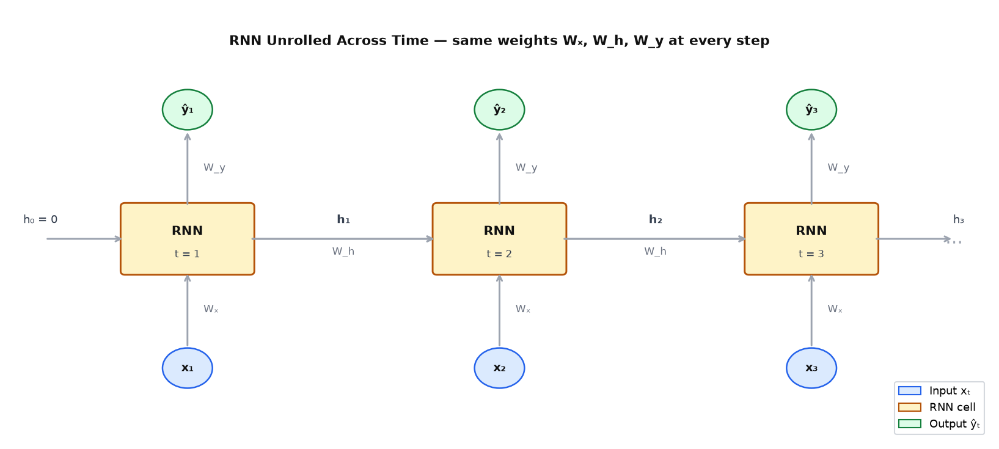
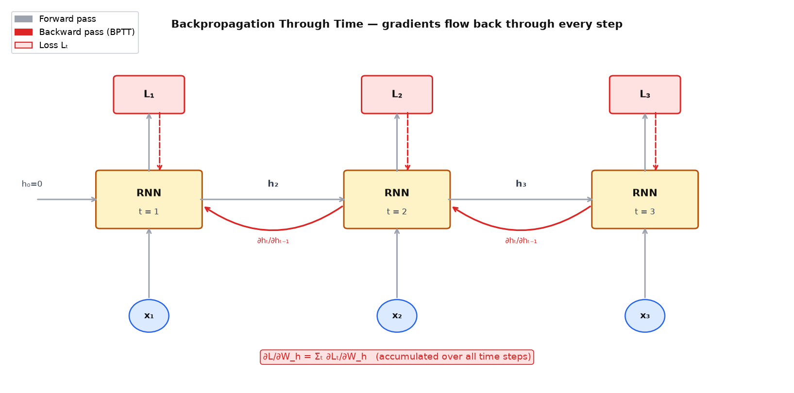
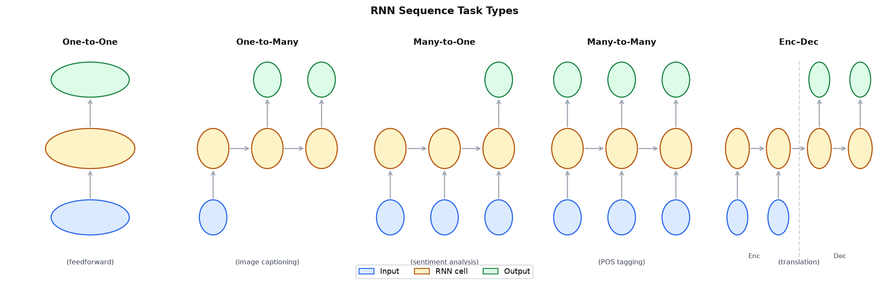

# 24 — Recurrent Neural Networks

---

## Part 1: The Problem with Feedforward Networks on Sequences

Every network covered so far takes a fixed-size input and produces a fixed-size output. A feedforward network processing a sentence of 10 words and a sentence of 50 words would need to be two different networks — or the input would need to be padded to a fixed length, discarding the variable structure entirely.

But the deeper problem is not size — it is **order and memory**. Consider predicting the next word in:

> "The cat sat on the ___"

The correct answer depends on the entire preceding context. A feedforward network that receives all words simultaneously as a flat vector has no way to represent the fact that "The" came first and "the" came fifth. It treats the input as an unordered bag of features. Shuffling the words would produce the same internal representation.

Natural sequences — language, time series, audio, DNA — have two properties that feedforward networks cannot exploit:

```
1. Variable length:   sequences differ in length; a fixed input size cannot accommodate this
2. Temporal order:    the meaning of a token depends on what came before it;
                      position matters, not just presence
```

What is needed is a network that processes one element at a time and carries a **memory** of what it has seen so far into the next step. This is what a Recurrent Neural Network does.

> A feedforward network sees the whole input at once and has no memory. A recurrent network processes one step at a time and passes a summary of its history forward. The hidden state is that summary.

---

## Part 2: The RNN Architecture

A **Recurrent Neural Network (RNN)** processes a sequence $x_1, x_2, \ldots, x_T$ one element at a time. At each time step $t$, it maintains a **hidden state** $h_t$ — a fixed-size vector that summarises everything the network has seen up to and including step $t$.

### The Update Equations

At each time step $t$, the hidden state is updated using the current input $x_t$ and the previous hidden state $h_{t-1}$:

$$z_t = W_h h_{t-1} + W_x x_t + b_h$$

$$h_t = \tanh(z_t)$$

The output at step $t$ (when needed) is:

$$\hat{y}_t = \text{softmax}(W_y h_t + b_y)$$

Where:
- $x_t \in \mathbb{R}^{n}$ — input at time step $t$, $n$ is the input size
- $h_t \in \mathbb{R}^{d}$ — hidden state at time step $t$, $d$ is the hidden size
- $h_0 = \mathbf{0}$ — initial hidden state, set to zero before the sequence begins

An RNN has **three weight matrices** and **two bias vectors**:

| Parameter | Shape | Role |
|---|---|---|
| $W_x$ | $d \times n$ | Maps the current input $x_t$ into hidden space — what does this new token contribute? |
| $W_h$ | $d \times d$ | Maps the previous hidden state $h_{t-1}$ into hidden space — what does memory contribute? |
| $b_h$ | $d$ | Bias for the hidden update |
| $W_y$ | $K \times d$ | Maps the hidden state $h_t$ to the output — what does the network predict? |
| $b_y$ | $K$ | Bias for the output, $K$ is the number of output classes |

$W_x$ and $W_h$ are both used at every time step to compute $z_t$. They are separate matrices because they transform different things — $W_x$ transforms the input (shape $n$) and $W_h$ transforms the hidden state (shape $d$). These two shapes are generally different, so a single matrix cannot do both jobs. $W_y$ is only applied when an output is needed at that step.

### Weight Sharing Across Time

The same weight matrices $W_h$, $W_x$, $W_y$ are used at every time step. This is the recurrent analogue of parameter sharing in CNNs — the same transformation is applied at every position. It means the network has the same number of parameters regardless of sequence length, and it can generalise to sequences longer than those seen during training.

### The Unrolled View

The diagram below shows the RNN unrolled across time steps — the same network repeated at each step, with the hidden state passed from one step to the next.



> The hidden state $h_t$ is the network's memory. It is a compressed summary of the entire input history $x_1, \ldots, x_t$. Everything the network knows about the past is encoded in this single vector.

---

## Part 3: Forward Pass Through Time

### Numerical Example

A minimal RNN with scalar inputs ($n=1$), hidden size $d=2$, no output layer. All weights and biases are given explicitly.

$$W_x = \begin{bmatrix} 0.5 \\ -0.3 \end{bmatrix}, \quad W_h = \begin{bmatrix} 0.4 & 0.1 \\ -0.2 & 0.6 \end{bmatrix}, \quad b_h = \begin{bmatrix} 0 \\ 0 \end{bmatrix}, \quad h_0 = \begin{bmatrix} 0 \\ 0 \end{bmatrix}$$

Input sequence: $x_1 = 1.0,\ x_2 = 0.5,\ x_3 = -1.0$.

**Step $t=1$:**

$$z_1 = W_h h_0 + W_x x_1 + b_h = \begin{bmatrix} 0.4 & 0.1 \\ -0.2 & 0.6 \end{bmatrix} \begin{bmatrix} 0 \\ 0 \end{bmatrix} + \begin{bmatrix} 0.5 \\ -0.3 \end{bmatrix}(1.0) + \begin{bmatrix} 0 \\ 0 \end{bmatrix} = \begin{bmatrix} 0.5 \\ -0.3 \end{bmatrix}$$

$$h_1 = \tanh\begin{bmatrix} 0.5 \\ -0.3 \end{bmatrix} = \begin{bmatrix} 0.4621 \\ -0.2913 \end{bmatrix}$$

**Step $t=2$:**

$$z_2 = W_h h_1 + W_x x_2 = \begin{bmatrix} 0.4 & 0.1 \\ -0.2 & 0.6 \end{bmatrix} \begin{bmatrix} 0.4621 \\ -0.2913 \end{bmatrix} + \begin{bmatrix} 0.5 \\ -0.3 \end{bmatrix}(0.5)$$

$$= \begin{bmatrix} 0.4 \times 0.4621 + 0.1 \times (-0.2913) \\ -0.2 \times 0.4621 + 0.6 \times (-0.2913) \end{bmatrix} + \begin{bmatrix} 0.25 \\ -0.15 \end{bmatrix} = \begin{bmatrix} 0.1557 \\ -0.2673 \end{bmatrix} + \begin{bmatrix} 0.25 \\ -0.15 \end{bmatrix} = \begin{bmatrix} 0.4057 \\ -0.4173 \end{bmatrix}$$

$$h_2 = \tanh\begin{bmatrix} 0.4057 \\ -0.4173 \end{bmatrix} = \begin{bmatrix} 0.3852 \\ -0.3944 \end{bmatrix}$$

**Step $t=3$:**

$$z_3 = W_h h_2 + W_x x_3 = \begin{bmatrix} 0.4 & 0.1 \\ -0.2 & 0.6 \end{bmatrix} \begin{bmatrix} 0.3852 \\ -0.3944 \end{bmatrix} + \begin{bmatrix} 0.5 \\ -0.3 \end{bmatrix}(-1.0)$$

$$= \begin{bmatrix} 0.4 \times 0.3852 + 0.1 \times (-0.3944) \\ -0.2 \times 0.3852 + 0.6 \times (-0.3944) \end{bmatrix} + \begin{bmatrix} -0.5 \\ 0.3 \end{bmatrix} = \begin{bmatrix} 0.1147 \\ -0.3137 \end{bmatrix} + \begin{bmatrix} -0.5 \\ 0.3 \end{bmatrix} = \begin{bmatrix} -0.3853 \\ -0.0137 \end{bmatrix}$$

$$h_3 = \tanh\begin{bmatrix} -0.3853 \\ -0.0137 \end{bmatrix} = \begin{bmatrix} -0.3685 \\ -0.0137 \end{bmatrix}$$

The final hidden state $h_3$ encodes a summary of the entire sequence $(1.0,\ 0.5,\ -1.0)$. In a many-to-one task (e.g. sequence classification), $h_3$ would be passed to an output layer to produce a prediction.

### Character-Level Example

In a character-level RNN, each input $x_t$ is a one-hot vector over the vocabulary. For the vocabulary $\{$h, e, l, o$\}$ (size $V=4$), the character 'h' is represented as:

$$x_{\text{h}} = \begin{bmatrix} 1 \\ 0 \\ 0 \\ 0 \end{bmatrix}, \quad x_{\text{e}} = \begin{bmatrix} 0 \\ 1 \\ 0 \\ 0 \end{bmatrix}, \quad x_{\text{l}} = \begin{bmatrix} 0 \\ 0 \\ 1 \\ 0 \end{bmatrix}, \quad x_{\text{o}} = \begin{bmatrix} 0 \\ 0 \\ 0 \\ 1 \end{bmatrix}$$

Processing the sequence "hel" with hidden size $d=3$, $W_x \in \mathbb{R}^{3 \times 4}$, $W_h \in \mathbb{R}^{3 \times 3}$:

- Step $t=1$: input $x_{\text{h}}$ — $W_x x_{\text{h}}$ selects the first column of $W_x$
- Step $t=2$: input $x_{\text{e}}$ — $W_x x_{\text{e}}$ selects the second column of $W_x$, combined with $W_h h_1$
- Step $t=3$: input $x_{\text{l}}$ — $W_x x_{\text{l}}$ selects the third column, combined with $W_h h_2$

At each step, the output $\hat{y}_t = \text{softmax}(W_y h_t + b_y)$ is a probability distribution over the vocabulary — the model's prediction of the next character. Trained on "hello", the model should learn to predict 'e' after 'h', 'l' after 'e', 'l' after 'l', and 'o' after the second 'l'.

> Multiplying a one-hot vector by a weight matrix is equivalent to looking up the corresponding column. The embedding of a character is simply the column of $W_x$ associated with that character — $W_x$ acts as a learned character embedding table.

---

## Part 4: Backpropagation Through Time

### The Computational Graph Across Time

Training an RNN requires computing $\frac{\partial L}{\partial W_h}$, $\frac{\partial L}{\partial W_x}$, and $\frac{\partial L}{\partial W_y}$. Because the same weights are used at every step, the gradient of the loss with respect to $W_h$ accumulates contributions from every time step.

For a sequence of length $T$ with loss $L = \sum_{t=1}^{T} L_t$, the gradient with respect to $W_h$ is:

$$\frac{\partial L}{\partial W_h} = \sum_{t=1}^{T} \frac{\partial L_t}{\partial W_h}$$

Each term $\frac{\partial L_t}{\partial W_h}$ requires backpropagating through all steps from $t$ back to step 1 — because $h_t$ depends on $h_{t-1}$, which depends on $h_{t-2}$, and so on. This is **Backpropagation Through Time (BPTT)**.

### The Chain Rule Across Time Steps

The gradient of $L_t$ with respect to $h_k$ (for $k \leq t$) involves a product of Jacobians across all intermediate steps:

$$\frac{\partial h_t}{\partial h_k} = \prod_{i=k+1}^{t} \frac{\partial h_i}{\partial h_{i-1}} = \prod_{i=k+1}^{t} \text{diag}(\tanh'(z_i)) \cdot W_h$$

where $\tanh'(z_i) = 1 - \tanh^2(z_i)$ is the elementwise derivative of tanh. The full gradient of $L_t$ with respect to $W_h$ is then:

$$\frac{\partial L_t}{\partial W_h} = \sum_{k=1}^{t} \frac{\partial L_t}{\partial h_t} \cdot \frac{\partial h_t}{\partial h_k} \cdot \frac{\partial h_k}{\partial W_h}$$

The diagram below shows the gradient flow during BPTT — gradients flow backward through the unrolled graph, accumulating at each step.



### Truncated BPTT

For long sequences, backpropagating all the way to step 1 is computationally expensive and numerically unstable. **Truncated BPTT** limits the backpropagation to a fixed number of steps $k$ — gradients are only propagated back $k$ steps from the current position. This is the standard approach in practice.

---

## Part 5: The Vanishing Gradient Problem in RNNs

### Why Gradients Vanish

The gradient of $h_t$ with respect to $h_k$ involves a product of $t - k$ matrices:

$$\frac{\partial h_t}{\partial h_k} = \prod_{i=k+1}^{t} \text{diag}(\tanh'(z_i)) \cdot W_h$$

Each factor in this product has two components that both push the gradient toward zero:

**1. The tanh derivative:** $\tanh'(z) = 1 - \tanh^2(z) \in (0, 1]$. It equals 1 only when $z = 0$ and shrinks toward 0 as $|z|$ grows. Multiplying many values less than 1 together produces a product that shrinks exponentially with $t - k$.

**2. The weight matrix $W_h$:** if the largest singular value of $W_h$ is less than 1, repeated multiplication by $W_h$ also shrinks the gradient exponentially.

The combined effect: for a sequence of length $T$, the gradient signal reaching step 1 from step $T$ is proportional to something like $\lambda^T$ where $\lambda < 1$. For $T = 50$, this is effectively zero.

$$\left\| \frac{\partial h_t}{\partial h_k} \right\| \leq \left( \gamma \cdot \|\tanh'\|_{\max} \right)^{t-k}$$

where $\gamma$ is related to the spectral norm of $W_h$. When this bound is less than 1, gradients vanish exponentially with distance.

### What This Means in Practice

The vanishing gradient means the RNN cannot learn **long-range dependencies** — relationships between tokens that are far apart in the sequence.

```
"The cat, which had been sitting on the mat for hours, finally ___"

The blank should be "moved" or "stood up" — it depends on "cat" 10 tokens back.
A vanilla RNN trained with BPTT will fail to learn this dependency.
The gradient signal from the blank back to "cat" has passed through 10 tanh
multiplications and is effectively zero by the time it reaches "cat".
```

The network effectively has a **short memory** — it can use the last few tokens well but loses information about earlier context. This is the fundamental limitation that motivated LSTM and GRU (**Note 25**).

> The vanishing gradient in RNNs is the same problem as in deep feedforward networks (**Note 06**), but with a crucial difference: in feedforward networks, depth is a design choice. In RNNs, depth is determined by sequence length — a 100-token sequence creates a 100-layer unrolled graph, and there is no way to make the sequence shorter.

---

## Part 6: Sequence Task Types and Applications

RNNs are not limited to one input-output configuration. The relationship between input and output sequences defines the task type.

The diagram below shows the four standard configurations — one-to-many, many-to-one, many-to-many (synchronised), and many-to-many (encoder-decoder).



- **One-to-one:** standard feedforward — single input, single output. Not recurrent.
- **One-to-many:** single input, sequence output. Example: image captioning — one image produces a sequence of words.
- **Many-to-one:** sequence input, single output. Example: sentiment analysis — a sentence produces one label (positive/negative).
- **Many-to-many (synchronised):** sequence input, sequence output, same length. Example: part-of-speech tagging — each word gets a tag.
- **Many-to-many (encoder-decoder):** sequence input, sequence output, different lengths. Example: machine translation — an English sentence produces a French sentence of different length. This architecture is covered in **Note 26**.

---

## Summary

Key takeaways:

- Feedforward networks fail on sequences because they require fixed-size inputs and have no memory of previous inputs — order and variable length cannot be handled
- An RNN processes one element at a time and maintains a hidden state $h_t = \tanh(W_h h_{t-1} + W_x x_t + b_h)$ that summarises the input history up to step $t$
- The same weight matrices $W_h$, $W_x$, $W_y$ are shared across all time steps — the network has a fixed parameter count regardless of sequence length
- In a character-level RNN, each input is a one-hot vector; multiplying by $W_x$ is equivalent to a column lookup — $W_x$ acts as a learned character embedding table
- BPTT computes gradients by unrolling the RNN through time and applying the chain rule across all steps; the gradient of the loss with respect to $W_h$ accumulates contributions from every time step
- The vanishing gradient problem in RNNs arises because the gradient of $h_t$ with respect to $h_k$ involves a product of $t-k$ Jacobians, each containing tanh derivatives less than 1 — gradients shrink exponentially with sequence length
- Vanilla RNNs have short memory — they cannot reliably learn dependencies between tokens more than a few steps apart; this is the fundamental limitation that LSTM and GRU (**Note 25**) are designed to solve
- The four sequence task types are: one-to-many (image captioning), many-to-one (sentiment analysis), many-to-many synchronised (POS tagging), and many-to-many encoder-decoder (machine translation)
