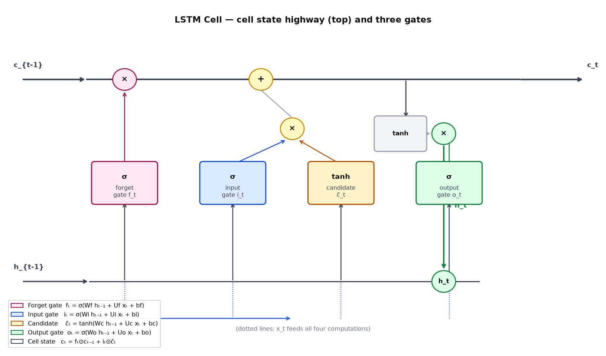
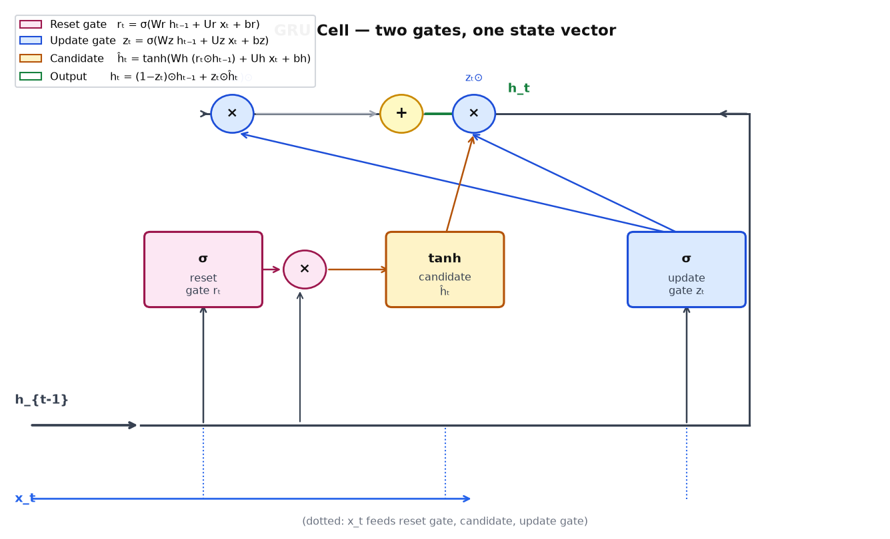

# 25 — LSTM and GRU

---

## Part 1: Why Vanilla RNNs Fail on Long Sequences

**Note 24** showed that the gradient of $h_t$ with respect to $h_k$ involves a product of $t - k$ Jacobians:

$$\frac{\partial h_t}{\partial h_k} = \prod_{i=k+1}^{t} \text{diag}(\tanh'(z_i)) \cdot W_h$$

Each factor contains tanh derivatives in $(0, 1]$. For sequences of length 50 or more, this product shrinks exponentially — the gradient signal from distant time steps reaches effectively zero. The network cannot update the weights responsible for long-range dependencies because the error signal never reaches them.

The root cause is structural: the vanilla RNN has only one mechanism for carrying information forward — the hidden state $h_t$, which is **overwritten** at every step. New input at step $t$ replaces the previous hidden state through a tanh nonlinearity. There is no way to protect information from being overwritten, and no way to selectively forget irrelevant information while preserving relevant information.

What is needed is a separate, protected memory channel that information can flow through without being repeatedly squashed by nonlinearities. This is the idea behind the **Long Short-Term Memory (LSTM)**.

> The vanilla RNN fails on long sequences not because it lacks capacity, but because it has no mechanism to protect information from being overwritten. Every step applies a tanh that compresses the hidden state — useful information from 50 steps ago has been compressed 50 times.

---

## Part 2: The LSTM Architecture

The **Long Short-Term Memory** (Hochreiter & Schmidhuber, 1997) introduces a second state vector alongside the hidden state: the **cell state** $c_t$. The cell state is the long-term memory of the network. It flows through the sequence with only linear interactions — no tanh squashing — so gradients can flow back through it without vanishing.

The hidden state $h_t$ remains the short-term memory, used for output at each step. The cell state $c_t$ is the long-term memory, protected by three learned gates.

### The Cell State Highway

The cell state update has the form:

$$c_t = f_t \odot c_{t-1} + i_t \odot \tilde{c}_t$$

where $\odot$ denotes elementwise multiplication. This is a **linear interpolation** between the old cell state and a new candidate — no tanh is applied to $c_{t-1}$ directly. Gradients flowing back through $c_t$ pass through only elementwise multiplications, not matrix multiplications with tanh derivatives. This is why LSTMs can learn dependencies across hundreds of steps.

### The Three Gates

Three sigmoid gates control what information flows through the cell state. Each gate outputs values in $(0, 1)$ — close to 0 means "block", close to 1 means "pass".

**Forget gate** $f_t$ — decides what to erase from the cell state:

$$f_t = \sigma(W_f h_{t-1} + U_f x_t + b_f)$$

**Input gate** $i_t$ — decides what new information to write to the cell state:

$$i_t = \sigma(W_i h_{t-1} + U_i x_t + b_i)$$

**Candidate cell state** $\tilde{c}_t$ — the new content proposed for writing:

$$\tilde{c}_t = \tanh(W_c h_{t-1} + U_c x_t + b_c)$$

**Cell state update** — erase with forget gate, write with input gate:

$$c_t = f_t \odot c_{t-1} + i_t \odot \tilde{c}_t$$

**Output gate** $o_t$ — decides what part of the cell state to expose as the hidden state:

$$o_t = \sigma(W_o h_{t-1} + U_o x_t + b_o)$$

**Hidden state update** — filtered view of the cell state:

$$h_t = o_t \odot \tanh(c_t)$$

### Weight Matrices and Dimensions

Let $n$ be the input size and $d$ be the hidden size. Each gate has two weight matrices and one bias:

| Parameter | Shape | Role |
|---|---|---|
| $W_f, W_i, W_c, W_o$ | $d \times d$ | Previous hidden state → gate (one per gate) |
| $U_f, U_i, U_c, U_o$ | $d \times n$ | Current input → gate (one per gate) |
| $b_f, b_i, b_c, b_o$ | $d$ | Bias (one per gate) |

Total parameters in the LSTM cell (excluding output layer): $4 \times (d^2 + dn + d) = 4d(d + n + 1)$.

The factor of 4 comes from the four separate computations — forget gate, input gate, candidate, output gate — each with its own full set of weights. This is four times the parameters of a vanilla RNN cell.

The diagram below shows the LSTM cell — the cell state highway running across the top, the three gates controlling what flows in and out.



> The cell state $c_t$ is the key innovation. It flows through the network with only elementwise operations — no matrix multiplication, no tanh applied directly to it. Gradients can flow back through $c_t$ across hundreds of steps without vanishing. The gates learn when to protect it, when to update it, and when to read from it.

---

## Part 3: LSTM Forward Pass — Worked Example

A minimal LSTM with input size $n = 1$, hidden size $d = 2$. All weights are given explicitly. This traces one time step from $h_0, c_0$ to $h_1, c_1$.

$$h_0 = \begin{bmatrix} 0 \\ 0 \end{bmatrix}, \quad c_0 = \begin{bmatrix} 0 \\ 0 \end{bmatrix}, \quad x_1 = 1.0$$

Weights (each $W \in \mathbb{R}^{2 \times 2}$, each $U \in \mathbb{R}^{2 \times 1}$, each $b \in \mathbb{R}^2$):

$$W_f = \begin{bmatrix} 0.1 & 0.2 \\ 0.3 & 0.4 \end{bmatrix}, \quad U_f = \begin{bmatrix} 0.5 \\ 0.6 \end{bmatrix}, \quad b_f = \begin{bmatrix} -1.0 \\ -1.0 \end{bmatrix}$$

$$W_i = \begin{bmatrix} 0.2 & 0.1 \\ 0.4 & 0.3 \end{bmatrix}, \quad U_i = \begin{bmatrix} 0.7 \\ 0.8 \end{bmatrix}, \quad b_i = \begin{bmatrix} 0.0 \\ 0.0 \end{bmatrix}$$

$$W_c = \begin{bmatrix} 0.3 & 0.1 \\ 0.2 & 0.4 \end{bmatrix}, \quad U_c = \begin{bmatrix} 0.6 \\ 0.5 \end{bmatrix}, \quad b_c = \begin{bmatrix} 0.0 \\ 0.0 \end{bmatrix}$$

$$W_o = \begin{bmatrix} 0.4 & 0.2 \\ 0.1 & 0.3 \end{bmatrix}, \quad U_o = \begin{bmatrix} 0.8 \\ 0.7 \end{bmatrix}, \quad b_o = \begin{bmatrix} 0.0 \\ 0.0 \end{bmatrix}$$

Since $h_0 = \mathbf{0}$, all $W \cdot h_0$ terms vanish. Each gate reduces to $U \cdot x_1 + b$.

**Forget gate:**

$$f_1 = \sigma\left(\begin{bmatrix} 0.5 \\ 0.6 \end{bmatrix}(1.0) + \begin{bmatrix} -1.0 \\ -1.0 \end{bmatrix}\right) = \sigma\begin{bmatrix} -0.5 \\ -0.4 \end{bmatrix} = \begin{bmatrix} 0.3775 \\ 0.4013 \end{bmatrix}$$

**Input gate:**

$$i_1 = \sigma\left(\begin{bmatrix} 0.7 \\ 0.8 \end{bmatrix}(1.0) + \begin{bmatrix} 0 \\ 0 \end{bmatrix}\right) = \sigma\begin{bmatrix} 0.7 \\ 0.8 \end{bmatrix} = \begin{bmatrix} 0.6682 \\ 0.6900 \end{bmatrix}$$

**Candidate cell state:**

$$\tilde{c}_1 = \tanh\left(\begin{bmatrix} 0.6 \\ 0.5 \end{bmatrix}(1.0)\right) = \tanh\begin{bmatrix} 0.6 \\ 0.5 \end{bmatrix} = \begin{bmatrix} 0.5370 \\ 0.4621 \end{bmatrix}$$

**Cell state update** ($f_1 \odot c_0 = \mathbf{0}$ since $c_0 = \mathbf{0}$):

$$c_1 = f_1 \odot c_0 + i_1 \odot \tilde{c}_1 = \mathbf{0} + \begin{bmatrix} 0.6682 \\ 0.6900 \end{bmatrix} \odot \begin{bmatrix} 0.5370 \\ 0.4621 \end{bmatrix} = \begin{bmatrix} 0.3588 \\ 0.3189 \end{bmatrix}$$

**Output gate:**

$$o_1 = \sigma\left(\begin{bmatrix} 0.8 \\ 0.7 \end{bmatrix}(1.0)\right) = \sigma\begin{bmatrix} 0.8 \\ 0.7 \end{bmatrix} = \begin{bmatrix} 0.6900 \\ 0.6682 \end{bmatrix}$$

**Hidden state:**

$$h_1 = o_1 \odot \tanh(c_1) = \begin{bmatrix} 0.6900 \\ 0.6682 \end{bmatrix} \odot \tanh\begin{bmatrix} 0.3588 \\ 0.3189 \end{bmatrix} = \begin{bmatrix} 0.6900 \\ 0.6682 \end{bmatrix} \odot \begin{bmatrix} 0.3452 \\ 0.3101 \end{bmatrix} = \begin{bmatrix} 0.2382 \\ 0.2072 \end{bmatrix}$$

The forget gate values $[0.38, 0.40]$ are both below 0.5 — the network is mostly forgetting the previous cell state (which is zero here anyway). The input gate values $[0.67, 0.69]$ are above 0.5 — the network is writing the new candidate into the cell state. The output gate $[0.69, 0.67]$ exposes a filtered version of the cell state as the hidden state.

---

## Part 4: The GRU

The **Gated Recurrent Unit** (Cho et al., 2014) simplifies the LSTM by merging the cell state and hidden state into a single vector and reducing three gates to two. There is no separate $c_t$ — the hidden state $h_t$ serves as both short-term and long-term memory.

### GRU Equations

**Reset gate** $r_t$ — controls how much of the previous hidden state to use when computing the candidate:

$$r_t = \sigma(W_r h_{t-1} + U_r x_t + b_r)$$

**Update gate** $z_t$ — controls how much of the previous hidden state to keep versus how much to replace with the new candidate:

$$z_t = \sigma(W_z h_{t-1} + U_z x_t + b_z)$$

**Candidate hidden state** — uses the reset gate to selectively suppress the previous hidden state:

$$\tilde{h}_t = \tanh(W_h (r_t \odot h_{t-1}) + U_h x_t + b_h)$$

**Hidden state update** — linear interpolation between old and new:

$$h_t = (1 - z_t) \odot h_{t-1} + z_t \odot \tilde{h}_t$$

The update gate $z_t$ plays the combined role of the LSTM's forget and input gates. When $z_t \approx 1$, the new candidate replaces the old hidden state. When $z_t \approx 0$, the old hidden state is preserved unchanged — the GRU effectively copies $h_{t-1}$ forward without modification, which is how it maintains long-range memory.

The diagram below shows the GRU cell — two gates, one state vector, the interpolation structure.



### What the Reset Gate Does

The reset gate $r_t$ controls how much of the previous hidden state influences the candidate $\tilde{h}_t$. When $r_t \approx 0$, the candidate is computed almost entirely from the current input $x_t$ — the network ignores its history and starts fresh. When $r_t \approx 1$, the candidate uses the full previous hidden state. This allows the GRU to drop irrelevant history when processing a new, unrelated input.

> The GRU's update gate is the key to long-range memory. When $z_t \approx 0$, the hidden state is copied forward unchanged: $h_t \approx h_{t-1}$. No matrix multiplication, no tanh — the information is preserved exactly. This is the GRU's equivalent of the LSTM's cell state highway.

---

## Part 5: LSTM vs GRU

Both architectures solve the vanishing gradient problem through gating — they create paths through which gradients can flow without repeated squashing. The differences are in complexity, parameter count, and practical performance.

### Parameter Count

For input size $n$ and hidden size $d$:

| Model | Parameters (cell only) | Gates |
|---|---|---|
| Vanilla RNN | $d^2 + dn + d$ | none |
| GRU | $3(d^2 + dn + d)$ | reset, update |
| LSTM | $4(d^2 + dn + d)$ | forget, input, output |

The GRU has $3/4$ the parameters of an LSTM with the same hidden size. For a hidden size of $d = 256$ and input size $n = 128$: LSTM has $4 \times (256^2 + 256 \times 128 + 256) = 394{,}240$ parameters; GRU has $295{,}680$.

### Structural Differences

```
LSTM                                GRU
────────────────────────────────    ────────────────────────────────
Two state vectors: h_t and c_t      One state vector: h_t only
Three gates: forget, input, output  Two gates: reset, update
Cell state = long-term memory       Update gate copies h_t forward
Forget and input gates independent  Update gate controls both
More expressive                     Simpler, fewer parameters
```

### When to Use Each

In practice, LSTM and GRU perform similarly on most tasks. The choice is guided by:

- **Use LSTM** when the task requires fine-grained control over what to remember and what to forget — the separate cell state and three independent gates give more expressive power. Tasks with very long sequences (hundreds of steps) or complex temporal structure tend to favour LSTM.
- **Use GRU** when compute or memory is constrained — fewer parameters means faster training and inference. GRU often matches LSTM performance on shorter sequences and simpler tasks.
- **In practice**, try both and compare on a validation set. The difference is rarely large enough to matter without empirical comparison.

> Both LSTM and GRU solve the vanishing gradient problem through the same mechanism: a linear path through which information can flow unchanged across many steps. In LSTM this path is the cell state; in GRU it is the hidden state when the update gate is near zero. The gating mechanism is the solution — the specific form of the gates is an engineering choice.

---

## Summary

Key takeaways:

- The vanilla RNN fails on long sequences because the hidden state is overwritten at every step through a tanh nonlinearity — gradients vanish exponentially with sequence length, making long-range dependencies unlearnable
- The LSTM introduces a cell state $c_t$ that flows through the network with only linear (elementwise) operations — gradients can propagate back through $c_t$ without vanishing
- The LSTM has three gates: the forget gate $f_t$ erases from the cell state, the input gate $i_t$ writes new content to the cell state, and the output gate $o_t$ controls what part of the cell state is exposed as the hidden state $h_t$
- The cell state update $c_t = f_t \odot c_{t-1} + i_t \odot \tilde{c}_t$ is a linear interpolation — no tanh is applied directly to $c_{t-1}$, which is why gradients can flow through it
- The GRU simplifies the LSTM by merging cell state and hidden state into one vector and replacing three gates with two: the reset gate $r_t$ controls how much history to use in the candidate, and the update gate $z_t$ interpolates between old and new hidden state
- When $z_t \approx 0$ in a GRU, the hidden state is copied forward unchanged — this is the GRU's equivalent of the LSTM's cell state highway
- The LSTM has $4d(d + n + 1)$ parameters in the cell; the GRU has $3d(d + n + 1)$ — the GRU is $3/4$ the size of an LSTM with the same hidden dimension
- In practice, LSTM and GRU perform similarly on most tasks — LSTM is preferred for very long sequences or complex temporal structure; GRU is preferred when compute is constrained
