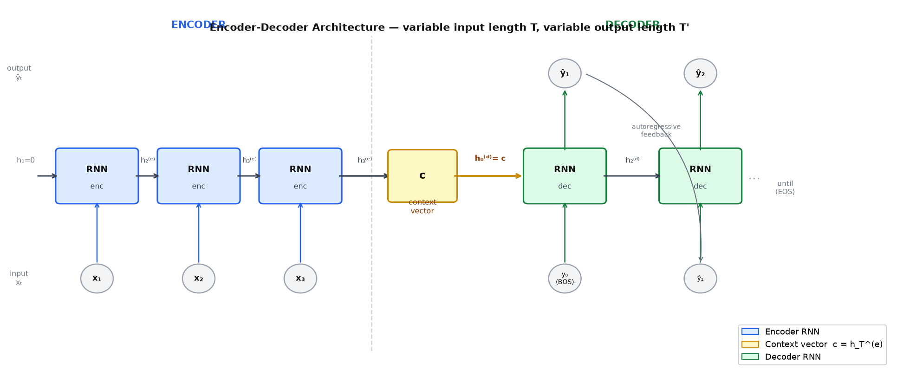

# 26 — Encoder-Decoder Architectures

---

## Part 1: The Sequence-to-Sequence Problem

**Note 24** introduced the many-to-many encoder-decoder configuration as one of the five sequence task types. The synchronised many-to-many RNN handles tasks where input and output have the same length — part-of-speech tagging produces one tag per word. But many important tasks require input and output sequences of **different lengths**:

```
Machine translation:   "The cat sat"  (3 tokens) → "Le chat s'est assis" (4 tokens)
Summarisation:         500-word article           → 3-sentence summary
Image captioning:      one image                  → variable-length sentence
```

A single RNN cannot handle this directly. If the network produces one output per input step, the output length is forced to equal the input length. If the output is taken only from the final hidden state, only one token can be produced.

The solution is to split the problem into two stages: first **read** the entire input and compress it into a summary, then **generate** the output from that summary. This is the **encoder-decoder** architecture.

> The encoder-decoder architecture separates understanding from generation. The encoder reads and compresses; the decoder generates. The two stages are connected by a single vector — the context vector — which carries everything the decoder needs to know about the input.

---

## Part 2: The Encoder

The **encoder** is an RNN that processes the input sequence $x_1, x_2, \ldots, x_T$ one token at a time. It produces a hidden state at each step using the standard RNN update:

$$h_t^{(e)} = \tanh\!\left(W_h^{(e)} h_{t-1}^{(e)} + W_x^{(e)} x_t + b_h^{(e)}\right)$$

The superscript $(e)$ denotes encoder parameters — the encoder has its own weight matrices, separate from the decoder.

After processing the entire input sequence, the encoder's final hidden state is taken as the **context vector**:

$$c = h_T^{(e)}$$

The context vector $c \in \mathbb{R}^d$ is a fixed-size summary of the entire input sequence. It encodes everything the encoder has learned about the input — the meaning, structure, and content — compressed into $d$ numbers.

When the encoder is an LSTM, both the final hidden state and cell state are passed to the decoder:

$$c = \left(h_T^{(e)},\ c_T^{(e)}\right)$$

The diagram below shows the encoder processing an input sequence and producing the context vector.



> The context vector is the bottleneck between encoder and decoder. Everything the decoder will ever know about the input must pass through this single fixed-size vector. The encoder's job is to compress the input into $c$ as faithfully as possible; the decoder's job is to reconstruct the output from $c$.

---

## Part 3: The Decoder

The **decoder** is a separate RNN that generates the output sequence $y_1, y_2, \ldots, y_{T'}$ one token at a time. It is initialised with the context vector:

$$h_0^{(d)} = c$$

At each step $t$, the decoder takes its **previous output** $y_{t-1}$ as input (not the original input sequence) and updates its hidden state:

$$h_t^{(d)} = \tanh\!\left(W_h^{(d)} h_{t-1}^{(d)} + W_y^{(d)} y_{t-1} + b_h^{(d)}\right)$$

The output token at each step is produced by a linear layer followed by softmax over the output vocabulary:

$$\hat{y}_t = \text{softmax}\!\left(W_o h_t^{(d)} + b_o\right)$$

The decoder continues generating tokens until it produces a special end-of-sequence token $\langle\text{EOS}\rangle$, which signals that generation is complete. This is how the output length $T'$ is determined at inference time — it is not fixed in advance.

### Teacher Forcing

During training, the decoder receives the **ground truth** previous token $y_{t-1}$ as input at each step, rather than its own prediction $\hat{y}_{t-1}$. This is called **teacher forcing**. It prevents errors from compounding during training — if the decoder makes a wrong prediction at step 2, using that wrong prediction as input at step 3 would make step 3 harder to learn. Teacher forcing stabilises training by always providing the correct context.

At inference time, teacher forcing is not available — the decoder must use its own previous prediction $\hat{y}_{t-1}$ as input. This creates a **train-test mismatch** that can cause the decoder to drift when it makes early errors.

---

## Part 4: Forward Pass — Worked Example

A minimal encoder-decoder with hidden size $d = 2$, scalar inputs ($n = 1$), scalar outputs ($K = 1$, regression). The encoder processes a 3-step input sequence; the decoder generates a 2-step output.

### Encoder

$$W_h^{(e)} = \begin{bmatrix} 0.4 & 0.1 \\ -0.2 & 0.6 \end{bmatrix}, \quad W_x^{(e)} = \begin{bmatrix} 0.5 \\ -0.3 \end{bmatrix}, \quad b_h^{(e)} = \begin{bmatrix} 0 \\ 0 \end{bmatrix}, \quad h_0^{(e)} = \begin{bmatrix} 0 \\ 0 \end{bmatrix}$$

Input sequence: $x_1 = 1.0,\ x_2 = 0.5,\ x_3 = -1.0$.

These are the same weights as the Note 24 worked example. The encoder hidden states are:

$$h_1^{(e)} = \begin{bmatrix} 0.4621 \\ -0.2913 \end{bmatrix}, \quad h_2^{(e)} = \begin{bmatrix} 0.3852 \\ -0.3944 \end{bmatrix}, \quad h_3^{(e)} = \begin{bmatrix} -0.3685 \\ -0.0137 \end{bmatrix}$$

The context vector is:

$$c = h_3^{(e)} = \begin{bmatrix} -0.3685 \\ -0.0137 \end{bmatrix}$$

### Decoder

The decoder is initialised with $h_0^{(d)} = c$. It uses a simple output layer $\hat{y}_t = W_o h_t^{(d)}$ (no softmax — regression output).

$$W_h^{(d)} = \begin{bmatrix} 0.3 & 0.2 \\ 0.1 & 0.4 \end{bmatrix}, \quad W_y^{(d)} = \begin{bmatrix} 0.5 \\ -0.4 \end{bmatrix}, \quad b_h^{(d)} = \begin{bmatrix} 0 \\ 0 \end{bmatrix}, \quad W_o = \begin{bmatrix} 0.6 & 0.8 \end{bmatrix}$$

The decoder receives a start token $y_0 = 0.0$ at step 1.

**Decoder step $t=1$:**

$$z_1^{(d)} = W_h^{(d)} h_0^{(d)} + W_y^{(d)} y_0 = \begin{bmatrix} 0.3 & 0.2 \\ 0.1 & 0.4 \end{bmatrix} \begin{bmatrix} -0.3685 \\ -0.0137 \end{bmatrix} + \begin{bmatrix} 0.5 \\ -0.4 \end{bmatrix}(0.0)$$

$$= \begin{bmatrix} 0.3 \times (-0.3685) + 0.2 \times (-0.0137) \\ 0.1 \times (-0.3685) + 0.4 \times (-0.0137) \end{bmatrix} = \begin{bmatrix} -0.1133 \\ -0.0423 \end{bmatrix}$$

$$h_1^{(d)} = \tanh\begin{bmatrix} -0.1133 \\ -0.0423 \end{bmatrix} = \begin{bmatrix} -0.1130 \\ -0.0423 \end{bmatrix}$$

$$\hat{y}_1 = W_o h_1^{(d)} = \begin{bmatrix} 0.6 & 0.8 \end{bmatrix} \begin{bmatrix} -0.1130 \\ -0.0423 \end{bmatrix} = 0.6 \times (-0.1130) + 0.8 \times (-0.0423) = -0.0678 - 0.0338 = -0.1016$$

**Decoder step $t=2$** (using $y_1 = \hat{y}_1 = -0.1016$ at inference, or ground truth at training):

$$z_2^{(d)} = W_h^{(d)} h_1^{(d)} + W_y^{(d)} y_1 = \begin{bmatrix} 0.3 & 0.2 \\ 0.1 & 0.4 \end{bmatrix} \begin{bmatrix} -0.1130 \\ -0.0423 \end{bmatrix} + \begin{bmatrix} 0.5 \\ -0.4 \end{bmatrix}(-0.1016)$$

$$= \begin{bmatrix} -0.0339 - 0.0085 \\ -0.0113 - 0.0169 \end{bmatrix} + \begin{bmatrix} -0.0508 \\ 0.0406 \end{bmatrix} = \begin{bmatrix} -0.0424 \\ -0.0282 \end{bmatrix} + \begin{bmatrix} -0.0508 \\ 0.0406 \end{bmatrix} = \begin{bmatrix} -0.0932 \\ 0.0124 \end{bmatrix}$$

$$h_2^{(d)} = \tanh\begin{bmatrix} -0.0932 \\ 0.0124 \end{bmatrix} = \begin{bmatrix} -0.0930 \\ 0.0124 \end{bmatrix}$$

$$\hat{y}_2 = \begin{bmatrix} 0.6 & 0.8 \end{bmatrix} \begin{bmatrix} -0.0930 \\ 0.0124 \end{bmatrix} = -0.0558 + 0.0099 = -0.0459$$

The decoder has produced two output values $(-0.1016,\ -0.0459)$ from the 3-step input sequence. The output length $T' = 2$ is different from the input length $T = 3$ — this is the defining property of the encoder-decoder architecture.

---

## Part 5: The Bottleneck Problem

The context vector $c$ has a fixed size $d$ regardless of the input sequence length. For a sequence of 5 tokens, $c$ must encode 5 tokens into $d$ numbers. For a sequence of 500 tokens, $c$ must encode 500 tokens into the same $d$ numbers.

This creates a fundamental information bottleneck. As the input sequence grows longer, the encoder must compress more information into the same fixed-size vector. For short sequences, the compression is manageable. For long sequences — a paragraph, a document, a long conversation — the context vector cannot faithfully represent all the relevant information.

The consequence is visible in practice: encoder-decoder models without attention perform well on short sequences (up to ~20 tokens) but degrade significantly on longer ones. The decoder, receiving only $c$, has no way to access the encoder's intermediate hidden states $h_1^{(e)}, h_2^{(e)}, \ldots, h_{T-1}^{(e)}$ — all of that information has been discarded.

```
Input length 5:    c must encode 5 tokens — manageable
Input length 50:   c must encode 50 tokens — difficult
Input length 500:  c must encode 500 tokens — effectively impossible

The decoder receives the same d-dimensional vector in all three cases.
```

The bottleneck problem motivated the development of the **attention mechanism** (**Note 27**). Instead of compressing the entire input into a single vector, attention allows the decoder to look back at all encoder hidden states at each decoding step — selecting which parts of the input are most relevant for generating the current output token.

> The bottleneck is not a flaw in the encoder-decoder design — it is an inherent consequence of compressing a variable-length sequence into a fixed-size vector. The fix is not to make $c$ larger, but to give the decoder direct access to the encoder's intermediate states. That is what attention does.

---

## Part 6: Applications

The encoder-decoder architecture applies wherever the input and output are sequences of different lengths or different modalities.

**Machine translation** is the canonical application. The encoder reads a sentence in the source language and produces a context vector. The decoder generates the translation in the target language token by token. The two languages have different vocabularies, different grammars, and different sentence lengths — the encoder-decoder handles all of this naturally because the encoder and decoder are entirely separate networks with separate vocabularies.

**Summarisation** uses the same architecture. The encoder reads a long document; the decoder generates a short summary. The extreme length asymmetry (500 words → 3 sentences) makes the bottleneck problem particularly severe here — attention is essentially required for summarisation to work well.

**Image captioning** replaces the encoder RNN with a CNN. The CNN processes the image and produces a feature vector (or feature map) that plays the role of the context vector. The decoder RNN then generates a caption word by word. This is a cross-modal application — the encoder and decoder operate on entirely different data types.

---

## Summary

Key takeaways:

- The encoder-decoder architecture solves the sequence-to-sequence problem — tasks where input and output sequences have different lengths, which a single RNN cannot handle
- The encoder is an RNN that processes the input sequence and compresses it into a fixed-size context vector $c = h_T^{(e)}$ — the final hidden state after reading the entire input
- The decoder is a separate RNN initialised with $c$; it generates the output sequence one token at a time, using its own previous output as input at each step
- Teacher forcing feeds ground truth tokens to the decoder during training to prevent error compounding; at inference the decoder uses its own predictions, creating a train-test mismatch
- The bottleneck problem arises because $c$ has fixed size $d$ regardless of input length — for long sequences, the encoder cannot faithfully compress all relevant information into $d$ numbers
- The bottleneck motivates the attention mechanism (**Note 27**): instead of a single context vector, attention gives the decoder direct access to all encoder hidden states at each decoding step
- Applications include machine translation (source → target language), summarisation (document → summary), and image captioning (CNN feature vector → caption)
