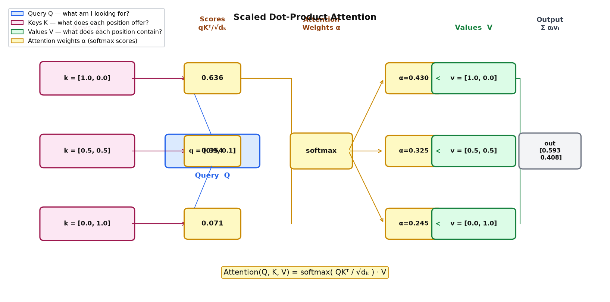
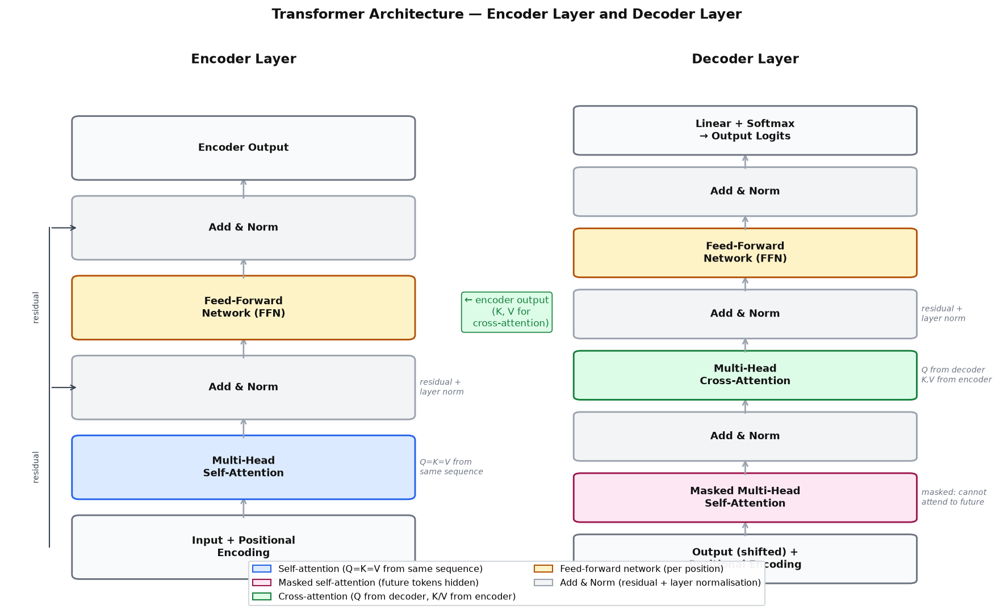

# 27 — Transformers and Attention Mechanism

---

## Part 1: The Attention Motivation

**Note 26** identified the bottleneck problem: the encoder-decoder architecture compresses the entire input sequence into a single fixed-size context vector $c = h_T^{(e)}$. The decoder receives only $c$ — it has no access to the encoder's intermediate hidden states $h_1^{(e)}, \ldots, h_{T-1}^{(e)}$. For long sequences, $c$ cannot faithfully represent all relevant information, and decoder performance degrades.

The fix is conceptually simple: instead of forcing the decoder to work from a single vector, let it **look back at all encoder hidden states** at each decoding step. At step $t$, the decoder can ask: which parts of the input are most relevant for generating output token $t$? It then forms a weighted combination of all encoder states, where the weights reflect relevance.

This is the **attention mechanism** (Bahdanau et al., 2015). The decoder does not receive a fixed $c$ — it receives a different context vector at every step, computed dynamically by attending to the encoder states.

> Attention solves the bottleneck by replacing the single fixed context vector with a dynamic one. At each decoding step, the decoder computes a weighted sum of all encoder hidden states — the weights are learned and reflect which input positions are most relevant for the current output token.

---

## Part 2: Scaled Dot-Product Attention

The modern formulation of attention (Vaswani et al., 2017) uses three matrices: **queries** $Q$, **keys** $K$, and **values** $V$.

The intuition: a query is what you are looking for, a key is what each position offers, and a value is what each position contains. Attention computes the compatibility between each query and all keys, converts the compatibilities to weights via softmax, and returns a weighted sum of the values.

### The Formula

$$\text{Attention}(Q, K, V) = \text{softmax}\!\left(\frac{QK^T}{\sqrt{d_k}}\right) V$$

where:
- $Q \in \mathbb{R}^{n_q \times d_k}$ — query matrix, $n_q$ queries each of dimension $d_k$
- $K \in \mathbb{R}^{n_k \times d_k}$ — key matrix, $n_k$ keys each of dimension $d_k$
- $V \in \mathbb{R}^{n_k \times d_v}$ — value matrix, $n_k$ values each of dimension $d_v$
- $\sqrt{d_k}$ — scaling factor to prevent large dot products from pushing softmax into saturation

The output has shape $\mathbb{R}^{n_q \times d_v}$ — one attended vector per query.

### The Scaling Factor

Without the $\sqrt{d_k}$ scaling, the dot products $QK^T$ grow in magnitude as $d_k$ increases. Large dot products push the softmax into regions where gradients are very small — the same vanishing gradient problem that tanh causes in RNNs. Dividing by $\sqrt{d_k}$ keeps the dot products in a range where softmax gradients remain healthy.

### Worked Example

Three encoder hidden states (keys and values), one decoder query. $d_k = d_v = 2$.

$$K = V = \begin{bmatrix} 1.0 & 0.0 \\ 0.5 & 0.5 \\ 0.0 & 1.0 \end{bmatrix}, \quad q = \begin{bmatrix} 0.9 & 0.1 \end{bmatrix}$$

**Step 1 — raw scores** $s = qK^T / \sqrt{d_k}$:

$$qK^T = \begin{bmatrix} 0.9 & 0.1 \end{bmatrix} \begin{bmatrix} 1.0 & 0.5 & 0.0 \\ 0.0 & 0.5 & 1.0 \end{bmatrix} = \begin{bmatrix} 0.90 & 0.50 & 0.10 \end{bmatrix}$$

$$s = \frac{1}{\sqrt{2}} \begin{bmatrix} 0.90 & 0.50 & 0.10 \end{bmatrix} = \begin{bmatrix} 0.636 & 0.354 & 0.071 \end{bmatrix}$$

**Step 2 — attention weights** $\alpha = \text{softmax}(s)$:

$$e^{0.636} = 1.889, \quad e^{0.354} = 1.425, \quad e^{0.071} = 1.074 \quad \Rightarrow \quad \text{sum} = 4.388$$

$$\alpha = \begin{bmatrix} 0.430 & 0.325 & 0.245 \end{bmatrix}$$

**Step 3 — attended output** $\text{out} = \alpha V$:

$$\text{out} = 0.430 \begin{bmatrix} 1.0 \\ 0.0 \end{bmatrix} + 0.325 \begin{bmatrix} 0.5 \\ 0.5 \end{bmatrix} + 0.245 \begin{bmatrix} 0.0 \\ 1.0 \end{bmatrix} = \begin{bmatrix} 0.430 + 0.163 + 0.000 \\ 0.000 + 0.163 + 0.245 \end{bmatrix} = \begin{bmatrix} 0.593 \\ 0.408 \end{bmatrix}$$

The query $q = [0.9, 0.1]$ is most similar to the first key $[1.0, 0.0]$, so the first position receives the highest weight (0.430). The output is a weighted blend of all three value vectors, dominated by the first.

The diagram below shows the query, key, value flow and the softmax weighting.



> The attention weights $\alpha$ are a probability distribution over input positions — they say how much each position contributes to the current output. A weight near 1 on one position means the decoder is focusing almost entirely on that input token. A uniform distribution means the decoder is averaging over all positions.

---

## Part 3: Multi-Head Attention

A single attention operation computes one set of weights — one way of attending to the input. But a sequence may have multiple types of relationships simultaneously: syntactic dependencies, semantic similarity, coreference, positional proximity. A single attention head cannot capture all of these at once.

**Multi-head attention** runs $H$ attention operations in parallel, each with its own learned projection matrices:

$$\text{head}_h = \text{Attention}(Q W_h^Q,\ K W_h^K,\ V W_h^V)$$

where $W_h^Q \in \mathbb{R}^{d_{\text{model}} \times d_k}$, $W_h^K \in \mathbb{R}^{d_{\text{model}} \times d_k}$, $W_h^V \in \mathbb{R}^{d_{\text{model}} \times d_v}$ are learned projections for head $h$.

The outputs of all heads are concatenated and projected back to the model dimension:

$$\text{MultiHead}(Q, K, V) = \text{Concat}(\text{head}_1, \ldots, \text{head}_H) \cdot W^O$$

where $W^O \in \mathbb{R}^{H d_v \times d_{\text{model}}}$ is the output projection.

In the original Transformer, $d_{\text{model}} = 512$, $H = 8$, $d_k = d_v = d_{\text{model}} / H = 64$. Each head operates in a 64-dimensional subspace — the total computation is similar to a single attention operation in the full 512-dimensional space, but the model can attend to different aspects simultaneously.

> Each attention head learns to attend to a different type of relationship. One head might track subject-verb agreement, another might track coreference, another might attend to adjacent tokens. Multi-head attention gives the model the capacity to represent all of these simultaneously.

---

## Part 4: Positional Encoding

The attention mechanism has no notion of order. The computation $\text{softmax}(QK^T / \sqrt{d_k})V$ treats the input as a **set** — shuffling the positions produces the same attention weights (just reordered). This is fundamentally different from an RNN, which processes tokens sequentially and implicitly encodes position through the hidden state.

To give the Transformer access to sequence order, **positional encodings** are added to the input embeddings before the first layer:

$$\text{input}_t = \text{embedding}(x_t) + \text{PE}(t)$$

The original Transformer uses sinusoidal positional encodings:

$$\text{PE}(t, 2i) = \sin\!\left(\frac{t}{10000^{2i / d_{\text{model}}}}\right)$$

$$\text{PE}(t, 2i+1) = \cos\!\left(\frac{t}{10000^{2i / d_{\text{model}}}}\right)$$

where $t$ is the position and $i$ is the dimension index. Even dimensions use sine, odd dimensions use cosine. The wavelengths form a geometric progression from $2\pi$ to $10000 \cdot 2\pi$, so each position has a unique encoding and nearby positions have similar encodings.

The key property: $\text{PE}(t + k)$ can be expressed as a linear function of $\text{PE}(t)$ for any fixed offset $k$. This means the model can learn to attend to relative positions by learning linear transformations of the positional encodings.

> Positional encoding is the Transformer's substitute for recurrence. An RNN encodes position implicitly through sequential processing. The Transformer processes all positions in parallel and must be told explicitly where each token is. The sinusoidal encoding gives each position a unique, structured fingerprint that the attention mechanism can use.

---

## Part 5: The Transformer Architecture

The Transformer (Vaswani et al., 2017) consists of an **encoder stack** and a **decoder stack**, each made of $N$ identical layers (typically $N = 6$).

### Encoder Layer

Each encoder layer has two sub-layers:

$$\text{sublayer}_1: \quad z = \text{LayerNorm}(x + \text{MultiHead}(x, x, x))$$

$$\text{sublayer}_2: \quad \text{out} = \text{LayerNorm}(z + \text{FFN}(z))$$

The multi-head attention in the encoder is **self-attention** — queries, keys, and values all come from the same sequence $x$. Each position attends to all other positions in the same sequence. The feed-forward network (FFN) is a two-layer MLP applied independently to each position:

$$\text{FFN}(z) = \max(0,\ z W_1 + b_1) W_2 + b_2$$

The residual connections (the $+$ in each sub-layer) and layer normalisation stabilise training in deep stacks — the same motivation as residual connections in ResNet (**Note 21**).

### Decoder Layer

Each decoder layer has three sub-layers:

$$\text{sublayer}_1: \quad z_1 = \text{LayerNorm}(x + \text{MaskedMultiHead}(x, x, x))$$

$$\text{sublayer}_2: \quad z_2 = \text{LayerNorm}(z_1 + \text{MultiHead}(z_1, \text{enc\_out}, \text{enc\_out}))$$

$$\text{sublayer}_3: \quad \text{out} = \text{LayerNorm}(z_2 + \text{FFN}(z_2))$$

The first sub-layer is **masked self-attention** — the decoder attends to its own previous outputs, but the mask prevents position $t$ from attending to positions $t+1, t+2, \ldots$ (future tokens are hidden during training). The second sub-layer is **cross-attention** — queries come from the decoder, keys and values come from the encoder output. This is where the decoder attends to the input sequence.

The diagram below shows one encoder layer and one decoder layer side by side.



### The Full Stack

$$\text{Encoder:} \quad \underbrace{[\text{Self-Attn} + \text{FFN}]}_{\times N} \quad \rightarrow \quad \text{encoder output}$$

$$\text{Decoder:} \quad \underbrace{[\text{Masked Self-Attn} + \text{Cross-Attn} + \text{FFN}]}_{\times N} \quad \rightarrow \quad \text{output logits}$$

The encoder output is passed to every decoder layer as the keys and values for cross-attention. The decoder generates one token at a time at inference, feeding its own output back as input — the same autoregressive loop as the RNN decoder in Note 26.

---

## Part 6: Why Transformers Replaced RNNs

Two fundamental advantages explain why Transformers have become the dominant architecture for sequence modelling.

### Parallelism During Training

An RNN processes tokens sequentially — step $t$ cannot begin until step $t-1$ is complete. For a sequence of length $T$, the forward pass requires $T$ sequential operations. This makes training on long sequences slow and prevents full utilisation of GPU parallelism.

The Transformer processes all positions simultaneously. The attention computation $\text{softmax}(QK^T / \sqrt{d_k})V$ is a matrix operation — all queries attend to all keys in one step. For a sequence of length $T$, the forward pass requires $O(1)$ sequential operations (ignoring the stack depth). Training is dramatically faster on modern hardware.

```
RNN forward pass:    T sequential steps — cannot parallelise across time
Transformer:         1 matrix operation — fully parallel across all positions
```

### Long-Range Dependencies Without Vanishing Gradients

In an RNN, the gradient from position $T$ to position $1$ must pass through $T$ sequential tanh multiplications — it vanishes exponentially. Even with LSTM gating, very long-range dependencies are difficult to learn.

In the Transformer, any two positions are connected by a direct attention weight — the path length between any two positions is $O(1)$ regardless of sequence length. The gradient from position $T$ to position $1$ passes through one softmax and one matrix multiplication, not $T$ of them.

```
RNN:         gradient path length = T   (vanishes for large T)
Transformer: gradient path length = 1   (constant regardless of T)
```

### The Tradeoff

The Transformer's attention computation has $O(T^2)$ memory and time complexity — every position attends to every other position. For very long sequences (documents, audio), this quadratic cost becomes prohibitive. RNNs have $O(T)$ complexity. This is the main remaining advantage of recurrent architectures for very long sequences.

```
                RNN             Transformer
─────────────   ─────────────   ─────────────────────
Training speed  Slow (serial)   Fast (parallel)
Long-range      Poor            Excellent
Memory (seq T)  O(T)            O(T²)
Inference       Sequential      Can be sequential
```

> The Transformer trades sequential computation for parallel computation, and trades linear memory for quadratic memory. For sequences up to a few thousand tokens — the vast majority of NLP tasks — the parallelism advantage dominates. For very long sequences, the quadratic cost is the limiting factor.

---

## Summary

Key takeaways:

- Attention solves the encoder-decoder bottleneck by replacing the fixed context vector with a dynamic one — at each decoding step, the decoder computes a weighted sum of all encoder hidden states, where the weights reflect relevance to the current output token
- Scaled dot-product attention computes $\text{Attention}(Q, K, V) = \text{softmax}(QK^T / \sqrt{d_k})V$ — queries are matched against keys to produce attention weights, which are used to take a weighted sum of values; the $\sqrt{d_k}$ scaling prevents softmax saturation
- Multi-head attention runs $H$ attention operations in parallel, each in a lower-dimensional subspace — different heads learn to attend to different types of relationships simultaneously
- Positional encoding adds a structured position signal to the input embeddings before the first layer — necessary because attention treats the input as a set and has no inherent notion of order
- The Transformer encoder uses self-attention (each position attends to all others in the same sequence); the decoder uses masked self-attention (cannot attend to future positions) followed by cross-attention (attends to encoder output)
- Transformers replaced RNNs primarily because of parallelism — all positions are processed simultaneously during training, enabling full GPU utilisation; and because any two positions are connected by a direct attention path of length $O(1)$, eliminating the vanishing gradient over distance
- The main cost of Transformers is $O(T^2)$ memory and compute for sequences of length $T$ — for very long sequences this quadratic scaling becomes the limiting factor
