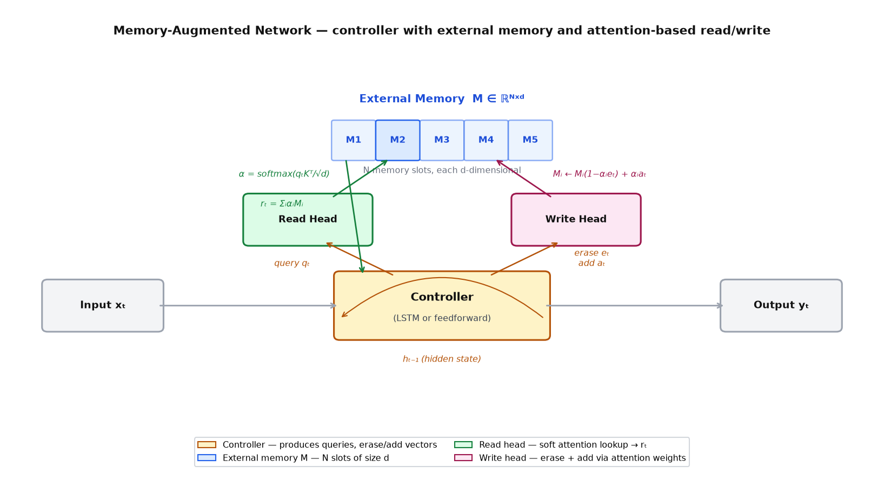

# 28 — Attention and Memory Models

---

## Part 1: Soft vs Hard Attention

**Note 27** introduced attention as a weighted sum of values: $\text{out} = \sum_i \alpha_i v_i$ where $\alpha_i \in (0, 1)$ and $\sum_i \alpha_i = 1$. This is **soft attention** — every position contributes to the output, weighted by its relevance. The weights are continuous and differentiable, so gradients flow through them during backpropagation. The entire system can be trained end-to-end with standard gradient descent.

**Hard attention** selects exactly one position: $\text{out} = v_j$ where $j = \arg\max_i \alpha_i$. The output is the value at the single most relevant position — no blending. This is more interpretable (the model is explicitly pointing at one thing) but the $\arg\max$ operation is not differentiable. A small change in the scores may not change which position is selected, so the gradient is zero almost everywhere. Training hard attention requires reinforcement learning or other gradient estimators — significantly more complex than standard backpropagation.

```
Soft attention:   out = Σᵢ αᵢ vᵢ        differentiable — trains with backprop
Hard attention:   out = v_{argmax α}      not differentiable — requires RL
```

In practice, soft attention dominates. The Transformer, all modern attention-based models, and the memory-augmented networks described in this note all use soft attention. Hard attention is used in specific settings where discrete selection is required and the training complexity is acceptable.

> Soft attention is differentiable because it is a weighted average — a smooth function of the scores. Hard attention is not differentiable because selection is a discrete operation. The choice between them is a tradeoff between interpretability and trainability.

---

## Part 2: Self-Attention

**Note 27** introduced two types of attention in the Transformer: self-attention (encoder) and cross-attention (decoder). The distinction is worth examining more carefully because self-attention is the more general and powerful of the two.

In **cross-attention**, queries come from one sequence (the decoder state) and keys/values come from a different sequence (the encoder output). The decoder is asking: which parts of the input are relevant to what I am generating now?

In **self-attention**, queries, keys, and values all come from the **same** sequence. Every position asks: which other positions in my own sequence are relevant to me?

$$\text{SelfAttention}(X) = \text{softmax}\!\left(\frac{(XW^Q)(XW^K)^T}{\sqrt{d_k}}\right)(XW^V)$$

where $X \in \mathbb{R}^{T \times d_{\text{model}}}$ is the sequence and $W^Q, W^K, W^V$ are learned projections.

Self-attention computes a new representation of each position that incorporates information from all other positions. After one self-attention layer, each position's representation is a weighted blend of all positions — the model has seen the entire context. After $N$ stacked layers, each position has been contextualised $N$ times, with each layer able to build on the relationships discovered by the previous one.

This is what makes the Transformer so powerful for language: the word "bank" in "river bank" and "bank account" should have different representations — self-attention allows the model to build context-dependent representations by attending to surrounding words.

> Self-attention transforms a sequence of context-independent token representations into context-dependent ones. After self-attention, each position's representation encodes not just what that token is, but how it relates to every other token in the sequence.

---

## Part 3: Memory-Augmented Networks

A neural network's "memory" is its weights — fixed after training — and its hidden state — fixed in size. Both are limited. The weights encode everything learned during training but cannot be updated at inference time. The hidden state can carry information across time steps but is a fixed-size vector that must compress everything into $d$ numbers.

**Memory-augmented networks** give the network access to an **external memory** — a matrix $M \in \mathbb{R}^{N \times d}$ of $N$ memory slots, each a $d$-dimensional vector. The network can read from and write to this memory at each time step using attention. Unlike the hidden state, the memory can store many independent pieces of information in separate slots, and the network can selectively access any slot without disturbing the others.

### The Read Operation

Reading from memory is a soft attention lookup. The controller (an RNN or feedforward network) produces a query vector $q_t$ and computes attention weights over the memory slots:

$$\alpha_i = \frac{\exp(q_t \cdot M_i / \sqrt{d})}{\sum_j \exp(q_t \cdot M_j / \sqrt{d})}$$

The read vector is the weighted sum of memory slots:

$$r_t = \sum_i \alpha_i M_i$$

This is identical to the attention mechanism from Note 27 — the memory slots are the keys and values, and the controller's query determines which slots to read.

### The Write Operation

Writing to memory updates the memory matrix. A simple write operation erases some content and adds new content:

$$M_i \leftarrow M_i (1 - \alpha_i e_t) + \alpha_i a_t$$

where $e_t \in [0,1]^d$ is an erase vector (what to remove) and $a_t \in \mathbb{R}^d$ is an add vector (what to write). Slots with high attention weight $\alpha_i$ are updated most strongly; slots with low weight are left nearly unchanged.

The diagram below shows the controller, external memory matrix, and the read/write heads connected by attention.



> The external memory decouples storage capacity from model size. A network with a $d=256$ hidden state can only store 256 numbers. A network with a $100 \times 256$ external memory can store 100 independent 256-dimensional vectors — and can read any of them in one step using attention.

---

## Part 4: The Neural Turing Machine

The **Neural Turing Machine** (NTM, Graves et al., 2014) is the canonical memory-augmented network. It consists of a **controller** (an LSTM or feedforward network) connected to an external memory matrix via differentiable read and write heads.

The key contribution of the NTM is its **addressing mechanism** — how the read/write heads decide which memory slots to access. Two addressing modes are combined:

**Content-based addressing** — attend to slots whose content is similar to a query key $k_t$:

$$\alpha_i^{\text{content}} \propto \exp\!\left(\beta_t \cdot \frac{k_t \cdot M_i}{\|k_t\| \|M_i\|}\right)$$

where $\beta_t > 0$ is a sharpening parameter — higher $\beta_t$ concentrates attention on the best-matching slot.

**Location-based addressing** — shift attention relative to the previous position. This allows the NTM to iterate through memory sequentially, like a tape head moving one slot at a time.

The final attention weights combine both modes, allowing the NTM to either retrieve by content (find the slot that matches this key) or by location (move to the next slot). This combination gives the NTM the ability to implement algorithms — sorting, copying, associative recall — that require both random access and sequential traversal of memory.

The NTM is fully differentiable: every operation — reading, writing, addressing — is a smooth function of the controller's outputs. The entire system is trained end-to-end with backpropagation through time.

```
NTM components:
  Controller:          LSTM or feedforward — produces queries, keys, erase/add vectors
  Memory matrix M:     N × d — external storage, updated at each step
  Read head:           content-based attention → read vector rₜ
  Write head:          content-based attention → erase and add → updated M
  Addressing:          content-based + location-based, combined and sharpened
```

---

## Part 5: Attention as Associative Memory

**Note 15** introduced the Hopfield network as an associative memory — a system that stores patterns as energy minima and retrieves them from partial or noisy inputs. **Note 18** generalised this to hetero-associative memory — one pattern retrieves a different stored pattern. The connection to attention is direct and illuminating.

In a Hopfield network, retrieval works by finding the stored pattern most similar to the query and returning it. In attention:

- The **keys** $K$ are the stored patterns
- The **query** $q$ is the retrieval cue
- The **values** $V$ are the content to be retrieved
- The **attention weights** $\alpha = \text{softmax}(qK^T / \sqrt{d_k})$ measure similarity between the query and each stored pattern
- The **output** $\alpha V$ is the retrieved content

Soft attention is a **differentiable, soft content-addressable lookup**. Instead of retrieving exactly one pattern (as in a Hopfield network), it retrieves a weighted blend of all patterns, with weights proportional to similarity. This softness is what makes it differentiable and trainable.

The modern Hopfield network (Ramsauer et al., 2020) made this connection explicit: it showed that the update rule of a continuous Hopfield network with exponential interactions is equivalent to one step of attention. The stored patterns are the keys, the query is the initial state, and the retrieved pattern is the attention output. The storage capacity of this modern Hopfield network scales exponentially with the dimension $d$ — far beyond the $0.14N$ limit of the classical Hopfield network from Note 15.

$$\text{Hopfield retrieval} \approx \text{softmax}(q K^T) K \qquad \text{(one update step)}$$

$$\text{Attention output} = \text{softmax}(q K^T / \sqrt{d_k}) V$$

The two are structurally identical — attention is a Hopfield retrieval step with a scaling factor and separate value vectors.

> Attention is associative memory made differentiable. The keys are stored patterns, the query is a retrieval cue, and the output is a soft blend of retrieved values weighted by similarity. The Transformer's power comes from stacking many such retrieval steps, each building on the context established by the previous one.

---

## Summary

Key takeaways:

- Soft attention computes a differentiable weighted sum $\text{out} = \sum_i \alpha_i v_i$ — trainable end-to-end with backpropagation; hard attention selects one position via $\arg\max$ — not differentiable, requires reinforcement learning
- Self-attention applies attention within a single sequence — each position attends to all other positions, producing context-dependent representations that encode relationships between tokens
- Memory-augmented networks add an external memory matrix $M \in \mathbb{R}^{N \times d}$ to a neural network; the controller reads from and writes to memory using soft attention, decoupling storage capacity from hidden state size
- The Neural Turing Machine combines content-based addressing (retrieve by similarity) and location-based addressing (move sequentially), making it capable of learning algorithms that require both random access and sequential traversal
- Attention is a differentiable soft content-addressable lookup — keys are stored patterns, queries are retrieval cues, values are retrieved content; the attention weights are similarity scores converted to a probability distribution via softmax
- The modern Hopfield network (Ramsauer et al., 2020) showed that one step of attention is equivalent to one Hopfield retrieval update — the two frameworks are mathematically equivalent, with attention being the differentiable, trainable version
