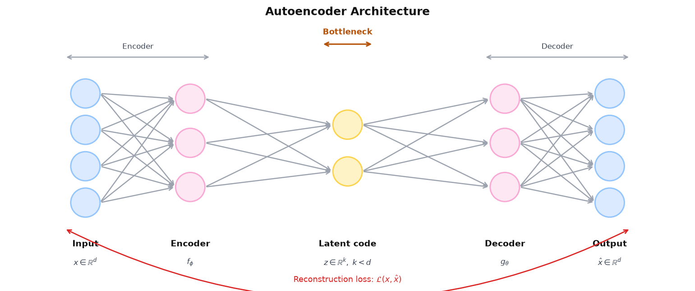

# Note 29 — Autoencoders

## Part 1: The Problem — Learning Without Labels

Supervised learning requires labelled data. Collecting and annotating large datasets is expensive, slow, and sometimes impossible. Yet unlabelled data is abundant — images, text, sensor readings — and it contains structure worth learning.

The question is: can a network learn a useful internal representation of data using only the data itself, with no labels?

An autoencoder answers yes. It trains a network to compress data into a compact code and then reconstruct the original from that code. The reconstruction target is the input itself — no labels needed.

> An autoencoder is a neural network trained to reproduce its input at its output, subject to a constraint that forces it to learn a compact internal representation.

The diagram below shows the overall structure: an encoder that maps input to a latent code, and a decoder that maps the code back to the input space.

### Formal Setup

Let $x \in \mathbb{R}^d$ be an input. The autoencoder consists of two functions:

- **Encoder:** $f_\phi : \mathbb{R}^d \to \mathbb{R}^k$ — maps input to latent code $z = f_\phi(x)$
- **Decoder:** $g_\theta : \mathbb{R}^k \to \mathbb{R}^d$ — maps latent code to reconstruction $\hat{x} = g_\theta(z)$

where $k < d$ (the bottleneck constraint). The parameters $\phi$ and $\theta$ are learned jointly by minimising the reconstruction loss.

In the simplest case, both encoder and decoder are single affine layers with a nonlinearity:

$$z = \tanh(W^{(e)} x + b^{(e)})$$

$$\hat{x} = W^{(d)} z + b^{(d)}$$

where $W^{(e)} \in \mathbb{R}^{k \times d}$, $W^{(d)} \in \mathbb{R}^{d \times k}$. Deeper autoencoders stack multiple layers in each half.

---

## Part 2: The Bottleneck — Forcing a Compact Representation

Without any constraint, a network could learn the identity function trivially — copy the input to the output through a hidden layer of size $d$ or larger. No useful structure would be learned.

The bottleneck is the constraint that makes autoencoders useful. By requiring $k \ll d$, the network is forced to discard information that cannot be reconstructed and retain only what is essential.

> The bottleneck forces the encoder to find the most informative $k$-dimensional summary of the input. The decoder must reconstruct the full input from that summary alone.

What gets retained depends on the data distribution. For images, the bottleneck tends to capture shape, colour, and texture. For time series, it captures dominant trends. The latent space $z$ is a learned coordinate system for the data manifold.

### Undercomplete vs Overcomplete

| Type | Bottleneck size | Risk |
|---|---|---|
| Undercomplete | $k < d$ | Too small: high reconstruction error |
| Overcomplete | $k \geq d$ | Can learn identity — needs regularisation |

Standard autoencoders use undercomplete bottlenecks. Overcomplete autoencoders require additional constraints (sparsity, noise) to prevent trivial solutions — covered in Parts 4 and 5.

---

## Part 3: Reconstruction Loss

The autoencoder is trained to minimise the discrepancy between the input $x$ and its reconstruction $\hat{x} = g_\theta(f_\phi(x))$.

### Mean Squared Error

For continuous-valued inputs, the standard loss is mean squared error (MSE):

$$\mathcal{L}(x, \hat{x}) = \frac{1}{d} \sum_{i=1}^{d} (x_i - \hat{x}_i)^2$$

MSE penalises large deviations quadratically. It is the natural choice when the output is treated as the mean of a Gaussian distribution over the input.

### Binary Cross-Entropy

For inputs with values in $[0, 1]$ (e.g. normalised pixel intensities), binary cross-entropy is often used instead:

$$\mathcal{L}(x, \hat{x}) = -\frac{1}{d} \sum_{i=1}^{d} \left[ x_i \log \hat{x}_i + (1 - x_i) \log(1 - \hat{x}_i) \right]$$

This treats each input dimension as a Bernoulli variable and requires a sigmoid activation on the decoder output.

### Worked Example

**Setup:** $d = 3$, $k = 2$. Encoder uses tanh, decoder uses linear output.

**Encoder weights and bias:**

$$W^{(e)} = \begin{bmatrix} 0.5 & -0.3 & 0.8 \\ -0.2 & 0.6 & 0.4 \end{bmatrix}, \quad b^{(e)} = \begin{bmatrix} 0.1 \\ -0.1 \end{bmatrix}$$

**Input:** $x = [1.0,\ 0.5,\ -1.0]^T$

**Step 1 — Encoder pre-activation:**

$$z^{(e)}_1 = 0.5(1.0) + (-0.3)(0.5) + 0.8(-1.0) + 0.1 = 0.5 - 0.15 - 0.8 + 0.1 = -0.35$$

$$z^{(e)}_2 = (-0.2)(1.0) + 0.6(0.5) + 0.4(-1.0) + (-0.1) = -0.2 + 0.3 - 0.4 - 0.1 = -0.40$$

**Step 2 — Encoder activation (tanh):**

$$z_1 = \tanh(-0.35) = \frac{e^{-0.35} - e^{0.35}}{e^{-0.35} + e^{0.35}} = \frac{0.7047 - 1.4191}{0.7047 + 1.4191} = \frac{-0.7144}{2.1238} \approx -0.3364$$

$$z_2 = \tanh(-0.40) = \frac{0.6703 - 1.4918}{0.6703 + 1.4918} = \frac{-0.8215}{2.1621} \approx -0.3799$$

Latent code: $z = [-0.3364,\ -0.3799]^T$

**Decoder weights and bias:**

$$W^{(d)} = \begin{bmatrix} 0.7 & -0.4 \\ 0.3 & 0.9 \\ -0.5 & 0.2 \end{bmatrix}, \quad b^{(d)} = \begin{bmatrix} 0.0 \\ 0.1 \\ -0.1 \end{bmatrix}$$

**Step 3 — Decoder (linear):**

$$\hat{x}_1 = 0.7(-0.3364) + (-0.4)(-0.3799) + 0.0 = -0.2355 + 0.1520 = -0.0835$$

$$\hat{x}_2 = 0.3(-0.3364) + 0.9(-0.3799) + 0.1 = -0.1009 - 0.3419 + 0.1 = -0.3428$$

$$\hat{x}_3 = (-0.5)(-0.3364) + 0.2(-0.3799) + (-0.1) = 0.1682 - 0.0760 - 0.1 = -0.0078$$

Reconstruction: $\hat{x} = [-0.0835,\ -0.3428,\ -0.0078]^T$

**Step 4 — MSE loss:**

$$\mathcal{L} = \frac{1}{3}\left[(1.0 - (-0.0835))^2 + (0.5 - (-0.3428))^2 + (-1.0 - (-0.0078))^2\right]$$

$$= \frac{1}{3}\left[(1.0835)^2 + (0.8428)^2 + (0.9922)^2\right]$$

$$= \frac{1}{3}\left[1.1740 + 0.7103 + 0.9845\right] = \frac{3.8688}{3} \approx 1.2896$$

The loss is high because the weights are random — training would reduce it by adjusting $W^{(e)}, b^{(e)}, W^{(d)}, b^{(d)}$ via backpropagation through both encoder and decoder.

---

## Part 4: Sparse Autoencoder

An undercomplete bottleneck is one way to prevent the identity solution. Another way is to use an overcomplete bottleneck ($k \geq d$) but add a penalty that forces most latent units to be inactive for any given input.

> A sparse autoencoder adds an L1 penalty on the latent activations, encouraging most units in $z$ to be near zero for any given input.

### Objective

$$\mathcal{L}_{\text{sparse}} = \frac{1}{d} \sum_{i=1}^{d} (x_i - \hat{x}_i)^2 + \lambda \sum_{j=1}^{k} |z_j|$$

The first term is reconstruction loss. The second term penalises the total activation magnitude of the latent code. The hyperparameter $\lambda > 0$ controls the trade-off.

### What Sparsity Achieves

With L1 regularisation, the network learns a **dictionary**: a set of $k$ features such that any input is well-described by a small subset of them. Each latent unit becomes a detector for a specific pattern — active only when that pattern is present in the input.

This is analogous to sparse coding in neuroscience: primary visual cortex neurons respond selectively to oriented edges, with most neurons silent for any given image patch.

### KL Divergence Penalty (Alternative)

An alternative formulation targets the average activation of each unit across the training set. Let $\hat{\rho}_j$ be the empirical mean activation of unit $j$, and $\rho$ be a target sparsity (e.g. $\rho = 0.05$). The penalty is:

$$\Omega = \sum_{j=1}^{k} \text{KL}(\rho \| \hat{\rho}_j) = \sum_{j=1}^{k} \left[ \rho \log \frac{\rho}{\hat{\rho}_j} + (1-\rho) \log \frac{1-\rho}{1-\hat{\rho}_j} \right]$$

This drives the average activation of each unit towards $\rho$, rather than penalising individual activations.

---

## Part 5: Denoising Autoencoder

A different way to prevent the identity solution is to corrupt the input before feeding it to the encoder, while keeping the reconstruction target as the clean input.

> A denoising autoencoder receives a corrupted version $\tilde{x}$ as input and is trained to reconstruct the original clean input $x$. This forces the encoder to learn features that are robust to the type of corruption applied.

### Corruption Process

Common corruption strategies:

| Corruption type | Description |
|---|---|
| Gaussian noise | $\tilde{x} = x + \epsilon$, $\epsilon \sim \mathcal{N}(0, \sigma^2 I)$ |
| Masking noise | Each dimension zeroed independently with probability $p$ |
| Salt-and-pepper | Each dimension set to min or max value with probability $p$ |

The corruption is applied only during training. At test time, the clean input is passed directly.

### Objective

$$\mathcal{L}_{\text{denoise}} = \frac{1}{d} \sum_{i=1}^{d} (x_i - \hat{x}_i)^2$$

where $\hat{x} = g_\theta(f_\phi(\tilde{x}))$ — the reconstruction is from the corrupted input, but the loss is measured against the clean target $x$.

### Why It Works

The denoising criterion forces the encoder to learn the structure of the data manifold. To reconstruct $x$ from $\tilde{x}$, the encoder must learn which directions in input space correspond to meaningful variation (along the manifold) versus noise (off the manifold). The learned representation captures the manifold geometry.

This is a form of self-supervised learning: the supervision signal (clean input) is derived from the data itself, with no external labels.

### Connection to Score Matching

Denoising autoencoders have a theoretical connection to score matching: a denoising autoencoder trained with Gaussian noise implicitly estimates the gradient of the data log-density $\nabla_x \log p(x)$. This connection motivates diffusion models, where iterative denoising steps are used to generate new samples.

---

## Part 6: Applications

Autoencoders are not trained to perform a specific task — they are trained to understand the structure of data. That understanding is then applied in several ways.

### Dimensionality Reduction

The encoder $f_\phi$ maps high-dimensional inputs to a low-dimensional latent space. This is a nonlinear generalisation of PCA. Unlike PCA, which finds the best linear subspace, an autoencoder can capture curved manifolds.

The latent codes $z = f_\phi(x)$ can be used as features for downstream tasks: clustering, visualisation (e.g. 2D latent space), or as input to a classifier.

### Anomaly Detection

An autoencoder trained on normal data learns to reconstruct normal inputs well. When an anomalous input is presented, the reconstruction error is high because the encoder has never seen that pattern and cannot compress it into the learned latent space.

The reconstruction error serves as an anomaly score:

$$\text{score}(x) = \| x - g_\theta(f_\phi(x)) \|^2$$

Inputs with score above a threshold are flagged as anomalies. This approach requires no anomaly labels — only normal training data.

### Pre-training

Before the widespread adoption of batch normalisation and residual connections, autoencoders were used for greedy layer-wise pre-training of deep networks. Each layer was pre-trained as an autoencoder, then the layers were stacked and fine-tuned with supervised learning.

This is less common today but remains relevant in low-label regimes: an autoencoder trained on large unlabelled data can initialise a network that is then fine-tuned on a small labelled set.

### Generative Modelling

Standard autoencoders do not have a well-structured latent space — nearby points in latent space do not necessarily correspond to similar inputs, and sampling from the latent space does not reliably produce valid inputs. Variational autoencoders (VAEs) address this by imposing a prior distribution on the latent space, enabling generation of new samples. VAEs are covered in **Note 30**.

---

## Summary

- An autoencoder trains a network to reconstruct its input through a bottleneck, learning a compact latent representation without labels.
- The encoder maps input $x \in \mathbb{R}^d$ to latent code $z \in \mathbb{R}^k$ with $k < d$; the decoder maps $z$ back to $\hat{x} \in \mathbb{R}^d$.
- The bottleneck forces the network to discard noise and retain only the most informative structure in the data.
- Reconstruction loss is MSE for continuous inputs and binary cross-entropy for inputs in $[0,1]$.
- A sparse autoencoder adds an L1 penalty on latent activations, learning a dictionary of selective feature detectors.
- A denoising autoencoder receives corrupted input and reconstructs the clean original, learning features robust to noise and capturing the data manifold geometry.
- Applications include dimensionality reduction, anomaly detection (via reconstruction error as anomaly score), and initialisation for supervised learning with limited labels.
