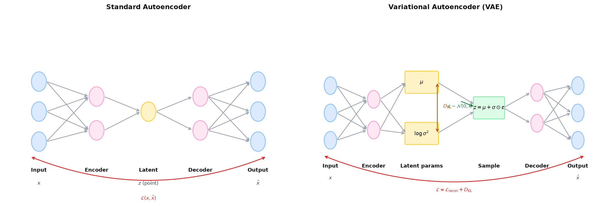

# Note 30 — Variational Autoencoders

## Part 1: The Limitation of Standard Autoencoders

A standard autoencoder learns to compress data into a latent code and reconstruct it. The encoder is a deterministic function: every input maps to exactly one point in latent space. This works well for reconstruction and dimensionality reduction, but it creates a fundamental problem for generation.

The latent space of a standard autoencoder is unstructured. There is no guarantee that points between two learned codes correspond to valid inputs, and there is no natural way to sample a new code that will decode into a realistic output. The network has learned to use whatever region of latent space is convenient — it has not been forced to organise that space in any principled way.

> A standard autoencoder cannot generate new samples because its latent space has no defined structure. Sampling a random point and decoding it produces arbitrary, often meaningless output.

The diagram below contrasts the deterministic bottleneck of a standard autoencoder with the stochastic bottleneck of a VAE.

The variational autoencoder (VAE) addresses this by replacing the deterministic latent code with a probability distribution. Instead of encoding $x$ to a single point $z$, the encoder outputs the parameters of a distribution over $z$. The decoder then reconstructs from a sample drawn from that distribution. A regularisation term forces the distribution to stay close to a standard Gaussian prior, which structures the latent space and makes sampling possible.

---

## Part 2: The VAE Encoder — A Distribution Over Latent Codes

In a VAE, the encoder does not output a single latent vector. It outputs the parameters of a Gaussian distribution over the latent space.

For each input $x$, the encoder outputs:

$$\mu = f_\mu(x), \qquad \log\sigma^2 = f_v(x)$$

where $\mu \in \mathbb{R}^k$ is the mean vector and $\log\sigma^2 \in \mathbb{R}^k$ is the log-variance vector. The encoder defines the approximate posterior:

$$q_\phi(z \mid x) = \mathcal{N}(z;\, \mu,\, \text{diag}(\sigma^2))$$

This is a $k$-dimensional Gaussian with diagonal covariance — each latent dimension is treated as independent. The encoder parameters $\phi$ include the weights of both $f_\mu$ and $f_v$.

### Why Log-Variance?

The network outputs $\log\sigma^2$ rather than $\sigma^2$ directly for two reasons. First, $\log\sigma^2$ is unconstrained — it can take any real value, which is natural for a neural network output. Second, $\sigma^2 = e^{\log\sigma^2}$ is always positive, ensuring a valid variance without requiring a constrained activation.

### Worked Example

**Setup:** $d = 3$, $k = 2$. The encoder has two separate linear heads: one for $\mu$, one for $\log\sigma^2$.

**Weights for $\mu$:**

$$W_\mu = \begin{bmatrix} 0.4 & -0.2 & 0.6 \\ -0.3 & 0.5 & 0.1 \end{bmatrix}, \quad b_\mu = \begin{bmatrix} 0.1 \\ -0.1 \end{bmatrix}$$

**Weights for $\log\sigma^2$:**

$$W_v = \begin{bmatrix} 0.2 & 0.3 & -0.4 \\ 0.1 & -0.2 & 0.3 \end{bmatrix}, \quad b_v = \begin{bmatrix} 0.0 \\ 0.0 \end{bmatrix}$$

**Input:** $x = [1.0,\ 0.5,\ -1.0]^T$

**Step 1 — Compute $\mu$:**

$$\mu_1 = 0.4(1.0) + (-0.2)(0.5) + 0.6(-1.0) + 0.1 = 0.4 - 0.1 - 0.6 + 0.1 = -0.20$$

$$\mu_2 = (-0.3)(1.0) + 0.5(0.5) + 0.1(-1.0) + (-0.1) = -0.3 + 0.25 - 0.1 - 0.1 = -0.25$$

**Step 2 — Compute $\log\sigma^2$:**

$$v_1 = 0.2(1.0) + 0.3(0.5) + (-0.4)(-1.0) + 0.0 = 0.2 + 0.15 + 0.4 = 0.75$$

$$v_2 = 0.1(1.0) + (-0.2)(0.5) + 0.3(-1.0) + 0.0 = 0.1 - 0.1 - 0.3 = -0.30$$

**Step 3 — Recover $\sigma^2$ and $\sigma$:**

$$\sigma^2_1 = e^{0.75} \approx 2.1170, \qquad \sigma_1 \approx 1.4550$$

$$\sigma^2_2 = e^{-0.30} \approx 0.7408, \qquad \sigma_2 \approx 0.8607$$

The encoder has produced the approximate posterior $q_\phi(z \mid x) = \mathcal{N}([-0.20,\ -0.25]^T,\ \text{diag}([2.1170,\ 0.7408]))$.

---

## Part 3: The Reparameterisation Trick

To train the VAE, gradients must flow from the reconstruction loss back through the sampling step to the encoder parameters $\phi$. But sampling is a stochastic operation — it has no gradient.

The reparameterisation trick resolves this by rewriting the sample as a deterministic function of $\mu$, $\sigma$, and a separate noise variable $\varepsilon$:

$$z = \mu + \sigma \odot \varepsilon, \qquad \varepsilon \sim \mathcal{N}(0, I)$$

where $\odot$ denotes element-wise multiplication. The randomness is now isolated in $\varepsilon$, which does not depend on $\phi$. The gradient of $z$ with respect to $\mu$ and $\sigma$ is well-defined:

$$\frac{\partial z}{\partial \mu} = 1, \qquad \frac{\partial z}{\partial \sigma} = \varepsilon$$

> The reparameterisation trick separates the stochastic part ($\varepsilon$) from the learnable part ($\mu$, $\sigma$), making the sampling step differentiable with respect to the encoder parameters.

Without this trick, the expectation over $z$ would need to be estimated by Monte Carlo sampling, and gradients could not be backpropagated through the sample. With it, the entire VAE is end-to-end differentiable.

### Worked Example (continued)

**Step 4 — Reparameterisation** with noise sample $\varepsilon = [0.5,\ -1.0]^T$:

$$z_1 = \mu_1 + \sigma_1 \cdot \varepsilon_1 = -0.20 + 1.4550 \times 0.5 = -0.20 + 0.7275 = 0.5275$$

$$z_2 = \mu_2 + \sigma_2 \cdot \varepsilon_2 = -0.25 + 0.8607 \times (-1.0) = -0.25 - 0.8607 = -1.1107$$

Latent sample: $z = [0.5275,\ -1.1107]^T$. This $z$ is passed to the decoder to produce the reconstruction.

---

## Part 4: The VAE Loss — ELBO

The VAE is trained by maximising the Evidence Lower BOund (ELBO) on the log-likelihood of the data. Equivalently, the loss to minimise is:

$$\mathcal{L}_{\text{VAE}} = \underbrace{\mathbb{E}_{q_\phi(z|x)}\left[-\log p_\theta(x \mid z)\right]}_{\text{reconstruction loss}} + \underbrace{D_{\text{KL}}\left(q_\phi(z \mid x) \,\|\, p(z)\right)}_{\text{KL term}}$$

where $p(z) = \mathcal{N}(0, I)$ is the prior over the latent space.

### Reconstruction Loss

The first term measures how well the decoder reconstructs $x$ from the sampled $z$. For continuous inputs with Gaussian decoder, this reduces to MSE. For binary inputs with Bernoulli decoder, it reduces to binary cross-entropy. In practice, the expectation is approximated with a single sample $z$ per input (one Monte Carlo sample is sufficient when batches are large).

### KL Divergence Term

The second term measures how far the approximate posterior $q_\phi(z \mid x)$ is from the prior $p(z) = \mathcal{N}(0, I)$. It acts as a regulariser: it penalises the encoder for producing distributions that deviate too far from the standard Gaussian.

### Derivation of the ELBO

Starting from the log-likelihood of the data:

$$\log p_\theta(x) = \log \int p_\theta(x \mid z)\, p(z)\, dz$$

This integral is intractable. Introducing the approximate posterior $q_\phi(z \mid x)$ and applying Jensen's inequality:

$$\log p_\theta(x) \geq \mathbb{E}_{q_\phi(z|x)}\left[\log p_\theta(x \mid z)\right] - D_{\text{KL}}\left(q_\phi(z \mid x) \,\|\, p(z)\right)$$

The right-hand side is the ELBO. Maximising the ELBO simultaneously pushes the reconstruction quality up and keeps the posterior close to the prior.

---

## Part 5: The KL Divergence Term

When both $q_\phi(z \mid x)$ and $p(z)$ are Gaussian, the KL divergence has a closed form. For a single latent dimension $j$ with mean $\mu_j$ and variance $\sigma^2_j$:

$$D_{\text{KL}}\left(\mathcal{N}(\mu_j, \sigma^2_j) \,\|\, \mathcal{N}(0, 1)\right) = \frac{1}{2}\left(\sigma^2_j + \mu^2_j - 1 - \log\sigma^2_j\right)$$

Summing over all $k$ latent dimensions:

$$D_{\text{KL}} = \frac{1}{2} \sum_{j=1}^{k} \left(\sigma^2_j + \mu^2_j - 1 - \log\sigma^2_j\right)$$

This is computed analytically — no sampling required for the KL term.

### What the KL Term Does

- When $\mu_j \to 0$ and $\sigma^2_j \to 1$, the KL contribution from dimension $j$ approaches zero.
- The KL term penalises encoders that map inputs to very different regions of latent space (large $|\mu_j|$) or that collapse to near-zero variance (very small $\sigma^2_j$, which would make the encoder deterministic).
- The result is a latent space where similar inputs cluster near the origin and the space is continuously filled — enabling smooth interpolation and sampling.

### Worked Example (continued)

**Step 5 — KL divergence** using $\mu = [-0.20,\ -0.25]^T$ and $\log\sigma^2 = [0.75,\ -0.30]^T$:

$$\text{KL}_1 = \frac{1}{2}\left(\sigma^2_1 + \mu^2_1 - 1 - \log\sigma^2_1\right) = \frac{1}{2}(2.1170 + 0.0400 - 1 - 0.75) = \frac{1}{2}(0.4070) = 0.2035$$

$$\text{KL}_2 = \frac{1}{2}\left(\sigma^2_2 + \mu^2_2 - 1 - \log\sigma^2_2\right) = \frac{1}{2}(0.7408 + 0.0625 - 1 - (-0.30)) = \frac{1}{2}(0.1033) = 0.0517$$

$$D_{\text{KL}} = 0.2035 + 0.0517 = 0.2552$$

This KL value would be added to the reconstruction loss (computed from the decoder output) to give the total VAE loss for this input.

---

## Part 6: Generating New Samples

Once the VAE is trained, generating a new sample requires only the decoder:

1. Sample $z \sim \mathcal{N}(0, I)$ — draw from the prior
2. Decode: $\hat{x} = g_\theta(z)$

This works because the KL term has forced the approximate posterior $q_\phi(z \mid x)$ to stay close to $\mathcal{N}(0, I)$ for all training inputs. The decoder has therefore been trained on latent codes drawn from a distribution that closely matches the prior. Sampling from the prior at test time produces codes the decoder has seen during training.

### Latent Space Interpolation

Because the KL term fills the latent space continuously, interpolating between two codes $z^{(1)}$ and $z^{(2)}$ produces a smooth transition in output space:

$$z(\alpha) = (1 - \alpha)\, z^{(1)} + \alpha\, z^{(2)}, \qquad \alpha \in [0, 1]$$

Decoding $z(\alpha)$ for a sequence of $\alpha$ values produces a smooth morphing between the two corresponding inputs. This is not possible with a standard autoencoder, where the interpolated code may fall in an untrained region of latent space.

### The $\beta$-VAE

A common extension introduces a weight $\beta > 1$ on the KL term:

$$\mathcal{L}_{\beta\text{-VAE}} = \mathbb{E}\left[-\log p_\theta(x \mid z)\right] + \beta\, D_{\text{KL}}\left(q_\phi(z \mid x) \,\|\, p(z)\right)$$

Increasing $\beta$ forces stronger disentanglement — each latent dimension tends to capture an independent factor of variation in the data (e.g. shape, colour, orientation). The cost is higher reconstruction error. $\beta = 1$ recovers the standard VAE.

---

## Summary

- A standard autoencoder maps inputs to a single latent point; its unstructured latent space cannot be sampled to generate new data.
- The VAE encoder outputs the parameters $\mu$ and $\log\sigma^2$ of a Gaussian approximate posterior $q_\phi(z \mid x)$ rather than a single point.
- The reparameterisation trick writes $z = \mu + \sigma \odot \varepsilon$ with $\varepsilon \sim \mathcal{N}(0, I)$, isolating the randomness and making the sampling step differentiable.
- The VAE loss is the negative ELBO: reconstruction loss plus KL divergence between the approximate posterior and the standard Gaussian prior.
- The KL divergence has a closed form for Gaussian distributions: $\frac{1}{2}\sum_j (\sigma^2_j + \mu^2_j - 1 - \log\sigma^2_j)$.
- After training, new samples are generated by sampling $z \sim \mathcal{N}(0, I)$ and decoding — the KL term ensures the decoder has been trained on codes that match this prior.
- The $\beta$-VAE extends the standard VAE by weighting the KL term to encourage disentangled latent representations.
