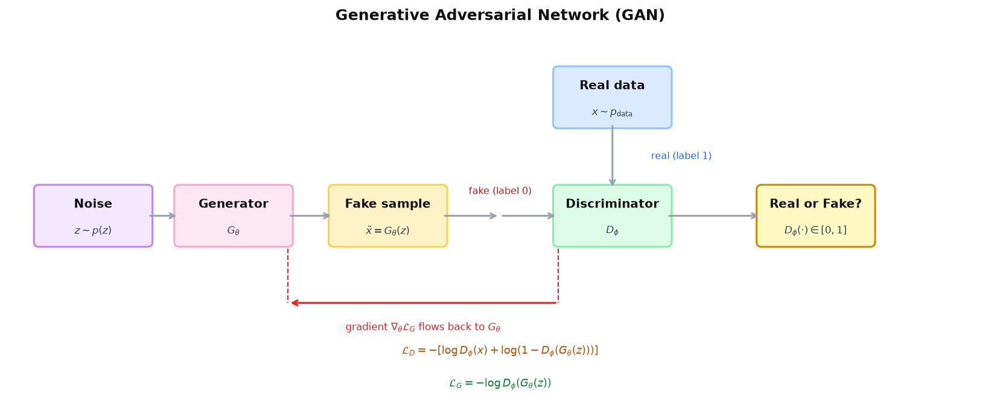

# Note 31 — Generative Adversarial Networks

## Part 1: The Generative Modelling Problem

A generative model learns the distribution of a dataset and can produce new samples from that distribution. Given a collection of images, a generative model should be able to produce new images that look like they came from the same source — not copies of training examples, but novel samples consistent with the learned distribution.

Earlier approaches to generative modelling required explicit density estimation: writing down a tractable probability model $p_\theta(x)$ and maximising the likelihood of the training data. This is difficult for high-dimensional data like images, where the true distribution is complex and the normalisation constant is intractable.

Generative Adversarial Networks (GANs), introduced by Goodfellow et al. in 2014, take a different approach. Instead of modelling the density explicitly, a GAN trains two networks against each other: a generator that produces synthetic data, and a discriminator that tries to distinguish real from synthetic. The generator improves by learning to fool the discriminator.

> A GAN trains a generator and a discriminator in an adversarial game. The generator learns to produce realistic data; the discriminator learns to detect fakes. At equilibrium, the generator produces data indistinguishable from real.

The diagram below shows the GAN framework: noise $z$ enters the generator, the generator produces a fake sample, and the discriminator receives both real and fake samples and outputs a probability of being real.

---

## Part 2: The Generator and Discriminator

### Generator

The generator $G_\theta : \mathbb{R}^{d_z} \to \mathbb{R}^{d_x}$ maps a noise vector $z$ sampled from a simple prior $p(z)$ (typically $\mathcal{N}(0, I)$ or $\text{Uniform}[-1,1]^{d_z}$) to a synthetic data point in the input space:

$$\tilde{x} = G_\theta(z)$$

The generator never sees real data directly. It learns only through the gradient signal from the discriminator.

### Discriminator

The discriminator $D_\phi : \mathbb{R}^{d_x} \to [0, 1]$ takes a data point — either real or generated — and outputs the probability that it is real:

$$D_\phi(x) = \sigma(f_\phi(x))$$

where $f_\phi$ is a neural network and $\sigma$ is the sigmoid function. $D_\phi(x) \approx 1$ means the discriminator believes $x$ is real; $D_\phi(x) \approx 0$ means it believes $x$ is fake.

### The Adversarial Relationship

The two networks have opposing objectives:

- The discriminator wants to output high values for real data and low values for generated data.
- The generator wants to produce data that causes the discriminator to output high values.

This is a two-player zero-sum game. The generator's loss is the discriminator's gain, and vice versa.

---

## Part 3: The Minimax Objective

The GAN training objective is:

$$\min_\theta \max_\phi \; V(D_\phi, G_\theta) = \mathbb{E}_{x \sim p_{\text{data}}}[\log D_\phi(x)] + \mathbb{E}_{z \sim p(z)}[\log(1 - D_\phi(G_\theta(z)))]$$

The discriminator maximises $V$ — it wants $D_\phi(x)$ close to 1 for real data and $D_\phi(G_\theta(z))$ close to 0 for fakes, making both log terms large (less negative).

The generator minimises $V$ — it wants $D_\phi(G_\theta(z))$ close to 1, making $\log(1 - D_\phi(G_\theta(z)))$ very negative.

### Discriminator Loss

In practice, the discriminator is trained to minimise the negative of $V$:

$$\mathcal{L}_D = -\left[\log D_\phi(x) + \log(1 - D_\phi(G_\theta(z)))\right]$$

This is binary cross-entropy: the discriminator is a binary classifier with real = 1 and fake = 0.

### Generator Loss (Non-Saturating)

The original generator objective is to minimise $\log(1 - D_\phi(G_\theta(z)))$. In practice this saturates early in training: when the generator is weak, $D_\phi(G_\theta(z)) \approx 0$, so $\log(1 - D_\phi(G_\theta(z))) \approx 0$ and the gradient is near zero.

The non-saturating alternative maximises $\log D_\phi(G_\theta(z))$ instead:

$$\mathcal{L}_G = -\log D_\phi(G_\theta(z))$$

This provides stronger gradients early in training when the generator most needs them, without changing the equilibrium.

### Worked Example

**Setup:** Scalar inputs. $D_\phi(x) = \sigma(w_D x + b_D)$ with $w_D = 0.8$, $b_D = 0.1$. $G_\theta(z) = w_G z + b_G$ with $w_G = 0.5$, $b_G = 0.2$.

**Real sample:** $x_{\text{real}} = 1.2$. **Noise:** $z = 0.6$.

**Step 1 — Discriminator on real:**

$$D_\phi(x_{\text{real}}) = \sigma(0.8 \times 1.2 + 0.1) = \sigma(1.06) = \frac{1}{1 + e^{-1.06}} = \frac{1}{1 + 0.3465} \approx 0.7427$$

**Step 2 — Generator output:**

$$G_\theta(z) = 0.5 \times 0.6 + 0.2 = 0.50$$

**Step 3 — Discriminator on fake:**

$$D_\phi(G_\theta(z)) = \sigma(0.8 \times 0.50 + 0.1) = \sigma(0.50) = \frac{1}{1 + e^{-0.50}} = \frac{1}{1 + 0.6065} \approx 0.6225$$

**Step 4 — Discriminator loss:**

$$\mathcal{L}_D = -[\log(0.7427) + \log(1 - 0.6225)] = -[\log(0.7427) + \log(0.3775)]$$

$$= -[-0.2975 + (-0.9746)] = -(-1.2721) = 1.2721$$

**Step 5 — Generator loss (non-saturating):**

$$\mathcal{L}_G = -\log D_\phi(G_\theta(z)) = -\log(0.6225) \approx 0.4748$$

The discriminator loss is high because the discriminator is not yet well-trained. The generator loss reflects that the discriminator currently assigns 62% probability of being real to the fake — the generator is already partially fooling it.

---

## Part 4: Training Dynamics

GAN training alternates between updating the discriminator and the generator. A typical training step for one mini-batch:

1. **Sample** a mini-batch of real data $\{x^{(i)}\}$ and a mini-batch of noise $\{z^{(i)}\}$
2. **Update discriminator:** compute $\mathcal{L}_D$, backpropagate, update $\phi$ — generator weights frozen
3. **Sample** a new mini-batch of noise $\{z^{(i)}\}$
4. **Update generator:** compute $\mathcal{L}_G$, backpropagate through $D_\phi \circ G_\theta$, update $\theta$ — discriminator weights frozen

The discriminator is sometimes updated $k > 1$ times per generator update to keep it stronger than the generator, providing a useful gradient signal.

### Nash Equilibrium

The theoretical optimum is a Nash equilibrium where neither player can improve by changing their strategy alone. Goodfellow et al. showed that the unique Nash equilibrium of the GAN game is:

$$p_{G_\theta} = p_{\text{data}}, \qquad D_\phi(x) = \frac{1}{2} \text{ for all } x$$

At equilibrium, the generator perfectly replicates the data distribution and the discriminator cannot distinguish real from fake — it outputs $\frac{1}{2}$ everywhere.

---

## Part 5: Training Instability

GAN training is notoriously unstable. Two failure modes are common.

### Mode Collapse

The generator learns to produce only a small subset of the data distribution — perhaps a single mode — because that is sufficient to fool the discriminator. The discriminator then adapts to detect that mode, the generator shifts to another, and the two cycle without converging.

> Mode collapse occurs when the generator maps many different noise vectors to nearly the same output, ignoring the diversity of the real data distribution.

### Vanishing Gradients for the Generator

If the discriminator becomes too strong early in training, $D_\phi(G_\theta(z)) \approx 0$ for all generated samples. The original generator loss $\log(1 - D_\phi(G_\theta(z)))$ saturates near zero, providing no gradient. The non-saturating loss $-\log D_\phi(G_\theta(z))$ mitigates this but does not eliminate it.

### Practical Stabilisation Techniques

| Technique | What it does |
|---|---|
| Non-saturating generator loss | Stronger gradients early in training |
| Label smoothing | Replace real labels 1 with 0.9 — prevents discriminator overconfidence |
| Gradient penalty (WGAN-GP) | Penalises discriminator gradient norm — enforces Lipschitz constraint |
| Spectral normalisation | Normalises discriminator weights to control Lipschitz constant |
| Balanced update ratio | Update discriminator $k$ times per generator update |

---

## Part 6: Applications

GANs have produced some of the most striking results in deep learning.

### Image Synthesis

GANs can generate photorealistic images of faces, objects, and scenes that do not exist. Progressive GAN and StyleGAN progressively grow the resolution during training, producing high-resolution outputs with fine detail.

### Style Transfer

A conditional GAN (cGAN) receives an additional conditioning signal alongside the noise. Image-to-image translation (pix2pix) uses a conditional GAN to translate between image domains: sketch to photo, day to night, satellite to map.

### Data Augmentation

GANs can generate synthetic training examples for rare classes or conditions — useful in medical imaging where labelled data is scarce. The synthetic data augments the real training set.

### Super-Resolution

SRGAN uses a GAN to upscale low-resolution images. The adversarial loss encourages the generator to produce sharp, realistic textures rather than the blurry outputs typical of MSE-trained upscalers.

---

## Summary

- A GAN trains a generator $G_\theta$ and a discriminator $D_\phi$ in an adversarial game: the generator produces synthetic data from noise, the discriminator classifies real vs fake.
- The minimax objective is $\min_\theta \max_\phi \; \mathbb{E}[\log D_\phi(x)] + \mathbb{E}[\log(1 - D_\phi(G_\theta(z)))]$.
- The discriminator loss is binary cross-entropy; the non-saturating generator loss is $-\log D_\phi(G_\theta(z))$, which provides stronger gradients early in training.
- Training alternates: update the discriminator with generator frozen, then update the generator with discriminator frozen.
- The Nash equilibrium is $p_{G_\theta} = p_{\text{data}}$ and $D_\phi(x) = \frac{1}{2}$ everywhere — the generator perfectly replicates the data distribution.
- Mode collapse and vanishing generator gradients are the two main failure modes; label smoothing, gradient penalties, and spectral normalisation are common stabilisation techniques.
- Applications include image synthesis, style transfer, data augmentation, and super-resolution.
