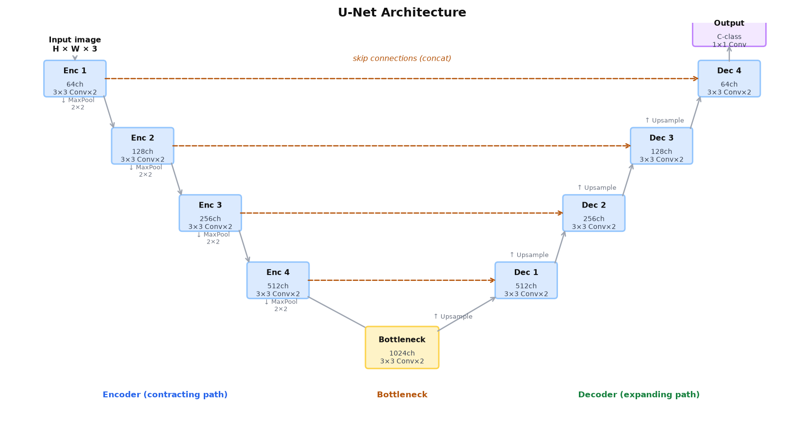

# Note 32 — Applications in Computer Vision

## Part 1: From Classification to Dense Prediction

A classification CNN takes an image and outputs a single label. This is useful, but many real-world tasks require more: knowing not just what is in an image, but where it is, and at what granularity.

Three levels of spatial understanding define the main computer vision tasks:

| Task | Output | Granularity |
|---|---|---|
| Classification | One label per image | Image-level |
| Object detection | Bounding boxes + labels | Object-level |
| Segmentation | One label per pixel | Pixel-level |

**Semantic segmentation** assigns a class label to every pixel — all pixels belonging to "road" get one label, all "pedestrian" pixels get another. It does not distinguish between individual instances of the same class.

**Instance segmentation** goes further: it assigns a separate label to each individual object instance, even within the same class. Two pedestrians side by side get different instance labels.

This note focuses on semantic segmentation and object detection — the two tasks that require the most architectural innovation beyond standard classification CNNs.

### Why Classification CNNs Cannot Segment

A standard classification CNN ends with global average pooling or a fully connected layer that collapses spatial information into a single vector. Spatial location is deliberately discarded — it is irrelevant for classification. For segmentation, spatial location is the entire output. A different architecture is needed.

---

## Part 2: Fully Convolutional Networks

The key insight behind fully convolutional networks (FCNs) is simple: a fully connected layer is just a convolution with a kernel the same size as the input feature map. Replacing all FC layers with convolutional layers preserves spatial structure throughout the network and allows the network to accept inputs of any size.

> A fully convolutional network replaces all fully connected layers with convolutional layers, producing a spatial output map rather than a single class vector.

### From Classification to Dense Prediction

Take a classification CNN trained on ImageNet. Its final FC layers collapse a $7 \times 7 \times 512$ feature map to a 1000-dimensional vector. Replace those FC layers with a $1 \times 1$ convolution that maps $7 \times 7 \times 512 \to 7 \times 7 \times C$ where $C$ is the number of classes. Each spatial position now has a class prediction — but at $\frac{1}{32}$ of the original resolution due to the pooling layers.

### Upsampling: Recovering Spatial Resolution

To produce a full-resolution segmentation map, the low-resolution prediction must be upsampled back to the input size. Two approaches:

**Bilinear interpolation** — a fixed, non-learnable upsampling that fills in values by weighted averaging of neighbours. Fast but coarse.

**Transposed convolution** (also called deconvolution) — a learnable upsampling. It inserts zeros between input values and applies a learned filter, effectively learning how to upsample. The output size for a transposed convolution with input size $W$, kernel $F$, stride $S$, padding $P$ is:

$$W_{\text{out}} = (W - 1) \cdot S - 2P + F$$

### Skip Connections in FCN

Upsampling from $\frac{1}{32}$ resolution in one step produces blurry boundaries. FCN addresses this with skip connections: predictions from earlier, higher-resolution feature maps are added to the upsampled output before the final prediction. This recovers fine spatial detail lost during downsampling.

---

## Part 3: U-Net

U-Net, introduced for biomedical image segmentation in 2015, takes the skip connection idea to its logical conclusion. It is a symmetric encoder-decoder architecture where every encoder layer is connected directly to its corresponding decoder layer.

The diagram below shows the U-Net architecture: the encoder path on the left, the bottleneck at the bottom, and the decoder path on the right with skip connections bridging each level.

### Encoder Path

The encoder is a standard CNN: repeated blocks of two $3 \times 3$ convolutions followed by ReLU, then $2 \times 2$ max pooling with stride 2. Each pooling step halves the spatial dimensions and doubles the number of feature channels. The encoder progressively compresses spatial information while building a rich feature representation.

At each level $l$, the encoder produces a feature map $e^{(l)}$ of spatial size $\frac{H}{2^l} \times \frac{W}{2^l}$ and $C \cdot 2^l$ channels.

### Bottleneck

The deepest layer — the bottleneck — has the smallest spatial size and the most channels. It captures the most abstract, context-rich representation of the input.

### Decoder Path

The decoder mirrors the encoder. At each level, the feature map is upsampled (transposed convolution, doubling spatial size), then concatenated with the corresponding encoder feature map via a skip connection, then passed through two $3 \times 3$ convolutions with ReLU.

The concatenation is the key operation: it combines the high-level semantic information from the decoder with the high-resolution spatial detail from the encoder at the same level.

$$d^{(l)} = \text{Conv}\left(\text{Cat}\left(\text{Up}(d^{(l+1)}),\ e^{(l)}\right)\right)$$

where $\text{Up}$ is transposed convolution, $\text{Cat}$ is channel-wise concatenation, and $\text{Conv}$ is the two-convolution block.

### Output Layer

The final layer is a $1 \times 1$ convolution that maps the feature channels to $C$ class scores per pixel, followed by a softmax (or sigmoid for binary segmentation). The output has the same spatial dimensions as the input.

### Why Skip Connections Matter

Without skip connections, the decoder must reconstruct fine spatial detail from the bottleneck alone — a highly compressed representation. Skip connections provide a direct path for high-resolution information to bypass the bottleneck. The decoder learns to combine "what" (from the bottleneck) with "where" (from the skip connections).

> U-Net's skip connections solve the fundamental tension in segmentation: the encoder must compress to understand context, but the decoder must recover the spatial precision that compression destroys.

---

## Part 4: Object Detection Pipelines

Object detection requires both localisation (where is the object?) and classification (what is it?). The output is a set of bounding boxes, each with a class label and a confidence score.

### Bounding Box Representation

A bounding box is represented as $(x_c, y_c, w, h)$ — centre coordinates, width, height — or equivalently as $(x_1, y_1, x_2, y_2)$ — top-left and bottom-right corners. The network predicts these as regression targets alongside class probabilities.

### Two-Stage Detectors: R-CNN Family

Two-stage detectors first propose candidate regions, then classify each region.

**R-CNN (2014):** Selective search generates ~2000 region proposals. Each proposal is warped to a fixed size and passed through a CNN independently. Slow — 2000 forward passes per image.

**Fast R-CNN (2015):** The entire image is passed through the CNN once to produce a shared feature map. Region proposals are projected onto this feature map and pooled (RoI pooling) to a fixed size. One forward pass per image, proposals share computation.

**Faster R-CNN (2015):** Replaces selective search with a Region Proposal Network (RPN) — a small CNN that slides over the feature map and predicts objectness scores and bounding box offsets for a set of anchor boxes at each location. Fully end-to-end trainable.

**Anchor boxes** are pre-defined boxes of various scales and aspect ratios placed at each spatial location. The RPN predicts offsets $(\Delta x, \Delta y, \Delta w, \Delta h)$ relative to each anchor, and an objectness score. Anchors with high objectness scores become proposals passed to the detection head.

### One-Stage Detectors: YOLO and SSD

One-stage detectors skip the proposal stage and predict boxes and classes directly from the feature map in a single pass.

**YOLO (You Only Look Once):** Divides the image into an $S \times S$ grid. Each cell predicts $B$ bounding boxes and $C$ class probabilities. Each box prediction includes $(x, y, w, h, \text{confidence})$. All predictions are made simultaneously in one forward pass — very fast.

**SSD (Single Shot MultiBox Detector):** Predicts from multiple feature maps at different scales, handling objects of different sizes. Anchors at each scale cover different aspect ratios.

### Two-Stage vs One-Stage

| Property | Two-stage (Faster R-CNN) | One-stage (YOLO, SSD) |
|---|---|---|
| Speed | Slower | Faster |
| Accuracy | Higher, especially small objects | Lower, improving with newer versions |
| Complexity | Higher | Lower |
| Use case | Accuracy-critical | Real-time applications |

---

## Part 5: Evaluation Metrics

### Intersection over Union (IoU)

IoU measures the overlap between a predicted bounding box $\hat{B}$ and a ground truth box $B$:

$$\text{IoU}(\hat{B}, B) = \frac{|\hat{B} \cap B|}{|\hat{B} \cup B|} = \frac{\text{area of intersection}}{\text{area of union}}$$

IoU ranges from 0 (no overlap) to 1 (perfect overlap). A detection is counted as a true positive if $\text{IoU} \geq \theta$, where $\theta = 0.5$ is the standard threshold.

#### Worked Example

**Predicted box:** $(x_1, y_1, x_2, y_2) = (10, 12, 50, 48)$ — area $= 40 \times 36 = 1440$

**Ground truth box:** $(x_1, y_1, x_2, y_2) = (15, 10, 55, 45)$ — area $= 40 \times 35 = 1400$

**Intersection coordinates:**

$$x_{\text{left}} = \max(10, 15) = 15, \quad x_{\text{right}} = \min(50, 55) = 50$$

$$y_{\text{top}} = \max(12, 10) = 12, \quad y_{\text{bottom}} = \min(48, 45) = 45$$

$$\text{Intersection} = (50 - 15) \times (45 - 12) = 35 \times 33 = 1155$$

**Union:**

$$\text{Union} = 1440 + 1400 - 1155 = 1685$$

**IoU:**

$$\text{IoU} = \frac{1155}{1685} \approx 0.686$$

Since $0.686 \geq 0.5$, this detection counts as a true positive at the standard threshold.

### Mean Average Precision (mAP)

For object detection, **Average Precision (AP)** for a single class is the area under the precision-recall curve as the confidence threshold varies. **mAP** averages AP across all classes:

$$\text{mAP} = \frac{1}{C} \sum_{c=1}^{C} \text{AP}_c$$

COCO-style mAP averages over IoU thresholds from 0.5 to 0.95 in steps of 0.05, written as $\text{mAP}_{0.5:0.95}$.

### Pixel Accuracy

For segmentation, the simplest metric is pixel accuracy: the fraction of pixels correctly classified:

$$\text{Pixel Accuracy} = \frac{\sum_c \text{TP}_c}{\text{total pixels}}$$

This is misleading when classes are imbalanced — a model that predicts "background" for every pixel achieves high accuracy on datasets where background dominates.

### Mean IoU (mIoU)

mIoU is the standard segmentation metric. For each class $c$, IoU is computed over all pixels:

$$\text{IoU}_c = \frac{\text{TP}_c}{\text{TP}_c + \text{FP}_c + \text{FN}_c}$$

Then averaged across classes:

$$\text{mIoU} = \frac{1}{C} \sum_{c=1}^{C} \text{IoU}_c$$

#### Worked Example

A $4 \times 4$ image (16 pixels) with 2 classes: background (0) and foreground (1).

| Pixels | True label | Predicted label | Role |
|---|---|---|---|
| 8 | 0 | 0 | TP for class 0 |
| 2 | 0 | 1 | FN for class 0, FP for class 1 |
| 3 | 1 | 0 | FN for class 1, FP for class 0 |
| 3 | 1 | 1 | TP for class 1 |

**Class 0 (background):** $\text{TP}_0 = 8$, $\text{FP}_0 = 3$, $\text{FN}_0 = 2$

$$\text{IoU}_0 = \frac{8}{8 + 3 + 2} = \frac{8}{13} \approx 0.6154$$

**Class 1 (foreground):** $\text{TP}_1 = 3$, $\text{FP}_1 = 2$, $\text{FN}_1 = 3$

$$\text{IoU}_1 = \frac{3}{3 + 2 + 3} = \frac{3}{8} = 0.3750$$

$$\text{mIoU} = \frac{0.6154 + 0.3750}{2} \approx 0.4952$$

mIoU penalises the model for missing foreground pixels even though pixel accuracy would be $\frac{8+3}{16} = 0.6875$ — a misleadingly optimistic figure.

---

## Summary

- Semantic segmentation assigns a class label to every pixel; instance segmentation additionally distinguishes individual object instances.
- Fully convolutional networks replace FC layers with convolutions, preserving spatial structure and enabling dense prediction at any input size; transposed convolutions provide learnable upsampling.
- U-Net is a symmetric encoder-decoder with skip connections at every level: the encoder compresses for context, the decoder recovers spatial detail, and skip connections bridge the two by concatenating encoder feature maps into the decoder path.
- Two-stage detectors (Faster R-CNN) use a Region Proposal Network to generate candidate boxes, then classify each; one-stage detectors (YOLO, SSD) predict boxes and classes in a single forward pass — faster but historically less accurate.
- IoU measures bounding box overlap: $\frac{\text{intersection}}{\text{union}}$; a detection is a true positive if $\text{IoU} \geq 0.5$.
- mAP averages precision-recall area under the curve across classes and IoU thresholds; mIoU averages per-class IoU across classes and is the standard segmentation metric.
