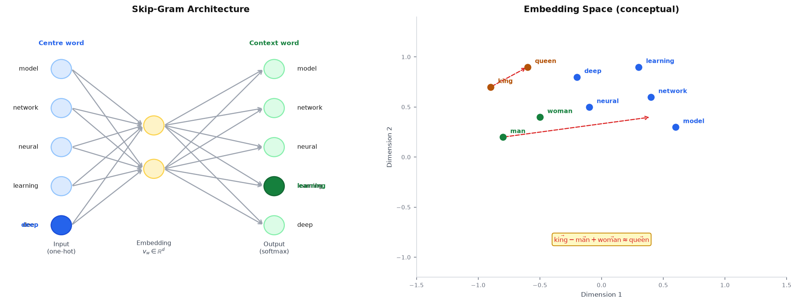

# Note 33 — Applications in NLP

## Part 1: Text as Sequences — Tokenisation and Vocabulary

Natural language is discrete and sequential. Before any neural network can process text, it must be converted into numbers. This requires two decisions: how to split text into units, and how to represent those units numerically.

### Tokenisation

**Word tokenisation** splits text at whitespace and punctuation boundaries. "Deep learning works" becomes ["Deep", "learning", "works"]. Simple but produces large vocabularies and cannot handle unseen words.

**Subword tokenisation** (e.g. Byte-Pair Encoding, WordPiece) splits rare words into smaller units while keeping common words intact. "unlearnable" might become ["un", "learn", "able"]. This limits vocabulary size and handles new words gracefully. Used in BERT, GPT, and most modern models.

**Character tokenisation** treats each character as a token. Tiny vocabulary, but sequences become very long.

### Vocabulary and One-Hot Encoding

The vocabulary $\mathcal{V}$ is the set of all unique tokens. Each token is assigned an integer index. The simplest representation is a one-hot vector: a vector of length $|\mathcal{V}|$ with a 1 at the token's index and 0 elsewhere.

One-hot vectors are sparse and high-dimensional. They encode no similarity between words — "cat" and "kitten" are as far apart as "cat" and "democracy". Dense word embeddings solve this.

---

## Part 2: Word Embeddings and Word2Vec

A word embedding maps each token to a dense vector in $\mathbb{R}^d$ where $d \ll |\mathcal{V}|$. Semantically similar words end up close in embedding space — a property that emerges from training on large corpora.

> Word embeddings encode meaning as geometry: similar words cluster together, and relationships between words correspond to directions in the embedding space.

The classic example: $\vec{\text{king}} - \vec{\text{man}} + \vec{\text{woman}} \approx \vec{\text{queen}}$.

### Word2Vec

Word2Vec (Mikolov et al., 2013) learns embeddings by training a shallow neural network on a self-supervised prediction task. Two variants:

**Skip-gram:** Given a centre word, predict the surrounding context words within a window of size $w$.

**CBOW (Continuous Bag of Words):** Given the surrounding context words, predict the centre word.

Both use the same architecture: an embedding lookup (input matrix $W_{\text{in}} \in \mathbb{R}^{|\mathcal{V}| \times d}$) and an output matrix $W_{\text{out}} \in \mathbb{R}^{d \times |\mathcal{V}|}$. The input embedding for word $w$ is the row $v_w$ of $W_{\text{in}}$; the output vector is the column $u_w$ of $W_{\text{out}}$.

### Skip-Gram Objective

For a centre word $w_c$ and context word $w_o$, the model predicts:

$$P(w_o \mid w_c) = \frac{\exp(u_{w_o}^T v_{w_c})}{\sum_{w \in \mathcal{V}} \exp(u_w^T v_{w_c})}$$

The loss for one (centre, context) pair is the negative log-probability:

$$\mathcal{L} = -\log P(w_o \mid w_c)$$

### Worked Example

**Vocabulary** ($|\mathcal{V}| = 5$): [deep, learning, neural, network, model]. Embedding dimension $d = 2$.

**Input embedding for "deep":** $v_{\text{deep}} = [0.5,\ -0.3]^T$

**Output vectors:**

$$u_{\text{learning}} = [0.4,\ 0.6]^T, \quad u_{\text{neural}} = [-0.2,\ 0.3]^T, \quad u_{\text{network}} = [0.1,\ -0.4]^T$$
$$u_{\text{model}} = [0.3,\ 0.2]^T, \quad u_{\text{deep}} = [-0.1,\ 0.5]^T$$

**Step 1 — Scores** $s_w = u_w^T v_{\text{deep}}$:

$$s_{\text{learning}} = 0.4(0.5) + 0.6(-0.3) = 0.20 - 0.18 = 0.02$$

$$s_{\text{neural}} = (-0.2)(0.5) + 0.3(-0.3) = -0.10 - 0.09 = -0.19$$

$$s_{\text{network}} = 0.1(0.5) + (-0.4)(-0.3) = 0.05 + 0.12 = 0.17$$

$$s_{\text{model}} = 0.3(0.5) + 0.2(-0.3) = 0.15 - 0.06 = 0.09$$

$$s_{\text{deep}} = (-0.1)(0.5) + 0.5(-0.3) = -0.05 - 0.15 = -0.20$$

**Step 2 — Softmax:**

$$e^{0.02} \approx 1.0202, \quad e^{-0.19} \approx 0.8270, \quad e^{0.17} \approx 1.1853, \quad e^{0.09} \approx 1.0942, \quad e^{-0.20} \approx 0.8187$$

$$\text{Sum} = 1.0202 + 0.8270 + 1.1853 + 1.0942 + 0.8187 = 4.9454$$

$$P(\text{learning} \mid \text{deep}) = \frac{1.0202}{4.9454} \approx 0.2063$$

**Step 3 — Loss:**

$$\mathcal{L} = -\log P(\text{learning} \mid \text{deep}) = -\log(0.2063) \approx 1.5773$$

Training would update $v_{\text{deep}}$ and $u_{\text{learning}}$ to increase this probability, and all other output vectors to decrease their scores.

The diagram below shows the Word2Vec skip-gram architecture and the embedding geometry after training.

---

## Part 3: Sentiment Analysis

Sentiment analysis classifies text by the opinion it expresses — typically positive, negative, or neutral. It is one of the most widely deployed NLP tasks: product reviews, social media monitoring, customer feedback.

### Pipeline

1. **Tokenise** the input text
2. **Embed** each token using a pre-trained or learned embedding
3. **Encode** the sequence with an RNN, LSTM, or Transformer encoder
4. **Pool** the sequence representation (last hidden state, mean, or CLS token)
5. **Classify** with a linear layer + softmax

### RNN-Based Sentiment Classifier

An LSTM processes the token sequence left to right. The final hidden state $h_T$ summarises the entire sequence and is passed to a linear classifier:

$$\hat{y} = \text{softmax}(W h_T + b)$$

The model is trained end-to-end with cross-entropy loss. The embedding layer is either initialised with pre-trained Word2Vec/GloVe vectors and fine-tuned, or learned from scratch.

### Transformer-Based Sentiment Classifier

A pre-trained transformer (e.g. BERT) prepends a special [CLS] token to the input. After encoding, the [CLS] representation is used as the sequence summary and passed to a classification head. Fine-tuning updates all parameters on the labelled sentiment data.

---

## Part 4: Language Modelling

A language model assigns a probability to a sequence of tokens. It answers: how likely is this sequence of words?

$$P(w_1, w_2, \ldots, w_T) = \prod_{t=1}^{T} P(w_t \mid w_1, \ldots, w_{t-1})$$

Training a language model is self-supervised: the supervision signal is the next token in the sequence, which is always available from raw text. No labels are needed.

### Perplexity

Perplexity measures how well a language model predicts a held-out test sequence. For a sequence of $T$ tokens:

$$\text{PPL} = \exp\left(-\frac{1}{T} \sum_{t=1}^{T} \log P(w_t \mid w_1, \ldots, w_{t-1})\right)$$

Perplexity is the exponentiated average negative log-probability per token. A perplexity of $k$ means the model is as uncertain as if it had to choose uniformly among $k$ options at each step. Lower is better.

> Perplexity is the standard metric for language models. A model with perplexity 50 is, on average, as confused as if it had to pick from 50 equally likely words at each position.

---

## Part 5: BERT and GPT

Modern NLP is dominated by large pre-trained transformer models. Two paradigms define the field.

### BERT — Bidirectional Encoder

BERT (Bidirectional Encoder Representations from Transformers, Devlin et al., 2018) pre-trains a transformer encoder on two tasks:

**Masked Language Modelling (MLM):** 15% of tokens are randomly masked. The model predicts the masked tokens from the surrounding context — both left and right. This forces bidirectional understanding.

**Next Sentence Prediction (NSP):** Given two sentences, predict whether the second follows the first in the original text.

After pre-training on a large corpus, BERT is fine-tuned on downstream tasks by adding a task-specific head (classification, question answering, named entity recognition) and training on labelled data.

BERT produces contextualised embeddings: the representation of a word depends on its context. "Bank" in "river bank" and "bank account" gets different representations.

### GPT — Autoregressive Decoder

GPT (Generative Pre-trained Transformer, Radford et al., 2018) pre-trains a transformer decoder on standard language modelling: predict the next token given all previous tokens. This is a left-to-right (causal) model — each position can only attend to earlier positions.

GPT is fine-tuned on downstream tasks or used directly for generation by sampling from the predicted distribution over the next token.

### BERT vs GPT

| Property | BERT | GPT |
|---|---|---|
| Architecture | Encoder (bidirectional) | Decoder (causal/left-to-right) |
| Pre-training task | Masked LM + NSP | Next token prediction |
| Strength | Understanding tasks (classification, QA) | Generation tasks (text completion, dialogue) |
| Fine-tuning | Task-specific head added | Prompt-based or fine-tuned |

---

## Summary

- Text is tokenised into words, subwords, or characters; tokens are mapped to integer indices and then to dense embedding vectors.
- Word2Vec learns embeddings by training a shallow network to predict context words from a centre word (skip-gram) or vice versa (CBOW); the skip-gram loss is $-\log P(w_o \mid w_c)$ where the probability is a softmax over dot products.
- Sentiment analysis classifies text opinion using an encoder (LSTM or Transformer) followed by a classification head; pre-trained embeddings and fine-tuning improve performance on small labelled datasets.
- A language model assigns probabilities to token sequences by factoring the joint probability into conditional next-token probabilities; perplexity is the standard evaluation metric.
- BERT pre-trains a bidirectional encoder with masked language modelling, producing contextualised representations suited to understanding tasks; GPT pre-trains a causal decoder with next-token prediction, suited to generation tasks.
