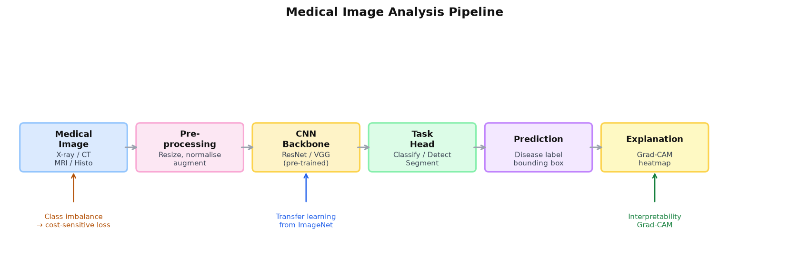

# Note 34 — Applications in Healthcare

## Part 1: Medical Image Analysis

Medical imaging produces some of the most information-dense data in healthcare: X-rays, CT scans, MRI, ultrasound, histology slides. Radiologists and pathologists spend years learning to interpret these images. Deep learning can assist — and in some narrow tasks, match or exceed — human performance.

The core tasks mirror those in general computer vision:

| Task | Medical example |
|---|---|
| Classification | Chest X-ray: pneumonia vs normal |
| Detection | Nodule detection in CT scans |
| Segmentation | Tumour boundary delineation in MRI |
| Regression | Bone age estimation from hand X-ray |

### Why Medical Imaging is Different

Medical images differ from natural images in ways that matter for deep learning:

**Modality diversity.** X-ray, CT, MRI, and histology have different physical origins, resolutions, and noise characteristics. A model trained on X-rays does not transfer directly to MRI.

**Label scarcity.** Annotating medical images requires clinical expertise. A radiologist labelling 100 CT scans per day is expensive. Datasets are orders of magnitude smaller than ImageNet.

**Class imbalance.** Disease is rare. A chest X-ray dataset may be 95% normal. A model that always predicts "normal" achieves 95% accuracy but is clinically useless.

**High stakes.** A false negative (missed cancer) has different consequences than a false positive (unnecessary biopsy). The cost asymmetry must be reflected in the evaluation metric and loss function.

The diagram below shows a typical medical image analysis pipeline.

---

## Part 2: Transfer Learning in Healthcare

Training a deep CNN from scratch requires millions of labelled examples. Medical datasets rarely exceed tens of thousands. Transfer learning bridges this gap.

### ImageNet Pre-training

A ResNet or VGG pre-trained on ImageNet has learned general visual features: edges, textures, shapes, object parts. These features are not specific to natural photographs — they are useful for any image recognition task, including medical imaging.

The standard approach:

1. Take a pre-trained backbone (e.g. ResNet-50 trained on ImageNet)
2. Replace the final classification head with a new head matching the medical task
3. **Feature extraction:** freeze all backbone weights, train only the new head on medical data
4. **Fine-tuning:** unfreeze the backbone (or its later layers) and continue training at a low learning rate

Fine-tuning is preferred when the medical dataset is large enough (thousands of examples). Feature extraction is safer when data is very scarce.

### Why It Works Despite Domain Shift

ImageNet images are natural photographs; chest X-rays are greyscale projections of anatomy. The domain shift is large. Yet transfer learning works because:

- Early layers learn low-level features (edges, gradients) that are universal across image types
- Later layers learn higher-level patterns that are more domain-specific — these are the layers that benefit most from fine-tuning

> Transfer learning from ImageNet to medical imaging works because low-level visual features are universal. The network does not need to relearn how to detect edges — it needs to learn what patterns of edges are clinically significant.

### Practical Considerations

- Medical images are often single-channel (greyscale). The first conv layer of a pre-trained model expects 3 channels. Common fixes: replicate the greyscale channel three times, or replace and reinitialise the first layer.
- Normalisation statistics (mean, std) from ImageNet do not match medical images. Recompute from the medical dataset.

---

## Part 3: Class Imbalance in Medical Data

In most medical datasets, the condition of interest is rare. A model trained naively on imbalanced data learns to predict the majority class.

### Cost-Sensitive Learning

Assign different weights to different classes in the loss function. For binary classification with class weights $w_0$ (normal) and $w_1$ (disease):

$$\mathcal{L} = -\left[w_1 \cdot y \log \hat{y} + w_0 \cdot (1-y) \log(1-\hat{y})\right]$$

A common choice is $w_c = \frac{N}{C \cdot N_c}$ where $N$ is total samples, $C$ is number of classes, and $N_c$ is samples in class $c$. This makes each class contribute equally to the loss regardless of frequency.

### Resampling

**Oversampling:** duplicate or augment minority class examples (e.g. SMOTE for tabular data; augmentation for images).

**Undersampling:** randomly remove majority class examples to balance the dataset.

### Evaluation Under Imbalance

Accuracy is misleading. The appropriate metrics are:

- **Sensitivity (recall):** $\frac{\text{TP}}{\text{TP} + \text{FN}}$ — fraction of true disease cases detected
- **Specificity:** $\frac{\text{TN}}{\text{TN} + \text{FP}}$ — fraction of true normal cases correctly identified
- **AUC-ROC:** threshold-independent measure of discrimination ability
- **F1 score:** harmonic mean of precision and recall

In clinical settings, sensitivity and specificity are reported together because the trade-off between them is a clinical decision, not a modelling decision.

---

## Part 4: Interpretability — Saliency Maps and Grad-CAM

A model that achieves high accuracy but cannot explain its predictions is difficult to trust in clinical practice. Interpretability methods produce visual explanations: which regions of the image drove the prediction?

### Saliency Maps

The simplest approach: compute the gradient of the class score $S_c$ with respect to the input image $x$:

$$M_{ij} = \left|\frac{\partial S_c}{\partial x_{ij}}\right|$$

Large gradient magnitude at pixel $(i,j)$ means that pixel strongly influences the prediction. The saliency map $M$ is overlaid on the input image to highlight important regions.

### Grad-CAM

Gradient-weighted Class Activation Mapping (Grad-CAM) produces a coarser but more interpretable heatmap by working at the level of the final convolutional feature maps rather than the input pixels.

**Step 1 — Compute importance weights.** For class $c$ and feature map $k$ of the final conv layer (spatial size $H \times W$), compute the global average of the gradient:

$$\alpha^k_c = \frac{1}{H \cdot W} \sum_{i=1}^{H} \sum_{j=1}^{W} \frac{\partial S_c}{\partial A^k_{ij}}$$

**Step 2 — Weighted combination.** Form the Grad-CAM heatmap:

$$L^c = \text{ReLU}\left(\sum_k \alpha^k_c \cdot A^k\right)$$

The ReLU keeps only the regions that positively influence the class score. The heatmap $L^c$ is upsampled to the input image size for visualisation.

> Grad-CAM answers: which spatial regions of the image did the network focus on when predicting class $c$?

### Worked Example

A CNN has a final conv layer with $K = 3$ feature maps, each of spatial size $2 \times 2$. The class is "pneumonia".

**Feature maps:**

$$A^1 = \begin{bmatrix} 0.8 & 0.2 \\ 0.3 & 0.6 \end{bmatrix}, \quad A^2 = \begin{bmatrix} 0.1 & 0.9 \\ 0.4 & 0.5 \end{bmatrix}, \quad A^3 = \begin{bmatrix} 0.7 & 0.3 \\ 0.2 & 0.8 \end{bmatrix}$$

**Gradients** $\frac{\partial S_c}{\partial A^k_{ij}}$ (given):

$$\frac{\partial S_c}{\partial A^1} = \begin{bmatrix} 0.5 & 0.5 \\ 0.5 & 0.5 \end{bmatrix}, \quad \frac{\partial S_c}{\partial A^2} = \begin{bmatrix} 0.3 & 0.3 \\ 0.3 & 0.3 \end{bmatrix}, \quad \frac{\partial S_c}{\partial A^3} = \begin{bmatrix} 0.2 & 0.2 \\ 0.2 & 0.2 \end{bmatrix}$$

**Step 1 — Importance weights** (global average pooling of gradients):

$$\alpha^1 = \frac{1}{4}(0.5 + 0.5 + 0.5 + 0.5) = 0.50$$

$$\alpha^2 = \frac{1}{4}(0.3 + 0.3 + 0.3 + 0.3) = 0.30$$

$$\alpha^3 = \frac{1}{4}(0.2 + 0.2 + 0.2 + 0.2) = 0.20$$

**Step 2 — Weighted combination:**

$$\sum_k \alpha^k A^k = 0.50 \begin{bmatrix} 0.8 & 0.2 \\ 0.3 & 0.6 \end{bmatrix} + 0.30 \begin{bmatrix} 0.1 & 0.9 \\ 0.4 & 0.5 \end{bmatrix} + 0.20 \begin{bmatrix} 0.7 & 0.3 \\ 0.2 & 0.8 \end{bmatrix}$$

$$= \begin{bmatrix} 0.40 & 0.10 \\ 0.15 & 0.30 \end{bmatrix} + \begin{bmatrix} 0.03 & 0.27 \\ 0.12 & 0.15 \end{bmatrix} + \begin{bmatrix} 0.14 & 0.06 \\ 0.04 & 0.16 \end{bmatrix} = \begin{bmatrix} 0.57 & 0.43 \\ 0.31 & 0.61 \end{bmatrix}$$

**Step 3 — ReLU:** all values are positive, so $L^c = \begin{bmatrix} 0.57 & 0.43 \\ 0.31 & 0.61 \end{bmatrix}$.

The top-left $(0.57)$ and bottom-right $(0.61)$ positions have the highest saliency — those spatial regions most influenced the pneumonia prediction.

---

## Part 5: Drug Discovery and Genomics

Deep learning is not limited to medical imaging. Two other high-impact areas are drug discovery and genomics.

### Drug Discovery

A drug molecule can be represented as a graph: atoms are nodes, bonds are edges. Graph Neural Networks (GNNs) learn representations of molecular graphs and predict properties such as binding affinity, toxicity, and solubility.

The key advantage over traditional methods: GNNs learn directly from molecular structure without hand-crafted features. They generalise to unseen molecules by learning transferable substructure patterns.

**Virtual screening:** given a target protein, rank millions of candidate molecules by predicted binding affinity. Deep learning reduces the experimental search space from millions to hundreds.

**De novo generation:** generative models (VAEs, GANs, diffusion models) can propose entirely new molecular structures with desired properties — molecules that have never been synthesised.

### Genomics

DNA sequences are discrete sequences over a 4-letter alphabet {A, T, C, G}. Transformer models pre-trained on large genomic databases (e.g. DNABERT, Nucleotide Transformer) learn contextualised representations of genomic sequences.

Applications:

- **Variant effect prediction:** predict whether a single nucleotide change (SNP) affects gene expression or protein function
- **Splice site prediction:** identify where pre-mRNA is cut and rejoined during splicing
- **Promoter and enhancer identification:** locate regulatory regions in the genome

The self-supervised pre-training paradigm from NLP transfers directly: mask random nucleotides and train the model to predict them from context.

---

## Summary

- Medical image analysis applies classification, detection, segmentation, and regression to X-ray, CT, MRI, and histology data; key challenges are label scarcity, class imbalance, and high-stakes errors.
- Transfer learning from ImageNet pre-trained models is the standard approach when medical datasets are small; early layers provide universal low-level features, later layers are fine-tuned on medical data.
- Class imbalance is addressed with cost-sensitive loss weighting ($w_c \propto 1/N_c$), resampling, and imbalance-aware metrics (sensitivity, specificity, AUC-ROC).
- Grad-CAM produces interpretable heatmaps by computing importance weights $\alpha^k_c$ as the global average gradient of the class score with respect to each feature map, then forming $L^c = \text{ReLU}(\sum_k \alpha^k_c A^k)$.
- Drug discovery uses GNNs on molecular graphs for property prediction and generative models for de novo molecule design; genomics uses transformer models pre-trained on DNA sequences for variant effect prediction, splice site detection, and regulatory region identification.
